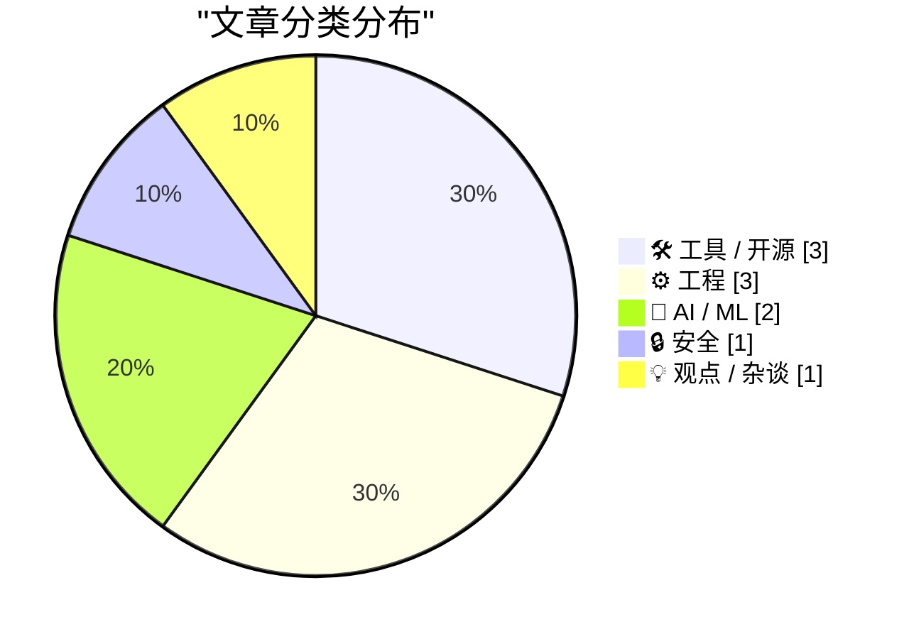
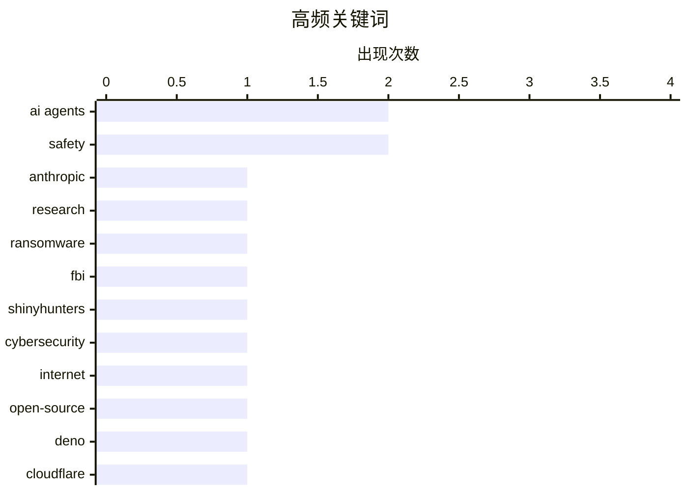

今日安全与监管层面出现两大焦点：FBI逮捕勒索软件谈判公司高管，突显执法力度升级；与此同时，业界呼吁立即召回具备互联网访问权限的开放式AI智能体，以防风险失控。工具生态方面，Deno宣布加入Cloudflare，进一步推动边缘计算与轻量级运行时的融合；本周的包管理新闻也显示供应链工具仍在快速迭代。软件开发趋势上，业界评论指出软件正处于“半人马时代”，即人类与AI深度协作的阶段，这一模式可能将持续数十年。

<!--more-->


> 来自 Karpathy 推荐的 92 个顶级技术博客，AI 精选 Top 10

## 🏆 今日必读

🥇 **Quoting The New York Times**

[Quoting The New York Times](https://simonwillison.net/2026/Oct/10/the-new-york-times/) — simonwillison.net · 20 小时前 · 🤖 AI / ML

> Quoting The New York Times

🏷️ AI agents, Anthropic, safety, research

🥈 **FBI Arrests Executive at Ransomware Negotiation Firm**

[FBI Arrests Executive at Ransomware Negotiation Firm](https://krebsonsecurity.com/2026/10/fbi-arrests-founder-of-ransomware-negotiation-firm/) — krebsonsecurity.com · 22 小时前 · 🔒 安全

> FBI Arrests Executive at Ransomware Negotiation Firm

🏷️ ransomware, FBI, ShinyHunters, cybersecurity

🥉 **We must recall open-ended AI agents with internet access from the market, now**

[We must recall open-ended AI agents with internet access from the market, now](https://garymarcus.substack.com/p/we-must-recall-open-ended-ai-agents) — garymarcus.substack.com · 18 小时前 · 🤖 AI / ML

> We must recall open-ended AI agents with internet access from the market, now

🏷️ AI agents, internet, safety, open-source

---

## 📊 数据概览

| 扫描源 | 抓取文章 | 时间范围 | 精选 |
|:---:|:---:|:---:|:---:|
| 84/92 | 2376 篇 → 26 篇 | 48h | **10 篇** |

### 分类分布



### 高频关键词



<details>
<summary>📈 纯文本关键词图（终端友好）</summary>

```
ai agents     │ ████████████████████ 2
safety        │ ████████████████████ 2
anthropic     │ ██████████░░░░░░░░░░ 1
research      │ ██████████░░░░░░░░░░ 1
ransomware    │ ██████████░░░░░░░░░░ 1
fbi           │ ██████████░░░░░░░░░░ 1
shinyhunters  │ ██████████░░░░░░░░░░ 1
cybersecurity │ ██████████░░░░░░░░░░ 1
internet      │ ██████████░░░░░░░░░░ 1
open-source   │ ██████████░░░░░░░░░░ 1
```

</details>

### 🏷️ 话题标签

**ai agents**(2) · **safety**(2) · **anthropic**(1) · research(1) · ransomware(1) · fbi(1) · shinyhunters(1) · cybersecurity(1) · internet(1) · open-source(1) · deno(1) · cloudflare(1) · durable objects(1) · open source(1) · ai coding(1) · software engineering(1) · human-ai collaboration(1) · future(1) · package management(1) · releases(1)

---

## 🛠 工具 / 开源

### 1. Deno is joining Cloudflare

[Deno is joining Cloudflare](https://simonwillison.net/2026/Oct/9/deno-is-joining-cloudflare/) — **simonwillison.net** · 23 小时前 · ⭐ 23/30

> Deno is joining Cloudflare

🏷️ Deno, Cloudflare, Durable Objects, open source

---

### 2. This Week in Package Management: 10 October 2026

[This Week in Package Management: 10 October 2026](https://nesbitt.io/2026/10/10/this-week-in-package-management.html) — **nesbitt.io** · 12 小时前 · ⭐ 23/30

> This Week in Package Management: 10 October 2026

🏷️ package management, releases, advisories

---

### 3. ttok 1.0

[ttok 1.0](https://simonwillison.net/2026/Oct/9/ttok/) — **simonwillison.net** · 1 天前 · ⭐ 19/30

> ttok 1.0

🏷️ ttok, CLI, token, OpenAI

---

## ⚙️ 工程

### 4. Inside a 1980s filter chip that uses switched capacitors

[Inside a 1980s filter chip that uses switched capacitors](http://www.righto.com/feeds/5504631233106574875/comments/default) — **righto.com** · 5 小时前 · ⭐ 20/30

> Inside a 1980s filter chip that uses switched capacitors

🏷️ IC, hardware, 1980s, chip

---

### 5. Reading List 10/10/26

[Reading List 10/10/26](https://www.construction-physics.com/p/reading-list-101026) — **construction-physics.com** · 7 小时前 · ⭐ 20/30

> Reading List 10/10/26

🏷️ nuclear, robotics, Anduril, technology

---

### 6. Some quick thoughts on Unit Testing ActivityPub

[Some quick thoughts on Unit Testing ActivityPub](https://shkspr.mobi/blog/2026/10/some-thoughts-on-unit-testing-activitypub/) — **shkspr.mobi** · 10 小时前 · ⭐ 18/30

> Some quick thoughts on Unit Testing ActivityPub

🏷️ unit testing, TDD, ActivityPub

---

## 🤖 AI / ML

### 7. Quoting The New York Times

[Quoting The New York Times](https://simonwillison.net/2026/Oct/10/the-new-york-times/) — **simonwillison.net** · 20 小时前 · ⭐ 24/30

> Quoting The New York Times

🏷️ AI agents, Anthropic, safety, research

---

### 8. We must recall open-ended AI agents with internet access from the market, now

[We must recall open-ended AI agents with internet access from the market, now](https://garymarcus.substack.com/p/we-must-recall-open-ended-ai-agents) — **garymarcus.substack.com** · 18 小时前 · ⭐ 24/30

> We must recall open-ended AI agents with internet access from the market, now

🏷️ AI agents, internet, safety, open-source

---

## 🔒 安全

### 9. FBI Arrests Executive at Ransomware Negotiation Firm

[FBI Arrests Executive at Ransomware Negotiation Firm](https://krebsonsecurity.com/2026/10/fbi-arrests-founder-of-ransomware-negotiation-firm/) — **krebsonsecurity.com** · 22 小时前 · ⭐ 24/30

> FBI Arrests Executive at Ransomware Negotiation Firm

🏷️ ransomware, FBI, ShinyHunters, cybersecurity

---

## 💡 观点 / 杂谈

### 10. Software's centaur age may last decades

[Software's centaur age may last decades](https://seangoedecke.com/softwares-centaur-age-may-last-decades/) — **seangoedecke.com** · 22 小时前 · ⭐ 23/30

> Software's centaur age may last decades

🏷️ AI coding, software engineering, human-AI collaboration, future

---

*生成于 2026-10-11 22:19 | 扫描 84 源 → 获取 2376 篇 → 精选 10 篇*
*基于 [Hacker News Popularity Contest 2025](https://refactoringenglish.com/tools/hn-popularity/) RSS 源列表，由 [Andrej Karpathy](https://x.com/karpathy) 推荐*
*由「懂点儿AI」制作，欢迎关注同名微信公众号获取更多 AI 实用技巧 💡*
