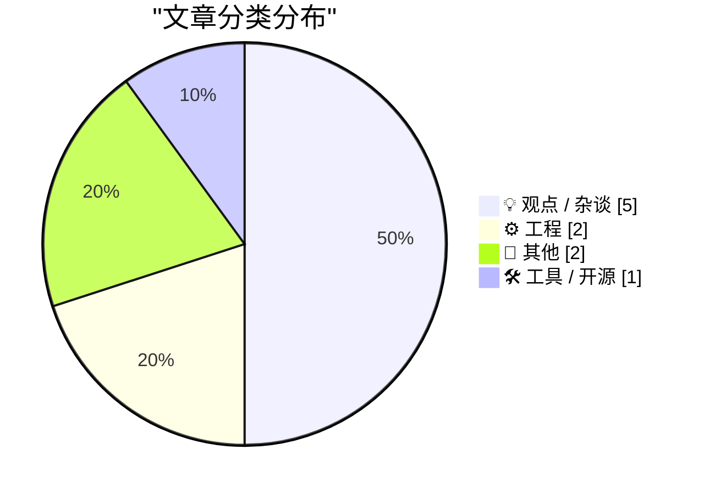
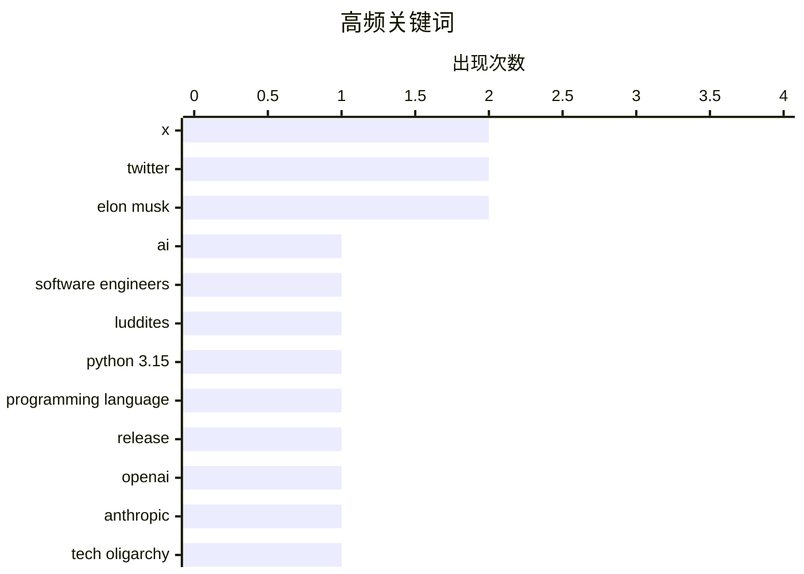

今日技术圈聚焦三大话题：AI对软件工程师职业的冲击持续引发争议，有人呼吁正视自动化对技术从业者的重塑；Python 3.15正式发布带来显式延迟导入等新特性，标志着语言工具链的持续演进；同时，X（原Twitter）平台现状引发广泛讨论，业界开始反思单一社交网络是否仍需服务所有用户。技术人文领域，技术评论人Robert X Cringely去世引缅怀，开发者社区也兴起通过付费测试改进文档质量的实践。

<!--more-->


> 来自 Karpathy 推荐的 92 个顶级技术博客，AI 精选 Top 10

## 🏆 今日必读

🥇 **软件工程师不能对AI做卢德分子**

[Software engineers don't get to be Luddites about AI](https://seangoedecke.com/software-engineers-dont-get-to-be-luddites-about-ai/) — seangoedecke.com · 22 小时前 · 💡 观点 / 杂谈

> 软件工程师对AI感到愤怒是合理的，因为他们的专业技能正在被自动化。然而，作者认为软件工程师是最后有资格抱怨的人，因为软件工程本身就是在不断自动化其他行业。作者以“成也萧何，败也萧何”的逻辑指出，软件工程师靠工具吃饭，如今被更强大的工具（AI）取代，不必过于愤慨。

💡 **为什么值得读**: 为那些对AI感到焦虑的软件工程师提供了一剂清醒剂，解释了为何这个群体最不应该抗拒AI浪潮。

🏷️ AI, software engineers, Luddites

🥈 **你好Python 3.15，再见3.10**

[Hello Python 3.15, goodbye 3.10, and now I can use 3.11](https://simonwillison.net/2026/Oct/12/python-3-15/) — simonwillison.net · 4 小时前 · ⚙️ 工程

> Python 3.15正式发布，作者作为维护多版本兼容开源项目的开发者，终于可以告别Python 3.10并开始使用3.11的新特性。文章重点介绍了最令作者兴奋的显式延迟导入（Explicit lazy imports）功能，来自PEP 810，允许开发者使用lazy关键字延迟模块加载以优化性能。

💡 **为什么值得读**: 对于Python开发者来说，这是一份实用的新版本特性指南，尤其是延迟导入这一性能优化利器。

🏷️ Python 3.15, programming language, release

🥉 **对OpenAI和Anthropic说不**

[Just say no to OpenAI and Anthropic](https://micahflee.com/just-say-no-to-openai-and-anthropic/) — micahflee.com · 23 小时前 · 💡 观点 / 杂谈

> 作者阅读了Naomi Klein和Astra Taylor合著的《终结时刻：法西斯主义与活着的世界的斗争》一书后，推荐给所有读者。作者认为科技寡头是终结时刻法西斯联盟的重要组成部分，书中对此有深刻分析。

💡 **为什么值得读**: 如果你关心科技与政治权力的交织，这本书及其观点值得深入阅读。

🏷️ OpenAI, Anthropic, tech oligarchy, AI industry

---

## 📊 数据概览

| 扫描源 | 抓取文章 | 时间范围 | 精选 |
|:---:|:---:|:---:|:---:|
| 87/92 | 2626 篇 → 21 篇 | 48h | **10 篇** |

### 分类分布



### 高频关键词



<details>
<summary>📈 纯文本关键词图（终端友好）</summary>

```
x                    │ ████████████████████ 2
twitter              │ ████████████████████ 2
elon musk            │ ████████████████████ 2
ai                   │ ██████████░░░░░░░░░░ 1
software engineers   │ ██████████░░░░░░░░░░ 1
luddites             │ ██████████░░░░░░░░░░ 1
python 3.15          │ ██████████░░░░░░░░░░ 1
programming language │ ██████████░░░░░░░░░░ 1
release              │ ██████████░░░░░░░░░░ 1
openai               │ ██████████░░░░░░░░░░ 1
```

</details>

### 🏷️ 话题标签

**x**(2) · **twitter**(2) · **elon musk**(2) · ai(1) · software engineers(1) · luddites(1) · python 3.15(1) · programming language(1) · release(1) · openai(1) · anthropic(1) · tech oligarchy(1) · ai industry(1) · robert cringely(1) · tech journalism(1) · obituary(1) · documentation(1) · readme(1) · developer experience(1) · communication(1)

---

## 💡 观点 / 杂谈

### 1. 软件工程师不能对AI做卢德分子

[Software engineers don't get to be Luddites about AI](https://seangoedecke.com/software-engineers-dont-get-to-be-luddites-about-ai/) — **seangoedecke.com** · 22 小时前 · ⭐ 25/30

> 软件工程师对AI感到愤怒是合理的，因为他们的专业技能正在被自动化。然而，作者认为软件工程师是最后有资格抱怨的人，因为软件工程本身就是在不断自动化其他行业。作者以“成也萧何，败也萧何”的逻辑指出，软件工程师靠工具吃饭，如今被更强大的工具（AI）取代，不必过于愤慨。

🏷️ AI, software engineers, Luddites

---

### 2. 对OpenAI和Anthropic说不

[Just say no to OpenAI and Anthropic](https://micahflee.com/just-say-no-to-openai-and-anthropic/) — **micahflee.com** · 23 小时前 · ⭐ 22/30

> 作者阅读了Naomi Klein和Astra Taylor合著的《终结时刻：法西斯主义与活着的世界的斗争》一书后，推荐给所有读者。作者认为科技寡头是终结时刻法西斯联盟的重要组成部分，书中对此有深刻分析。

🏷️ OpenAI, Anthropic, tech oligarchy, AI industry

---

### 3. X再次标记了那个位置

[★ X Once Again Marks the Spot](https://daringfireball.net/2026/10/x_once_again_marks_the_spot) — **daringfireball.net** · 1 天前 · ⭐ 20/30

> 作者假设如果有人从隐居的荒岛归来，一年多后首次看到X（推特）的现状，可能会合理猜测Elon Musk已经无聊到把它卖了。文章暗指X目前的状态和变化。

🏷️ X, Twitter, Elon Musk

---

### 4. 不要诊断你的对手

[Don't diagnose your opponents](https://seangoedecke.com/dont-diagnose-your-opponents/) — **seangoedecke.com** · 1 天前 · ⭐ 19/30

> 当与他人意见分歧时，有两条路：要么尝试理解对方在说什么（他们的理由、立场、证据），要么去“诊断”他们——即讨论他们为什么这么说。例如争论微服务时，说“你喜欢微服务只是想美化简历”。作者认为这种诊断式的争论在网络论战中很常见，应该避免。

🏷️ communication, disagreement, debate

---

### 5. X已偏离目标

[The X is Off-Target](https://feed.tedium.co/link/15204/17494770/x-social-media-monoliths-critique) — **tedium.co** · 6 小时前 · ⭐ 18/30

> 文章探讨X（推特）是否再次变好这个错误的问题，作者认为真正的问题是：我们是否已经过了那个单一社交网络需要为所有人提供一切的年代？

🏷️ X, Twitter, social network, Elon Musk

---

## ⚙️ 工程

### 6. 你好Python 3.15，再见3.10

[Hello Python 3.15, goodbye 3.10, and now I can use 3.11](https://simonwillison.net/2026/Oct/12/python-3-15/) — **simonwillison.net** · 4 小时前 · ⭐ 24/30

> Python 3.15正式发布，作者作为维护多版本兼容开源项目的开发者，终于可以告别Python 3.10并开始使用3.11的新特性。文章重点介绍了最令作者兴奋的显式延迟导入（Explicit lazy imports）功能，来自PEP 810，允许开发者使用lazy关键字延迟模块加载以优化性能。

🏷️ Python 3.15, programming language, release

---

### 7. 我花钱请人试着阅读我的README

[I paid people to try and follow my README](https://shkspr.mobi/blog/2026/10/i-paid-people-to-try-and-follow-my-readme/) — **shkspr.mobi** · 1 天前 · ⭐ 20/30

> 开发者不擅长写文档，常常声称“读文档”（RTFM）但实际上没什么可读的（There ain't no FM to R）。作者通过付钱让用户测试是否能按照README成功操作，来实际改进文档质量。文章探讨了如何更好地为用户服务的问题。

🏷️ documentation, README, developer experience

---

## 📝 其他

### 8. 马克·斯蒂芬斯（又名罗伯特·X·克里格利）去世，享年73岁

[Mark Stephens, a.k.a. Robert X. Cringely, Died at 73](https://www.facebook.com/story.php?story_fbid=pfbid0YbCLrAJfBirAWuPBy4a7pauaQ6gHkAPUwtbzyg2wAjeMcruFC7dWUZKQJKkNChP9l&amp;id=536506060&amp;_rdr) — **daringfireball.net** · 5 小时前 · ⭐ 21/30

> 技术记者马克·斯蒂芬斯（以笔名Robert X. Cringely为人所知）于73岁去世。他曾是科技新闻领域独特的声音，不仅理解技术，更理解技术背后的人——梦想家、发明家、企业家、怪才和改变世界的冒险者。他能将复杂的话题变得易懂、有趣、幽默且充满人文关怀。

🏷️ Robert Cringely, tech journalism, obituary

---

### 9. 逻辑的范畴模型

[Categorical models of logics](https://www.johndcook.com/blog/2026/10/12/categorical-models-of-logics/) — **johndcook.com** · 9 小时前 · ⭐ 18/30

> 作者几天前写了关于模态逻辑的拓扑模型。如果读者更熟悉一般拓扑学而不是模态逻辑，这种对应关系会很有帮助；如果认为一般拓扑学的动机很明显但模态逻辑的动机可疑，两者之间的对应关系可能消除一些疑虑。

🏷️ category theory, modal logic, topology

---

## 🛠 工具 / 开源

### 10. datasette-ports 0.4发布

[datasette-ports 0.4](https://simonwillison.net/2026/Oct/12/datasette-ports/) — **simonwillison.net** · 17 小时前 · ⭐ 17/30

> 作者的数据插件datasette-ports发布了0.4版本，该插件用于检测和列出当前机器上的所有Datasette实例。新版本支持最新版本，并显示检测到的PID，方便作者使用Python 3.15的新profiler进行性能分析。

🏷️ Datasette, plugin, ports

---

*生成于 2026-10-13 22:18 | 扫描 87 源 → 获取 2626 篇 → 精选 10 篇*
*基于 [Hacker News Popularity Contest 2025](https://refactoringenglish.com/tools/hn-popularity/) RSS 源列表，由 [Andrej Karpathy](https://x.com/karpathy) 推荐*
*由「懂点儿AI」制作，欢迎关注同名微信公众号获取更多 AI 实用技巧 💡*
