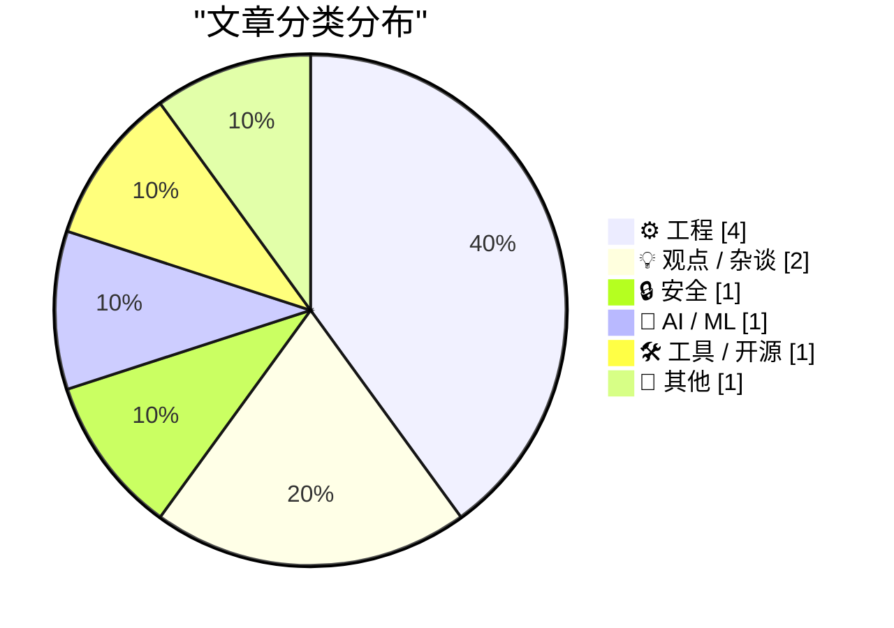
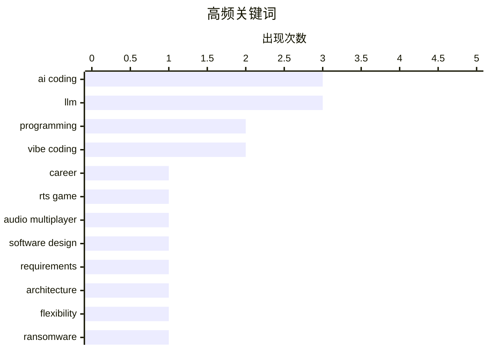

AI编程正在重塑开发者的职业认知与实践方式，“vibe coding”从被质疑到被广泛接受，AI辅助编程已从实验阶段进入实际生产游戏；与此同时，网络安全形势依然严峻，最新披露显示勒索软件组织与某些安全公司高管存在勾连，暴露出行业内部的安全隐患；此外，Apple在产品设计上出现明显转向，macOS移除争议的菜单图标设计，并即将发布新一代硬件产品。

<!--more-->


> 来自 Karpathy 推荐的 92 个顶级技术博客，AI 精选 Top 10

## 🏆 今日必读

🥇 **编程的讣告**

[My obituary for programming](https://simonwillison.net/2026/Oct/19/my-obituary-for-programming/) — simonwillison.net · 22 小时前 · 💡 观点 / 杂谈

> 本文探讨了AI编程代理对职业程序员的影响。作者引用Jeremy Scheff的观点指出，编程曾是理想工作——解决棘手的逻辑谜题就能获得报酬，越难的谜题收入越高。然而，随着LLM能直接生成代码，那些享受解题过程的程序员面临真实的失去感；而只关心构建可用系统的程序员则获得了持续馈赠的礼物。

💡 **为什么值得读**: 如果你是一名程序员，读这篇反思性文章能帮助你理解AI对自己职业身份的深层冲击。

🏷️ AI coding, programming, career, LLM

🥈 **Battle Drones：基于音频 multiplayer 的 vibe coded RTS 游戏**

[Battle Drones - a vibe coded RTS with audio-based multiplayer](https://simonwillison.net/2026/Oct/20/battledrones/) — simonwillison.net · 2 小时前 · ⚙️ 工程

> 作者使用"vibe coding"方式（通过LLM对话描述需求）开发了一款命令与征服风格的RTS游戏Battle Drones。与之前的实验不同，这款游戏"真的好玩"——作者通过告诉Claude"让它变得更好玩"达成了这一目标。游戏还支持基于音频的多人游戏功能，附近设备可通过音频同步游戏状态。

💡 **为什么值得读**: 展示了AI辅助编程的最新实践水平，以及如何通过自然语言提示让LLM生成真正好玩的游戏。

🏷️ RTS game, vibe coding, audio multiplayer, AI coding

🥉 **你缺少哪些需求？**

[What requirements don't you have?](https://seangoedecke.com/what-requirements-dont-you-have/) — seangoedecke.com · 1 天前 · ⚙️ 工程

> 软件设计中，你没有的需求与已有的需求同样重要。识别什么是可以妥协的——什么可以慢、可以陈旧、可以僵化——通常是实现优雅设计的关键。作者指出，优雅的系统会主动放弃一些需求。

💡 **为什么值得读**: 一句话点破软件设计的核心思维：做减法比做加法更重要，适合所有层次的开发者。

🏷️ software design, requirements, architecture, flexibility

---

## 📊 数据概览

| 扫描源 | 抓取文章 | 时间范围 | 精选 |
|:---:|:---:|:---:|:---:|
| 84/92 | 2546 篇 → 37 篇 | 48h | **10 篇** |

### 分类分布



### 高频关键词



<details>
<summary>📈 纯文本关键词图（终端友好）</summary>

```
ai coding         │ ████████████████████ 3
llm               │ ████████████████████ 3
programming       │ █████████████░░░░░░░ 2
vibe coding       │ █████████████░░░░░░░ 2
career            │ ███████░░░░░░░░░░░░░ 1
rts game          │ ███████░░░░░░░░░░░░░ 1
audio multiplayer │ ███████░░░░░░░░░░░░░ 1
software design   │ ███████░░░░░░░░░░░░░ 1
requirements      │ ███████░░░░░░░░░░░░░ 1
architecture      │ ███████░░░░░░░░░░░░░ 1
```

</details>

### 🏷️ 话题标签

**ai coding**(3) · **llm**(3) · **programming**(2) · vibe coding(2) · career(1) · rts game(1) · audio multiplayer(1) · software design(1) · requirements(1) · architecture(1) · flexibility(1) · ransomware(1) · shinyhunters(1) · fbi(1) · negotiator(1) · macos(1) · ui design(1) · icons(1) · ux(1) · development(1)

---

## ⚙️ 工程

### 1. Battle Drones：基于音频 multiplayer 的 vibe coded RTS 游戏

[Battle Drones - a vibe coded RTS with audio-based multiplayer](https://simonwillison.net/2026/Oct/20/battledrones/) — **simonwillison.net** · 2 小时前 · ⭐ 24/30

> 作者使用"vibe coding"方式（通过LLM对话描述需求）开发了一款命令与征服风格的RTS游戏Battle Drones。与之前的实验不同，这款游戏"真的好玩"——作者通过告诉Claude"让它变得更好玩"达成了这一目标。游戏还支持基于音频的多人游戏功能，附近设备可通过音频同步游戏状态。

🏷️ RTS game, vibe coding, audio multiplayer, AI coding

---

### 2. 你缺少哪些需求？

[What requirements don't you have?](https://seangoedecke.com/what-requirements-dont-you-have/) — **seangoedecke.com** · 1 天前 · ⭐ 23/30

> 软件设计中，你没有的需求与已有的需求同样重要。识别什么是可以妥协的——什么可以慢、可以陈旧、可以僵化——通常是实现优雅设计的关键。作者指出，优雅的系统会主动放弃一些需求。

🏷️ software design, requirements, architecture, flexibility

---

### 3. macOS 默认菜单图标被移除

[No More Icons In Every Menu By Default](https://blog.jim-nielsen.com/2026/icons-in-every-menu/) — **blog.jim-nielsen.com** · 1 天前 · ⭐ 22/30

> macOS Golden Gate（27版）移除了Tahoe版本中每个菜单项默认显示图标的设计。Apple新版人机界面指南明确将Tahoe的菜单图标做法列为"反面教材"。作者认为这是Apple承认错误并做出改变的体现。

🏷️ macOS, UI design, icons, UX

---

### 4. 为什么需要 ud2 而 int 6 就在那里？

[Why do we need ud2 when int 6 is right there?](https://devblogs.microsoft.com/oldnewthing/20261019-00/?p=112781/) — **devblogs.microsoft.com/oldnewthing** · 1 天前 · ⭐ 21/30

> 本文解释了x86指令集中ud2和int 6的区别。作者指出，中断不是错误（fault），这是理解为何需要ud2这条明确标记为无效指令的关键。

🏷️ x86, assembly, CPU instructions, exception handling

---

## 💡 观点 / 杂谈

### 5. 编程的讣告

[My obituary for programming](https://simonwillison.net/2026/Oct/19/my-obituary-for-programming/) — **simonwillison.net** · 22 小时前 · ⭐ 26/30

> 本文探讨了AI编程代理对职业程序员的影响。作者引用Jeremy Scheff的观点指出，编程曾是理想工作——解决棘手的逻辑谜题就能获得报酬，越难的谜题收入越高。然而，随着LLM能直接生成代码，那些享受解题过程的程序员面临真实的失去感；而只关心构建可用系统的程序员则获得了持续馈赠的礼物。

🏷️ AI coding, programming, career, LLM

---

### 6. 外行支持技术领域是因为技术而非艺术

[Laypeople support technical fields for technology, not art](https://seangoedecke.com/laypeople-support-technical-fields-for-technology-not-art/) — **seangoedecke.com** · 22 小时前 · ⭐ 21/30

> 本文探讨了LLM是否应该用于编程和数学等"艺术性"技术领域的争论。作者认为，无论这些领域是否真的属于艺术，这对普通大众都没有说服力——外行支持技术领域的理由是其技术价值而非艺术价值。

🏷️ LLM, programming, technology, art

---

## 🔒 安全

### 7. 联邦怀疑勒索谈判公司高管运营 ShinyHunters 勒索网站

[Feds Suspect Ransom Negotiator Ran ShinyHunters Extortion Site](https://krebsonsecurity.com/2026/10/feds-suspect-ransom-negotiator-ran-shinyhunters-extortion-site/) — **krebsonsecurity.com** · 1 天前 · ⭐ 22/30

> 美国联邦调查人员追查最近窃取FBI敏感数据的ShinyHunters黑客组织时，发现两家勒索谈判公司的高管与该勒索组织保持异常密切的关系。消息人士称，其中一位美国高管甚至帮助ShinyHunters运营向受害者施压支付赎金的网站。

🏷️ ransomware, ShinyHunters, FBI, negotiator

---

## 🤖 AI / ML

### 8. Weekly Update 526: Building HIBP AI/SI First

[Weekly Update 526: Building HIBP AI/SI First](https://www.troyhunt.com/weekly-update-526/) — **troyhunt.com** · 1 天前 · ⭐ 22/30

> 作者认为"vibe coding"一词已经不再是贬义词。那些曾用这个词批评AI编程的人如今已接受趋势并开始使用这一方式。

🏷️ AI coding, vibe coding, development

---

## 🛠 工具 / 开源

### 9. llm-tools-datasette 0.1.1 发布

[llm-tools-datasette 0.1.1](https://simonwillison.net/2026/Oct/18/llm-tools-datasette/) — **simonwillison.net** · 1 天前 · ⭐ 20/30

> 作者在LLM 0.33中切换到httpx2库时，忘记了会导致未直接依赖httpx的插件出现问题。llm-tools-datasette插件因此损坏，现已修复并发布0.1.1版本。

🏷️ LLM, datasette, plugin, release

---

## 📝 其他

### 10. Apple 下周洛杉矶活动：'Pro and Tell'

[Apple Event, in Los Angeles, Next Week: ‘Pro and Tell’](https://x.com/gregjoz/status/2112212372182249831) — **daringfireball.net** · 23 小时前 · ⭐ 20/30

> Apple宣布将于下周在洛杉矶举办"Pro and Tell"活动。传闻将发布配备OLED触摸屏的新款MacBook Pro、搭载M6的入门级MacBook Pro、M6 iMac以及配备OLED显示屏的iPad mini。

🏷️ Apple, MacBook Pro, OLED, M6

---

*生成于 2026-10-21 22:18 | 扫描 84 源 → 获取 2546 篇 → 精选 10 篇*
*基于 [Hacker News Popularity Contest 2025](https://refactoringenglish.com/tools/hn-popularity/) RSS 源列表，由 [Andrej Karpathy](https://x.com/karpathy) 推荐*
*由「懂点儿AI」制作，欢迎关注同名微信公众号获取更多 AI 实用技巧 💡*
