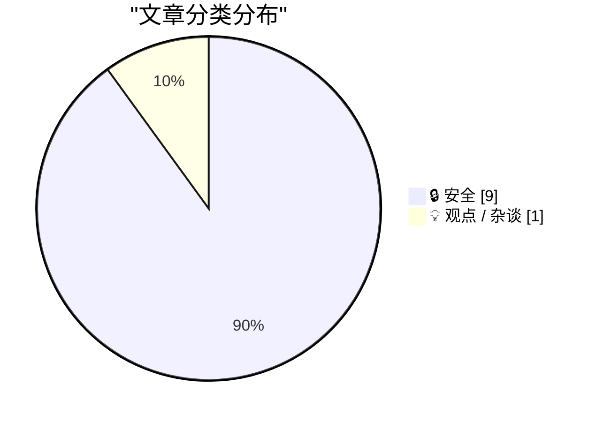
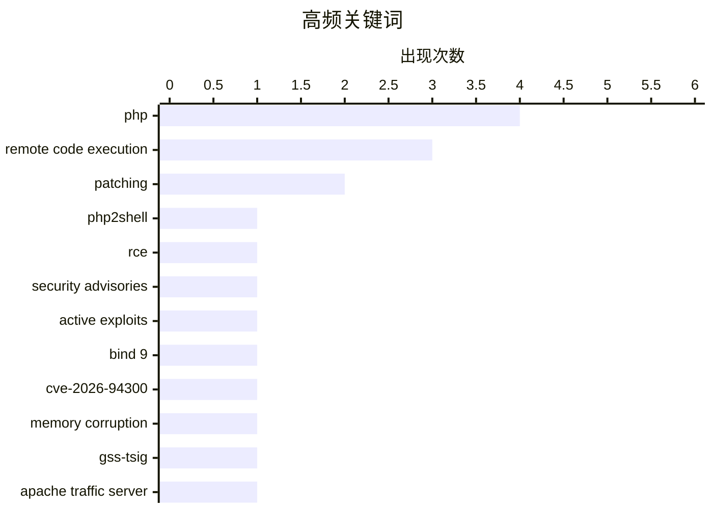

今日技术圈焦点集中在高危漏洞的紧急处置：PHP 两个远程代码执行漏洞已出现真实攻击，网站和服务器运营者必须立即升级，不能依赖临时缓解。与此同时，BIND、ImageMagick、Brotli、musl 等事件再次暴露 C/C++ 生态长期存在的内存安全隐患，实验性功能和不可信输入仍可能成为攻击入口。中间 CA 私钥泄露则将风险推向证书与软件供应链，Linux、Python 等生态需同步刷新信任库。另一边，AI 编程智能体正在重塑开发者的价值感与职业满足感，其影响因开发者工作偏好而明显分化。

<!--more-->


> 来自 Karpathy 推荐的 92 个顶级技术博客，AI 精选 Top 10

## 🏆 今日必读

🥇 **立即升级 PHP 安装以防范 php2shell**

[Upgrade your PHP installs immediately to protect against php2shell](https://www.jeffgeerling.com/blog/2026/php-vulnerability-php2shell/) — jeffgeerling.com · 8 小时前 · 🔒 安全

> PHP 基金会发布了两个严重程度均为 9.2/10 的安全公告，分别涉及 OOM 内存破坏导致的远程代码执行，以及全局状态残留导致的远程代码执行。任何运行 PHP 服务的用户都应立即升级至 PHP 8.2.35、8.3.36、8.4.27 或 8.5.12。Red Hat 衍生发行版用户还需确保从 Remi 社区仓库获得更新，相关维护者已在休假期间推送了修复版本。鉴于漏洞可能已被实际利用，延迟升级会显著增加服务器被接管的风险。

💡 **为什么值得读**: 文章提供了明确的受影响版本和立即修复建议，适合在几分钟内完成 PHP 生产环境的安全处置。

🏷️ PHP, php2shell, RCE, security advisories

🥈 **广泛的 PHP 漏洞今天可能导致大量网站中断**

[Widespread PHP Flaw May Cause Many Site Outages Today](https://krebsonsecurity.com/2026/10/widespread-php-flaw-may-cause-many-site-outages-today/) — krebsonsecurity.com · 6 小时前 · 🔒 安全

> 两个可让攻击者完全控制服务器的 PHP 严重漏洞正在引发广泛影响，近 70% 的网站需要更新其核心软件才能完成修复。安全专家表示，针对这些漏洞的可用攻击代码已经出现，并且相关攻击已被用于真实环境。尚未打补丁的网站可能因 PHP 服务异常而向访客返回“404”或“Page Not Found”错误。核心观点是，网站维护者必须尽快部署 PHP 更新，不能继续依赖临时缓解措施。

💡 **为什么值得读**: 文章量化了漏洞影响范围并确认存在在野利用，有助于运维团队判断网站大面积中断风险和更新优先级。

🏷️ PHP, remote code execution, active exploits, patching

🥉 **“无法阻止这种情况”：唯一经常发生这种现象的语言用户如是说**

["No way to prevent this" say users of only language where this regularly happens](https://xeiaso.net/shitposts/no-way-to-prevent-this/memory-safety/CVE-2026-94300/) — xeiaso.net · 22 小时前 · 🔒 安全

> BIND 9 的 named 因 CVE-2026-94300 面临可导致远程代码执行的内存破坏漏洞，管理员在公告发布后紧急重建并修补系统。攻击者可重放已捕获且由 GSS-TSIG 签名的 UDP 消息，在协商的 TSIG 密钥仍然有效时结合恶意查询实施攻击。问题源于受影响的 C 语言组件，文章以讽刺口吻强调其内存安全风险。作者借此指出，该项目过去 50 年相关的内存安全漏洞占比很高，相关项目的安全缺陷发生概率据称高出约 20 倍。

💡 **为什么值得读**: 文章不仅呈现了 BIND 9 的具体攻击链，还借漏洞案例反思低层 C 代码的系统性安全成本。

🏷️ BIND 9, CVE-2026-94300, memory corruption, GSS-TSIG

---

## 📊 数据概览

| 扫描源 | 抓取文章 | 时间范围 | 精选 |
|:---:|:---:|:---:|:---:|
| 86/92 | 2601 篇 → 35 篇 | 48h | **10 篇** |

### 分类分布



### 高频关键词



<details>
<summary>📈 纯文本关键词图（终端友好）</summary>

```
php                   │ ████████████████████ 4
remote code execution │ ███████████████░░░░░ 3
patching              │ ██████████░░░░░░░░░░ 2
php2shell             │ █████░░░░░░░░░░░░░░░ 1
rce                   │ █████░░░░░░░░░░░░░░░ 1
security advisories   │ █████░░░░░░░░░░░░░░░ 1
active exploits       │ █████░░░░░░░░░░░░░░░ 1
bind 9                │ █████░░░░░░░░░░░░░░░ 1
cve-2026-94300        │ █████░░░░░░░░░░░░░░░ 1
memory corruption     │ █████░░░░░░░░░░░░░░░ 1
```

</details>

### 🏷️ 话题标签

**php**(4) · **remote code execution**(3) · **patching**(2) · php2shell(1) · rce(1) · security advisories(1) · active exploits(1) · bind 9(1) · cve-2026-94300(1) · memory corruption(1) · gss-tsig(1) · apache traffic server(1) · cve-2026-111813(1) · magick(1) · unauthenticated access(1) · brotli(1) · cve-2026-111497(1) · out-of-bounds write(1) · security release(1) · vulnerability(1)

---

## 🔒 安全

### 1. 立即升级 PHP 安装以防范 php2shell

[Upgrade your PHP installs immediately to protect against php2shell](https://www.jeffgeerling.com/blog/2026/php-vulnerability-php2shell/) — **jeffgeerling.com** · 8 小时前 · ⭐ 27/30

> PHP 基金会发布了两个严重程度均为 9.2/10 的安全公告，分别涉及 OOM 内存破坏导致的远程代码执行，以及全局状态残留导致的远程代码执行。任何运行 PHP 服务的用户都应立即升级至 PHP 8.2.35、8.3.36、8.4.27 或 8.5.12。Red Hat 衍生发行版用户还需确保从 Remi 社区仓库获得更新，相关维护者已在休假期间推送了修复版本。鉴于漏洞可能已被实际利用，延迟升级会显著增加服务器被接管的风险。

🏷️ PHP, php2shell, RCE, security advisories

---

### 2. 广泛的 PHP 漏洞今天可能导致大量网站中断

[Widespread PHP Flaw May Cause Many Site Outages Today](https://krebsonsecurity.com/2026/10/widespread-php-flaw-may-cause-many-site-outages-today/) — **krebsonsecurity.com** · 6 小时前 · ⭐ 27/30

> 两个可让攻击者完全控制服务器的 PHP 严重漏洞正在引发广泛影响，近 70% 的网站需要更新其核心软件才能完成修复。安全专家表示，针对这些漏洞的可用攻击代码已经出现，并且相关攻击已被用于真实环境。尚未打补丁的网站可能因 PHP 服务异常而向访客返回“404”或“Page Not Found”错误。核心观点是，网站维护者必须尽快部署 PHP 更新，不能继续依赖临时缓解措施。

🏷️ PHP, remote code execution, active exploits, patching

---

### 3. “无法阻止这种情况”：唯一经常发生这种现象的语言用户如是说

["No way to prevent this" say users of only language where this regularly happens](https://xeiaso.net/shitposts/no-way-to-prevent-this/memory-safety/CVE-2026-94300/) — **xeiaso.net** · 22 小时前 · ⭐ 27/30

> BIND 9 的 named 因 CVE-2026-94300 面临可导致远程代码执行的内存破坏漏洞，管理员在公告发布后紧急重建并修补系统。攻击者可重放已捕获且由 GSS-TSIG 签名的 UDP 消息，在协商的 TSIG 密钥仍然有效时结合恶意查询实施攻击。问题源于受影响的 C 语言组件，文章以讽刺口吻强调其内存安全风险。作者借此指出，该项目过去 50 年相关的内存安全漏洞占比很高，相关项目的安全缺陷发生概率据称高出约 20 倍。

🏷️ BIND 9, CVE-2026-94300, memory corruption, GSS-TSIG

---

### 4. “无法阻止这种情况”：唯一经常发生这种现象的语言用户如是说

["No way to prevent this" say users of only language where this regularly happens](https://xeiaso.net/shitposts/no-way-to-prevent-this/memory-safety/CVE-2026-111813/) — **xeiaso.net** · 22 小时前 · ⭐ 27/30

> Apache Traffic Server 的实验性 magick 插件因 CVE-2026-111813 面临严重漏洞，运行该插件的系统需要立即修补。在默认未签名配置下，未经身份验证的客户端可以控制传递给 ImageMagick convert 的参数，从而在服务器上执行任意命令。此次风险位于用 C++ 编写的插件中，攻击者甚至不需要进行内存破坏。核心观点是，实验性功能若缺乏严格的身份验证和参数隔离，就可能成为直接的远程命令执行入口。

🏷️ Apache Traffic Server, CVE-2026-111813, magick, unauthenticated access

---

### 5. “无法阻止这种情况”：唯一经常发生这种现象的语言用户如是说

["No way to prevent this" say users of only language where this regularly happens](https://xeiaso.net/shitposts/no-way-to-prevent-this/memory-safety/CVE-2026-111497/) — **xeiaso.net** · 22 小时前 · ⭐ 27/30

> Brotli 解码器因 CVE-2026-111497 存在可导致远程代码执行的越界写漏洞，运维人员需要重建并修补受影响系统。攻击者只需让服务器处理畸形的压缩数据流，就可能触发越界写入并控制执行流程。漏洞位于以 C 语言编写的组件中，文章再次以讽刺方式批评此类内存安全问题无法靠架构层面彻底消除。作者借该事件强调，过去 50 年约 90% 的世界内存安全漏洞集中在 C 语言生态中，相关项目遭遇安全问题的可能性据称高出约 20 倍。

🏷️ Brotli, CVE-2026-111497, out-of-bounds write, remote code execution

---

### 6. 今日 PHP 安全发布，以及我们如何加强 PHP 安全

[Today's PHP Security Release, and How We're Strengthening PHP Security](https://simonwillison.net/2026/Oct/21/php-security-release/) — **simonwillison.net** · 3 小时前 · ⭐ 26/30

> PHP 8.x 全系列发布安全更新，修复两个可导致远程代码执行的漏洞；由于协同披露流程发生信息泄露，相关利用代码从前一晚开始流传。漏洞编号在 10 月 20 日约 15:00 UTC 提前出现在论坛和社交媒体上，同时错误标注了 10.0 的 CVSS 分数，实际分数为 9.2。PHP 项目随后将原定 10 月 22 日的发布提前至 10 月 20 日 19:30 UTC 发布公告。事件暴露出协调披露、发布时间控制和评分审核机制中的问题，并促使 PHP 基金会着手加强安全响应流程。

🏷️ PHP, security release, vulnerability, patching

---

### 7. eMudhra 中间 CA 遭入侵

[eMudhra Intermediate CA Compromise](https://simonwillison.net/2026/Oct/20/emudhra-certificates/) — **simonwillison.net** · 22 小时前 · ⭐ 26/30

> eMudhra 的八张中间 CA 证书私钥已经泄露，这些证书链向上连接 Mozilla、Microsoft、Apple 和 Chrome 等广泛信任的根证书。依赖内置信任列表的软件如果继续使用旧证书包，可能错误信任被攻击者控制的证书链。Linux 发行版需要更新 ca-certificates 包，而 Python 生态已发布 uv 0.13.4、pip 26.2.2 和 certifi 2026.10.19 来替换受影响的证书列表。核心结论是，所有捆绑或缓存根证书的程序都必须同步刷新信任库。

🏷️ eMudhra, certificate authority, private keys, PKI

---

### 8. 赶紧给服务器打补丁吧

[Jesus Christ patch your shit now](https://xeiaso.net/shitposts/no-way-to-prevent-this/memory-safety/CVE-2026-109618/) — **xeiaso.net** · 22 小时前 · ⭐ 25/30

> PHP 因 CVE-2026-109618 面临多个内存安全漏洞，攻击者可在服务器上执行任意代码。漏洞公告发布后，站点可靠性工程师和系统管理员被迫紧急重建并修补所有相关系统。作者明确指出，这类问题不能仅靠外围缓解措施解决，必须部署正式补丁，否则漏洞仍可被直接利用。相关组件使用 C 语言编写，文章延续讽刺语气，将这一事件归因于 C 语言生态长期存在的内存安全隐患。核心结论是，对高危远程代码执行漏洞不存在侥幸，唯一可靠的处置方式是立即更新。

🏷️ PHP, CVE-2026-109618, memory safety, remote code execution

---

### 9. “无法阻止这种情况”：唯一经常发生这种现象的语言用户如是说

["No way to prevent this" say users of only language where this regularly happens](https://xeiaso.net/shitposts/no-way-to-prevent-this/memory-safety/CVE-2026-107891/) — **xeiaso.net** · 22 小时前 · ⭐ 24/30

> musl 的 regcomp() 因 CVE-2026-107891 存在多个整数溢出漏洞，管理员需要紧急重建并修补受影响系统。当程序编译不可信正则表达式时，溢出会造成分配空间不足，并可能进一步触发堆越界写入。攻击结果包括拒绝服务，严重情况下还可实现任意代码执行。漏洞来自以 C 语言编写的组件，文章再次以讽刺方式批评内存安全问题难以被彻底预防，并借此强调过去 50 年约 90% 的相关漏洞与 C 语言生态有关。

🏷️ musl, CVE-2026-107891, regular expressions, integer overflow

---

## 💡 观点 / 杂谈

### 10. 我为编程撰写的讣告

[My obituary for programming](https://simonwillison.net/2026/Oct/19/my-obituary-for-programming/) — **simonwillison.net** · 1 天前 · ⭐ 25/30

> 文章探讨编程智能体正在削弱职业程序员从解决技术难题中获得的核心乐趣。过去，程序员依靠逻辑推理、策略设计和系统实现来证明自身价值，如今这些环节越来越多地可以交给 LLM 完成。如果开发者的主要兴趣在于搭建可运行的系统，而不特别在意问题本身，LLM 将是一项持续带来效率收益的工具。相反，如果亲手解决复杂问题正是职业满足感的重要来源，这种变化带来的损失就非常真实。文章的核心观点是，AI 工具对不同类型开发者的价值存在明显分化。

🏷️ coding agents, programming, career, automation

---

*生成于 2026-10-22 22:18 | 扫描 86 源 → 获取 2601 篇 → 精选 10 篇*
*基于 [Hacker News Popularity Contest 2025](https://refactoringenglish.com/tools/hn-popularity/) RSS 源列表，由 [Andrej Karpathy](https://x.com/karpathy) 推荐*
*由「懂点儿AI」制作，欢迎关注同名微信公众号获取更多 AI 实用技巧 💡*
