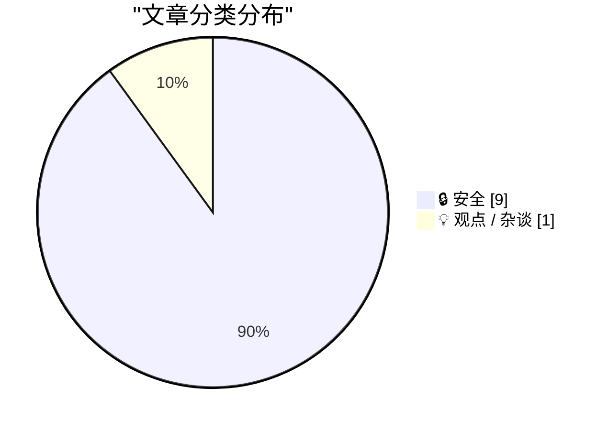
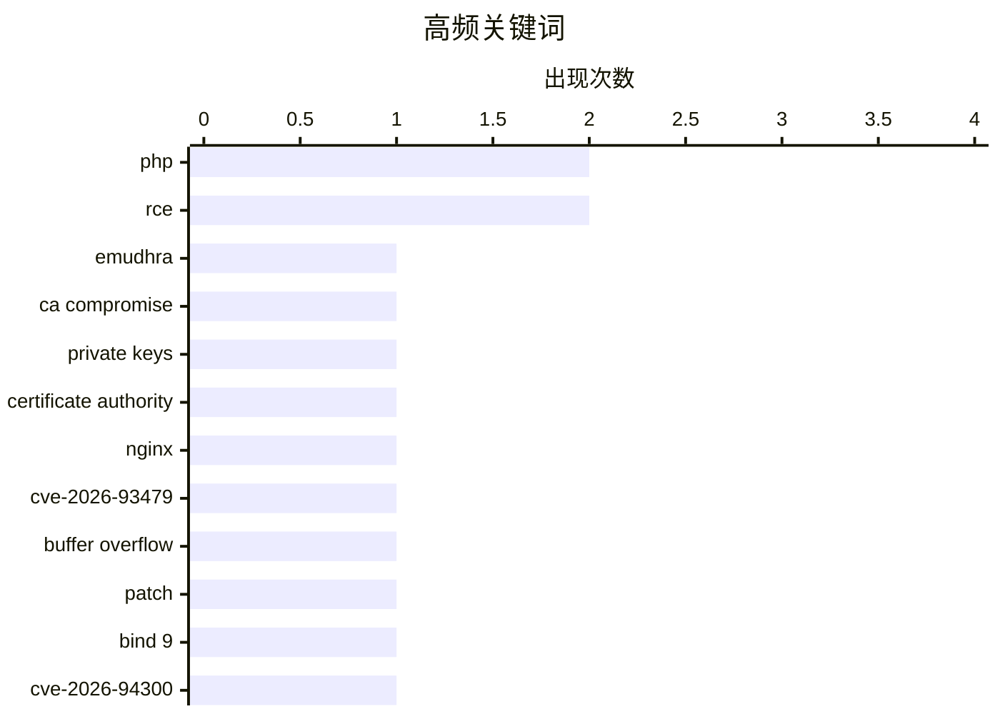

今天的安全焦点集中在证书信任链与基础设施漏洞两条主线上：中间 CA 私钥泄露牵动全球根证书更新，而 PHP、NGINX、BIND、musl 等组件接连曝出高危问题，凸显原生代码内存安全的系统性风险。与此同时，椭圆曲线与密钥生成再次引发对算法、随机数和部署环节全链路安全的讨论。另一股观点则指出，AI 时代的软件性能瓶颈更多来自架构、算法和 I/O 设计，而非单纯受编程语言拖累。当前趋势表明，及时更新依赖、收敛插件攻击面和审视底层密码基础设施，已成为技术团队不可回避的日常工程责任。

<!--more-->


> 来自 Karpathy 推荐的 92 个顶级技术博客，AI 精选 Top 10

## 🏆 今日必读

🥇 **eMudhra 中间 CA 遭到入侵**

[eMudhra Intermediate CA Compromise](https://simonwillison.net/2026/Oct/20/emudhra-certificates/) — simonwillison.net · 1 天前 · 🔒 安全

> eMudhra 的 8 张中间 CA 证书私钥已遭泄露，这些证书链向 Mozilla、Microsoft、Apple 和 Chrome 根证书计划及众多下游信任库。依赖内置根证书或信任列表的软件都必须更新信任证书，Linux 发行版也需要更新 ca-certificates 软件包。Python 生态已发布新版信任列表，其中 uv 0.13.4、pip 26.2.2 和 certifi 2026.10.19 均包含升级后的证书。证书吊销与信任链调整可能造成广泛兼容性和服务可用性影响，因此相关组织应尽快核查并更新证书配置。

💡 **为什么值得读**: 这是一次影响范围极广的 PKI 信任链事件，涉及主流浏览器和 Python 工具链，值得运维与安全团队立即核查并更新证书。

🏷️ eMudhra, CA compromise, private keys, certificate authority

🥈 **用户称“这种事无法阻止”：C 语言经常出现此类漏洞**

["No way to prevent this" say users of only language where this regularly happens](https://xeiaso.net/shitposts/no-way-to-prevent-this/memory-safety/CVE-2026-93479/) — xeiaso.net · 22 小时前 · 🔒 安全

> NGINX 披露 CVE-2026-93479，可通过特制请求触发 worker 脚本求值中的堆缓冲区溢出，并导致 worker 重启。攻击条件包括在 map 输出之前引用正则捕获结果，或在特定字符串表达式中使用不可缓存变量；若 ASLR 被禁用或绕过，还可能实现代码执行。漏洞源于以 C 编写的组件，站点可靠性工程师和系统管理员已紧急重建并修补系统。文章以讽刺口吻强调，内存安全问题反复出现在 C 语言生态中，不能把责任简单归咎于个别开发者。

💡 **为什么值得读**: 该案例展示了 NGINX 请求处理链中的高危触发路径与 ASLR 绕过风险，对负责 Web 基础设施和依赖 NGINX 的团队具有直接应急价值。

🏷️ NGINX, CVE-2026-93479, buffer overflow, patch

🥉 **用户称“这种事无法阻止”：C 语言经常出现此类漏洞**

["No way to prevent this" say users of only language where this regularly happens](https://xeiaso.net/shitposts/no-way-to-prevent-this/memory-safety/CVE-2026-94300/) — xeiaso.net · 1 天前 · 🔒 安全

> BIND 9 披露 CVE-2026-94300，其 named 组件在特定条件下处理 GSS-TSIG 认证流量时会发生内存破坏。重放仍处于有效期的 TSIG 签名 UDP 消息，并与攻击者控制的 DNS 区域构造查询结合后，可能导致远程代码执行。漏洞发布后，站点可靠性工程师和系统管理员紧急重建并修补受影响系统。问题再次暴露出 C 语言组件中的内存安全风险，以及防御性编程和及时更新基础设施的重要性。

💡 **为什么值得读**: 文章揭示了 BIND 9 中 GSS-TSIG 消息重放与恶意区域组合利用的完整风险链，适合 DNS 运维和安全人员评估暴露面。

🏷️ BIND 9, CVE-2026-94300, memory corruption, GSS-TSIG

---

## 📊 数据概览

| 扫描源 | 抓取文章 | 时间范围 | 精选 |
|:---:|:---:|:---:|:---:|
| 85/92 | 2571 篇 → 42 篇 | 48h | **10 篇** |

### 分类分布



### 高频关键词



<details>
<summary>📈 纯文本关键词图（终端友好）</summary>

```
php                   │ ████████████████████ 2
rce                   │ ████████████████████ 2
emudhra               │ ██████████░░░░░░░░░░ 1
ca compromise         │ ██████████░░░░░░░░░░ 1
private keys          │ ██████████░░░░░░░░░░ 1
certificate authority │ ██████████░░░░░░░░░░ 1
nginx                 │ ██████████░░░░░░░░░░ 1
cve-2026-93479        │ ██████████░░░░░░░░░░ 1
buffer overflow       │ ██████████░░░░░░░░░░ 1
patch                 │ ██████████░░░░░░░░░░ 1
```

</details>

### 🏷️ 话题标签

**php**(2) · **rce**(2) · **emudhra**(1) · ca compromise(1) · private keys(1) · certificate authority(1) · nginx(1) · cve-2026-93479(1) · buffer overflow(1) · patch(1) · bind 9(1) · cve-2026-94300(1) · memory corruption(1) · gss-tsig(1) · apache traffic server(1) · cve-2026-111813(1) · authentication bypass(1) · plugin(1) · brotli(1) · cve-2026-111497(1)

---

## 🔒 安全

### 1. eMudhra 中间 CA 遭到入侵

[eMudhra Intermediate CA Compromise](https://simonwillison.net/2026/Oct/20/emudhra-certificates/) — **simonwillison.net** · 1 天前 · ⭐ 27/30

> eMudhra 的 8 张中间 CA 证书私钥已遭泄露，这些证书链向 Mozilla、Microsoft、Apple 和 Chrome 根证书计划及众多下游信任库。依赖内置根证书或信任列表的软件都必须更新信任证书，Linux 发行版也需要更新 ca-certificates 软件包。Python 生态已发布新版信任列表，其中 uv 0.13.4、pip 26.2.2 和 certifi 2026.10.19 均包含升级后的证书。证书吊销与信任链调整可能造成广泛兼容性和服务可用性影响，因此相关组织应尽快核查并更新证书配置。

🏷️ eMudhra, CA compromise, private keys, certificate authority

---

### 2. 用户称“这种事无法阻止”：C 语言经常出现此类漏洞

["No way to prevent this" say users of only language where this regularly happens](https://xeiaso.net/shitposts/no-way-to-prevent-this/memory-safety/CVE-2026-93479/) — **xeiaso.net** · 22 小时前 · ⭐ 27/30

> NGINX 披露 CVE-2026-93479，可通过特制请求触发 worker 脚本求值中的堆缓冲区溢出，并导致 worker 重启。攻击条件包括在 map 输出之前引用正则捕获结果，或在特定字符串表达式中使用不可缓存变量；若 ASLR 被禁用或绕过，还可能实现代码执行。漏洞源于以 C 编写的组件，站点可靠性工程师和系统管理员已紧急重建并修补系统。文章以讽刺口吻强调，内存安全问题反复出现在 C 语言生态中，不能把责任简单归咎于个别开发者。

🏷️ NGINX, CVE-2026-93479, buffer overflow, patch

---

### 3. 用户称“这种事无法阻止”：C 语言经常出现此类漏洞

["No way to prevent this" say users of only language where this regularly happens](https://xeiaso.net/shitposts/no-way-to-prevent-this/memory-safety/CVE-2026-94300/) — **xeiaso.net** · 1 天前 · ⭐ 27/30

> BIND 9 披露 CVE-2026-94300，其 named 组件在特定条件下处理 GSS-TSIG 认证流量时会发生内存破坏。重放仍处于有效期的 TSIG 签名 UDP 消息，并与攻击者控制的 DNS 区域构造查询结合后，可能导致远程代码执行。漏洞发布后，站点可靠性工程师和系统管理员紧急重建并修补受影响系统。问题再次暴露出 C 语言组件中的内存安全风险，以及防御性编程和及时更新基础设施的重要性。

🏷️ BIND 9, CVE-2026-94300, memory corruption, GSS-TSIG

---

### 4. 用户称“这种事无法阻止”：C 语言经常出现此类漏洞

["No way to prevent this" say users of only language where this regularly happens](https://xeiaso.net/shitposts/no-way-to-prevent-this/memory-safety/CVE-2026-111813/) — **xeiaso.net** · 1 天前 · ⭐ 27/30

> Apache Traffic Server 披露 CVE-2026-111813，影响其实验性 magick 图像处理插件。该插件默认采用未签名配置，允许未认证客户端控制传给 ImageMagick convert 的参数。攻击者因此可以通过精心构造的请求在服务器上执行任意命令，而且无需进行内存破坏即可利用。虽然漏洞位于 C++ 插件中，但文章借此讽刺了原生插件直接信任外部参数所暴露的命令注入风险。站点可靠性工程师和系统管理员应立即修补或禁用相关插件，并审查其配置。

🏷️ Apache Traffic Server, CVE-2026-111813, authentication bypass, plugin

---

### 5. 用户称“这种事无法阻止”：C 语言经常出现此类漏洞

["No way to prevent this" say users of only language where this regularly happens](https://xeiaso.net/shitposts/no-way-to-prevent-this/memory-safety/CVE-2026-111497/) — **xeiaso.net** · 1 天前 · ⭐ 27/30

> Brotli 披露 CVE-2026-111497，其解码器存在越界写漏洞，处理畸形压缩流时可导致远程代码执行。漏洞发布后，站点可靠性工程师和系统管理员紧急重建并修补使用 Brotli 的系统。问题源于 C 语言实现的内存安全缺陷，说明即便压缩库位于程序内部，其输入边界仍必须被视为不可信数据。文章以夸张措辞批评开发者长期忽视内存安全，并强调这类系统性风险无法仅靠事后应急消除。

🏷️ Brotli, CVE-2026-111497, remote code execution, decoder

---

### 6. 天啊，赶紧给你的系统打补丁

[Jesus Christ patch your shit now](https://xeiaso.net/shitposts/no-way-to-prevent-this/memory-safety/CVE-2026-109618/) — **xeiaso.net** · 1 天前 · ⭐ 27/30

> PHP 披露 CVE-2026-109618，包含多个可能导致攻击者在服务器上执行任意代码的内存安全漏洞。作者明确表示，这些问题不能仅靠缓解措施长期应对，运行 PHP 服务的组织必须立即安装更新。漏洞与 PHP 的 C 语言组件有关，发布后站点可靠性工程师和系统管理员已紧急重建和修补系统。文章反复强调立即修补的必要性，反对以风险可接受或缺少替代方案为理由拖延处置。

🏷️ PHP, CVE-2026-109618, memory safety, RCE

---

### 7. 后门、无能与椭圆曲线

[Backdoors, Incompetence, and Elliptic Curves](https://www.johndcook.com/blog/2026/10/21/emudhra/) — **johndcook.com** · 1 天前 · ⭐ 27/30

> NIST 椭圆曲线近期因两类问题连续登上新闻：Anthropic 发布的 NIST 曲线种子研究，以及与损坏证书有关的安全事件。作者此前已经讨论过 NSA 可能借椭圆曲线植入后门的可能性。此次联系表明，NIST 曲线的风险讨论不仅涉及设计选择与政府介入，也涉及证书基础设施中的实际故障和运营失误。椭圆曲线及随机数生成机制的安全性，必须同时从算法、密钥生成和部署实践三个层面审视。

🏷️ NIST, elliptic curves, backdoors, certificates

---

### 8. 立即升级 PHP 安装，以防范 php2shell

[Upgrade your PHP installs immediately to protect against php2shell](https://www.jeffgeerling.com/blog/2026/php-vulnerability-php2shell/) — **jeffgeerling.com** · 1 天前 · ⭐ 26/30

> PHP 团队发布了两项严重安全公告，分别涉及内存耗尽导致的内存破坏远程代码执行，以及陈旧全局状态导致的远程代码执行。两项漏洞的 CVSS 评分均为 9.2，任何运行 PHP 服务的组织都应立即升级至 8.2.35、8.3.36、8.4.27 或 8.5.12。Remi 即使在休假期间也发布了相关更新，文章特别提醒用户不要因维护者暂时缺席而延误修补。php2shell 风险要求以版本升级而非临时缓解作为主要应对手段。

🏷️ PHP, php2shell, RCE, security advisory

---

### 9. 用户称“这种事无法阻止”：C 语言经常出现此类漏洞

["No way to prevent this" say users of only language where this regularly happens](https://xeiaso.net/shitposts/no-way-to-prevent-this/memory-safety/CVE-2026-107891/) — **xeiaso.net** · 1 天前 · ⭐ 26/30

> musl 披露 CVE-2026-107891，其 regcomp() 在编译不可信正则表达式时存在多个整数溢出。整数溢出会导致分配空间过小，进而可能触发堆越界写、拒绝服务和任意代码执行。漏洞公布后，站点可靠性工程师和系统管理员已紧急重建并修补相关系统。风险根源仍是 C 语言中的内存安全缺陷，尤其是直接处理外部输入的正则编译路径，文章借此强调原生代码需要更严格的边界检查和持续修补。

🏷️ musl, CVE-2026-107891, integer overflow, regular expressions

---

## 💡 观点 / 杂谈

### 10. 软件慢是因为设计糟糕，而不是语言慢

[Software is slow because of bad design, not slow languages](https://seangoedecke.com/software-is-slow-because-of-bad-design-not-slow-languages/) — **seangoedecke.com** · -102 分钟前 · ⭐ 26/30

> AI 时代常见的一种主张，是把现有软件重写为 C 或 Rust 就能显著提速，但这对大多数程序并不成立。尽管 C 在某些计算任务中可能比 Python 快约 50 倍，真实程序的性能通常更受 I/O、网络、数据库和外部服务约束。语言执行速度真正成为瓶颈时，Python 等语言往往已有成熟的 C 扩展，可用接近原生的速度完成任务。文章的核心结论是，性能问题通常应通过改进架构、算法和 I/O 设计解决，而不是盲目更换编程语言。

🏷️ software design, performance, Rust, AI agents

---

*生成于 2026-10-23 22:18 | 扫描 85 源 → 获取 2571 篇 → 精选 10 篇*
*基于 [Hacker News Popularity Contest 2025](https://refactoringenglish.com/tools/hn-popularity/) RSS 源列表，由 [Andrej Karpathy](https://x.com/karpathy) 推荐*
*由「懂点儿AI」制作，欢迎关注同名微信公众号获取更多 AI 实用技巧 💡*
