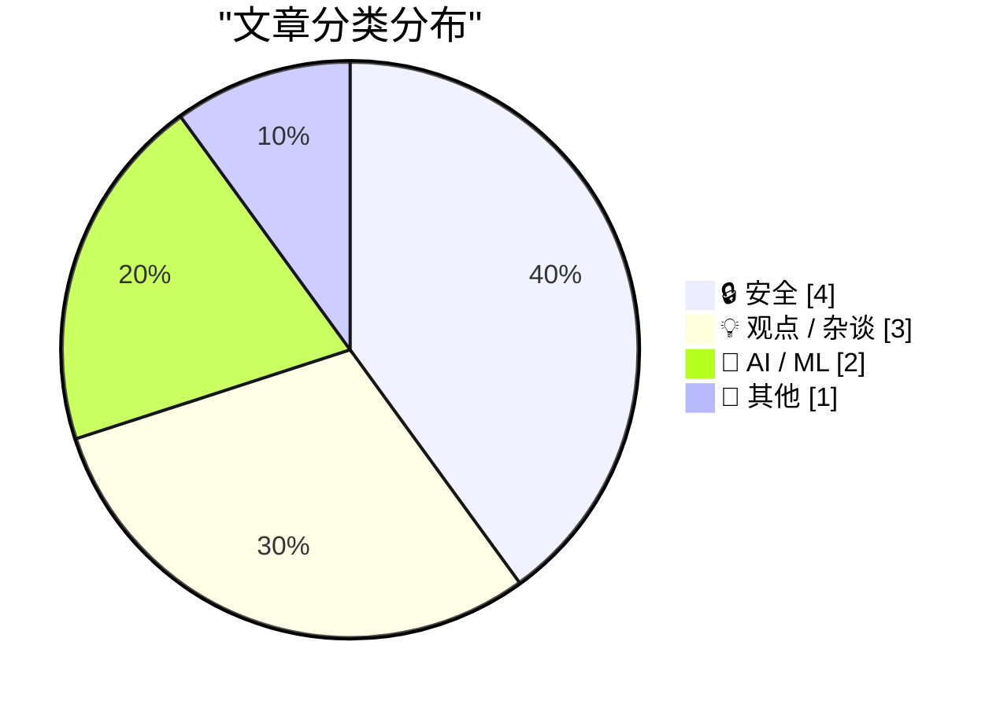
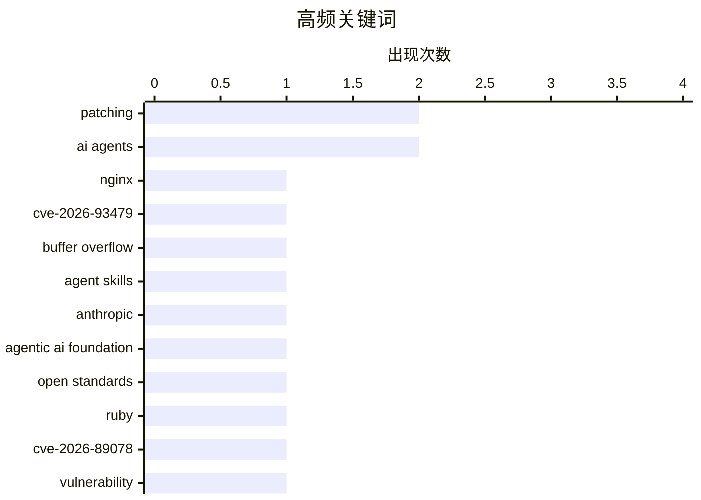

今日技术圈的两大焦点是内存安全风险与智能体生态的加速演进。NGINX、Ruby 等漏洞再次暴露底层代码在内存管理上的长期脆弱性，提醒业界安全治理不能只依赖事后打补丁。与此同时，Agent Skills 被捐赠给开放基金会，Kimi K3.1 Pro 等模型接连亮相，智能体正从单点竞赛走向协议标准化、能力升级与基础设施安全挑战并存的阶段。另一个值得警惕的趋势是，AI 提升效率的同时，自动化攻击与持续高压生产正在放大组织和个人的安全与 productivity 悖论。

<!--more-->


> 来自 Karpathy 推荐的 92 个顶级技术博客，AI 精选 Top 10

## 🏆 今日必读

🥇 **“无法阻止这种问题”——“这种问题经常发生的唯一语言”的用户如是说**

["No way to prevent this" say users of only language where this regularly happens](https://xeiaso.net/shitposts/no-way-to-prevent-this/memory-safety/CVE-2026-93479/) — xeiaso.net · 1 天前 · 🔒 安全

> CVE-2026-93479 暴露了 NGINX 中由 C 编写的组件所存在的堆缓冲区溢出，特定请求可通过正则映射捕获或非缓存变量触发 worker 重启。攻击者构造的请求还可能造成代码执行，尤其是在 ASLR 被关闭或绕过的情况下。该漏洞发布后，站点可靠性工程师和系统管理员被迫紧急重建并修补系统。文章以“只有 C 会反复出现此类问题”的讽刺说法，影射过去 50 年全球 90% 内存安全漏洞与 C 语言的关联。

💡 **为什么值得读**: 它把真实的 NGINX 高危漏洞与对 C 语言内存安全问题的讽刺结合在一起，既能提供安全案例，也能引发对低层语言风险治理的思考。

🏷️ NGINX, CVE-2026-93479, buffer overflow, patching

🥈 **将 Agent Skills 捐赠给智能体人工智能基金会**

[Donating Agent Skills to the Agentic AI Foundation](https://simonwillison.net/2026/Oct/22/donating-agent-skills/) — simonwillison.net · 1 天前 · 🤖 AI / ML

> Anthropic 将 Agent Skills 标准捐赠给 Linux Foundation 旗下、此前由其与 Block、OpenAI 共同创立的 Agentic AI Foundation（AAIF）。此次捐赠旨在让 Agent Skills 保持开放、社区驱动和厂商中立。Anthropic 此前还向 AAIF 捐赠了模型上下文协议 MCP，使技能规范与智能体通信协议形成互补。作者认为，AAIF 很可能成为 Agent Skills 的长期归宿，并呼应了其早在 2025 年 12 月对标准化路径的判断。

💡 **为什么值得读**: 这是观察 Agent Skills、MCP 与智能体开放生态走向的重要一手消息，有助于理解智能体工具标准化及厂商中立治理的进展。

🏷️ Agent Skills, Anthropic, Agentic AI Foundation, open standards

🥉 **“无法阻止这种问题”——“这种问题经常发生的唯一语言”的用户如是说**

["No way to prevent this" say users of only language where this regularly happens](https://xeiaso.net/shitposts/no-way-to-prevent-this/memory-safety/CVE-2026-89078/) — xeiaso.net · 22 小时前 · 🔒 安全

> CVE-2026-89078 揭示了 Ruby 的 Onigmo 正则表达式解析器在特定失败路径中的 double free 漏洞。当正则表达式包含分支结构且解析失败时，可能发生内存损坏；如果应用允许攻击者控制并编译正则模式，还可能造成远程代码执行。漏洞公布后，站点可靠性人员和系统管理员需要紧急修补受影响系统。文章再次采用“只有 C 会反复出现此类漏洞”的戏谑表述，讽刺将内存安全问题归咎于 C 语言本身。

💡 **为什么值得读**: 它以真实 Ruby CVE 为切入点，说明即便采用带垃圾回收的高级语言，其原生扩展和底层依赖仍可能成为高危攻击面。

🏷️ Ruby, CVE-2026-89078, vulnerability, patching

---

## 📊 数据概览

| 扫描源 | 抓取文章 | 时间范围 | 精选 |
|:---:|:---:|:---:|:---:|
| 85/92 | 2578 篇 → 33 篇 | 48h | **10 篇** |

### 分类分布



### 高频关键词



<details>
<summary>📈 纯文本关键词图（终端友好）</summary>

```
patching              │ ████████████████████ 2
ai agents             │ ████████████████████ 2
nginx                 │ ██████████░░░░░░░░░░ 1
cve-2026-93479        │ ██████████░░░░░░░░░░ 1
buffer overflow       │ ██████████░░░░░░░░░░ 1
agent skills          │ ██████████░░░░░░░░░░ 1
anthropic             │ ██████████░░░░░░░░░░ 1
agentic ai foundation │ ██████████░░░░░░░░░░ 1
open standards        │ ██████████░░░░░░░░░░ 1
ruby                  │ ██████████░░░░░░░░░░ 1
```

</details>

### 🏷️ 话题标签

**patching**(2) · **ai agents**(2) · **nginx**(1) · cve-2026-93479(1) · buffer overflow(1) · agent skills(1) · anthropic(1) · agentic ai foundation(1) · open standards(1) · ruby(1) · cve-2026-89078(1) · vulnerability(1) · kimi k3.1 pro(1) · llm(1) · moonshot ai(1) · open weights(1) · software design(1) · performance(1) · rust(1) · ai(1)

---

## 🔒 安全

### 1. “无法阻止这种问题”——“这种问题经常发生的唯一语言”的用户如是说

["No way to prevent this" say users of only language where this regularly happens](https://xeiaso.net/shitposts/no-way-to-prevent-this/memory-safety/CVE-2026-93479/) — **xeiaso.net** · 1 天前 · ⭐ 29/30

> CVE-2026-93479 暴露了 NGINX 中由 C 编写的组件所存在的堆缓冲区溢出，特定请求可通过正则映射捕获或非缓存变量触发 worker 重启。攻击者构造的请求还可能造成代码执行，尤其是在 ASLR 被关闭或绕过的情况下。该漏洞发布后，站点可靠性工程师和系统管理员被迫紧急重建并修补系统。文章以“只有 C 会反复出现此类问题”的讽刺说法，影射过去 50 年全球 90% 内存安全漏洞与 C 语言的关联。

🏷️ NGINX, CVE-2026-93479, buffer overflow, patching

---

### 2. “无法阻止这种问题”——“这种问题经常发生的唯一语言”的用户如是说

["No way to prevent this" say users of only language where this regularly happens](https://xeiaso.net/shitposts/no-way-to-prevent-this/memory-safety/CVE-2026-89078/) — **xeiaso.net** · 22 小时前 · ⭐ 27/30

> CVE-2026-89078 揭示了 Ruby 的 Onigmo 正则表达式解析器在特定失败路径中的 double free 漏洞。当正则表达式包含分支结构且解析失败时，可能发生内存损坏；如果应用允许攻击者控制并编译正则模式，还可能造成远程代码执行。漏洞公布后，站点可靠性人员和系统管理员需要紧急修补受影响系统。文章再次采用“只有 C 会反复出现此类漏洞”的戏谑表述，讽刺将内存安全问题归咎于 C 语言本身。

🏷️ Ruby, CVE-2026-89078, vulnerability, patching

---

### 3. Booking.com 和 Novotel 出现更多钓鱼信息

[More phishing messages via Booking.com and Novotel](https://shkspr.mobi/blog/2026/10/more-phishing-messages-via-booking-com-and-novotel/) — **shkspr.mobi** · 10 小时前 · ⭐ 24/30

> 作者通过 Booking.com 预订 Novotel 酒店两天后，收到了两封经 WhatsApp 发送的钓鱼消息。两条消息都准确包含其姓名、电话号码、住宿地点和入住日期，暗示 Booking.com、Novotel 或相关流程中的数据可能被泄露或滥用。第一条消息来自一个葡萄牙企业账户，其名称与 Novotel 品牌明显不符。作者认为这两条钓鱼信息制作得并不高明，但个人信息的高度准确性仍然值得警惕。

🏷️ phishing, Booking.com, WhatsApp, credential theft

---

### 4. 突发新闻：美国银行正遭受 AI 智能体攻击

[Breaking news: U.S. banks are taking hits from AI agents](https://garymarcus.substack.com/p/breaking-news-us-banks-are-taking) — **garymarcus.substack.com** · 1 天前 · ⭐ 24/30

> 文章聚焦美国银行业基础设施近期受到 AI 智能体攻击的问题，并暗示任何新的关键基础设施都可能成为下一个目标。标题强调“AI 智能体”这一新型自动化攻击因素正在扩大安全风险范围。不过，所给摘录没有提供具体事件、受害银行、攻击方式或损失数据。其核心警示是，银行安全防御不能只针对传统人工攻击，还要考虑能够自主规划和执行操作的智能体。

🏷️ AI agents, banking, cybersecurity

---

## 💡 观点 / 杂谈

### 5. 软件慢是因为设计糟糕，而不是语言慢

[Software is slow because of bad design, not slow languages](https://seangoedecke.com/software-is-slow-because-of-bad-design-not-slow-languages/) — **seangoedecke.com** · 22 小时前 · ⭐ 26/30

> 把程序从 Python 等语言重写为 C 或 Rust，通常无法带来预期中的性能提升，因为多数真实程序主要受 I/O 而非语言执行速度限制。尽管 C 在某些计算任务中可能比 Python 快约 50 倍，这类差异并不代表整个应用会快 50 倍。许多慢语言已经可以通过成熟库、原生扩展或运行时获得接近 C 的性能。真正决定软件性能的因素通常是架构与设计，包括数据流、缓存策略、并发方式和 I/O 调度。

🏷️ software design, performance, Rust, AI

---

### 6. 生产力悖论

[Productivity](https://idiallo.com/byte-size/productivity-video) — **idiallo.com** · 1 天前 · ⭐ 23/30

> 当 AI 智能体承担繁琐工作、让人们以更少时间获得同样结果时，生产力的提升往往不会转化为更多休息。相反，省下的时间会转化为更多产出目标，让原本“无需亲自工作”的人依旧没有属于自己的时间。视频中运行着 8 个后台智能体的人即使声称工作已全部外包，仍处于忙碌和焦虑状态。作者借《办公空间》的梗反思了现代职场把效率提升等同于持续劳动的机制。

🏷️ AI agents, productivity, automation, work

---

### 7. 倾尽国王的所有马匹和士兵，仍无法让 CoreWeave 重新拼合

[All the king’s horses and all the king’s men haven’t been able to put CoreWeave back together again](https://garymarcus.substack.com/p/all-the-kings-horses-and-all-the) — **garymarcus.substack.com** · 1 天前 · ⭐ 23/30

> 文章以《鹅妈妈童谣》的句式形容 CoreWeave 难以重新整合，暗示这家 AI 基础设施公司正面临严重且持续的问题。科技行业普遍不希望看到其倒闭，但即便如此，其股价在过去 6 个月内仍下跌超过 50%。标题传达的不是单纯的暂时技术故障，而是外界对公司整体稳定性和恢复能力的怀疑。所给摘录没有进一步说明股价下跌背后的财务、融资或技术原因。

🏷️ CoreWeave, AI infrastructure, stock market

---

## 🤖 AI / ML

### 8. 将 Agent Skills 捐赠给智能体人工智能基金会

[Donating Agent Skills to the Agentic AI Foundation](https://simonwillison.net/2026/Oct/22/donating-agent-skills/) — **simonwillison.net** · 1 天前 · ⭐ 27/30

> Anthropic 将 Agent Skills 标准捐赠给 Linux Foundation 旗下、此前由其与 Block、OpenAI 共同创立的 Agentic AI Foundation（AAIF）。此次捐赠旨在让 Agent Skills 保持开放、社区驱动和厂商中立。Anthropic 此前还向 AAIF 捐赠了模型上下文协议 MCP，使技能规范与智能体通信协议形成互补。作者认为，AAIF 很可能成为 Agent Skills 的长期归宿，并呼应了其早在 2025 年 12 月对标准化路径的判断。

🏷️ Agent Skills, Anthropic, Agentic AI Foundation, open standards

---

### 9. Kimi K3.1 Pro 正式发布

[Introducing Kimi K3.1 Pro](https://simonwillison.net/2026/Oct/23/kimi-k31-pro/) — **simonwillison.net** · 2 小时前 · ⭐ 26/30

> Kimi K3.1 Pro 已登陆 Kimi API，模型权重尚未开放，但 Moonshot 承诺在 2026 年 11 月 4 日前发布完整权重。另有速度提升 2 至 3 倍的 Highspeed 版本，价格却是标准版的两倍，输入 token 缓存命中部分除外。其标准版定价为每百万输入 token 2 美元、输出 token 10 美元，与 GPT-6.1 Sol 相同，约为 Claude Opus 5.5 的一半。Moonshot 的评测显示其能力大致处于 Opus 5.5 和 GPT-6 Astra 水平，Artificial Analysis 则给出 55 分，仅低于 Claude Opus 5.5 的 58 分。

🏷️ Kimi K3.1 Pro, LLM, Moonshot AI, open weights

---

## 📝 其他

### 10. 苹果重点展示 50 多款已完成 Duo 适配的 iPhone 应用

[Apple Highlights 50+ iPhone Apps That Have Already Been Optimized for the Duo](https://www.apple.com/newsroom/2026/10/developers-bring-incredible-new-app-experiences-to-iphone-duo/) — **daringfireball.net** · 1 天前 · ⭐ 22/30

> Apple Newsroom 展示了 50 多款已经针对 iPhone Duo 优化体验的应用和游戏，相关编辑精选专区将于本周五在 App Store 上线，更多应用更新也会在全年陆续推出。完成适配的产品会在商店页面获得“Made for iPhone Duo”标识，便于用户识别。Apple 将这次屏幕形态变化与 iPhone X、iPhone 6 Plus、iPhone 5 和 iPhone 4 Retina 等历代产品迁移相提并论。适配期间，未及时更新的应用可能因布局或交互不协调而影响使用体验。作者认为用户会因此转向体验更好的竞品，并提到自己已经停止使用未适配的 Mastodon。

🏷️ iPhone Duo, iOS, App Store, Apple

---

*生成于 2026-10-24 22:19 | 扫描 85 源 → 获取 2578 篇 → 精选 10 篇*
*基于 [Hacker News Popularity Contest 2025](https://refactoringenglish.com/tools/hn-popularity/) RSS 源列表，由 [Andrej Karpathy](https://x.com/karpathy) 推荐*
*由「懂点儿AI」制作，欢迎关注同名微信公众号获取更多 AI 实用技巧 💡*
