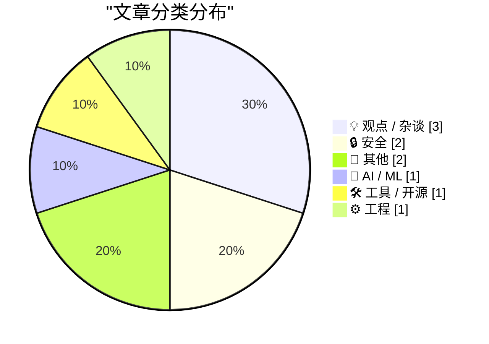
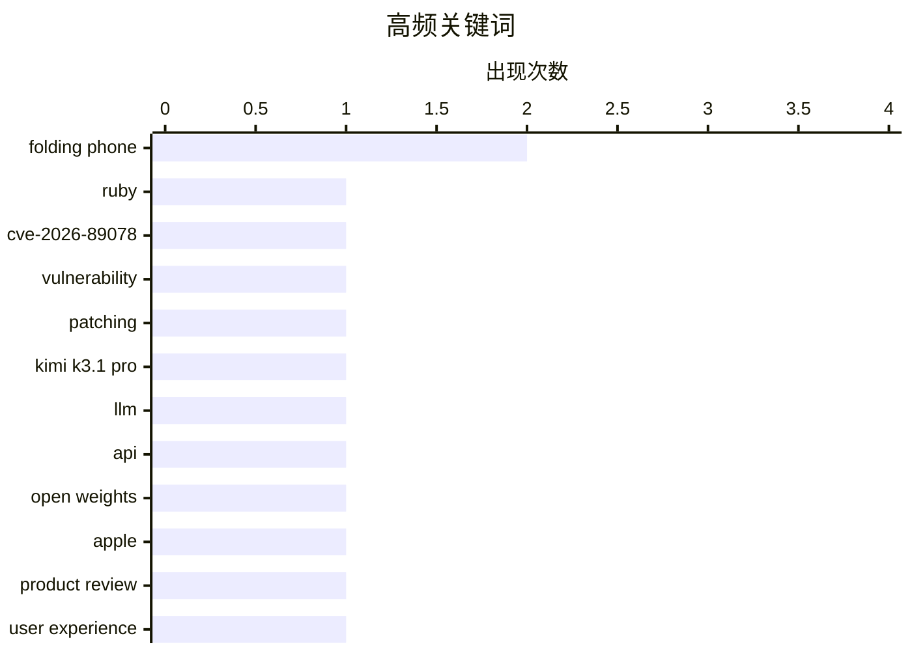

今日技术圈聚焦两大主线：安全风险持续从底层漏洞向软件供应链和个人数据泄露延伸，内存安全、钓鱼攻击与依赖管理成为共同关键词。与此同时，AI 模型竞争继续升级，Kimi K3.1 Pro 以更低价格和高性能加入头部模型行列，但生成式 AI 的收益与风险仍备受争议。另一股讨论则转向技术自主与工程实践：欧洲加速审视对美国技术基础设施的依赖，而开发者重新强调，架构设计和系统治理往往比盲目重写语言更重要。

<!--more-->


> 来自 Karpathy 推荐的 92 个顶级技术博客，AI 精选 Top 10

## 🏆 今日必读

🥇 **用户称“根本无从防范”：这种问题只会在这一门语言中反复发生**

["No way to prevent this" say users of only language where this regularly happens](https://xeiaso.net/shitposts/no-way-to-prevent-this/memory-safety/CVE-2026-89078/) — xeiaso.net · 1 天前 · 🔒 安全

> Ruby 发布 CVE-2026-89078 后，站点可靠性工程师和系统管理员紧急重建并修补系统，以应对 Onigmo 正则表达式解析器中的双重释放漏洞。漏洞在解析包含分支选择的攻击者可控模式并触发失败时，可能造成内存损坏及潜在远程代码执行。根因之一是相关组件使用 C 编写；文章以讽刺口吻强调，90% 的全球内存安全漏洞都发生在这一语言中。漏洞披露后，数百名程序员以“有时就是会这样，谁也无能为力”来表达无奈。

💡 **为什么值得读**: 这个案例同时展示了正则表达式解析漏洞的现实风险，以及安全讨论中归咎于 C 语言却不追究架构缺陷的荒谬之处。

🏷️ Ruby, CVE-2026-89078, vulnerability, patching

🥈 **Kimi K3.1 Pro 正式发布**

[Introducing Kimi K3.1 Pro](https://simonwillison.net/2026/Oct/23/kimi-k31-pro/) — simonwillison.net · 1 天前 · 🤖 AI / ML

> 月之暗面在 Kimi API 上线 Kimi K3.1 Pro，目前尚未开放模型权重，但承诺在 2026 年 11 月 4 日前发布完整权重。标准版定价为每百万输入 token 2 美元、输出 token 10 美元，与 GPT-6.1 Sol 相同，价格仅为 Claude Opus 5.5 的一半。另有一个速度提升 2 至 3 倍的 Highspeed 版本，售价翻倍，但输入 token 缓存命中的价格保持不变。官方基准显示其整体能力约等于 Claude Opus 5.5 和 GPT-6 Astra，并在部分项目上领先；Artificial Analysis 给出 55 分，仅低于 Claude Opus 5.5 的 58 分。

💡 **为什么值得读**: Kimi K3.1 Pro 以接近旗舰闭源模型的价格和基准表现加入竞争，还承诺开放权重，对模型选型和本地部署决策很有参考价值。

🏷️ Kimi K3.1 Pro, LLM, API, open weights

🥉 **The Verge 的 Duo 评测：“苹果折叠手机是一段混乱而昂贵的好时光”**

[The Verge’s Duo Review: ‘Apple’s Folding Phone Is a Messy, Expensive Good Time’](https://www.theverge.com/tech/1015028/iphone-duo-review) — daringfireball.net · 1 天前 · 📝 其他

> The Verge 对苹果 Duo 折叠手机进行了评测，重点关注其双屏形态带来的握持与交互适应问题。用户几乎每次打开手机都会本能地旋转设备，而且无论朝哪个方向旋转都能正常使用，但逆时针握持可将摄像头置于顶部、音量键置于左上角。连续一周测试后，这种操作逐渐变得自然，却仍与用户最初的习惯相反。使用配套保护壳时，容纳 Touch ID 传感器和相机控制区域的巨大缺口看起来更像位于设备底部，进一步强化了整体布局的违和感。评测的核心感受是，Duo 虽然提供新鲜体验，却需要用户持续重新建立对按键和屏幕方向的认知。

💡 **为什么值得读**: 这篇评测不只是罗列参数，而是从日常握持、方向感知和配件使用等细节揭示了双屏折叠设备尚未解决的交互问题。

🏷️ Apple, folding phone, product review, user experience

---

## 📊 数据概览

| 扫描源 | 抓取文章 | 时间范围 | 精选 |
|:---:|:---:|:---:|:---:|
| 86/92 | 2599 篇 → 31 篇 | 48h | **10 篇** |

### 分类分布



### 高频关键词



<details>
<summary>📈 纯文本关键词图（终端友好）</summary>

```
folding phone  │ ████████████████████ 2
ruby           │ ██████████░░░░░░░░░░ 1
cve-2026-89078 │ ██████████░░░░░░░░░░ 1
vulnerability  │ ██████████░░░░░░░░░░ 1
patching       │ ██████████░░░░░░░░░░ 1
kimi k3.1 pro  │ ██████████░░░░░░░░░░ 1
llm            │ ██████████░░░░░░░░░░ 1
api            │ ██████████░░░░░░░░░░ 1
open weights   │ ██████████░░░░░░░░░░ 1
apple          │ ██████████░░░░░░░░░░ 1
```

</details>

### 🏷️ 话题标签

**folding phone**(2) · **ruby**(1) · **cve-2026-89078**(1) · vulnerability(1) · patching(1) · kimi k3.1 pro(1) · llm(1) · api(1) · open weights(1) · apple(1) · product review(1) · user experience(1) · hinge durability(1) · robot testing(1) · camera(1) · package management(1) · releases(1) · advisories(1) · developer tools(1) · starlink(1)

---

## 💡 观点 / 杂谈

### 1. 埃隆·马斯克刚刚给了欧洲一个替换美国技术的机会

[Elon Musk Just Gave Europe a Reason to Replace American Technology](https://steveblank.com/2026/10/24/europe-gets-a-wake-up-call/) — **steveblank.com** · 9 小时前 · ⭐ 25/30

> 作者从欧洲政策制定者对马斯克相关决策的反应切入，讨论欧洲技术自主性的现实压力。美国决定切断面向乌克兰的情报服务，并限制其军事版 Starlink——Starshield——的使用，而这一事件在美国媒体中很快淡去。作者认为，此举可能成为欧洲重新评估对美国技术依赖的催化剂。核心观点是，地缘政治控制风险能够促使欧洲考虑采用可替代的技术基础设施。

🏷️ Starlink, Starshield, Ukraine, technology sovereignty

---

### 2. 软件慢是因为设计糟糕，而不是语言慢

[Software is slow because of bad design, not slow languages](https://seangoedecke.com/software-is-slow-because-of-bad-design-not-slow-languages/) — **seangoedecke.com** · 1 天前 · ⭐ 24/30

> 文章反驳了“用 AI 将软件重写为 C 或 Rust，就能普遍获得显著性能提升”的观点。尽管 C 在某些计算任务中可比 Python 快约 50 倍，多数真实程序的性能仍主要受 I/O 约束，而不是语言执行速度限制。对于确实受语言性能影响的任务，Python 等较慢语言通常已经拥有可通过成熟库释放接近 C 级速度的方案。作者据此强调，软件性能首先取决于架构和系统设计，而不是盲目更换编程语言。

🏷️ software design, performance, Rust, AI coding

---

### 3. 生成式 AI 会带来更多伤害还是更多益处？

[Will Generative AI do more harm than good?](https://garymarcus.substack.com/p/will-generative-ai-do-more-harm-than) — **garymarcus.substack.com** · 2 小时前 · ⭐ 24/30

> 文章提出一个围绕生成式 AI 净影响的核心问题：它最终带来的危害是否会超过价值。现有内容以“情况看起来不太妙”直接表达作者的负面倾向。摘录没有进一步列出具体 harms、技术证据或可验证的数据，因此尚不足以判断作者的主要论证依据。这个开场为后续风险分析定下了谨慎而悲观的基调。

🏷️ generative AI, AI risks, technology policy, society

---

## 🔒 安全

### 4. 用户称“根本无从防范”：这种问题只会在这一门语言中反复发生

["No way to prevent this" say users of only language where this regularly happens](https://xeiaso.net/shitposts/no-way-to-prevent-this/memory-safety/CVE-2026-89078/) — **xeiaso.net** · 1 天前 · ⭐ 27/30

> Ruby 发布 CVE-2026-89078 后，站点可靠性工程师和系统管理员紧急重建并修补系统，以应对 Onigmo 正则表达式解析器中的双重释放漏洞。漏洞在解析包含分支选择的攻击者可控模式并触发失败时，可能造成内存损坏及潜在远程代码执行。根因之一是相关组件使用 C 编写；文章以讽刺口吻强调，90% 的全球内存安全漏洞都发生在这一语言中。漏洞披露后，数百名程序员以“有时就是会这样，谁也无能为力”来表达无奈。

🏷️ Ruby, CVE-2026-89078, vulnerability, patching

---

### 5. 通过 Booking.com 和 Novotel 发送的更多钓鱼消息

[More phishing messages via Booking.com and Novotel](https://shkspr.mobi/blog/2026/10/more-phishing-messages-via-booking-com-and-novotel/) — **shkspr.mobi** · 1 天前 · ⭐ 24/30

> 作者通过 Booking.com 预订 Novotel 酒店两天后，经 WhatsApp 收到了针对性钓鱼消息。攻击者掌握了其准确姓名、电话号码、住宿地点和入住日期，显示 Booking.com 等平台可能泄露或暴露订房数据。两条消息的制作者都显得不够专业，例如其中一条使用葡萄牙语企业账户，与 Novotel 连锁酒店的身份明显不符。尽管本次攻击手法并不高明，精准的个人信息仍让钓鱼内容更具可信度。

🏷️ phishing, Booking.com, WhatsApp, Novotel

---

## 📝 其他

### 6. The Verge 的 Duo 评测：“苹果折叠手机是一段混乱而昂贵的好时光”

[The Verge’s Duo Review: ‘Apple’s Folding Phone Is a Messy, Expensive Good Time’](https://www.theverge.com/tech/1015028/iphone-duo-review) — **daringfireball.net** · 1 天前 · ⭐ 26/30

> The Verge 对苹果 Duo 折叠手机进行了评测，重点关注其双屏形态带来的握持与交互适应问题。用户几乎每次打开手机都会本能地旋转设备，而且无论朝哪个方向旋转都能正常使用，但逆时针握持可将摄像头置于顶部、音量键置于左上角。连续一周测试后，这种操作逐渐变得自然，却仍与用户最初的习惯相反。使用配套保护壳时，容纳 Touch ID 传感器和相机控制区域的巨大缺口看起来更像位于设备底部，进一步强化了整体布局的违和感。评测的核心感受是，Duo 虽然提供新鲜体验，却需要用户持续重新建立对按键和屏幕方向的认知。

🏷️ Apple, folding phone, product review, user experience

---

### 7. Joanna Stern 评测 Duo：“优点、缺点与故障”

[Joanna Stern Reviews the Duo: ‘The Good, the Bad, and the Buggy’](https://www.youtube.com/watch?v=bxDTWuL9GxY) — **daringfireball.net** · 1 天前 · ⭐ 26/30

> Joanna Stern 在 16 分钟视频中集中评测了 Duo 的优缺点及稳定性问题。她定制了一台机器人，在一周内让设备折叠和展开超过 32,000 次，以检查铰链是否出现松动。她还把手机带到哈德逊河上的游艇和光线昏暗的酒吧，分别测试便携体验与相机表现。Face ID 的缺失成为她使用过程中的突出抱怨。Stern 的总体结论与作者评价一致，说明两款评测都认可产品价值，同时指出了影响日常使用的缺陷。

🏷️ folding phone, hinge durability, robot testing, camera

---

## 🤖 AI / ML

### 8. Kimi K3.1 Pro 正式发布

[Introducing Kimi K3.1 Pro](https://simonwillison.net/2026/Oct/23/kimi-k31-pro/) — **simonwillison.net** · 1 天前 · ⭐ 26/30

> 月之暗面在 Kimi API 上线 Kimi K3.1 Pro，目前尚未开放模型权重，但承诺在 2026 年 11 月 4 日前发布完整权重。标准版定价为每百万输入 token 2 美元、输出 token 10 美元，与 GPT-6.1 Sol 相同，价格仅为 Claude Opus 5.5 的一半。另有一个速度提升 2 至 3 倍的 Highspeed 版本，售价翻倍，但输入 token 缓存命中的价格保持不变。官方基准显示其整体能力约等于 Claude Opus 5.5 和 GPT-6 Astra，并在部分项目上领先；Artificial Analysis 给出 55 分，仅低于 Claude Opus 5.5 的 58 分。

🏷️ Kimi K3.1 Pro, LLM, API, open weights

---

## 🛠 工具 / 开源

### 9. 本周包管理动态：2026 年 10 月 24 日

[This Week in Package Management: 24 October 2026](https://nesbitt.io/2026/10/24/this-week-in-package-management.html) — **nesbitt.io** · 12 小时前 · ⭐ 26/30

> 这是一份围绕包管理生态的每周资讯汇总。内容覆盖软件包、依赖管理工具及供应链领域的新版本发布。它还会整理安全公告和值得关注的行业文章。文章采用短篇幅聚合形式，帮助读者集中掌握一周内的工具变化与风险信号，而无需逐个追踪相关项目。

🏷️ package management, releases, advisories, developer tools

---

## ⚙️ 工程

### 10. 你可能不知道的一些 systemd 实用功能

[Interesting systemd features you may not know about](https://martinalderson.com/posts/interesting-systemd-features/?utm_source=rss&amp;utm_medium=rss&amp;utm_campaign=feed) — **martinalderson.com** · 22 小时前 · ⭐ 23/30

> 文章介绍了一批容易被忽略但非常实用的 systemd 功能，包括内存上限、运行时长限制和 sleep inhibitor。systemd 还可提供比传统 cron 更易管理的定时任务机制，以及通过 path unit 响应文件或目录变化的方案。这些能力特别适合运行一次性的、由智能代理生成的代码。文章展示了 systemd 不只是服务启动器，还能承担资源治理、调度和事件驱动控制等职责。

🏷️ systemd, Linux, resource limits, cron

---

*生成于 2026-10-25 22:18 | 扫描 86 源 → 获取 2599 篇 → 精选 10 篇*
*基于 [Hacker News Popularity Contest 2025](https://refactoringenglish.com/tools/hn-popularity/) RSS 源列表，由 [Andrej Karpathy](https://x.com/karpathy) 推荐*
*由「懂点儿AI」制作，欢迎关注同名微信公众号获取更多 AI 实用技巧 💡*
