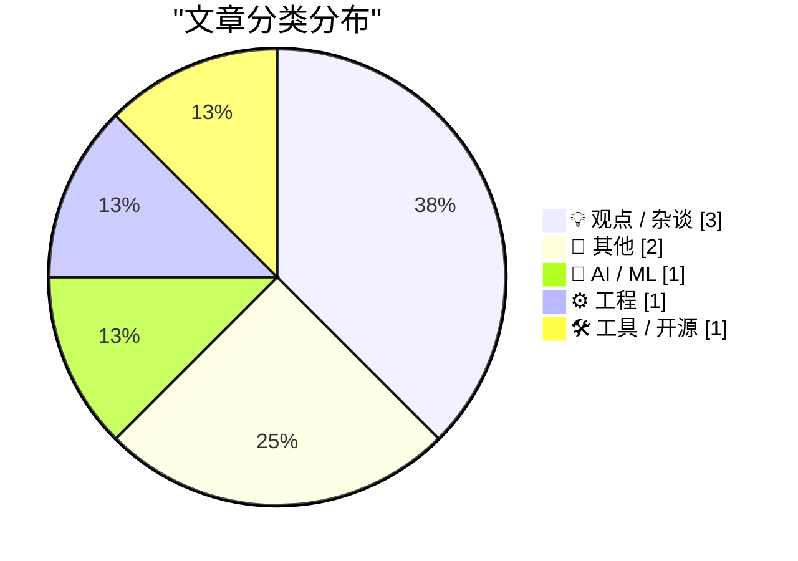
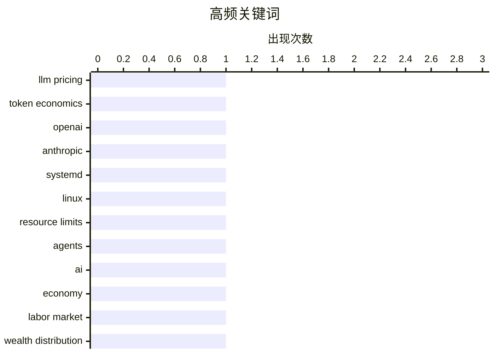

大模型价格战进入“真实成本”竞争阶段，推理效率、基础设施扩展与市场竞争正共同压低智能代理和批量应用的门槛。与此同时，AI带来的效率红利并未自动惠及所有人，技术主权、关键基础设施依赖与网络安全人才能力分化，正成为产业落地中的新议题。工程实践也在从零散脚本转向更可控、隔离且可观测的服务体系，systemd等基础工具成为承载自动化与不可信工作负载的重要底座。

<!--more-->


> 来自 Karpathy 推荐的 92 个顶级技术博客，AI 精选 Top 8

## 🏆 今日必读

🥇 **OpenAI 与 Anthropic 数月内将大模型价格下调最高 80%，原因何在？**

[OpenAI and Anthropic cut their LLM prices by up to 80% within a few months. Why?](https://minimaxir.com/2026/10/cheap-llms/) — minimaxir.com · 1 小时前 · 🤖 AI / ML

> OpenAI 与 Anthropic 在数月内将大模型调用价格下调最高 80%，价格战背后的核心问题是“一个 token 的真实成本”究竟是多少。分析将 API 标价与模型推理所消耗的计算资源、输出 token 数量及实际任务效率区分开来，避免只比较每百万 token 的单价。模型优化、推理基础设施扩展和厂商之间的市场竞争，共同推动头部模型的可用成本持续下降。对开发者而言，低价能降低批量推理、原型验证和智能代理工作流的门槛，但评估时仍应结合输出长度、延迟、成功率与模型能力。核心结论是，大模型价格下降既是技术进步的结果，也意味着仅凭 token 单价已越来越难判断产品的实际使用成本。

💡 **为什么值得读**: 这篇文章提供了一套理解大模型降价的成本视角，适合在选型、预算规划和评估低价 API 时快速建立判断框架。

🏷️ LLM pricing, token economics, OpenAI, Anthropic

🥈 **你可能不知道的 systemd 实用功能**

[Interesting systemd features you may not know about](https://martinalderson.com/posts/interesting-systemd-features/?utm_source=rss&amp;utm_medium=rss&amp;utm_campaign=feed) — martinalderson.com · 1 天前 · ⚙️ 工程

> systemd 不只是服务启动器，还提供内存上限、运行时限、休眠抑制器、定时器与路径单元等适合约束临时任务的机制。借助 MemoryMax、RuntimeMaxSec 等资源限制，可以防止一次性或由智能代理生成的代码耗尽主机资源。新的 cron 和 path unit 能力则能以声明式方式处理周期任务与文件变化，减少对传统 crontab 和专用守护进程的依赖。这些特性尤其适合运行不可信、短生命周期的自动化工作负载，同时增强隔离性与可观测性。核心观点是，善用 systemd 的现代功能可以把许多原本零散的后台脚本整合成更可靠、易管理的服务单元。

💡 **为什么值得读**: 文章覆盖的都是容易被忽视但能显著提升自动化代码可靠性与资源治理能力的高级 systemd 特性，尤其适合部署 AI 代理或临时任务。

🏷️ systemd, Linux, resource limits, agents

🥉 **水涨船高**

[A rising tide raises all rents](https://jyn.dev/rising-tide-raises-rents/) — jyn.dev · 22 小时前 · 💡 观点 / 杂谈

> AI 重组经济活动时，谁能够分享效率提升带来的收益，是文章讨论的核心问题。“水涨船高”借用“租金”这一经济学概念，指向由稀缺资源、知识产权或市场控制力产生的收益。AI 的广泛应用可能同时改变劳动、资本和中间品之间的收益分配，因此整体经济增长并不等于每个群体都同步受益。文章将分析重点放在技术红利流向谁、哪些既有优势会被放大，以及劳动者需要何种制度安排。作者的核心观点是，应把 AI 视为重新分配经济租金的力量，而不是自动惠及所有人的生产力红利。

💡 **为什么值得读**: 文章以经济学视角审视 AI 红利分配，有助于读者跳出“技术是否有用”的讨论，进一步追问收益归属与制度应对。

🏷️ AI, economy, labor market, wealth distribution

---

## 📊 数据概览

| 扫描源 | 抓取文章 | 时间范围 | 精选 |
|:---:|:---:|:---:|:---:|
| 51/92 | 1743 篇 → 8 篇 | 48h | **8 篇** |

### 分类分布



### 高频关键词



<details>
<summary>📈 纯文本关键词图（终端友好）</summary>

```
llm pricing     │ ████████████████████ 1
token economics │ ████████████████████ 1
openai          │ ████████████████████ 1
anthropic       │ ████████████████████ 1
systemd         │ ████████████████████ 1
linux           │ ████████████████████ 1
resource limits │ ████████████████████ 1
agents          │ ████████████████████ 1
ai              │ ████████████████████ 1
economy         │ ████████████████████ 1
```

</details>

### 🏷️ 话题标签

**llm pricing**(1) · **token economics**(1) · **openai**(1) · anthropic(1) · systemd(1) · linux(1) · resource limits(1) · agents(1) · ai(1) · economy(1) · labor market(1) · wealth distribution(1) · starlink(1) · europe(1) · technology sovereignty(1) · geopolitics(1) · cybersecurity(1) · salary(1) · careers(1) · world war ii(1)

---

## 💡 观点 / 杂谈

### 1. 水涨船高

[A rising tide raises all rents](https://jyn.dev/rising-tide-raises-rents/) — **jyn.dev** · 22 小时前 · ⭐ 22/30

> AI 重组经济活动时，谁能够分享效率提升带来的收益，是文章讨论的核心问题。“水涨船高”借用“租金”这一经济学概念，指向由稀缺资源、知识产权或市场控制力产生的收益。AI 的广泛应用可能同时改变劳动、资本和中间品之间的收益分配，因此整体经济增长并不等于每个群体都同步受益。文章将分析重点放在技术红利流向谁、哪些既有优势会被放大，以及劳动者需要何种制度安排。作者的核心观点是，应把 AI 视为重新分配经济租金的力量，而不是自动惠及所有人的生产力红利。

🏷️ AI, economy, labor market, wealth distribution

---

### 2. 埃隆·马斯克给了欧洲一个摆脱美国技术的理由

[Elon Musk Just Gave Europe a Reason to Replace American Technology](https://steveblank.com/2026/10/24/europe-gets-a-wake-up-call/) — **steveblank.com** · 1 天前 · ⭐ 22/30

> 美国切断面向乌克兰的情报支持，并限制军事版 Starlink（Starshield）的使用能力，此举在欧洲政策圈引发了强烈反应。这件事暴露出欧洲对 SpaceX 等美国企业提供的通信、情报和军事技术存在高度依赖。欧洲决策者由此获得了推动技术主权、构建替代通信网络和加强本地数字基础设施的明确政治契机。Starlink 与 Starshield 之间的军民用途差异，也凸显了关键基础设施集中于单一美国供应商所带来的风险。文章的核心结论是，马斯克的政策决定虽然是一次外部冲击，却可能成为欧洲加速减少对 American technology 依赖的“清醒警报”。

🏷️ Starlink, Europe, technology sovereignty, geopolitics

---

### 3. 入门级网络安全岗位能赚多少？

[How much you can make in an entry level cyber security job](https://dfarq.homeip.net/how-much-you-can-make-in-an-entry-level-cyber-security-job/?utm_source=rss&#038;utm_medium=rss&#038;utm_campaign=how-much-you-can-make-in-an-entry-level-cyber-security-job) — **dfarq.homeip.net** · 11 小时前 · ⭐ 16/30

> 入门级网络安全岗位的薪资水平，以及网络安全人才短缺是否意味着人人都能获得高薪，是文章的核心问题。分析区分了 SOC 分析师、漏洞分析师等入门岗位，并考察岗位所在地区、雇佣机构及具体职责对薪酬的影响。人才缺口确实能带来就业机会，但薪酬上限仍会受到经验要求、认证、加班强度和实际技术贡献等因素限制。相较于简单执行告警响应或合规检查的职位，能够承担漏洞研究、安全工程和事件处置工作的岗位通常拥有更完整的收入潜力。核心结论是，网络安全的高需求并不等于所有初入行者都能获得相同回报，职业路径需要从执行型工作逐步转向可验证的技术能力。

🏷️ cybersecurity, salary, careers

---

## 📝 其他

### 4. 照亮天空

[lighting the skies](https://computer.rip/2026-10-25-searchlights.html) — **computer.rip** · 22 小时前 · ⭐ 12/30

> 核武器是否从根本上永久改变了战争，是文章重新审视的核心问题。以《奥本海默》等作品为代表的流行文化，长期强化了原子弹在技术史和战争史中的决定性地位。但历史学家和战略研究者更关注这种叙述是否被夸大，例如东京常规燃烧轰炸造成的伤亡可能与广岛、长崎核打击相当。核武器的文化冲击与军事效果确实巨大，但其影响需要与常规空袭、炮兵和工业动员等力量共同评估。战争早期由探照灯和大型机械装备主导战斗想象的历史，也能帮助揭示技术象征如何影响公众认知。文章的核心观点是，核武器的重要性不应被否认，但把二战结局完全归因于原子弹，既忽视其他常规武器，也简化了复杂的因果关系。

🏷️ World War II, military technology, nuclear weapons

---

### 5. Commodore 1600 VICmodem

[Commodore 1600 VICmodem](https://dfarq.homeip.net/commodore-1600-vicmodem/?utm_source=rss&#038;utm_medium=rss&#038;utm_campaign=commodore-1600-vicmodem) — **dfarq.homeip.net** · 1 天前 · ⭐ 11/30

> 1982 年的 Commodore 1600 VICmodem 是为 VIC-20 设计的拨号调制解调器，目标是让价格相对低廉的家用电脑能够接入在线网络。VIC-20 此前以低于 300 美元的价格提供彩色计算能力，Commodore 随即围绕这一硬件扩展通信外设。其 1200 波特速率代表了当时家用设备连接电话线路的重要阶段，使 BBS、电子邮件和远程信息交流变得可行。它与 VIC-20 的低价定位共同体现了 Commodore 推动个人计算普及的产品策略。核心结论是，VICmodem 的意义不仅在于单一外设本身，也在于它如何把联网能力带入大众市场。

🏷️ Commodore, VICmodem, 1980s, computing history

---

## 🤖 AI / ML

### 6. OpenAI 与 Anthropic 数月内将大模型价格下调最高 80%，原因何在？

[OpenAI and Anthropic cut their LLM prices by up to 80% within a few months. Why?](https://minimaxir.com/2026/10/cheap-llms/) — **minimaxir.com** · 1 小时前 · ⭐ 26/30

> OpenAI 与 Anthropic 在数月内将大模型调用价格下调最高 80%，价格战背后的核心问题是“一个 token 的真实成本”究竟是多少。分析将 API 标价与模型推理所消耗的计算资源、输出 token 数量及实际任务效率区分开来，避免只比较每百万 token 的单价。模型优化、推理基础设施扩展和厂商之间的市场竞争，共同推动头部模型的可用成本持续下降。对开发者而言，低价能降低批量推理、原型验证和智能代理工作流的门槛，但评估时仍应结合输出长度、延迟、成功率与模型能力。核心结论是，大模型价格下降既是技术进步的结果，也意味着仅凭 token 单价已越来越难判断产品的实际使用成本。

🏷️ LLM pricing, token economics, OpenAI, Anthropic

---

## ⚙️ 工程

### 7. 你可能不知道的 systemd 实用功能

[Interesting systemd features you may not know about](https://martinalderson.com/posts/interesting-systemd-features/?utm_source=rss&amp;utm_medium=rss&amp;utm_campaign=feed) — **martinalderson.com** · 1 天前 · ⭐ 24/30

> systemd 不只是服务启动器，还提供内存上限、运行时限、休眠抑制器、定时器与路径单元等适合约束临时任务的机制。借助 MemoryMax、RuntimeMaxSec 等资源限制，可以防止一次性或由智能代理生成的代码耗尽主机资源。新的 cron 和 path unit 能力则能以声明式方式处理周期任务与文件变化，减少对传统 crontab 和专用守护进程的依赖。这些特性尤其适合运行不可信、短生命周期的自动化工作负载，同时增强隔离性与可观测性。核心观点是，善用 systemd 的现代功能可以把许多原本零散的后台脚本整合成更可靠、易管理的服务单元。

🏷️ systemd, Linux, resource limits, agents

---

## 🛠 工具 / 开源

### 8. 适用于 Apple Network Server v1.0 的 macOS 扩展包

[MacOS Extensions pack for the Apple Network Server v1.0](https://oldvcr.blogspot.com/feeds/6275078006024628345/comments/default) — **oldvcr.blogspot.com** · 21 小时前 · ⭐ 10/30

> 适用于 Apple Network Server v1.0 的 macOS Extensions pack，重新整理了这款 1996 年服务器的软件扩展资源。Apple Network Server 是一款价格超过 10,000 美元、强调 Unix 能力并且仅限量供应的高端服务器。该扩展包的价值在于保存和整理当年围绕 ANS 构建的 macOS 扩展及其兼容环境，让这款封闭且稀有的平台更易于继续使用与研究。由于原始硬件、系统和配套软件几乎无法从常规渠道获得，整理这些组件本身就是一项重要的数字保存工作。核心结论是，这个项目通过补齐旧系统生态，使 Apple Network Server 的技术遗产能够在现代环境中得到更完整的理解和延续。

🏷️ MacOS, Apple Network Server, extensions

---

*生成于 2026-10-26 22:33 | 扫描 51 源 → 获取 1743 篇 → 精选 8 篇*
*基于 [Hacker News Popularity Contest 2025](https://refactoringenglish.com/tools/hn-popularity/) RSS 源列表，由 [Andrej Karpathy](https://x.com/karpathy) 推荐*
*由「懂点儿AI」制作，欢迎关注同名微信公众号获取更多 AI 实用技巧 💡*
