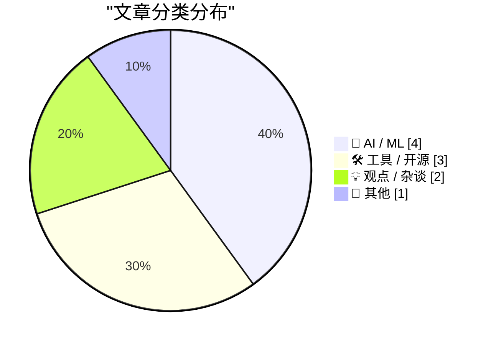
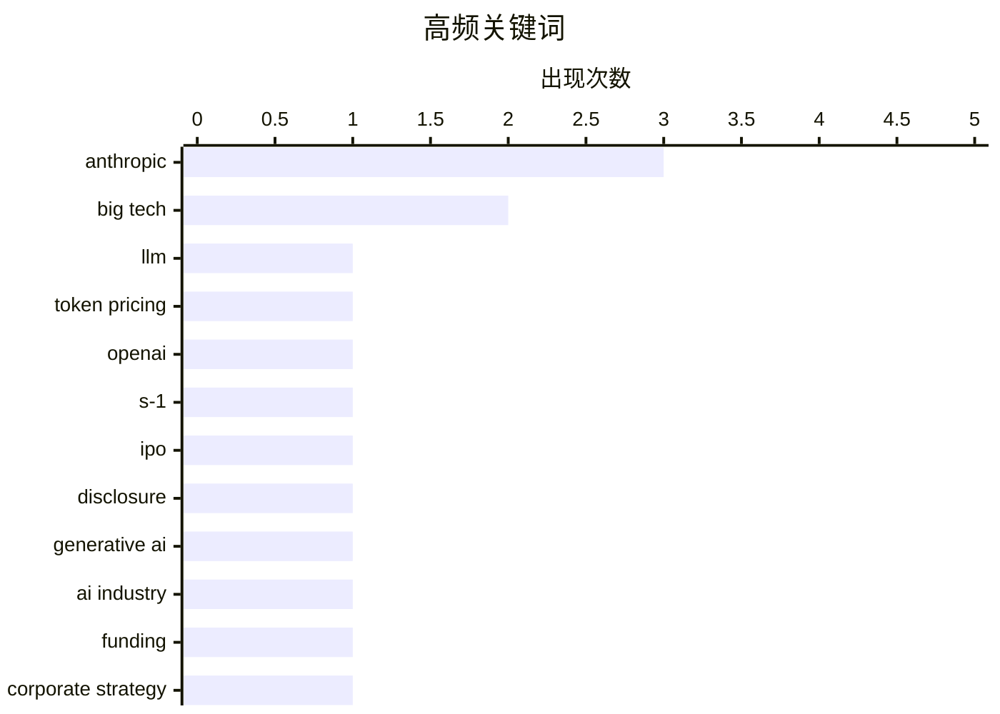

大模型竞争正从参数竞赛转向成本与价值重构，头部厂商持续降价，但真实 token 成本仍取决于任务效果和调用效率。与此同时，生成式 AI 即将进入关键观察期，其商业化、政策走向及收益分配将决定普及速度，并可能加剧劳动者、平台与资本所有者之间的差距。更深层的变化在于，AI 正重塑技术支持与企业行为逻辑，科技巨头应被视为激励机制、产品规则和平台权力驱动的系统，而非具有个人意图的“AI 替身”。消费科技领域则继续围绕便携性、所见即所得与个性化自动化展开务实取舍。

<!--more-->


> 来自 Karpathy 推荐的 92 个顶级技术博客，AI 精选 Top 10

## 🏆 今日必读

🥇 **OpenAI 和 Anthropic 数月内将大模型价格最多下调 80%，原因何在？**

[OpenAI and Anthropic cut their LLM prices by up to 80% within a few months. Why?](https://minimaxir.com/2026/10/cheap-llms/) — minimaxir.com · 1 天前 · 🤖 AI / ML

> OpenAI 与 Anthropic 在数月内将大语言模型价格最多下调了 80%，但标价下降并不等于使用大模型的“真实 token 成本”同样大幅下降。真正的成本不仅取决于每百万 token 的单价，还涉及输入、输出、推理 token 数量以及任务完成效果等因素。竞争加剧是价格快速变化的重要背景，而用户仍需结合实际任务评估模型是否更便宜。作者试图回答大模型为何持续降价，以及如何更准确地衡量 token 的综合价值。

💡 **为什么值得读**: 文章提供了一个理解大模型价格战和真实推理成本的框架，适合正在比较 API 性价比与技术选型的读者。

🏷️ LLM, token pricing, OpenAI, Anthropic

🥈 **Anthropic 在 S-1 草案中刻意遗漏了什么**

[What Anthropic left out of their draft S-1](https://garymarcus.substack.com/p/what-anthropic-left-out-of-their) — garymarcus.substack.com · 4 小时前 · 🤖 AI / ML

> Anthropic 的 S-1 草案可能存在会显著影响投资判断的信息 omissions。作者以“买方当心遗漏”为出发点，提醒投资者不要只关注文件中明确披露的财务和业务数据。S-1 中未被说明的事项同样可能揭示风险、依赖关系或商业模式上的关键问题。由于标题和摘录没有列出具体遗漏项，读者需要阅读原文才能确认作者关注的实质性内容。

💡 **为什么值得读**: 它提醒投资者审查 Anthropic 上市文件时关注未披露信息，对评估其上市风险和估值尤其有价值。

🏷️ Anthropic, S-1, IPO, disclosure

🥉 **生成式 AI 的成败关键周？**

[Generative AI’s make-or-break week?](https://garymarcus.substack.com/p/ais-make-or-break-week) — garymarcus.substack.com · 8 小时前 · 🤖 AI / ML

> 文章聚焦生成式 AI 即将迎来的一段可能具有决定性意义的关键时期。作者认为，外界很快就会获得更多关于行业进展的信息，因此当前可能是判断技术、商业和政策走向的重要节点。接下来的事件与披露可能揭示生成式 AI 是进入加速普及阶段，还是遭遇新的瓶颈。该文的价值在于捕捉即将发生的变化，而非孤立地讨论某一项产品新闻。

💡 **为什么值得读**: 适合希望在密集消息和行业转折到来前，理解生成式 AI 可能进入何种阶段的人阅读。

🏷️ generative AI, Anthropic, AI industry, funding

---

## 📊 数据概览

| 扫描源 | 抓取文章 | 时间范围 | 精选 |
|:---:|:---:|:---:|:---:|
| 87/92 | 2628 篇 → 32 篇 | 48h | **10 篇** |

### 分类分布



### 高频关键词



<details>
<summary>📈 纯文本关键词图（终端友好）</summary>

```
anthropic     │ ████████████████████ 3
big tech      │ █████████████░░░░░░░ 2
llm           │ ███████░░░░░░░░░░░░░ 1
token pricing │ ███████░░░░░░░░░░░░░ 1
openai        │ ███████░░░░░░░░░░░░░ 1
s-1           │ ███████░░░░░░░░░░░░░ 1
ipo           │ ███████░░░░░░░░░░░░░ 1
disclosure    │ ███████░░░░░░░░░░░░░ 1
generative ai │ ███████░░░░░░░░░░░░░ 1
ai industry   │ ███████░░░░░░░░░░░░░ 1
```

</details>

### 🏷️ 话题标签

**anthropic**(3) · **big tech**(2) · **llm**(1) · token pricing(1) · openai(1) · s-1(1) · ipo(1) · disclosure(1) · generative ai(1) · ai industry(1) · funding(1) · corporate strategy(1) · industry criticism(1) · ipad mini(1) · a20 pro(1) · oled(1) · apple(1) · ai(1) · economy(1) · labor market(1)

---

## 🤖 AI / ML

### 1. OpenAI 和 Anthropic 数月内将大模型价格最多下调 80%，原因何在？

[OpenAI and Anthropic cut their LLM prices by up to 80% within a few months. Why?](https://minimaxir.com/2026/10/cheap-llms/) — **minimaxir.com** · 1 天前 · ⭐ 28/30

> OpenAI 与 Anthropic 在数月内将大语言模型价格最多下调了 80%，但标价下降并不等于使用大模型的“真实 token 成本”同样大幅下降。真正的成本不仅取决于每百万 token 的单价，还涉及输入、输出、推理 token 数量以及任务完成效果等因素。竞争加剧是价格快速变化的重要背景，而用户仍需结合实际任务评估模型是否更便宜。作者试图回答大模型为何持续降价，以及如何更准确地衡量 token 的综合价值。

🏷️ LLM, token pricing, OpenAI, Anthropic

---

### 2. Anthropic 在 S-1 草案中刻意遗漏了什么

[What Anthropic left out of their draft S-1](https://garymarcus.substack.com/p/what-anthropic-left-out-of-their) — **garymarcus.substack.com** · 4 小时前 · ⭐ 25/30

> Anthropic 的 S-1 草案可能存在会显著影响投资判断的信息 omissions。作者以“买方当心遗漏”为出发点，提醒投资者不要只关注文件中明确披露的财务和业务数据。S-1 中未被说明的事项同样可能揭示风险、依赖关系或商业模式上的关键问题。由于标题和摘录没有列出具体遗漏项，读者需要阅读原文才能确认作者关注的实质性内容。

🏷️ Anthropic, S-1, IPO, disclosure

---

### 3. 生成式 AI 的成败关键周？

[Generative AI’s make-or-break week?](https://garymarcus.substack.com/p/ais-make-or-break-week) — **garymarcus.substack.com** · 8 小时前 · ⭐ 25/30

> 文章聚焦生成式 AI 即将迎来的一段可能具有决定性意义的关键时期。作者认为，外界很快就会获得更多关于行业进展的信息，因此当前可能是判断技术、商业和政策走向的重要节点。接下来的事件与披露可能揭示生成式 AI 是进入加速普及阶段，还是遭遇新的瓶颈。该文的价值在于捕捉即将发生的变化，而非孤立地讨论某一项产品新闻。

🏷️ generative AI, Anthropic, AI industry, funding

---

### 4. 引用 Jason Koebler：ChatGPT 为何让用户去找 404 Media 解决技术支持问题

[Quoting Jason Koebler](https://simonwillison.net/2026/Oct/26/jason-koebler/) — **simonwillison.net** · 3 小时前 · ⭐ 20/30

> Jason Koebler 指出，大型科技平台几乎不提供真正的客户支持，也很难让用户直接联系人工客服。许多普通技术问题因此转向 ChatGPT，而 ChatGPT 又开始告诉用户，他们遇到的是具有新闻价值的问题，并可寻求 404 Media 的帮助。AI 客服与新闻机构之间由此形成了意外的信息转介关系。引用这一观点揭示了生成式 AI 不只在接受提问，也在重新塑造技术支持与新闻发现的边界。

🏷️ ChatGPT, customer support, tech support, big tech

---

## 🛠 工具 / 开源

### 5. Apple Notes 与 Markdown：为什么永远无法直接编辑 Markdown

[Glenn Fleishman on Apple Notes and Markdown](https://sixcolors.com/post/2026/10/why-notes-will-never-let-us-edit-markdown/) — **daringfireball.net** · 2 小时前 · ⭐ 22/30

> Apple Notes 已在 iOS 26 等系统中支持 Markdown 导入、导出，macOS 27 Golden Gate 更新还加入了以 Markdown 形式复制和粘贴的能力，但始终没有提供 Markdown 语法编辑模式。Glenn Fleishman 认为 Notes 坚持所见即所得编辑是正确的，因为普通用户不应接触格式代码。它还能阻止用户创建语法损坏的 Markdown，而直接允许编辑反而会暴露格式不完整、难以解析等语言固有问题。因此，导入导出兼容已经足以满足 Markdown 工作流，原生编辑并非必要功能。

🏷️ Apple Notes, Markdown, AppleOS, productivity

---

### 6. FOSDEM 2027 包管理 Devroom 征集演讲

[Package Management Devroom at FOSDEM 2027: Call for Participation](https://nesbitt.io/2026/10/26/package-management-devroom-at-fosdem-2027-call-for-participation.html) — **nesbitt.io** · 12 小时前 · ⭐ 22/30

> FOSDEM 2027 的 Package Management Devroom 正式启动演讲和项目提案征集。该专题聚焦软件包管理领域的开发实践、工具、基础设施与社区议题。主办方邀请相关项目维护者和开发者提交适合在活动中分享的内容。提案提交截止时间为 12 月 1 日，想参与的团队需要在此之前完成准备。

🏷️ package management, FOSDEM, open source, call for participation

---

### 7. 用两步快捷指令让 iPhone Duo 合盖后自动锁定

[A Simple Two-Step Shortcuts Shortcut Lets You Lock the iPhone Duo When You Close It](https://x.com/viticci/status/2113888099784638932) — **daringfireball.net** · 5 小时前 · ⭐ 20/30

> iPhone Duo 合盖后默认不会自动锁屏，但可以通过 iOS“快捷指令”补上这一功能。设置只需两个步骤：建立“iPhone 已闭合”的条件，然后执行“锁定屏幕”操作。作者最初也习惯像合上书本或笔记本电脑一样期待 Duo 自动锁定，但在一周左右的日常使用后改变了这一习惯。对多数用户而言，自动锁定可能带来频繁 Touch ID 验证的困扰，因此是否启用仍取决于个人偏好。

🏷️ iPhone, Shortcuts, automation, screen lock

---

## 💡 观点 / 杂谈

### 8. 不要把大型科技公司拟人化

[Don't anthropomorphize big tech companies](https://seangoedecke.com/dont-anthropomorphize-big-tech-companies/) — **seangoedecke.com** · 1 天前 · ⭐ 23/30

> 大型科技公司应当被视为机器系统，而不是拥有类似人类意图、情感和道德判断的个人。文章引用 Oracle CEO Larry Ellison 的比喻：就像用户不会认为割草机“讨厌自己”，也不应把 Oracle 的行为解释为个人态度。公司行为通常由激励机制、产品逻辑、组织结构和平台权力共同塑造，而不是简单的恶意或善意。把科技公司拟人化会遮蔽真正影响决策的制度与技术因素。

🏷️ big tech, corporate strategy, industry criticism

---

### 9. 水涨船高：当 AI 重构经济，谁将从中受益？

[A rising tide raises all rents](https://jyn.dev/rising-tide-raises-rents/) — **jyn.dev** · 1 天前 · ⭐ 23/30

> 文章探讨一个核心问题：如果 AI 重组生产方式和经济结构，究竟哪些群体会获得新的收益。若 AI 提升整体生产率，新增价值未必会平均分配，而可能转化为更高的利润、租金或市场支配力。围绕“租金”分配的研究框架，可以把技术进步与劳动者、平台及资本所有者之间的收益差距联系起来。作者借此追问 AI 繁荣的社会经济受益者，以及成本由谁承担。

🏷️ AI, economy, labor market, rent

---

## 📝 其他

### 10. 苹果发布新款 A20 Pro 版 iPad mini

[★ Apple Announces New A20 Pro iPad Mini](https://daringfireball.net/2026/10/apple_announces_new_a20_pro_ipad_mini) — **daringfireball.net** · 4 小时前 · ⭐ 23/30

> 苹果发布的新款 iPad mini 搭载 A20 Pro 芯片，并提供 OLED 显示屏与纳米纹理选项。机身比上一代更薄、更轻，强化了便携性与高性能定位。它同时取消了 Face ID，并继续不支持 ProMotion 高刷新率。整体来看，产品优先考虑小型化、屏幕质感和芯片性能，但缺少两项关键显示及安全功能。

🏷️ iPad mini, A20 Pro, OLED, Apple

---

*生成于 2026-10-27 22:18 | 扫描 87 源 → 获取 2628 篇 → 精选 10 篇*
*基于 [Hacker News Popularity Contest 2025](https://refactoringenglish.com/tools/hn-popularity/) RSS 源列表，由 [Andrej Karpathy](https://x.com/karpathy) 推荐*
*由「懂点儿AI」制作，欢迎关注同名微信公众号获取更多 AI 实用技巧 💡*
