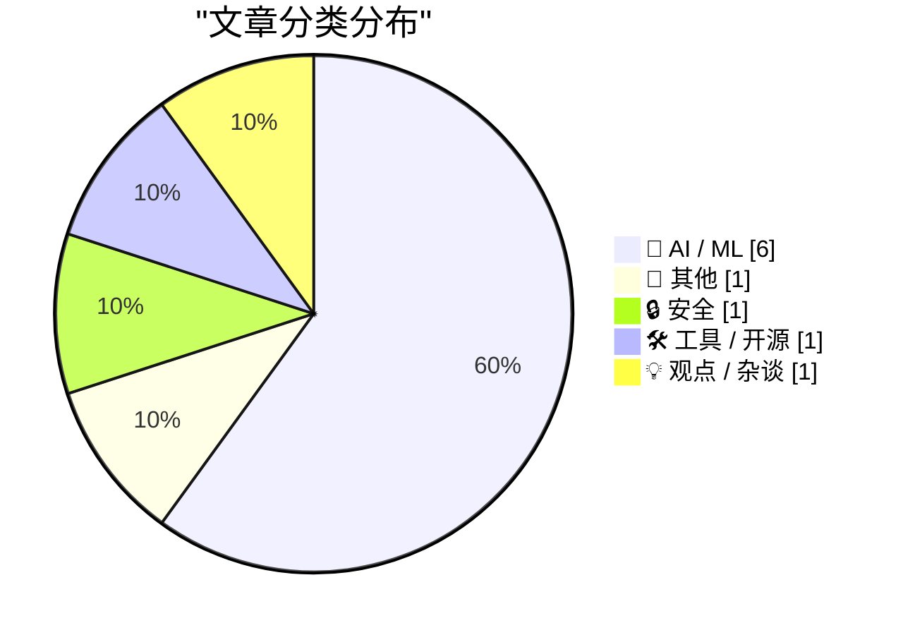
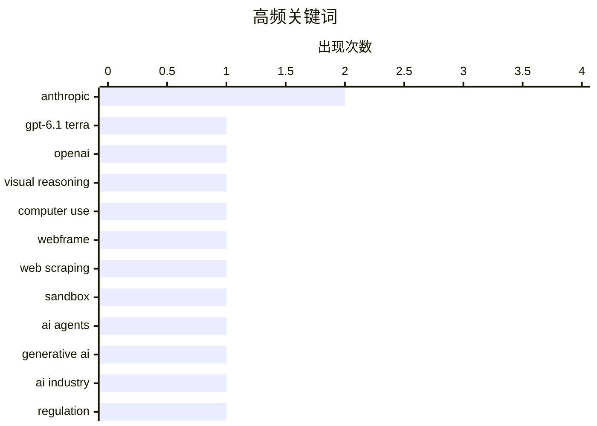

生成式 AI 正从参数竞赛转向能力与成本的精细权衡，视觉理解、计算机操作和日常办公成为模型升级的新焦点。与此同时，AI 正加速融入创意软件与终端设备，创作流程、移动办公及软硬件协同迎来新一轮产品竞赛。行业也面临更严格的审视：重大漏洞影响仍需可靠证据验证，模型评价不应被片面叙事误导，而数据授权与披露完整性正成为商业化不可回避的红线。

<!--more-->


> 来自 Karpathy 推荐的 92 个顶级技术博客，AI 精选 Top 10

## 🏆 今日必读

🥇 **GPT-6.1 Terra**

[GPT-6.1 Terra](https://simonwillison.net/2026/Oct/26/gpt-61-terra/) — simonwillison.net · 22 小时前 · 🤖 AI / ML

> OpenAI 发布 GPT-6.1 Terra，将重点放在精细视觉推理、精确的计算机操作以及更自然清晰的写作上。相比上一代 GPT-5.6 Terra，新模型面向起草提案、解读技术图纸、填写表单和剪辑视频等日常工作场景进一步提升效率与准确性。Terra 属于并非最低价也非最高价的中间档模型，定位与 Anthropic 的 Sonnet 类似，因此实际选型时需要权衡成本和能力。计算机操作尤其适合较低成本模型处理大量常规任务，这使模型定位与任务经济性成为值得关注的核心。

💡 **为什么值得读**: 这篇文章不只是罗列发布信息，还通过与 GPT-5.6 Terra、Anthropic Sonnet 的对照，帮助读者判断视觉推理和计算机操作任务应该选择哪一档模型。

🏷️ GPT-6.1 Terra, OpenAI, visual reasoning, computer use

🥈 **webframe：作为网页抓取器和沙盒的评估**

[webframe: evaluated as a scraper and a sandbox](https://simonwillison.net/2026/Oct/26/webframe-evaluation/) — simonwillison.net · 1 天前 · 🤖 AI / ML

> webframe 是 Jeff Lindsay 开发的一个轻量级工具，可像运行程序一样执行网页：输入 URL 或文件路径后，它会在隐藏的无头网页视图中运行，并把 console.log() 输出到标准输出、将异常输出到标准错误。它使用 Go 编写并依赖 glaze 库，能够调用 macOS 的 WKWebView、Linux 的 WebKitGTK 和 Windows 的 WebView2，而无需捆绑自己的浏览器引擎。相比依赖 Playwright 的 shot-scraper javascript，webframe 的体量更小、实现更紧凑，兼具网页抓取、浏览器自动化和隔离执行沙盒等用途。

💡 **为什么值得读**: 对于需要把网页当作程序执行或搭建轻量级浏览器自动化流程的开发者，这是一个无需自行维护浏览器引擎、且比 Playwright 方案更精简的实用选择。

🏷️ webframe, web scraping, sandbox, AI agents

🥉 **生成式 AI 的成败关键周？**

[Generative AI’s make-or-break week?](https://garymarcus.substack.com/p/ais-make-or-break-week) — garymarcus.substack.com · 1 天前 · 🤖 AI / ML

> 文章把当前阶段视为观察生成式 AI 能否经受关键考验的重要时间窗口。其核心关注点是外部事件究竟会证明生成式 AI 已具备实际价值，还是暴露其局限与风险。现阶段节选没有列出具体案例、指标或结论，而是预告后续可能会获得更多信息。整体上，这是一种基于即将发生的事件来判断行业走向的观察框架。

💡 **为什么值得读**: 它适合希望在密集新闻和行业信号中判断生成式 AI 拐点的读者，但当前节选信息有限，需结合正文才能了解作者的具体依据。

🏷️ generative AI, Anthropic, AI industry, regulation

---

## 📊 数据概览

| 扫描源 | 抓取文章 | 时间范围 | 精选 |
|:---:|:---:|:---:|:---:|
| 86/92 | 2603 篇 → 37 篇 | 48h | **10 篇** |

### 分类分布



### 高频关键词



<details>
<summary>📈 纯文本关键词图（终端友好）</summary>

```
anthropic        │ ████████████████████ 2
gpt-6.1 terra    │ ██████████░░░░░░░░░░ 1
openai           │ ██████████░░░░░░░░░░ 1
visual reasoning │ ██████████░░░░░░░░░░ 1
computer use     │ ██████████░░░░░░░░░░ 1
webframe         │ ██████████░░░░░░░░░░ 1
web scraping     │ ██████████░░░░░░░░░░ 1
sandbox          │ ██████████░░░░░░░░░░ 1
ai agents        │ ██████████░░░░░░░░░░ 1
generative ai    │ ██████████░░░░░░░░░░ 1
```

</details>

### 🏷️ 话题标签

**anthropic**(2) · **gpt-6.1 terra**(1) · **openai**(1) · visual reasoning(1) · computer use(1) · webframe(1) · web scraping(1) · sandbox(1) · ai agents(1) · generative ai(1) · ai industry(1) · regulation(1) · apple creator studio(1) · ai features(1) · keynote(1) · json(1) · macbook pro(1) · oled(1) · touch display(1) · m5 pro(1)

---

## 🤖 AI / ML

### 1. GPT-6.1 Terra

[GPT-6.1 Terra](https://simonwillison.net/2026/Oct/26/gpt-61-terra/) — **simonwillison.net** · 22 小时前 · ⭐ 28/30

> OpenAI 发布 GPT-6.1 Terra，将重点放在精细视觉推理、精确的计算机操作以及更自然清晰的写作上。相比上一代 GPT-5.6 Terra，新模型面向起草提案、解读技术图纸、填写表单和剪辑视频等日常工作场景进一步提升效率与准确性。Terra 属于并非最低价也非最高价的中间档模型，定位与 Anthropic 的 Sonnet 类似，因此实际选型时需要权衡成本和能力。计算机操作尤其适合较低成本模型处理大量常规任务，这使模型定位与任务经济性成为值得关注的核心。

🏷️ GPT-6.1 Terra, OpenAI, visual reasoning, computer use

---

### 2. webframe：作为网页抓取器和沙盒的评估

[webframe: evaluated as a scraper and a sandbox](https://simonwillison.net/2026/Oct/26/webframe-evaluation/) — **simonwillison.net** · 1 天前 · ⭐ 25/30

> webframe 是 Jeff Lindsay 开发的一个轻量级工具，可像运行程序一样执行网页：输入 URL 或文件路径后，它会在隐藏的无头网页视图中运行，并把 console.log() 输出到标准输出、将异常输出到标准错误。它使用 Go 编写并依赖 glaze 库，能够调用 macOS 的 WKWebView、Linux 的 WebKitGTK 和 Windows 的 WebView2，而无需捆绑自己的浏览器引擎。相比依赖 Playwright 的 shot-scraper javascript，webframe 的体量更小、实现更紧凑，兼具网页抓取、浏览器自动化和隔离执行沙盒等用途。

🏷️ webframe, web scraping, sandbox, AI agents

---

### 3. 生成式 AI 的成败关键周？

[Generative AI’s make-or-break week?](https://garymarcus.substack.com/p/ais-make-or-break-week) — **garymarcus.substack.com** · 1 天前 · ⭐ 25/30

> 文章把当前阶段视为观察生成式 AI 能否经受关键考验的重要时间窗口。其核心关注点是外部事件究竟会证明生成式 AI 已具备实际价值，还是暴露其局限与风险。现阶段节选没有列出具体案例、指标或结论，而是预告后续可能会获得更多信息。整体上，这是一种基于即将发生的事件来判断行业走向的观察框架。

🏷️ generative AI, Anthropic, AI industry, regulation

---

### 4. Apple Creator Studio 增添多项 AI 功能，并为 Keynote 推出新的开放 JSON 文件格式

[Apple Creator Studio Updated With a Slew of AI Features, Along With a New Open JSON File Format for Keynote](https://www.apple.com/newsroom/2026/10/apple-creator-studio-adds-powerful-new-ai-features-and-even-more-creative-tools/) — **daringfireball.net** · 19 分钟前 · ⭐ 24/30

> Apple 为覆盖 Mac、iPad 和 iPhone 的 Creator Studio 创意应用套件推出一批新功能。Final Cut Pro for Mac 新增 MotionVFX，提供视觉特效、插件、转场、模板和动态图形工具，并支持与 Pixelmator Pro 无缝编辑；精选内容中心 Content Hub 也加入视频素材。Logic Pro for Mac 增加处于测试阶段的智能助手、增强版 Stem Splitter 和重新设计的浏览器，后者整合全部声音、音乐理解能力及 Splice 素材库。Pixelmator Pro 的 Generate Fill 可通过自然语言改写图像选区，而 Keynote、Pages 和 Numbers 同样开始测试新的 AI 辅助功能；Keynote 还获得了新的开放 JSON 文件格式。

🏷️ Apple Creator Studio, AI features, Keynote, JSON

---

### 5. 《纽约时报》似乎对 Marissa Mayer 很不客气

[The NYT Seemingly Does Marissa Mayer Dirty](https://www.nytimes.com/2026/10/25/style/marissa-mayer-ai-assistants-women.html?unlocked_article_code=1.L1E.xBwx.X_EjBGNsRNqr) — **daringfireball.net** · 21 小时前 · ⭐ 23/30

> 《纽约时报》在报道前 Yahoo CEO、Google 首位女性工程师 Marissa Mayer 及其 AI 创业公司 Dazzle 时，引用了她让个人 AI 助手总结女儿优点的故事。Dazzle 在几秒内给出“富有同理心、富有创造力且喜欢动物”的回答，这段轶事因显得不寻常而遭到社交媒体批评。评论者据此认为 Mayer 可能判断失准，文章作者则表示这段叙述既尖锐又可能误导读者。关键背景是 Mayer 本人随后在 X 上作出澄清，因此不能只凭被截取的家庭故事判断她的 AI 理念或 Dazzle 的实际能力。

🏷️ Marissa Mayer, AI startup, Dazzle

---

### 6. Anthropic 草拟 S-1 时没有披露的内容

[What Anthropic left out of their draft S-1](https://garymarcus.substack.com/p/what-anthropic-left-out-of-their) — **garymarcus.substack.com** · 1 天前 · ⭐ 23/30

> 文章聚焦 Anthropic 上市申请文件 S-1 草稿中的信息遗漏，而非只复述其中已经公开的内容。现有节选以“买家当心遗漏”为核心提醒，提示读者审查发行文件时不能只看表面披露。材料没有在节选中列出具体遗漏项目、涉及数据或财务指标，因此无法据此判断这些空白的影响程度。其主要价值在于提醒投资者和潜在买方核对风险因素、商业条件与公司陈述之间是否完整一致。

🏷️ Anthropic, S-1, AI safety, disclosure

---

## 📝 其他

### 7. “Pro and Tell”周还剩下什么：支持触控的 OLED MacBook

[What’s Left for ‘Pro and Tell’ Week: Touch-Enabled OLED MacBooks](https://www.macrumors.com/2026/10/27/macbook-pro-with-touchscreen-tomorrow/) — **daringfireball.net** · 4 小时前 · ⭐ 24/30

> 据 Bloomberg 的 Mark Gurman 报道，苹果将在周三发布 14 英寸和 16 英寸的触控 OLED MacBook Pro。新机预计采用更窄边框、灵动岛替代刘海，并提供更轻且略薄的设计。高端型号将搭载现有 M5 Pro 和 M5 Max 芯片，发布时间可能落在今年年底至明年初。苹果还将在洛杉矶太平洋时间上午 10 点举行为期一天的私有“Pro and Tell”体验活动。

🏷️ MacBook Pro, OLED, touch display, M5 Pro

---

## 🔒 安全

### 8. 每周更新 527：末日新闻与现实

[Weekly Update 527: Cybergeddon News v. Reality](https://www.troyhunt.com/weekly-update-527/) — **troyhunt.com** · 14 小时前 · ⭐ 24/30

> 随着上一周的新闻逐渐沉淀，之前所谓即将发生的网络末日并未成为现实。实际过程中没有出现摧毁互联网的大规模中断，所谓的 PHP2Shell 威胁也未引发预期中的灾难性后果。直到数天之后，才出现一则能够较可靠地把相关漏洞和事件追溯到 PHP2Shell 的报道。这一结果说明，围绕重大漏洞的早期预警和媒体报道可能存在夸大成分，最终影响仍需由可靠技术证据确认。

🏷️ PHP2Shell, cybersecurity, vulnerability, incident response

---

## 🛠 工具 / 开源

### 9. 苹果就 iPhone Duo 内屏开裂问题发表声明

[Apple Issues Statement on iPhone Duo’s Crack Problem](https://9to5mac.com/2026/10/26/apple-responds-to-reports-of-iphone-duos-inner-display-cracking/) — **daringfireball.net** · 22 小时前 · ⭐ 23/30

> 苹果确认，少量 iPhone Duo 的内层显示屏会出现开裂问题，并表示该现象出现得相对较快。多数 iPhone Duo 用户并未受到影响，苹果称早期用户反馈整体非常积极，开发者也在快速适配这一独特设备形态。出现问题的设备可直接联系 AppleCare 更换，不需要购买 AppleCare+。如果设备通过运营商渠道购买，用户仍应直接联系 AppleCare，而不是先找运营商处理。

🏷️ iPhone Duo, display cracking, Apple, hardware reliability

---

## 💡 观点 / 杂谈

### 10. 英寸与英里

[Inches & Miles](https://feed.tedium.co/link/15204/17507724/ai-startups-sketchy-behavior) — **tedium.co** · 8 小时前 · ⭐ 23/30

> 文章认为，AI 时代正在鼓励创业公司再次采取大胆冒险的做法，并把“数据可用”视为理所当然。争议的核心是，一些初创企业未经明确许可便使用用户数据，再围绕这些数据建立商业模式。这种做法把数据获取成本和用户同意问题包装成了创业过程中的默认前提。现有节选未提供具体公司、用户规模或案例细节，但明确提出了粗率取用数据这一批评方向。

🏷️ AI startups, data privacy, data usage, venture capital

---

*生成于 2026-10-28 22:19 | 扫描 86 源 → 获取 2603 篇 → 精选 10 篇*
*基于 [Hacker News Popularity Contest 2025](https://refactoringenglish.com/tools/hn-popularity/) RSS 源列表，由 [Andrej Karpathy](https://x.com/karpathy) 推荐*
*由「懂点儿AI」制作，欢迎关注同名微信公众号获取更多 AI 实用技巧 💡*
