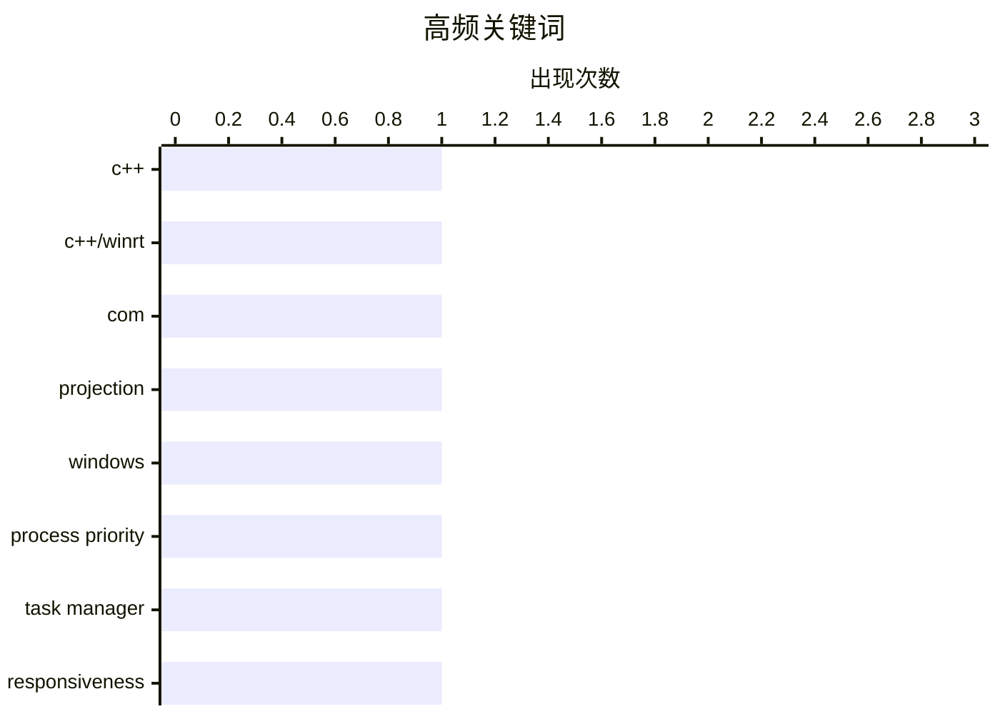

今日技术圈聚焦工程实践中的“少走弯路”：无论是 C++/WinRT 接口投影，还是系统调度设计，都强调避免不必要的转换、绕行与优先级滥用。性能优化并非简单抬高权限，系统响应性更依赖合理的资源分配与整体平衡。核心趋势是：以更直接、稳健的设计取代过度纠偏和局部强攻。

<!--more-->


> 来自 Karpathy 推荐的 92 个顶级技术博客，AI 精选 Top 2

## 📊 数据概览

| 扫描源 | 抓取文章 | 时间范围 | 精选 |
|:---:|:---:|:---:|:---:|
| 1/92 | 10 篇 → 2 篇 | 48h | **2 篇** |

### 分类分布


### 高频关键词



<details>
<summary>📈 纯文本关键词图（终端友好）</summary>

```
c++              │ ████████████████████ 1
c++/winrt        │ ████████████████████ 1
com              │ ████████████████████ 1
projection       │ ████████████████████ 1
windows          │ ████████████████████ 1
process priority │ ████████████████████ 1
task manager     │ ████████████████████ 1
responsiveness   │ ████████████████████ 1
```

</details>

### 🏷️ 话题标签

**c++**(1) · **c++/winrt**(1) · **com**(1) · projection(1) · windows(1) · process priority(1) · task manager(1) · responsiveness(1)

---

## ⚙️ 工程

### 1. C++/WinRT 的过度纠偏：使用 make_self 后立即转换为投影接口

[C++/WinRT overcorrection: Using make_self and immediately converting it to the projected interface](https://devblogs.microsoft.com/oldnewthing/20261028-00/?p=112803/) — **devblogs.microsoft.com/oldnewthing** · 8 小时前 · ⭐ 17/30

> C++/WinRT 中先调用 `make_self<Implementation>()` 创建实现对象，再立即转换为投影接口，是否是一种合适的写法，是这一话题的核心。`make_self` 返回指向具体 C++ 实现类的智能指针，适合在暴露给 ABI 之前访问实现类特有的成员。如果随后马上通过 `.as<ProjectedInterface>()` 等方式转换，额外的实现层访问已经没有实际价值，反而引入了不必要的接口查询和 ABI 转换步骤。对于只需要返回投影接口的场景，直接使用 `make<ProjectedInterface>` 工厂函数会更直接；只有在需要持有和操作具体实现对象时，才应使用 `make_self`。这种写法不会造成功能错误，但属于可以避免的绕路，也是对 `make_self` 使用场景的过度纠偏。

🏷️ C++, C++/WinRT, COM, projection

---

### 2. 为什么不将任务栏和任务管理器设为高优先级以保持响应？

[Why don’t we run the taskbar and Task Manager at high priority, so they can remain responsive?](https://devblogs.microsoft.com/oldnewthing/20261027-00/?p=112800/) — **devblogs.microsoft.com/oldnewthing** · 1 天前 · ⭐ 16/30

> 任务栏和任务管理器为什么不默认以高优先级运行，以及更高调度优先级能否真正改善界面响应，是文章讨论的核心。Windows 的线程调度会结合优先级类别、动态优先级调整和前台提升机制，高优先级并不意味着程序能够绕过阻塞等待、消息泵延迟或处理器被占满等问题。把任务栏或任务管理器长期设为高优先级，可能让它们在繁忙时抢占普通进程的计算时间，甚至造成低优先级任务饥饿，反而降低系统整体响应能力；实时优先级带来的风险更高。任务管理器可以临时调整其他进程的优先级，但自身保持正常优先级，正是为了避免影响关键系统工作。总体而言，保持正常优先级并利用 Windows 的交互式调度机制，比用高优先级换取局部响应更安全、均衡。

🏷️ Windows, process priority, Task Manager, responsiveness

---

*生成于 2026-10-29 22:18 | 扫描 1 源 → 获取 10 篇 → 精选 2 篇*
*基于 [Hacker News Popularity Contest 2025](https://refactoringenglish.com/tools/hn-popularity/) RSS 源列表，由 [Andrej Karpathy](https://x.com/karpathy) 推荐*
*由「懂点儿AI」制作，欢迎关注同名微信公众号获取更多 AI 实用技巧 💡*
