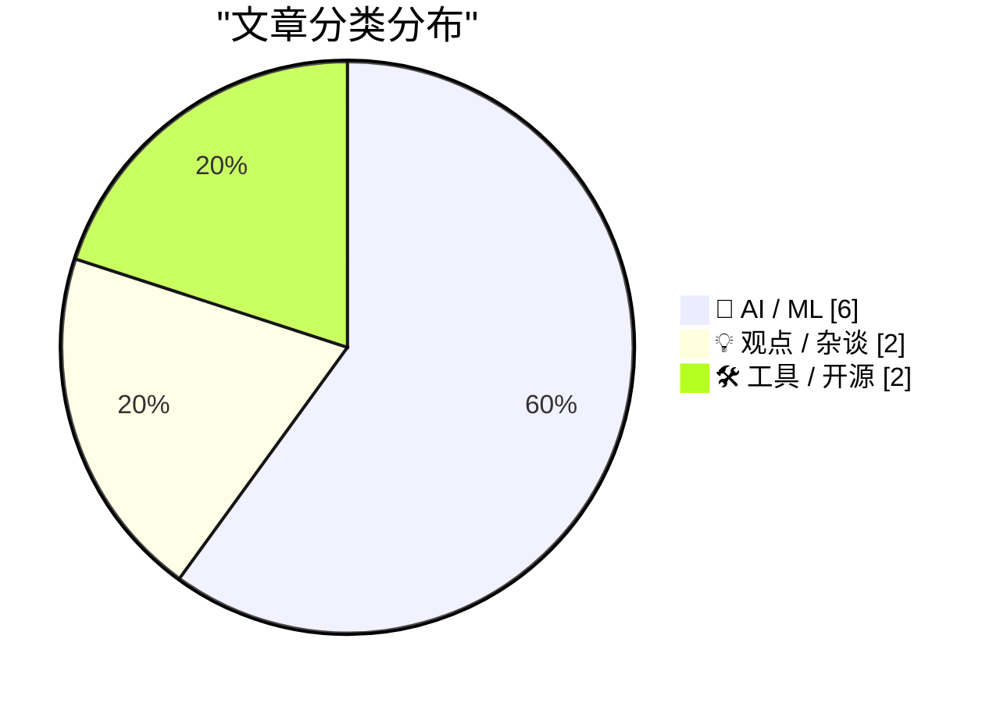
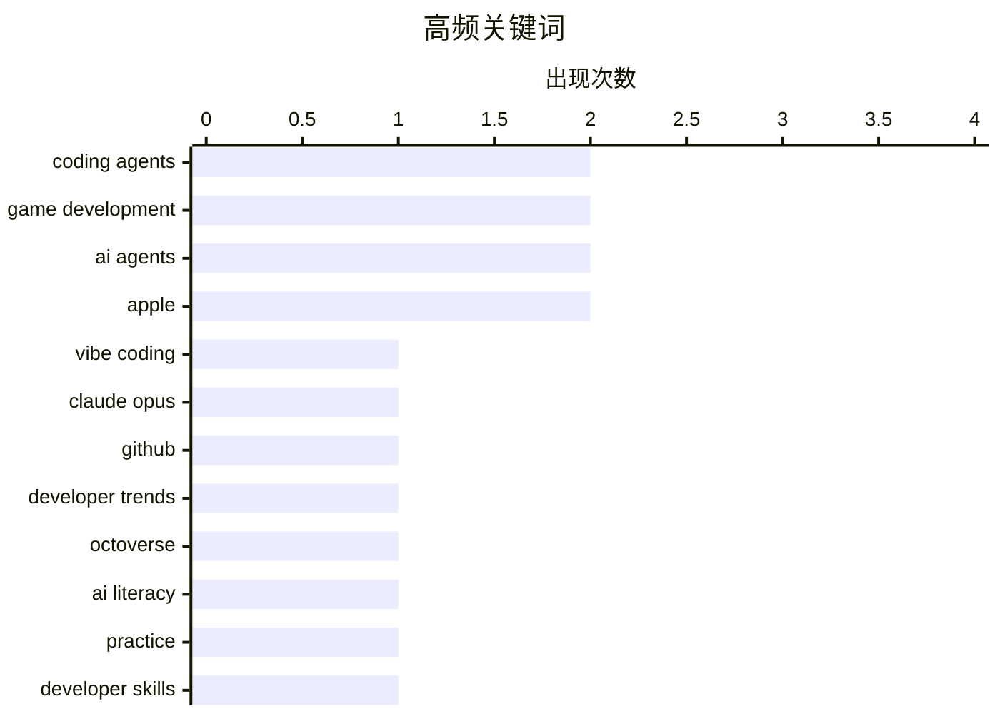

AI 智能体正跨过“辅助工具”阶段，从代码生成走向复杂游戏开发与软件生产全流程，GitHub 代码活动创新高进一步印证了这种规模化渗透。与此同时，智能体竞争已不只是模型能力比拼，执行延迟、工具调用、上下文管理和硬件优化成为决定落地效率的关键。随着应用加速普及，提示技巧会不断迭代，但长期练习、结果验证与工作流设计仍是人机协作能力差异的核心。AI 正持续重塑开发、游戏内容和系统交互方式，而苹果扩展 Siri 语言支持、为 Mac 引入触控补充，则显示这场体验变革正从模型层走向终端入口。

<!--more-->


> 来自 Karpathy 推荐的 92 个顶级技术博客，AI 精选 Top 10

## 🏆 今日必读

🥇 **“氛围编程”游戏开发的十月拐点**

[The October inflection point for vibe game development](https://simonwillison.net/2026/Oct/28/vibe-game-development/) — simonwillison.net · 1 天前 · 🤖 AI / ML

> 作者认为，2026 年 10 月成为“氛围编程”游戏开发的新拐点，类似于 2025 年 11 月 Opus 4.5 与 GPT-5.1 令编码智能体达到实用拐点时的突破。通过 Tree Appreciator、Emberwick、Battle Drones 和 Pumpkin Farmer 等案例，他展示了自然语言驱动的游戏创作方式。关键变化在于，开发者能够以提示词和智能体完成足够复杂、具备可玩性的游戏，而不再只是生成简单原型。结论是，AI 编码工具已跨过从概念验证到日常游戏开发工具的临界阶段。

💡 **为什么值得读**: 文章通过多个真实项目展示了 AI 游戏开发从实验性演示走向可实际使用的重要转折，适合关注生成式 AI、辅助编程和独立游戏开发的人快速了解这一趋势。

🏷️ coding agents, game development, vibe coding, Claude Opus

🥈 **GitHub Octoverse 2026**

[GitHub Octoverse 2026](https://simonwillison.net/2026/Oct/28/github-octoverse-2026/) — simonwillison.net · 1 天前 · 🤖 AI / ML

> GitHub Universe 大会上，GitHub EVP Jay Parikh 发布了 2026 年 Octoverse 报告，展示开发者活动与智能体编程的新规模。报告指出，GitHub 每月合并的 PR 已达到 2.20 亿个，每月产生 73.8 亿次提交，两项指标均创下新高。增长表明，代码正在以过去难以企及的频率被创建、修改和合并，智能体则进一步扩大了开发产能。这些数据反映出 AI 智能体已从辅助工具深度融入全球软件生产流程。

💡 **为什么值得读**: 2.20 亿个合并 PR 和 73.8 亿次月度提交提供了罕见的平台级量化证据，能帮助从业者判断智能体编程对软件工程规模和协作方式的实际影响。

🏷️ GitHub, coding agents, developer trends, Octoverse

🥉 **精通 AI 需要时间与练习**

[Getting good at AI takes time and practice](https://seangoedecke.com/getting-good-at-ai-takes-time-and-practice/) — seangoedecke.com · 1 天前 · 💡 观点 / 杂谈

> 文章反驳了“只要告诉模型想做什么，就自然会用 AI”的简单看法。随着模型升级，部分提示技巧会迅速过时，但有效使用 AI 仍然需要长期实践、持续尝试和判断力。真正的能力不只是掌握命令式技巧，还包括理解模型能力边界、验证输出，并将 AI 融入具体工作流程。作者的核心观点是，精通 AI 并无通用捷径，学习曲线和实践经验依然不可替代。

💡 **为什么值得读**: 这篇短文针对 AI 工具日新月异背景下最常见的技能幻觉进行了辨析，对希望建立稳定 AI 工作方法、而不是依赖短期技巧的读者很有参考价值。

🏷️ AI literacy, practice, developer skills, AI tooling

---

## 📊 数据概览

| 扫描源 | 抓取文章 | 时间范围 | 精选 |
|:---:|:---:|:---:|:---:|
| 87/92 | 2629 篇 → 33 篇 | 48h | **10 篇** |

### 分类分布



### 高频关键词



<details>
<summary>📈 纯文本关键词图（终端友好）</summary>

```
coding agents    │ ████████████████████ 2
game development │ ████████████████████ 2
ai agents        │ ████████████████████ 2
apple            │ ████████████████████ 2
vibe coding      │ ██████████░░░░░░░░░░ 1
claude opus      │ ██████████░░░░░░░░░░ 1
github           │ ██████████░░░░░░░░░░ 1
developer trends │ ██████████░░░░░░░░░░ 1
octoverse        │ ██████████░░░░░░░░░░ 1
ai literacy      │ ██████████░░░░░░░░░░ 1
```

</details>

### 🏷️ 话题标签

**coding agents**(2) · **game development**(2) · **ai agents**(2) · apple(2) · vibe coding(1) · claude opus(1) · github(1) · developer trends(1) · octoverse(1) · ai literacy(1) · practice(1) · developer skills(1) · ai tooling(1) · inference speed(1) · ttft(1) · sandboxing(1) · autonomous models(1) · simulation(1) · ai(1) · agency(1)

---

## 🤖 AI / ML

### 1. “氛围编程”游戏开发的十月拐点

[The October inflection point for vibe game development](https://simonwillison.net/2026/Oct/28/vibe-game-development/) — **simonwillison.net** · 1 天前 · ⭐ 28/30

> 作者认为，2026 年 10 月成为“氛围编程”游戏开发的新拐点，类似于 2025 年 11 月 Opus 4.5 与 GPT-5.1 令编码智能体达到实用拐点时的突破。通过 Tree Appreciator、Emberwick、Battle Drones 和 Pumpkin Farmer 等案例，他展示了自然语言驱动的游戏创作方式。关键变化在于，开发者能够以提示词和智能体完成足够复杂、具备可玩性的游戏，而不再只是生成简单原型。结论是，AI 编码工具已跨过从概念验证到日常游戏开发工具的临界阶段。

🏷️ coding agents, game development, vibe coding, Claude Opus

---

### 2. GitHub Octoverse 2026

[GitHub Octoverse 2026](https://simonwillison.net/2026/Oct/28/github-octoverse-2026/) — **simonwillison.net** · 1 天前 · ⭐ 27/30

> GitHub Universe 大会上，GitHub EVP Jay Parikh 发布了 2026 年 Octoverse 报告，展示开发者活动与智能体编程的新规模。报告指出，GitHub 每月合并的 PR 已达到 2.20 亿个，每月产生 73.8 亿次提交，两项指标均创下新高。增长表明，代码正在以过去难以企及的频率被创建、修改和合并，智能体则进一步扩大了开发产能。这些数据反映出 AI 智能体已从辅助工具深度融入全球软件生产流程。

🏷️ GitHub, coding agents, developer trends, Octoverse

---

### 3. 让智能体跑得更快：过去 12 个月的经验总结

[Making agents fast - what I've learnt over the last 12 months](https://martinalderson.com/posts/making-agents-fast/?utm_source=rss&amp;utm_medium=rss&amp;utm_campaign=feed) — **martinalderson.com** · 22 小时前 · ⭐ 26/30

> 文章总结了过去 12 个月提升 AI 智能体运行速度的实践经验，强调速度优化不能只依赖更快的模型。评估推理性能时，需要区分首 token 延迟（TTFT）与每秒生成 token 数（tok/s），分别衡量响应启动速度和持续吞吐量。通过工具调用轨迹可以定位耗时步骤，并据此构建智能体真正愿意调用的工具与接口。硬件配置、上下文管理和沙箱隔离同样影响实际性能，最终目标应是让整个智能体执行链路更高效。

🏷️ AI agents, inference speed, TTFT, sandboxing

---

### 4. 使用自主的 Fable 级模型构建多人游戏世界

[Building a multiplayer game world with autonomous Fable-class models](https://simonwillison.net/2026/Oct/29/how-i-built-the-most-ai-pilled-company-in-the-world/) — **simonwillison.net** · 5 小时前 · ⭐ 25/30

> 文章介绍了 Jacob Sansbury 团队如何使用被称为 Fable 级的自主模型构建 Spawn——一个允许玩家通过提示词修改游戏世界的大型多人游戏环境。游戏内智能体 Savi 能理解自然语言指令，并将需求转化为世界中的对象、场景和动作。作者实际体验后让系统依次生成一座城堡、一条龙，并骑龙在城堡上空飞行，展示了模型与游戏引擎结合后的即时创造能力。案例表明，前沿模型驱动的智能体工程正在探索传统游戏开发流程之外的新型交互与内容生成方式。

🏷️ AI agents, game development, autonomous models, simulation

---

### 5. Siri AI 在 OS 27.2 中扩展至更多语言

[Siri AI Expands to More Languages in OS 27.2](https://nr.apple.com/Du9G9W8Nq1) — **daringfireball.net** · 1 天前 · ⭐ 24/30

> 苹果通过 OS 27.2 软件更新扩大了新版 Siri AI 的可用范围，新增支持法语、日语、韩语、葡萄牙语和西班牙语。新版 Siri 被定位为能力更强、更加对话化且更具个性化的系统服务。不过，Siri AI 目前仍无法在欧盟地区的 iOS、iPadOS 和 watchOS 上使用。苹果表示正与欧盟方面积极沟通，以寻找推进上线合规问题的路径，但文章并未给出明确的欧盟开放时间表。

🏷️ Siri, Apple, language support, voice assistant

---

### 6. 使用 Qwen3-TTS 创建自定义语音

[Custom Voices With Qwen3-TTS](https://lucumr.pocoo.org/2026/10/29/qwen3-custom-voices/) — **lucumr.pocoo.org** · 22 小时前 · ⭐ 24/30

> 作者在和孩子制作地牢爬行游戏时，希望为旁白和角色配音，但不愿使用千篇一律的标准 AI 声音。团队最初选择 Kokoro，之后转向支持通过语音嵌入克隆和定制声音的 Qwen3-TTS，以获得更独特的声音效果。实践显示，Qwen3-TTS 的自定义语音能力比最初预期更复杂，需要进一步理解模型提供的不同生成方式和使用技巧。只要掌握声音嵌入与参数配置，它便能用于旁白、角色语音等实际游戏场景。

🏷️ Qwen3-TTS, text-to-speech, custom voices, voice cloning

---

## 💡 观点 / 杂谈

### 7. 精通 AI 需要时间与练习

[Getting good at AI takes time and practice](https://seangoedecke.com/getting-good-at-ai-takes-time-and-practice/) — **seangoedecke.com** · 1 天前 · ⭐ 26/30

> 文章反驳了“只要告诉模型想做什么，就自然会用 AI”的简单看法。随着模型升级，部分提示技巧会迅速过时，但有效使用 AI 仍然需要长期实践、持续尝试和判断力。真正的能力不只是掌握命令式技巧，还包括理解模型能力边界、验证输出，并将 AI 融入具体工作流程。作者的核心观点是，精通 AI 并无通用捷径，学习曲线和实践经验依然不可替代。

🏷️ AI literacy, practice, developer skills, AI tooling

---

### 8. 你只需让 AI 替你做事

[You can just ask AI to do things](https://seangoedecke.com/you-can-just-ask-ai-to-do-things/) — **seangoedecke.com** · 22 小时前 · ⭐ 25/30

> 作者把使用 AI 的关键能力概括为“能动性”，即主动尝试新工具、雄心勃勃的任务以及新的工作方式。日常开发中，他经常让智能体启动开发服务器、处理复杂的开发环境问题，而不是亲自运行 Bash 命令。智能体速度快、耐心无限且知识面广，尤其适合排查异常环境和重复执行底层操作。许多人的真正瓶颈并非模型能力，而是尚未意识到这些任务可以交给 AI 自动化。

🏷️ AI, agency, productivity, developer workflow

---

## 🛠 工具 / 开源

### 9. 带触控屏的新款 MacBook Pro：Steven Levy 谈这一转身

[Steven Levy on the New MacBook Pro, With, Yes, a Touchscreen](https://www.wired.com/story/the-inside-story-of-why-apple-finally-brought-a-touch-display-to-the-mac/) — **daringfireball.net** · 18 小时前 · ⭐ 24/30

> Steven Levy 披露了苹果新款 MacBook Pro 引入触控屏的幕后决策，以及苹果如何避免这项变化破坏 Mac 延续 42 年的交互传统。负责相关设计的 John Ternus 表示，Mac 仍以键盘和触控板为主要输入方式，触控只是某些场景下更舒适、便捷的补充。为实现这一目标，新机同时采用苹果眼中最好的 Mac OLED 显示屏，并确保触控功能没有增加机身重量或厚度。Levy 在长时间上手和演示后认为，触控屏对 macOS 界面造成的负面影响基本都已消除，并表示自己很喜欢这一设计。

🏷️ MacBook Pro, touchscreen, Apple, OLED

---

### 10. 本周源码动态：2026 年 10 月 28 日

[This Week in Source Control: 28 October 2026](https://nesbitt.io/2026/10/28/this-week-in-source-control.html) — **nesbitt.io** · 1 天前 · ⭐ 24/30

> 这是一期围绕版本控制系统与代码托管平台生态的每周资讯汇总，覆盖 2026 年 10 月 28 日前后的相关动态。内容主要整理各项目的新版本发布、安全公告、社区文章以及值得关注的工具变化。它以跨项目和平台的快讯形式，帮助开发者掌握源码管理领域正在发生的更新。整体定位更偏向生态雷达，而不是围绕某一项技术展开深入教程。

🏷️ source control, Git, forges, release security

---

*生成于 2026-10-30 22:18 | 扫描 87 源 → 获取 2629 篇 → 精选 10 篇*
*基于 [Hacker News Popularity Contest 2025](https://refactoringenglish.com/tools/hn-popularity/) RSS 源列表，由 [Andrej Karpathy](https://x.com/karpathy) 推荐*
*由「懂点儿AI」制作，欢迎关注同名微信公众号获取更多 AI 实用技巧 💡*
