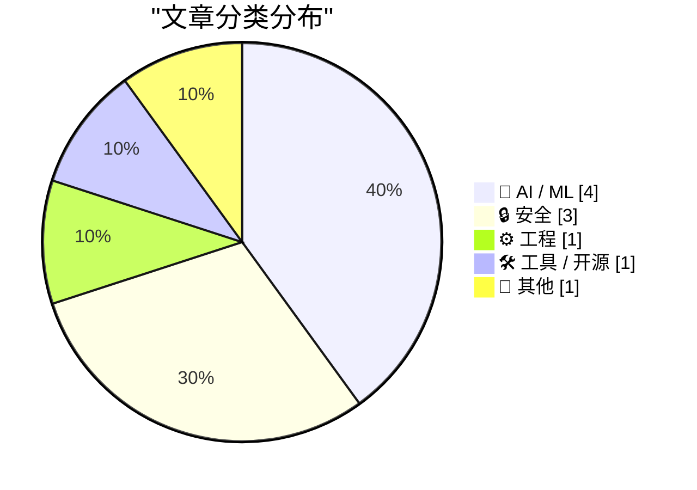
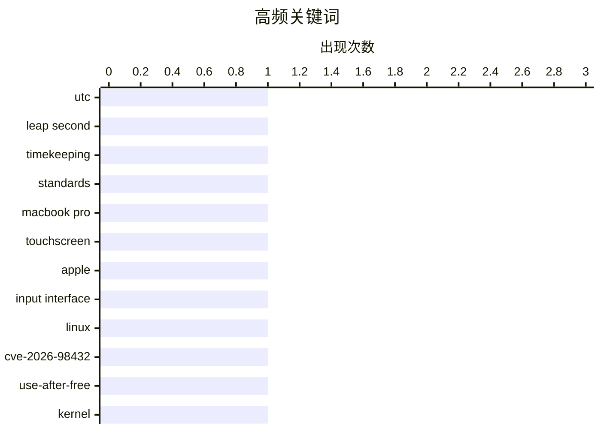

今日技术圈的主线是基础标准更新、平台治理收紧与 AI 智能体加速落地。闰秒退出宣告 UTC 迈入更简洁的新阶段，而软件包签名、可信发布及高额隐私和解，则凸显安全与数据责任正成为平台不可回避的经营成本。与此同时，AI 热点已从单纯追逐模型能力转向工程效率、声音定制和真实交互体验，API 补贴与游戏智能体实践进一步显示，智能体生态正加速商业化。整体而言，技术竞争正在从“能不能做”转向“能否高效、安全且可信地普及”。

<!--more-->


> 来自 Karpathy 推荐的 92 个顶级技术博客，AI 精选 Top 10

## 🏆 今日必读

🥇 **欢呼吧，闰秒死了！**

[Rejoice, leap seconds are dead!](https://www.jeffgeerling.com/blog/2026/rejoice-the-utc-leap-second-is-dead/) — jeffgeerling.com · 8 小时前 · ⚙️ 工程

> CGPM 通过第 5 号决议，宣布协调世界时（UTC）最后一个闰秒已经成为历史，未来将不再引入闰秒。这意味着 UTC 不再通过额外插入一秒来协调地球自转与原子时之间的偏差。此举消除了闰秒给时间同步、协议实现和软件更新带来的长期不确定性。作者以庆祝口吻解读这项决议，认为告别闰秒是 UTC 现代化进程中的好消息。

💡 **为什么值得读**: 文章用一个明确的时间标准决策，解释了闰秒机制即将退出历史舞台及其对全球时间系统的影响。

🏷️ UTC, leap second, timekeeping, standards

🥈 **史蒂文·莱维：新款 MacBook Pro 终于加入触控屏**

[Steven Levy on the New MacBook Pro, With, Yes, a Touchscreen](https://www.wired.com/story/the-inside-story-of-why-apple-finally-brought-a-touch-display-to-the-mac/) — daringfireball.net · 1 天前 · 🛠 工具 / 开源

> 新款 MacBook Pro 在保留触控板和键盘这一核心交互方式的同时加入了触控屏，Apple 试图证明触控能力不会破坏 Mac 的产品传统。设计负责人 Jonathan Ternus 表示，触控屏与 OLED 显示屏是同步完成的，新增功能没有让设备变得更重或更厚。Steven Levy 经过上手体验和演示后表示，触控功能对 Mac 界面造成的担忧均已消失，并对这种交互方式表示喜爱。文章的核心观点是，Apple 终于找到了不以牺牲便携性和既有 Mac 使用体验为代价的触控方案。

💡 **为什么值得读**: 文章不仅展示了一款可能改变 Mac 交互范式的设备，还解释了 Apple 如何化解触控屏与经典电脑形态之间的矛盾。

🏷️ MacBook Pro, touchscreen, Apple, input interface

🥉 **“没辙”：这个漏洞经常发生的唯一语言，用户如此表示**

["No way to prevent this" say users of only language where this regularly happens](https://xeiaso.net/shitposts/no-way-to-prevent-this/memory-safety/CVE-2026-98432/) — xeiaso.net · 1 天前 · 🔒 安全

> Linux 项目披露 CVE-2026-98432，该漏洞源于 C 语言组件中的释放后使用问题，可被利用执行任意代码。触发条件与连接握手期间重传精心构造的连接请求有关，漏洞公布后，站点可靠性工程师和系统管理员紧急重建并修补系统。文章以讽刺口吻将责任归咎于 C 语言，因为过去 50 年全球 90% 的内存安全漏洞都发生于使用该语言的软件中，相关项目的安全漏洞概率高出 20 倍。所谓“没辙”的说法讽刺了开发者长期忽视内存安全问题的现状。

💡 **为什么值得读**: 这个案例把具体的 Linux 高危漏洞与内存安全语言之争结合起来，清楚展示了一个技术风险如何演变为系统性的工程责任问题。

🏷️ Linux, CVE-2026-98432, use-after-free, kernel

---

## 📊 数据概览

| 扫描源 | 抓取文章 | 时间范围 | 精选 |
|:---:|:---:|:---:|:---:|
| 87/92 | 2629 篇 → 33 篇 | 48h | **10 篇** |

### 分类分布



### 高频关键词



<details>
<summary>📈 纯文本关键词图（终端友好）</summary>

```
utc             │ ████████████████████ 1
leap second     │ ████████████████████ 1
timekeeping     │ ████████████████████ 1
standards       │ ████████████████████ 1
macbook pro     │ ████████████████████ 1
touchscreen     │ ████████████████████ 1
apple           │ ████████████████████ 1
input interface │ ████████████████████ 1
linux           │ ████████████████████ 1
cve-2026-98432  │ ████████████████████ 1
```

</details>

### 🏷️ 话题标签

**utc**(1) · **leap second**(1) · **timekeeping**(1) · standards(1) · macbook pro(1) · touchscreen(1) · apple(1) · input interface(1) · linux(1) · cve-2026-98432(1) · use-after-free(1) · kernel(1) · qwen3-tts(1) · custom voices(1) · text-to-speech(1) · voice cloning(1) · privacy(1) · location data(1) · insurance(1) · settlement(1)

---

## 🤖 AI / ML

### 1. 使用 Qwen3-TTS 创建自定义声音

[Custom Voices With Qwen3-TTS](https://lucumr.pocoo.org/2026/10/29/qwen3-custom-voices/) — **lucumr.pocoo.org** · 1 天前 · ⭐ 27/30

> 作者与孩子开发地牢爬行游戏时，希望为游戏加入旁白和角色配音，同时避免常见 AI 声音的同质化。作者最初使用 Kokoro，但转而选择支持通过声音嵌入生成自定义声音的 Qwen3-TTS，以获得更独特的声音克隆效果。实际使用表明，自定义声音的配置比表面看起来更复杂，也具有更大的创作空间。文章分享了 Qwen3-TTS 自定义声音的实践方法、示例以及可进一步发挥的用法。

🏷️ Qwen3-TTS, custom voices, text-to-speech, voice cloning

---

### 2. 让智能体跑得更快：过去 12 个月学到的经验

[Making agents fast - what I've learnt over the last 12 months](https://martinalderson.com/posts/making-agents-fast/?utm_source=rss&amp;utm_medium=rss&amp;utm_campaign=feed) — **martinalderson.com** · 1 天前 · ⭐ 26/30

> 文章总结了作者过去 12 个月优化 AI 智能体速度的实践经验，涵盖推理延迟、工具调用、工具设计、硬件和沙箱环境。性能分析需要区分首字响应时间（TTFT）与每秒生成令牌数（tok/s），因为二者分别影响启动体验和持续生成吞吐量。通过记录和分析工具调用轨迹，可以找出耗时过长、重复执行或设计不合理的环节。作者还强调为智能体构建它们真正愿意使用的工具，并结合硬件配置与沙箱策略改善整体执行效率。

🏷️ AI agents, inference speed, TTFT, sandboxing

---

### 3. 符合条件的 ChatGPT 订阅可享 API 额度福利

[API credits benefit for eligible ChatGPT subscriptions](https://simonwillison.net/2026/Oct/29/api-credits/) — **simonwillison.net** · 23 小时前 · ⭐ 25/30

> OpenAI 推出了与 Anthropic 类似的 API 额度福利，面向每月订阅金额为 100 美元、200 美元和 500 美元的 ChatGPT 用户。符合条件的订阅者可获得相同金额的 API 额度，并用于其名下的一家 API 组织。Anthropic 已率先为相应 Max 和 Team 订阅方案提供按月发放、但会过期的 API 额度。对同时订阅两家平台并需要调用商业 API 的开发者而言，现有用量补贴可降低额外 API 成本。

🏷️ OpenAI, ChatGPT, API credits, subscriptions

---

### 4. 使用自主的 Fable 级模型构建多人游戏世界

[Building a multiplayer game world with autonomous Fable-class models](https://simonwillison.net/2026/Oct/29/how-i-built-the-most-ai-pilled-company-in-the-world/) — **simonwillison.net** · 1 天前 · ⭐ 24/30

> Spawn 是一个多人游戏环境，玩家可以通过自然语言提示指挥游戏内智能体 Savi 修改游戏世界。Simon Willison 实测后让智能体生成了一座城堡和一条巨龙，并骑上巨龙围绕城堡飞行。项目展示了前沿模型与自主智能体工程结合后，游戏环境可以由玩家意图实时塑造。标题虽然夸张，但核心价值在于呈现了生成式智能体在交互式多人游戏中的实际可行性。

🏷️ autonomous agents, game development, multiplayer, Fable

---

## 🔒 安全

### 5. “没辙”：这个漏洞经常发生的唯一语言，用户如此表示

["No way to prevent this" say users of only language where this regularly happens](https://xeiaso.net/shitposts/no-way-to-prevent-this/memory-safety/CVE-2026-98432/) — **xeiaso.net** · 1 天前 · ⭐ 27/30

> Linux 项目披露 CVE-2026-98432，该漏洞源于 C 语言组件中的释放后使用问题，可被利用执行任意代码。触发条件与连接握手期间重传精心构造的连接请求有关，漏洞公布后，站点可靠性工程师和系统管理员紧急重建并修补系统。文章以讽刺口吻将责任归咎于 C 语言，因为过去 50 年全球 90% 的内存安全漏洞都发生于使用该语言的软件中，相关项目的安全漏洞概率高出 20 倍。所谓“没辙”的说法讽刺了开发者长期忽视内存安全问题的现状。

🏷️ Linux, CVE-2026-98432, use-after-free, kernel

---

### 6. 通用汽车背叛驾驶员隐私，将支付 2.2 亿美元

[GM to Pay $220 Million After Betraying Their Own Drivers’ Privacy](https://www.reuters.com/business/autos-transportation/gm-pay-220-million-settle-allegations-it-violated-consumers-privacy-2026-10-29/) — **daringfireball.net** · 4 小时前 · ⭐ 26/30

> 通用汽车（GM）将支付 2.2 亿美元，以和解其非法向经纪人出售驾驶员行为及位置数据的指控。相关数据随后被保险机构用于计算、甚至提高部分车主的保险费率。此次和解涉及美国 35 个州和哥伦比亚特区的总检察长，争议源自 GM 的 Smart Driver 项目。该项目于 2016 年开始面向数百万名驾驶员提供驾驶安全服务，并于 2024 年停止运营，部分参与者还被纳入 OnStar 安全、导航和诊断服务。事件表明，企业对驾驶数据的商业化处理一旦违背承诺，就可能面临高昂的监管和法律责任。

🏷️ privacy, location data, insurance, settlement

---

### 7. 软件包注册中心中的签名、溯源证明与可信发布

[Signing and Attestations Across Package Registries](https://nesbitt.io/2026/10/30/signing-and-attestations-across-package-registries.html) — **nesbitt.io** · 12 小时前 · ⭐ 26/30

> 文章对软件包注册中心采用的签名、溯源证明和可信发布机制进行横向考察。签名机制关注软件包来源与内容如何建立信任，溯源证明则进一步记录构建过程和供应链上下文。可信发布试图减少长期密钥管理带来的风险，让受信任身份能够自动发布经过验证的软件包。文章将不同注册中心的实践放在同一框架下比较，便于开发者理解各平台在软件供应链安全上的差异。

🏷️ package registries, signing, provenance, trusted publishing

---

## ⚙️ 工程

### 8. 欢呼吧，闰秒死了！

[Rejoice, leap seconds are dead!](https://www.jeffgeerling.com/blog/2026/rejoice-the-utc-leap-second-is-dead/) — **jeffgeerling.com** · 8 小时前 · ⭐ 27/30

> CGPM 通过第 5 号决议，宣布协调世界时（UTC）最后一个闰秒已经成为历史，未来将不再引入闰秒。这意味着 UTC 不再通过额外插入一秒来协调地球自转与原子时之间的偏差。此举消除了闰秒给时间同步、协议实现和软件更新带来的长期不确定性。作者以庆祝口吻解读这项决议，认为告别闰秒是 UTC 现代化进程中的好消息。

🏷️ UTC, leap second, timekeeping, standards

---

## 🛠 工具 / 开源

### 9. 史蒂文·莱维：新款 MacBook Pro 终于加入触控屏

[Steven Levy on the New MacBook Pro, With, Yes, a Touchscreen](https://www.wired.com/story/the-inside-story-of-why-apple-finally-brought-a-touch-display-to-the-mac/) — **daringfireball.net** · 1 天前 · ⭐ 27/30

> 新款 MacBook Pro 在保留触控板和键盘这一核心交互方式的同时加入了触控屏，Apple 试图证明触控能力不会破坏 Mac 的产品传统。设计负责人 Jonathan Ternus 表示，触控屏与 OLED 显示屏是同步完成的，新增功能没有让设备变得更重或更厚。Steven Levy 经过上手体验和演示后表示，触控功能对 Mac 界面造成的担忧均已消失，并对这种交互方式表示喜爱。文章的核心观点是，Apple 终于找到了不以牺牲便携性和既有 Mac 使用体验为代价的触控方案。

🏷️ MacBook Pro, touchscreen, Apple, input interface

---

## 📝 其他

### 10. 苹果将台湾区 App Store 抽成大幅下调 4 个百分点

[Apple Drops App Store Commission by a Whopping 4 Percentage Points in Taiwan](https://developer.apple.com/news/?id=w9mxlhek) — **daringfireball.net** · 1 天前 · ⭐ 25/30

> 苹果在与台湾公平交易委员会协商后，调整了台湾区 App Store 的服务费率。自 2026 年 10 月 31 日起，台湾区 iOS 和 iPadOS 上标准应用内购买及付费应用的佣金率将由 30% 下调至 26%。此次降幅达到 4 个百分点，是此次监管沟通带来的明确调整。台湾区由此成为继日本之后又一个完成费率修正的 App Store 市场。

🏷️ App Store, commission, Taiwan, regulation

---

*生成于 2026-10-31 22:18 | 扫描 87 源 → 获取 2629 篇 → 精选 10 篇*
*基于 [Hacker News Popularity Contest 2025](https://refactoringenglish.com/tools/hn-popularity/) RSS 源列表，由 [Andrej Karpathy](https://x.com/karpathy) 推荐*
*由「懂点儿AI」制作，欢迎关注同名微信公众号获取更多 AI 实用技巧 💡*
