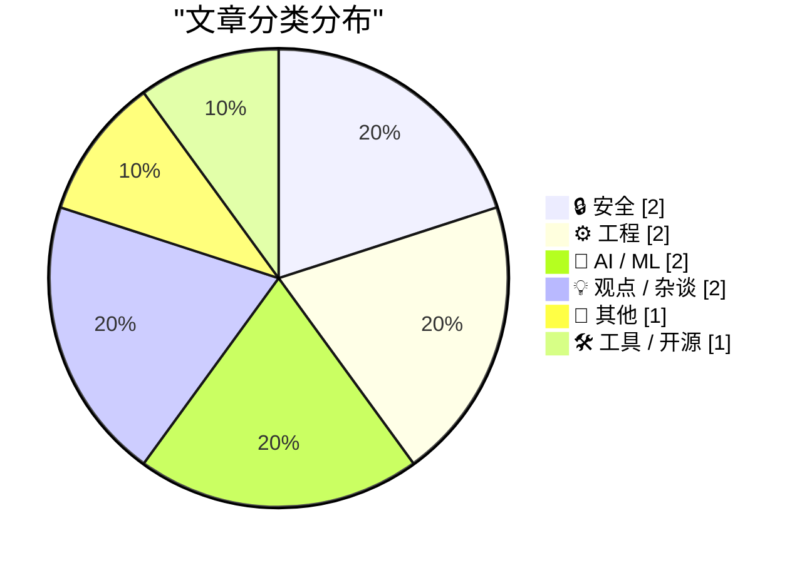
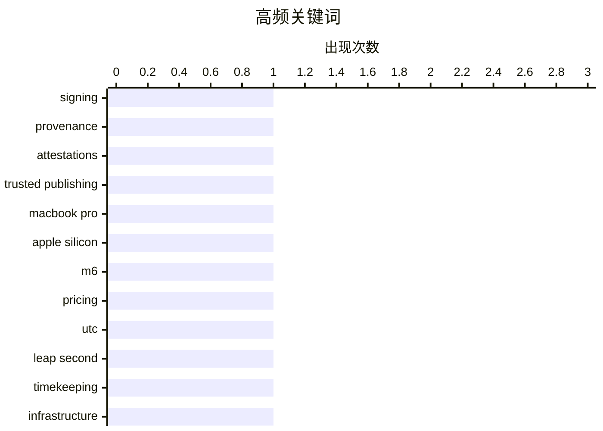

今日技术圈的主线之一，是软件供应链安全从单一平台的签名机制走向跨包注册表的身份认证、来源证明与可信发布治理。与此同时，AI 正加速从“生成代码”走向“直接承载可执行系统”，模型权重、API 额度与订阅体系正在重塑开发工具的商业形态。基础设施与数字治理同样受到关注，UTC 告别闰秒、重大工程风险暴露，以及车联网数据滥用等事件，凸显时间标准、隐私边界和安全责任在技术演进中的重要性。整体来看，今天的讨论不仅关注技术能力本身，也更强调可信、可维护与可持续的长期治理。

<!--more-->


> 来自 Karpathy 推荐的 92 个顶级技术博客，AI 精选 Top 10

## 🏆 今日必读

🥇 **各软件包注册表的签名与证明机制**

[Signing and Attestations Across Package Registries](https://nesbitt.io/2026/10/30/signing-and-attestations-across-package-registries.html) — nesbitt.io · 1 天前 · 🔒 安全

> 各软件包注册表在代码签名、来源证明和可信发布方面采用了不同机制，增加了跨平台发布与供应链安全治理的复杂度。文章对这些注册表中的签名、溯源证明和可信发布方案进行横向考察，帮助开发者理解各类机制如何建立发布者身份与制品来源的可信链路。不同注册表之间的能力差异，也是评估供应链安全、自动化发布和生态兼容性的关键因素。整体内容定位为一份跨注册表的安全机制调查，而非只聚焦单一平台。

💡 **为什么值得读**: 这份横向调查能帮助开发者和安全团队快速看清各包注册表的信任机制差异，避免在签名、来源验证或可信发布选型时遗漏关键环节。

🏷️ signing, provenance, attestations, trusted publishing

🥈 **M6、M5 Pro 与 M5 Max MacBook Pro 的价格和配置**

[★ MacBook Pro Pricing and Configurations for M6, M5 Pro, and M5 Max](https://daringfireball.net/2026/10/macbook_pro_pricing_and_configurations_for_m6_m5_pro_and_m5_max) — daringfireball.net · 1 天前 · 📝 其他

> 文章集中整理了采用 M6、M5 Pro 和 M5 Max 芯片的 MacBook Pro 价格及配置选项，并制作成便于比较的表格。通过把不同内存、存储等组合集中呈现，读者可以更快判断各型号之间的性能与成本差异。作者表示，后续还会补充对新一代硬件以及 PROLED XDR 型号显示器的完整评价。当前内容的主要价值是提供一份配置与价格速查表。

💡 **为什么值得读**: 一页式配置表省去了反复查阅官方规格和零售页面的时间，尤其适合准备购买 MacBook Pro 或比较不同芯片型号的读者。

🏷️ MacBook Pro, Apple silicon, M6, pricing

🥉 **欢庆吧，闰秒终于死了！**

[Rejoice, leap seconds are dead!](https://www.jeffgeerling.com/blog/2026/rejoice-the-utc-leap-second-is-dead/) — jeffgeerling.com · 1 天前 · ⚙️ 工程

> CGPM 通过第 5 号决议决定，UTC 最后一次闰秒已在 2016 年年底发生，此后不会再插入新的闰秒。这意味着协调世界时将不再依靠不定期增加一秒来维持与地球自转的同步，相关时间系统也不必继续处理未来闰秒公告。决议是在作者度假期间作出的，因此文章此时才补充发布相关说明。对依赖精确时间同步、测试和日历计算的工程师而言，这是 UTC 时间制度的一次重要变化。

💡 **为什么值得读**: 文章说明了一个足以影响全球时间同步、测试基础设施和软件日期处理方式的制度性变化，同时给出明确的历史与决议依据。

🏷️ UTC, leap second, timekeeping, infrastructure

---

## 📊 数据概览

| 扫描源 | 抓取文章 | 时间范围 | 精选 |
|:---:|:---:|:---:|:---:|
| 87/92 | 2639 篇 → 23 篇 | 48h | **10 篇** |

### 分类分布



### 高频关键词



<details>
<summary>📈 纯文本关键词图（终端友好）</summary>

```
signing            │ ████████████████████ 1
provenance         │ ████████████████████ 1
attestations       │ ████████████████████ 1
trusted publishing │ ████████████████████ 1
macbook pro        │ ████████████████████ 1
apple silicon      │ ████████████████████ 1
m6                 │ ████████████████████ 1
pricing            │ ████████████████████ 1
utc                │ ████████████████████ 1
leap second        │ ████████████████████ 1
```

</details>

### 🏷️ 话题标签

**signing**(1) · **provenance**(1) · **attestations**(1) · trusted publishing(1) · macbook pro(1) · apple silicon(1) · m6(1) · pricing(1) · utc(1) · leap second(1) · timekeeping(1) · infrastructure(1) · package management(1) · releases(1) · security advisories(1) · qwen3.5(1) · llm(1) · nes(1) · emulator(1) · openai(1)

---

## 🔒 安全

### 1. 各软件包注册表的签名与证明机制

[Signing and Attestations Across Package Registries](https://nesbitt.io/2026/10/30/signing-and-attestations-across-package-registries.html) — **nesbitt.io** · 1 天前 · ⭐ 26/30

> 各软件包注册表在代码签名、来源证明和可信发布方面采用了不同机制，增加了跨平台发布与供应链安全治理的复杂度。文章对这些注册表中的签名、溯源证明和可信发布方案进行横向考察，帮助开发者理解各类机制如何建立发布者身份与制品来源的可信链路。不同注册表之间的能力差异，也是评估供应链安全、自动化发布和生态兼容性的关键因素。整体内容定位为一份跨注册表的安全机制调查，而非只聚焦单一平台。

🏷️ signing, provenance, attestations, trusted publishing

---

### 2. 通用汽车背叛驾驶员隐私，将支付 2.2 亿美元和解

[GM to Pay $220 Million After Betraying Their Own Drivers’ Privacy](https://www.reuters.com/business/autos-transportation/gm-pay-220-million-settle-allegations-it-violated-consumers-privacy-2026-10-29/) — **daringfireball.net** · 1 天前 · ⭐ 23/30

> 通用汽车将支付 2.2 亿美元，以和解其涉嫌非法出售驾驶员行为和位置数据的指控。相关数据被转售给保险经纪商，后者利用这些信息制定、甚至提高保险费率；和解涉及美国 35 个州和华盛顿哥伦比亚特区的总检察长。争议源于 Smart Driver 项目，该项目在 2016 年至 2024 年停止服务期间吸引了数百万驾驶员，GM 曾承诺未经许可不出售数据。参与者还可能在使用该功能时被纳入 OnStar 安全、导航和诊断服务。

🏷️ privacy, location data, GM, insurance

---

## ⚙️ 工程

### 3. 欢庆吧，闰秒终于死了！

[Rejoice, leap seconds are dead!](https://www.jeffgeerling.com/blog/2026/rejoice-the-utc-leap-second-is-dead/) — **jeffgeerling.com** · 1 天前 · ⭐ 24/30

> CGPM 通过第 5 号决议决定，UTC 最后一次闰秒已在 2016 年年底发生，此后不会再插入新的闰秒。这意味着协调世界时将不再依靠不定期增加一秒来维持与地球自转的同步，相关时间系统也不必继续处理未来闰秒公告。决议是在作者度假期间作出的，因此文章此时才补充发布相关说明。对依赖精确时间同步、测试和日历计算的工程师而言，这是 UTC 时间制度的一次重要变化。

🏷️ UTC, leap second, timekeeping, infrastructure

---

### 4. 阅读清单：2026 年 10 月 31 日

[Reading List 10/31/26](https://www.construction-physics.com/p/reading-list-103126) — **construction-physics.com** · 9 小时前 · ⭐ 21/30

> 本期阅读清单汇集了太空光纤电缆制造、区域供热和高速铁路等多个技术与基础设施主题。文章还涉及西班牙高速铁路事故、中国空天飞机等交通与航天议题。不同条目共同关注大型工程系统如何制造、运行，以及潜在风险如何暴露。清单适合通过一组短篇材料快速了解当天值得关注的行业动态。

🏷️ fiber optics, nuclear energy, high-speed rail, spaceplane

---

## 🤖 AI / ML

### 5. dbreunig/nesformer：在 Qwen 模型权重中模拟 NES

[dbreunig/nesformer](https://simonwillison.net/2026/Oct/30/nesformer/) — **simonwillison.net** · 1 天前 · ⭐ 23/30

> Drew Breunig 受到 qwenputer 项目的启发，把 NES 的 6502 CPU 模拟器编码进 Qwen3.5-4B 的模型权重中。这个项目因此可以直接运行《超级马里奥兄弟》等 NES ROM，但执行速度非常缓慢。其构建方式使用 Opus 5.5 提示模型阅读技术文章和源代码，再探索以类似 FPGA MISTR 的方式模拟 NES 芯片与内存。它展示了大型语言模型不仅能生成代码，还可能把可执行系统直接固化在权重中。

🏷️ Qwen3.5, LLM, NES, emulator

---

### 6. 符合条件的 ChatGPT 订阅可获得 API 额度

[API credits benefit for eligible ChatGPT subscriptions](https://simonwillison.net/2026/Oct/29/api-credits/) — **simonwillison.net** · 1 天前 · ⭐ 23/30

> OpenAI 推出了面向符合条件的 ChatGPT 付费订阅用户的 API credits 权益。每月订阅价格为 100、200 或 500 美元的套餐，可获得相同金额、用于一个 API 组织的额度。此前 Anthropic 已为每月 100、200 和 500 美元的 Max 与 Team 订阅提供等额且会过期的 Anthropic API 额度。新安排基本复制了这一模式，让订阅用户无需单独为 API 使用量付费。

🏷️ OpenAI, ChatGPT, API credits, Anthropic

---

## 💡 观点 / 杂谈

### 7. Pluralistic：形式问题（2026 年 10 月 31 日）

[Pluralistic: Formalities (31 Oct 2026)](https://pluralistic.net/2026/10/31/burn-berne/) — **pluralistic.net** · 7 小时前 · ⭐ 22/30

> 这期《Pluralistic》以链接汇编形式讨论版权、隐私、权力关系和互联网治理等问题。文章首先关注美国版权局对 AI 时代版权制度的调整，强调版权是需要通过创作和努力获得的权益，而不是自动产生的结果。其余链接延伸至“911”事件后的 martial law、星巴克竞争、SOPA、斯诺登、俄罗斯互联网审查、销售税累退性等历史与现实案例。内容也列出作者近期的公开活动、著作及长期阅读与写作倡议。

🏷️ AI, copyright, policy, creative work

---

### 8. 优雅与智力往往负相关

[Elegance and intelligence are anticorrelated](https://seangoedecke.com/elegance-and-intelligence-are-anticorrelated/) — **seangoedecke.com** · 1 天前 · ⭐ 20/30

> 文章提出一个反直觉观点：优雅与原始智力有时呈负相关，因为聪明的人可以直接用蛮力或高速计算解决问题，从而省略巧妙的推导。冯·诺依曼解决“两名骑车人相向而行、苍蝇往返飞行”的经典问题时，并非事先知道取巧方法，而是瞬间算出了无限级数。冯·诺依曼还可能凭借超强记忆力直接记住大量姓名，而不必设计助记法。对软件工程师而言，这种差异尤其值得关注，因为高智力有时会产生能运行但维护性、简洁性较差的方案。

🏷️ elegance, intelligence, problem solving, software design

---

## 📝 其他

### 9. M6、M5 Pro 与 M5 Max MacBook Pro 的价格和配置

[★ MacBook Pro Pricing and Configurations for M6, M5 Pro, and M5 Max](https://daringfireball.net/2026/10/macbook_pro_pricing_and_configurations_for_m6_m5_pro_and_m5_max) — **daringfireball.net** · 1 天前 · ⭐ 25/30

> 文章集中整理了采用 M6、M5 Pro 和 M5 Max 芯片的 MacBook Pro 价格及配置选项，并制作成便于比较的表格。通过把不同内存、存储等组合集中呈现，读者可以更快判断各型号之间的性能与成本差异。作者表示，后续还会补充对新一代硬件以及 PROLED XDR 型号显示器的完整评价。当前内容的主要价值是提供一份配置与价格速查表。

🏷️ MacBook Pro, Apple silicon, M6, pricing

---

## 🛠 工具 / 开源

### 10. 本周包管理动态：2026 年 10 月 31 日

[This Week in Package Management: 31 October 2026](https://nesbitt.io/2026/10/31/this-week-in-package-management.html) — **nesbitt.io** · 12 小时前 · ⭐ 24/30

> 文章汇总了 2026 年 10 月 31 日这一周软件包管理领域的重要动态。内容覆盖多个生态中的版本发布、安全公告和相关文章，为读者提供集中式周报入口。通过把分散在各工具和项目中的更新整理在一起，可以降低追踪包管理器变化的成本。该周报适合希望持续了解软件供应链、工具发布与安全资讯的开发者。

🏷️ package management, releases, security advisories

---

*生成于 2026-11-01 22:18 | 扫描 87 源 → 获取 2639 篇 → 精选 10 篇*
*基于 [Hacker News Popularity Contest 2025](https://refactoringenglish.com/tools/hn-popularity/) RSS 源列表，由 [Andrej Karpathy](https://x.com/karpathy) 推荐*
*由「懂点儿AI」制作，欢迎关注同名微信公众号获取更多 AI 实用技巧 💡*
