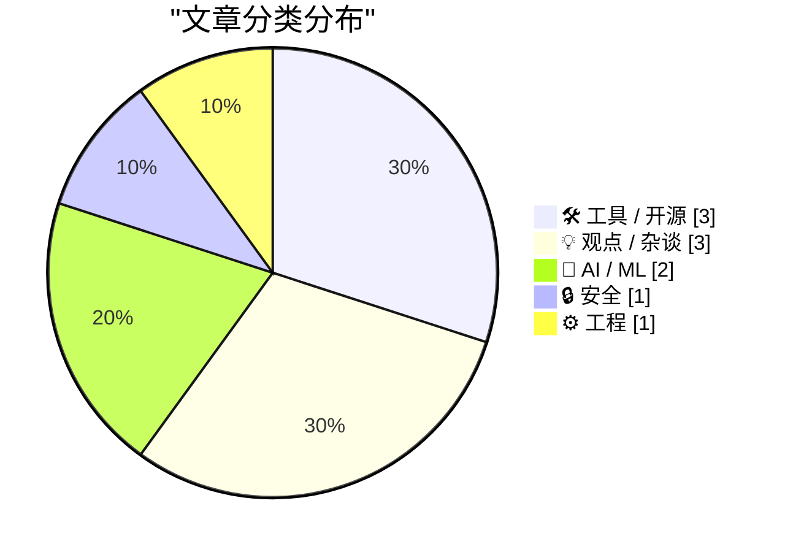
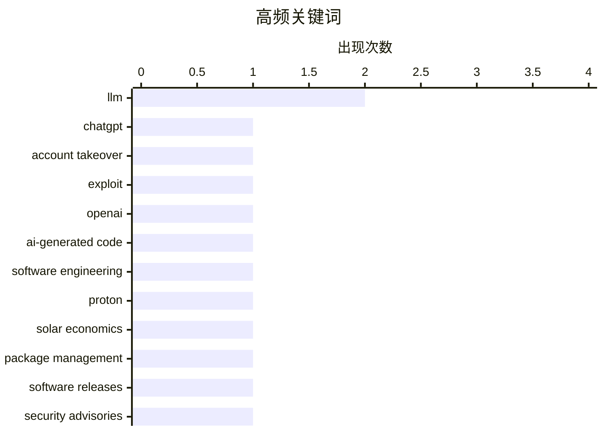

AI 正从辅助编码走向更自主的智能体应用，但账户安全、权限边界和跨沙箱通信成为首要风险。与此同时，AI 开始重塑软件工程文化、团队管理和项目信誉，传统文档与质量背书正面临可信度压力。随着智能体深入注册、运维等流程，开发者需要同步强化供应链安全、身份授权和 AI 时代的技术治理。

<!--more-->


> 来自 Karpathy 推荐的 92 个顶级技术博客，AI 精选 Top 10

## 🏆 今日必读

🥇 **我们如何接管 ChatGPT 账户**

[How We Took Over ChatGPT Accounts](https://simonwillison.net/2026/Oct/31/how-we-took-over-chatgpt-accounts/) — simonwillison.net · 23 小时前 · 🔒 安全

> Parameter Labs 披露了一组针对 ChatGPT artifacts 模式的安全利用，该模式现称“HTML 预览”，会在沙箱化 iframe 中运行交互式自定义 HTML 应用。安全的关键在于严格隔离 HTML，防止不可信代码与 OpenAI API 交互或访问私人数据。攻击链利用 ChatGPT 图表功能所依赖的 MathLive JavaScript 库，其虚拟键盘可由父页面通过 postMessage() 从沙箱 iframe 触发。作者认为，这一复杂的跨沙箱消息链暴露出 ChatGPT 在第三方库集成、iframe 通信和权限边界上的潜在风险。

💡 **为什么值得读**: 这是少见的真实 AI 产品攻击链拆解，有助于安全工程师理解沙箱 iframe、postMessage 与第三方 JavaScript 库组合后可能产生的实际风险。

🏷️ ChatGPT, account takeover, exploit, OpenAI

🥈 **第 528 期周报：阅读 AI 生成的代码与太阳能经济**

[Weekly Update 528: Reading AI-generated Code & the Economics of Solar](https://www.troyhunt.com/weekly-update-528/) — troyhunt.com · 14 小时前 · 🤖 AI / ML

> 本期周报围绕 AI 生成代码的阅读方式以及太阳能经济展开，并同时关注 Proton CEO 发布的 AI 工程宣言。Proton 的工程宣言因管理风格和措辞而引发大量争议，作者也认同其中一些负面评价。内容反映出 AI 工具正在影响软件工程文化，而不仅仅是改变代码的生产效率。即使企业将 AI 引入开发流程，管理层如何表达工程原则仍会直接影响团队认同与公众观感。

💡 **为什么值得读**: 它把 AI 生成代码的技术变化与工程组织文化放在同一框架下，适合想同时理解生产力工具和团队治理影响的读者。

🏷️ AI-generated code, software engineering, Proton, solar economics

🥉 **本周包管理动态：2026 年 10 月 31 日**

[This Week in Package Management: 31 October 2026](https://nesbitt.io/2026/10/31/this-week-in-package-management.html) — nesbitt.io · 1 天前 · 🛠 工具 / 开源

> 这是一份汇总包管理生态中软件发布、安全公告和相关文章的周期性速览。其内容覆盖包管理工具链各项目的最新进展，可用于追踪依赖更新与潜在供应链风险。相比逐个访问各项目发布页，集中式列表能更快建立当日生态变化的全貌。读者可以从中筛选值得进一步跟进的版本、安全修复和深度文章。

💡 **为什么值得读**: 对于需要持续跟踪依赖更新、供应链公告和包管理工具动态的开发者，这份周报能显著减少信息收集时间。

🏷️ package management, software releases, security advisories, open source

---

## 📊 数据概览

| 扫描源 | 抓取文章 | 时间范围 | 精选 |
|:---:|:---:|:---:|:---:|
| 87/92 | 2640 篇 → 19 篇 | 48h | **10 篇** |

### 分类分布



### 高频关键词



<details>
<summary>📈 纯文本关键词图（终端友好）</summary>

```
llm                  │ ████████████████████ 2
chatgpt              │ ██████████░░░░░░░░░░ 1
account takeover     │ ██████████░░░░░░░░░░ 1
exploit              │ ██████████░░░░░░░░░░ 1
openai               │ ██████████░░░░░░░░░░ 1
ai-generated code    │ ██████████░░░░░░░░░░ 1
software engineering │ ██████████░░░░░░░░░░ 1
proton               │ ██████████░░░░░░░░░░ 1
solar economics      │ ██████████░░░░░░░░░░ 1
package management   │ ██████████░░░░░░░░░░ 1
```

</details>

### 🏷️ 话题标签

**llm**(2) · **chatgpt**(1) · **account takeover**(1) · exploit(1) · openai(1) · ai-generated code(1) · software engineering(1) · proton(1) · solar economics(1) · package management(1) · software releases(1) · security advisories(1) · open source(1) · ai agents(1) · authentication(1) · workos(1) · auth.md(1) · documentation(1) · software trust(1) · particledb(1)

---

## 🛠 工具 / 开源

### 1. 本周包管理动态：2026 年 10 月 31 日

[This Week in Package Management: 31 October 2026](https://nesbitt.io/2026/10/31/this-week-in-package-management.html) — **nesbitt.io** · 1 天前 · ⭐ 25/30

> 这是一份汇总包管理生态中软件发布、安全公告和相关文章的周期性速览。其内容覆盖包管理工具链各项目的最新进展，可用于追踪依赖更新与潜在供应链风险。相比逐个访问各项目发布页，集中式列表能更快建立当日生态变化的全貌。读者可以从中筛选值得进一步跟进的版本、安全修复和深度文章。

🏷️ package management, software releases, security advisories, open source

---

### 2. WorkOS：让智能体无需浏览器即可注册你的应用

[WorkOS: Let Agents Sign Up for Your App Without a Browser](https://workos.com/auth-md?utm_source=daringfireball&amp;utm_medium=newsletter&amp;utm_campaign=q42026) — **daringfireball.net** · 1 小时前 · ⭐ 22/30

> WorkOS 推出 auth.md 机制，让 AI 智能体能够读取机器可读的注册说明，而不必像人类一样操作网页注册流程。开发者只需在 WorkOS 控制台完成配置，AuthKit 便会发布对应的 auth.md 文件。智能体读取文件后可自行注册，并获得开发者可控、权限受限且短期有效的凭证。整个流程不打断用户正在进行的操作，也不要求智能体接触浏览器登录。

🏷️ AI agents, authentication, WorkOS, auth.md

---

### 3. datasette-llm 0.1a9

[datasette-llm 0.1a9](https://simonwillison.net/2026/Oct/31/datasette-llm/) — **simonwillison.net** · 1 天前 · ⭐ 21/30

> datasette-llm 0.1a9 改进了底层插件的用户体验，并开始自动采用 LLM 使用的默认模型。此前启动 Datasette Agent 时，还必须显式设置 plugins.datasette-agent.default_model，例如 gpt-6-astra。现在可直接运行 uvx --with datasette-agent datasette content.db --internal internal.db，而无需额外配置默认模型。该版本是 Datasette Agent 后续较大升级前的一次轻量级易用性改进。

🏷️ Datasette, LLM, Python, agents

---

## 💡 观点 / 杂谈

### 4. 大学每月只需花费 20 美元

[College will only cost $20 a month](https://idiallo.com/blog/college-will-cost-20-dollars) — **idiallo.com** · 1 天前 · ⭐ 21/30

> 作者以自己子女的教育选择为切入点，反思传统大学学位在 AI 时代是否仍值得其高昂成本。2020 至 2022 年间，科技公司招聘旺盛，他有时每周面试三名候选人，许多计算机科学学生也在这段热潮中选择了专业道路。如今招聘已显著放缓，即将毕业的学生发现就业市场与入学时预期截然不同，获得工作并不容易。面对同样的不确定性，作者将自己每月 20 美元的 AI 订阅与传统大学及倾尽积蓄的精英教育路线进行对比。

🏷️ computer science, education, tech careers, tuition

---

### 5. Pluralistic：形式与礼仪（2026 年 10 月 31 日）

[Pluralistic: Formalities (31 Oct 2026)](https://pluralistic.net/2026/10/31/burn-berne/) — **pluralistic.net** · 1 天前 · ⭐ 21/30

> 本期链接汇总以美国版权局重新强调版权需要主动争取和保护为开篇主题。链接内容跨越互联网治理、职场与政治讽刺、性别议题以及音乐、软件和数字版权案例，包括 Laserwriter II、Snowden 与法治、俄罗斯诉 DST，以及星巴克互诉等条目。评论者借此表达对 AI 时代版权边界、平台权力和“作者授权”概念的持续关注。整份清单延续了作者以历史案例和幽默链接审视制度与技术问题的编辑风格。

🏷️ AI copyright, Copyright Office, law, link roundup

---

### 6. 改善职业声誉的快办法与慢办法

[Fast and slow ways to improve your reputation](https://seangoedecke.com/how-to-get-assigned-interesting-work/) — **seangoedecke.com** · 22 小时前 · ⭐ 19/30

> 文章围绕一个常见的职场困境展开：工程师想参与重要项目以建立声誉，却往往需要先有声誉才有机会获得这些项目。作者提出，应从科技公司的真实激励和决策机制出发，而不只是遵循表面上的正式流程。若团队总让同一名资深员工承担曝光度更高的工作，管理者口头同意新人主导项目并不足以改变结果。解决办法需要结合快速争取可见机会与长期积累可验证专业影响力两种路径。

🏷️ engineering reputation, career growth, project ownership, technical leadership

---

## 🤖 AI / ML

### 7. 第 528 期周报：阅读 AI 生成的代码与太阳能经济

[Weekly Update 528: Reading AI-generated Code & the Economics of Solar](https://www.troyhunt.com/weekly-update-528/) — **troyhunt.com** · 14 小时前 · ⭐ 27/30

> 本期周报围绕 AI 生成代码的阅读方式以及太阳能经济展开，并同时关注 Proton CEO 发布的 AI 工程宣言。Proton 的工程宣言因管理风格和措辞而引发大量争议，作者也认同其中一些负面评价。内容反映出 AI 工具正在影响软件工程文化，而不仅仅是改变代码的生产效率。即使企业将 AI 引入开发流程，管理层如何表达工程原则仍会直接影响团队认同与公众观感。

🏷️ AI-generated code, software engineering, Proton, solar economics

---

### 8. 引用 Kyle Kingsbury

[Quoting Kyle Kingsbury](https://simonwillison.net/2026/Nov/1/kyle-kingsbury/) — **simonwillison.net** · 5 小时前 · ⭐ 21/30

> Jepsen 的 Kyle Kingsbury 在 ParticleDB 1.1.4 分析中指出，LLM 的使用正在侵蚀人们对文档、软件及其维护组织的信任。传统上可被用来判断系统成熟度的信号，如今更容易被生成式 AI 伪造，因此工程师可能需要以怀疑眼光审视新项目。维护者面临的挑战不仅是保证软件正确和文档准确，还要向用户证明这些质量承诺确实成立。该观点揭示了 AI 时代软件质量背书机制面临的新压力。

🏷️ LLM, documentation, software trust, Particledb

---

## 🔒 安全

### 9. 我们如何接管 ChatGPT 账户

[How We Took Over ChatGPT Accounts](https://simonwillison.net/2026/Oct/31/how-we-took-over-chatgpt-accounts/) — **simonwillison.net** · 23 小时前 · ⭐ 27/30

> Parameter Labs 披露了一组针对 ChatGPT artifacts 模式的安全利用，该模式现称“HTML 预览”，会在沙箱化 iframe 中运行交互式自定义 HTML 应用。安全的关键在于严格隔离 HTML，防止不可信代码与 OpenAI API 交互或访问私人数据。攻击链利用 ChatGPT 图表功能所依赖的 MathLive JavaScript 库，其虚拟键盘可由父页面通过 postMessage() 从沙箱 iframe 触发。作者认为，这一复杂的跨沙箱消息链暴露出 ChatGPT 在第三方库集成、iframe 通信和权限边界上的潜在风险。

🏷️ ChatGPT, account takeover, exploit, OpenAI

---

## ⚙️ 工程

### 10. 阅读清单：2026 年 10 月 31 日

[Reading List 10/31/26](https://www.construction-physics.com/p/reading-list-103126) — **construction-physics.com** · 1 天前 · ⭐ 21/30

> 本期阅读清单聚焦太空基础设施与大型工程体系，涵盖太空光纤电缆制造和核能区域供热。清单还收录了西班牙高速铁路事故、中国空天飞机等交通与航天议题。所列文章把技术产业、基础设施能力及事故风险放在一起观察。它适合希望快速扩展视野、了解重资产工程与前沿产业动态的读者。

🏷️ fiber optics, nuclear energy, high-speed rail, spaceplane

---

*生成于 2026-11-02 22:18 | 扫描 87 源 → 获取 2640 篇 → 精选 10 篇*
*基于 [Hacker News Popularity Contest 2025](https://refactoringenglish.com/tools/hn-popularity/) RSS 源列表，由 [Andrej Karpathy](https://x.com/karpathy) 推荐*
*由「懂点儿AI」制作，欢迎关注同名微信公众号获取更多 AI 实用技巧 💡*
