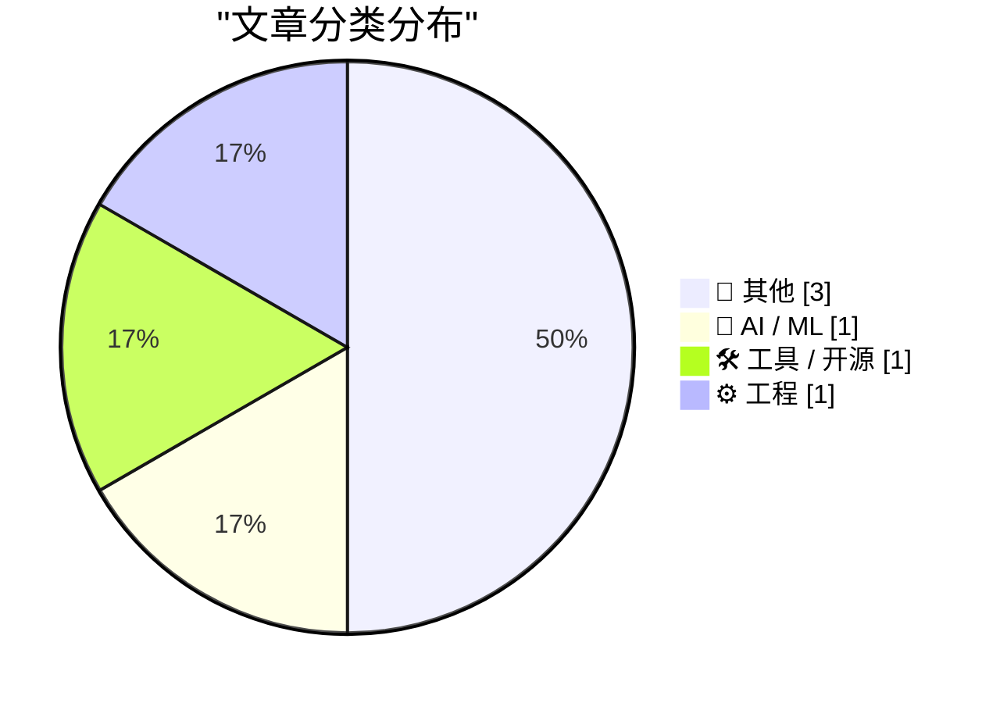
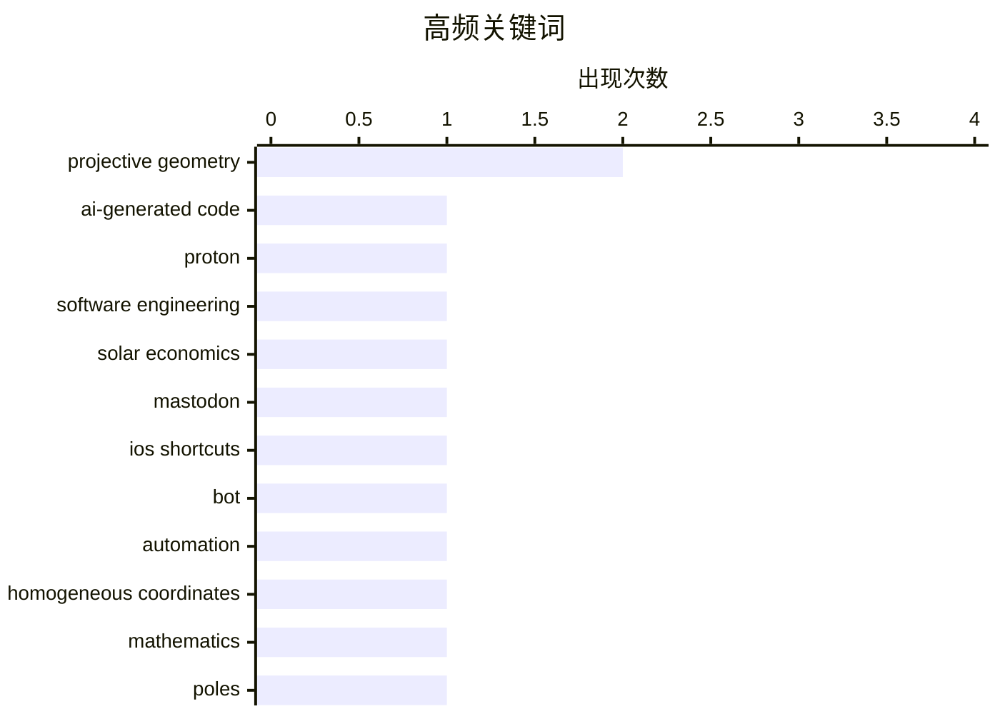

今日技术圈呈现三条清晰主线：AI 工程讨论从能力展示转向代码质量、管理责任与真实使用成本。与此同时，自动化正在变得更轻量，iOS 快捷指令等端侧工具以近乎零运维的方式承担起机器人任务。数学与计算机复古内容则重新强调抽象背后的直觉，以及隐藏结构在拆解和系统演化中的重要性；从射影几何的统一视角到早期电商的泡沫兴衰，技术发展始终同时受理论认知与经济环境塑造。

<!--more-->


> 来自 Karpathy 推荐的 92 个顶级技术博客，AI 精选 Top 6

## 🏆 今日必读

🥇 **每周更新 528：阅读 AI 生成的代码与太阳能的经济学**

[Weekly Update 528: Reading AI-generated Code & the Economics of Solar](https://www.troyhunt.com/weekly-update-528/) — troyhunt.com · 1 天前 · 🤖 AI / ML

> Troy Hunt 的第 528 期周报，本期视频主题是「阅读 AI 生成的代码」以及太阳能的经济性。视频发布之际，Proton CEO 发布的「AI @ Proton 工程宣言」恰好登上头条，作者顺带点评了这份宣言，认为其管理层风格与措辞引起大量负面反应是理所应当的。本期内容把 AI 工程实践的个人观察与新能源经济性的讨论结合在一起，构成一次跨技术与社会话题的杂谈式更新。整体基调是作者的独立观点输出，而非中立的新闻汇总。

💡 **为什么值得读**: 适合想了解开发者如何审视 AI 生成代码质量、同时关注个人能源经济与技术圈热点争论的读者，10 分钟可快速掌握作者立场。

🏷️ AI-generated code, Proton, software engineering, solar economics

🥈 **用 iOS 快捷指令驱动的 Mastodon 机器人**

[A Mastodon bot powered by iOS Shortcuts](https://evanhahn.com/mastodon-bot-with-ios-shortcuts/) — evanhahn.com · 1 天前 · 🛠 工具 / 开源

> 作者把自己运营的 Mastodon 机器人从服务器迁到 iPhone 上的 iOS 快捷指令（Shortcuts）中运行。该机器人名为 Ulrira（取自《塞尔达传说：梦见岛》中的老翁 Ulrira），会从游戏文本 dump 中随机抽取一句台词并发布到 Mastodon。快捷指令流程共五步：获取 ulrira.txt 文件 → 读取 → 按行分割 → 随机选一行 → 向 Mastodon 发起 HTTP POST 请求。相比自建服务器方案，端侧快捷指令几乎零运维成本，但需要手机定期执行。

💡 **为什么值得读**: 展示了一个无需服务器、无需代码的轻量级机器人实现路径，对想用 iPhone 自动化做社交定时发布的读者有直接借鉴意义。

🏷️ Mastodon, iOS Shortcuts, bot, automation

🥉 **与射影平面和解**

[Making peace with the projective plane](https://www.johndcook.com/blog/2026/11/02/projective-plane/) — johndcook.com · 7 小时前 · 📝 其他

> John D. Cook 回顾自己学生时代学习射影空间与齐次坐标时的困惑：当时这些概念在没有动机的情况下被直接呈现，显得纯粹抽象。许多年后他才意识到它们其实是自然且几乎必然的构造。文中通过把二维点表示为三维空间中的过原点直线（即齐次坐标 / 射影平面 RP²）这一视角，解释了射影几何中「点」与「方向不再有区别」的本质，从而给出这些抽象定义的内在动机。

💡 **为什么值得读**: 为那些被线性代数「齐次坐标」和射影几何绕晕的读者提供一份有上下文的解释型入门，比教材式定义更容易建立直觉。

🏷️ projective geometry, homogeneous coordinates, mathematics

---

## 📊 数据概览

| 扫描源 | 抓取文章 | 时间范围 | 精选 |
|:---:|:---:|:---:|:---:|
| 68/92 | 2101 篇 → 6 篇 | 48h | **6 篇** |

### 分类分布



### 高频关键词



<details>
<summary>📈 纯文本关键词图（终端友好）</summary>

```
projective geometry     │ ████████████████████ 2
ai-generated code       │ ██████████░░░░░░░░░░ 1
proton                  │ ██████████░░░░░░░░░░ 1
software engineering    │ ██████████░░░░░░░░░░ 1
solar economics         │ ██████████░░░░░░░░░░ 1
mastodon                │ ██████████░░░░░░░░░░ 1
ios shortcuts           │ ██████████░░░░░░░░░░ 1
bot                     │ ██████████░░░░░░░░░░ 1
automation              │ ██████████░░░░░░░░░░ 1
homogeneous coordinates │ ██████████░░░░░░░░░░ 1
```

</details>

### 🏷️ 话题标签

**projective geometry**(2) · **ai-generated code**(1) · **proton**(1) · software engineering(1) · solar economics(1) · mastodon(1) · ios shortcuts(1) · bot(1) · automation(1) · homogeneous coordinates(1) · mathematics(1) · poles(1) · polars(1) · ibm pc/xt(1) · floppy drive(1) · vintage hardware(1) · repair(1) · etoys.com(1) · dot-com bubble(1) · e-commerce(1)

---

## 📝 其他

### 1. 与射影平面和解

[Making peace with the projective plane](https://www.johndcook.com/blog/2026/11/02/projective-plane/) — **johndcook.com** · 7 小时前 · ⭐ 15/30

> John D. Cook 回顾自己学生时代学习射影空间与齐次坐标时的困惑：当时这些概念在没有动机的情况下被直接呈现，显得纯粹抽象。许多年后他才意识到它们其实是自然且几乎必然的构造。文中通过把二维点表示为三维空间中的过原点直线（即齐次坐标 / 射影平面 RP²）这一视角，解释了射影几何中「点」与「方向不再有区别」的本质，从而给出这些抽象定义的内在动机。

🏷️ projective geometry, homogeneous coordinates, mathematics

---

### 2. 极点与极线的统一视角

[A unified view of poles and polars](https://www.johndcook.com/blog/2026/11/01/projective-poles-and-polars/) — **johndcook.com** · 1 天前 · ⭐ 15/30

> 作者此前已分别撰文讨论球面三角形的对偶（即极三角形）、平面几何中的极点与极线，并简略提及它们向射影几何的推广。本文的核心是把这些看似割裂的话题统一起来：借助射影对偶，点与直线互为对偶对象，极点与极线、球面极三角形都可用同一套「对偶」语言描述。这种统一视角也解释了为什么在欧氏平面中谈极点极线会显得别扭——它们的自然栖息地其实是射影几何。

🏷️ poles, polars, projective geometry

---

### 3. Etoys.com 及其迅速崛起与陨落

[Etoys.com and its rapid rise and fall](https://dfarq.homeip.net/etoys-com-and-its-rapid-rise-and-fall/?utm_source=rss&#038;utm_medium=rss&#038;utm_campaign=etoys-com-and-its-rapid-rise-and-fall) — **dfarq.homeip.net** · 10 小时前 · ⭐ 12/30

> 故事从 1997 年 11 月讲起：互联网刚起步，人们相信在网上卖玩具能成为大生意，etoys.com 就这样诞生。作者梳理这家早期电商公司的快速扩张期——凭借抢先占位、品类聚焦和面向发烧友的定位，它一度成为互联网零售的明星公司。但随后到来的世纪末网络泡沫破裂，流量与估值双双崩塌，公司从鼎盛跌入破产清算。这个案例成为 dot-com 泡沫中最具代表性的「快速升起又快速倒下」的样本之一。

🏷️ Etoys.com, dot-com bubble, e-commerce, internet history

---

## 🤖 AI / ML

### 4. 每周更新 528：阅读 AI 生成的代码与太阳能的经济学

[Weekly Update 528: Reading AI-generated Code & the Economics of Solar](https://www.troyhunt.com/weekly-update-528/) — **troyhunt.com** · 1 天前 · ⭐ 23/30

> Troy Hunt 的第 528 期周报，本期视频主题是「阅读 AI 生成的代码」以及太阳能的经济性。视频发布之际，Proton CEO 发布的「AI @ Proton 工程宣言」恰好登上头条，作者顺带点评了这份宣言，认为其管理层风格与措辞引起大量负面反应是理所应当的。本期内容把 AI 工程实践的个人观察与新能源经济性的讨论结合在一起，构成一次跨技术与社会话题的杂谈式更新。整体基调是作者的独立观点输出，而非中立的新闻汇总。

🏷️ AI-generated code, Proton, software engineering, solar economics

---

## 🛠 工具 / 开源

### 5. 用 iOS 快捷指令驱动的 Mastodon 机器人

[A Mastodon bot powered by iOS Shortcuts](https://evanhahn.com/mastodon-bot-with-ios-shortcuts/) — **evanhahn.com** · 1 天前 · ⭐ 17/30

> 作者把自己运营的 Mastodon 机器人从服务器迁到 iPhone 上的 iOS 快捷指令（Shortcuts）中运行。该机器人名为 Ulrira（取自《塞尔达传说：梦见岛》中的老翁 Ulrira），会从游戏文本 dump 中随机抽取一句台词并发布到 Mastodon。快捷指令流程共五步：获取 ulrira.txt 文件 → 读取 → 按行分割 → 随机选一行 → 向 Mastodon 发起 HTTP POST 请求。相比自建服务器方案，端侧快捷指令几乎零运维成本，但需要手机定期执行。

🏷️ Mastodon, iOS Shortcuts, bot, automation

---

## ⚙️ 工程

### 6. IBM PC/XT 驱动器卡在仓位里怎么办？如何取出软盘驱动器

[IBM PC/XT drives stuck in the bay? How to free them](https://dfarq.homeip.net/ibm-pc-xt-drives-stuck-in-the-bay-how-to-free-them/?utm_source=rss&#038;utm_medium=rss&#038;utm_campaign=ibm-pc-xt-drives-stuck-in-the-bay-how-to-free-them) — **dfarq.homeip.net** · 1 天前 · ⭐ 14/30

> 在 IBM PC/XT 5160 机型上拆卸软盘驱动器时，拧掉表面可见的两颗固定螺丝后驱动器仍然卡在仓位中拔不出来。原因是驱动器除了可见螺丝外，还被机架导轨与背面的固定点额外约束。作者给出的操作要领是继续查找并松开隐藏的固定螺丝/卡扣，同时配合释放导轨，才能让驱动器顺利沿轨道退出，而不必强行撬动。文中附有面向 5160 实机的逐步拆解说明。

🏷️ IBM PC/XT, floppy drive, vintage hardware, repair

---

*生成于 2026-11-03 22:28 | 扫描 68 源 → 获取 2101 篇 → 精选 6 篇*
*基于 [Hacker News Popularity Contest 2025](https://refactoringenglish.com/tools/hn-popularity/) RSS 源列表，由 [Andrej Karpathy](https://x.com/karpathy) 推荐*
*由「懂点儿AI」制作，欢迎关注同名微信公众号获取更多 AI 实用技巧 💡*
