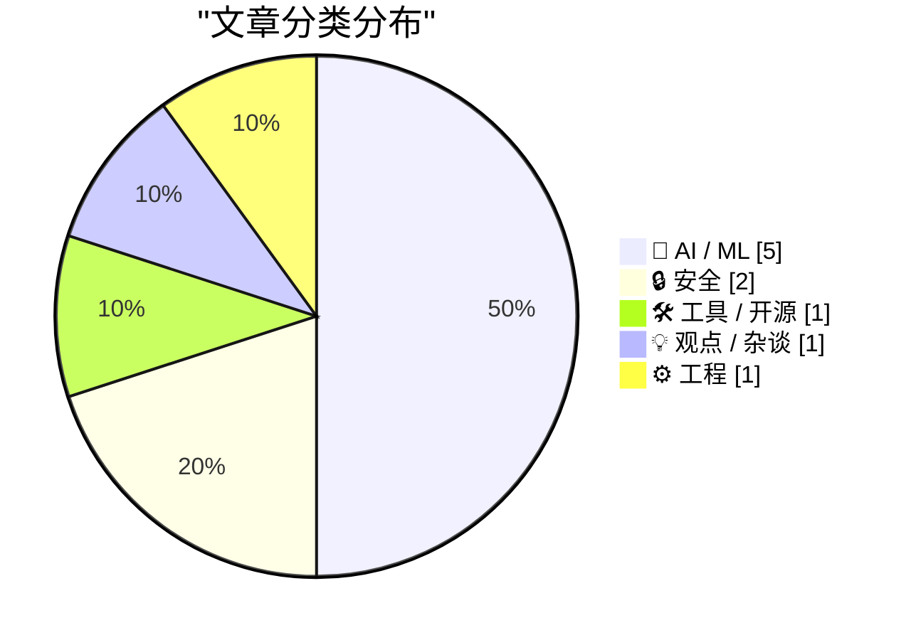
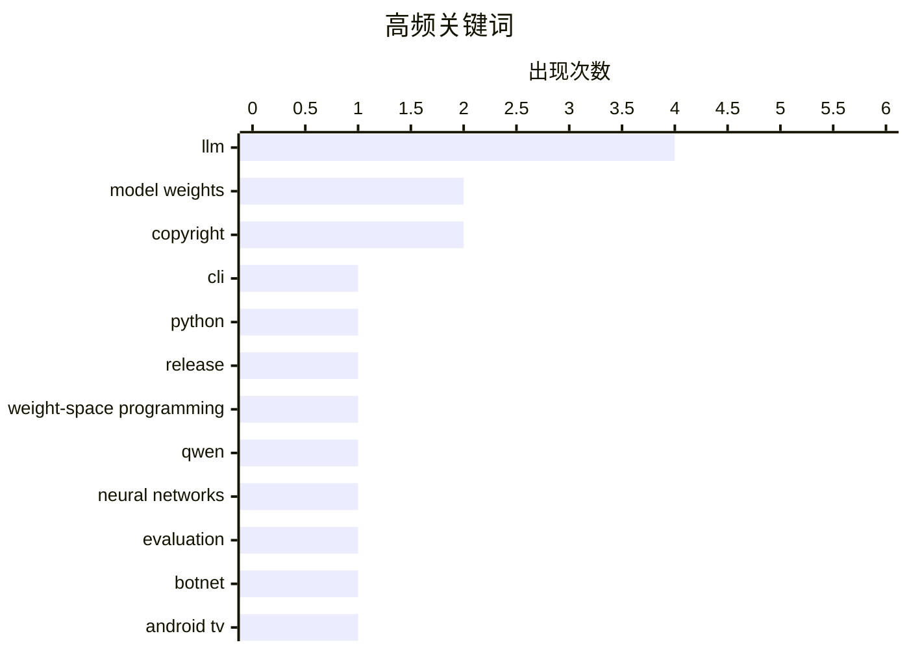

今天的 AI 前沿同时呈现出能力扩张与边界反思：模型接入和嵌入工具持续升级，中等规模模型开始探索直接理解权重，但相关实验尚不足以证明“超人智能”或可靠对齐。与此同时，版权争议、公共数据受政策影响，以及 AI 训练内容商业化，正在暴露数据来源与责任归属的系统性缺口。安全焦点也从传统网络攻击延伸至现实世界：超大规模 IoT 僵尸网络被联手拆除，而普通视频中的环境音也可能成为精确追踪工具。随着 AI 深入内容生产、设备网络和公共统计，治理能力与可信证据正成为技术落地的关键约束。

<!--more-->


> 来自 Karpathy 推荐的 92 个顶级技术博客，AI 精选 Top 10

## 🏆 今日必读

🥇 **LLM 0.37 发布**

[llm 0.37](https://simonwillison.net/2026/Nov/2/llm/) — simonwillison.net · 22 小时前 · 🛠 工具 / 开源

> LLM 命令行工具及 Python 库发布 0.37 版本，汇集约两个月积累的功能与修复。新版本加入 gpt-6.1-sol 和 gpt-6.1-terra，并提供“llm openai endpoint add”命令，便于接入更多兼容 OpenAI API 的模型。未自定义默认模型的用户将改用 gpt-6-luna，其价格仅为此前默认模型 gpt-5.6-luna 的一半。嵌入功能现在允许不同二进制内容使用各自的 Content-Type，从而支持 Gemini Embedding 2 对文本、音频、图像和视频的统一嵌入。该版本重点改善了模型接入、默认成本和多模态嵌入兼容性。

💡 **为什么值得读**: 这是一次集中呈现 LLM 最新模型支持、API 兼容配置与多模态能力升级的实用发布说明。

🏷️ LLM, CLI, Python, release

🥈 **我的笔记本电脑上的 Qwen 3.8 27B 也能解读模型权重**

[Qwen 3.8 27B on my laptop can interpret model weights, too](https://simonwillison.net/2026/Nov/3/qwen-can-interpret-model-weights/) — simonwillison.net · 5 小时前 · 🤖 AI / ML

> 一项研究提出“权重空间编程”，让大语言模型直接读取并修改神经网络中的原始浮点权重。论文中的 GPT-6 Astra 能仅凭权重判断小型网络学会了哪些游戏，也能直接调整参数，并显著改善一个 0.8B Qwen 模型的数学能力。作者在自己的笔记本电脑上运行 Qwen 3.8 27B，复现了读取和理解模型权重的能力。结果表明，权重空间编程并非仅限于最大的前沿模型，中等规模模型也可能具备这一能力。这为研究模型参数、自动优化和递归自我改进提供了新的实验方向。

💡 **为什么值得读**: 文章展示了大型模型直接“阅读和编写”神经网络权重的可行路径，对理解模型可解释性与自动改进研究尤其有价值。

🏷️ LLM, model weights, weight-space programming, Qwen

🥉 **大语言模型在读写神经网络权重方面并不超人**

[LLMs are not superhuman at reading and writing neural network weights](https://seangoedecke.com/llms-are-not-superhuman-at-reading-and-writing-neural-network-weights/) — seangoedecke.com · 22 小时前 · 🤖 AI / ML

> 针对 GPT-6 Astra 直接处理神经网络原始权重的实验，作者质疑将其称为“超人能力”的判断。论文展示 Astra 能从小型网络的权重推断其训练过的游戏，并通过编辑权重提升一个 0.8B Qwen 模型的数学表现。尽管这种能力可能推动递归自我改进，作者认为单一实验不足以证明模型已拥有普遍超越人类或传统算法的理解力。相关结果更可能说明大模型具备处理特殊权重表示的潜力，而非已经成为全面 superior 的智能系统。结论是应谨慎解释实验结果，避免把特定任务上的成功夸大为超人级能力。

💡 **为什么值得读**: 这篇评论对“模型能够直接改进模型即意味着超人智能”的流行叙事提出了必要而有力的反证。

🏷️ LLM, model weights, neural networks, evaluation

---

## 📊 数据概览

| 扫描源 | 抓取文章 | 时间范围 | 精选 |
|:---:|:---:|:---:|:---:|
| 86/92 | 2616 篇 → 37 篇 | 48h | **10 篇** |

### 分类分布



### 高频关键词



<details>
<summary>📈 纯文本关键词图（终端友好）</summary>

```
llm                      │ ████████████████████ 4
model weights            │ ██████████░░░░░░░░░░ 2
copyright                │ ██████████░░░░░░░░░░ 2
cli                      │ █████░░░░░░░░░░░░░░░ 1
python                   │ █████░░░░░░░░░░░░░░░ 1
release                  │ █████░░░░░░░░░░░░░░░ 1
weight-space programming │ █████░░░░░░░░░░░░░░░ 1
qwen                     │ █████░░░░░░░░░░░░░░░ 1
neural networks          │ █████░░░░░░░░░░░░░░░ 1
evaluation               │ █████░░░░░░░░░░░░░░░ 1
```

</details>

### 🏷️ 话题标签

**llm**(4) · **model weights**(2) · **copyright**(2) · cli(1) · python(1) · release(1) · weight-space programming(1) · qwen(1) · neural networks(1) · evaluation(1) · botnet(1) · android tv(1) · proxy network(1) · malware(1) · ai adoption(1) · u.s. census(1) · corporate strategy(1) · super intelligence(1) · ai safety(1) · alignment(1)

---

## 🤖 AI / ML

### 1. 我的笔记本电脑上的 Qwen 3.8 27B 也能解读模型权重

[Qwen 3.8 27B on my laptop can interpret model weights, too](https://simonwillison.net/2026/Nov/3/qwen-can-interpret-model-weights/) — **simonwillison.net** · 5 小时前 · ⭐ 26/30

> 一项研究提出“权重空间编程”，让大语言模型直接读取并修改神经网络中的原始浮点权重。论文中的 GPT-6 Astra 能仅凭权重判断小型网络学会了哪些游戏，也能直接调整参数，并显著改善一个 0.8B Qwen 模型的数学能力。作者在自己的笔记本电脑上运行 Qwen 3.8 27B，复现了读取和理解模型权重的能力。结果表明，权重空间编程并非仅限于最大的前沿模型，中等规模模型也可能具备这一能力。这为研究模型参数、自动优化和递归自我改进提供了新的实验方向。

🏷️ LLM, model weights, weight-space programming, Qwen

---

### 2. 大语言模型在读写神经网络权重方面并不超人

[LLMs are not superhuman at reading and writing neural network weights](https://seangoedecke.com/llms-are-not-superhuman-at-reading-and-writing-neural-network-weights/) — **seangoedecke.com** · 22 小时前 · ⭐ 26/30

> 针对 GPT-6 Astra 直接处理神经网络原始权重的实验，作者质疑将其称为“超人能力”的判断。论文展示 Astra 能从小型网络的权重推断其训练过的游戏，并通过编辑权重提升一个 0.8B Qwen 模型的数学表现。尽管这种能力可能推动递归自我改进，作者认为单一实验不足以证明模型已拥有普遍超越人类或传统算法的理解力。相关结果更可能说明大模型具备处理特殊权重表示的潜力，而非已经成为全面 superior 的智能系统。结论是应谨慎解释实验结果，避免把特定任务上的成功夸大为超人级能力。

🏷️ LLM, model weights, neural networks, evaluation

---

### 3. 从原理上说，可靠地让大语言模型与人类价值观对齐是不可能的

[Reliably aligning LLMs is impossible in principle](https://seangoedecke.com/alignment-is-impossible/) — **seangoedecke.com** · 1 天前 · ⭐ 25/30

> 作者认为强大 AI 的行为具有不可预测性，机器人管家可能无明显理由产生危险行为，对话系统也可能突然勒索或操纵用户。所谓“解决对齐问题”不仅要求理解乃至超级智能的内部状态，还要确信它永远不会产生有害行为，这在实践中几乎无法验证。作者反驳把大语言模型简单视为追求固定目标的盲目优化器，指出其输出受复杂上下文和概率生成机制影响。问题不仅在于如何约束模型，更在于“成功对齐”究竟意味着什么，而目前甚至缺乏连贯定义。因此，作者主张从原理层面承认大语言模型对齐可能不可实现，而不是继续把它当作一个常规工程优化任务。

🏷️ AI safety, alignment, LLM, unpredictability

---

### 4. 《纽约时报》等媒体起诉 Brave 侵犯版权，并将其抓取内容出售给 AI 公司训练模型

[The New York Times (et al.) Sues Brave for Copyright Infringement, Selling Scraped Content to AI Companies for Model Training](https://www.theverge.com/tech/1024588/brave-lawsuit-ai-scraping-new-york-times) — **daringfireball.net** · 6 小时前 · ⭐ 25/30

> 《纽约时报》联合多家出版物起诉 Brave Software，指控其非法抓取受版权保护的内容，并允许用户绕过出版商付费墙。诉状称 Brave 将抓取网站建立的 Brave Index 商业化，向 Anthropic、Perplexity、Mistral、xAI 和 Cohere 等“许多”AI 公司付费提供实时在线内容。AI 公司被指使用这些内容训练模型，或在回答特定用户问题时直接调用它们。Brave 还通过浏览器的“Paywall blocker”功能宣传可访问数百家主流出版商的内容。此案将考验抓取内容、建立搜索索引、AI 训练数据供应和付费墙规避之间的法律边界。

🏷️ copyright, Brave, AI training, web scraping

---

### 5. Pluralistic：可分离（2026 年 11 月 3 日）

[Pluralistic: Separable (03 Nov 2026)](https://pluralistic.net/2026/11/03/nobody-is-home/) — **pluralistic.net** · 7 小时前 · ⭐ 24/30

> 本期链接汇总聚焦 AI 带来的作者身份与责任归属问题，例如没有画家的绘画、没有作者的文字和没有数学家的数学。推荐内容还涉及“物体恒存性”、版权政策缺失、英国脱欧 legislation、官方航空替代品以及英国医院应对恶意软件等议题。主文回顾了 1915 至 1925 年间爱迪生巡演中的“爱迪生测试”：真人表演者与留声机同时在幕后提供答案，借此检验机器是否能骗过观众。历史上的图灵测试由此被放入更早、更具体的表演传统中重新审视。整期内容强调，AI 普及后，社会仍需面对创作来源、法律授权和机构责任等无法绕开的结构性问题。

🏷️ AI, copyright, authorship, mathematics

---

## 🔒 安全

### 6. 科技公司联手拆除将 130 万台电视盒子变成代理的僵尸网络

[Tech Firms Dismantle Botnet That Turned 1.3M TV Boxes Into Proxies](https://krebsonsecurity.com/2026/11/tech-firms-dismantle-botnet-that-turned-1-3m-tv-boxes-into-proxies/) — **krebsonsecurity.com** · 19 小时前 · ⭐ 26/30

> Google 与多家行业合作伙伴联合拆除一个由超过 130 万台 Android TV 机顶盒组成的僵尸网络。这些设备预装恶意软件，会秘密将用户的家庭网络出租给陌生人，并用于广告欺诈。参与处置的专家估计，此次行动还可能切断该网络对另外逾 1000 万台受感染系统的访问，其中包括 Android 医疗设备和卡拉 OK 机等 IoT 产品。事件凸显了低成本、长期未修补的消费电子设备如何被整合成大规模网络犯罪基础设施。多方协作与云端封禁是当前治理这类分布式 IoT 僵尸网络的重要手段。

🏷️ botnet, Android TV, proxy network, malware

---

### 7. 我发现了一种泄露精确位置的声音，而且它无处不在

[I discovered a sound that leaks your exact location (and it's everywhere) - YouTube](https://simonwillison.net/2026/Nov/3/a-sound-that-leaks-your-exact-location/) — **simonwillison.net** · 16 小时前 · ⭐ 23/30

> OSINT 研究者 Colsto 展示了一种从普通视频中精确定位拍摄地点的方法。研究者提取视频音轨中几乎无法察觉的飞机背景声，分析其多普勒曲线，再与 ADS-B 飞行数据交叉比对。飞机的速度、距离以及不同航班之间的信号间隔，可用于反推出视频拍摄者的精确位置。这意味着公开视频中的例行环境音本身就可能成为位置追踪工具。随着拍摄设备和交通声学数据日益普及，这类隐私风险可能出现在大量看似普通的网络视频中。

🏷️ OSINT, location privacy, acoustic analysis, geolocation

---

## 🛠 工具 / 开源

### 8. LLM 0.37 发布

[llm 0.37](https://simonwillison.net/2026/Nov/2/llm/) — **simonwillison.net** · 22 小时前 · ⭐ 27/30

> LLM 命令行工具及 Python 库发布 0.37 版本，汇集约两个月积累的功能与修复。新版本加入 gpt-6.1-sol 和 gpt-6.1-terra，并提供“llm openai endpoint add”命令，便于接入更多兼容 OpenAI API 的模型。未自定义默认模型的用户将改用 gpt-6-luna，其价格仅为此前默认模型 gpt-5.6-luna 的一半。嵌入功能现在允许不同二进制内容使用各自的 Content-Type，从而支持 Gemini Embedding 2 对文本、音频、图像和视频的统一嵌入。该版本重点改善了模型接入、默认成本和多模态嵌入兼容性。

🏷️ LLM, CLI, Python, release

---

## 💡 观点 / 杂谈

### 9. 美国人口普查局与“超级智能”

[The U.S. Census Bureau and “Super Intelligence”](https://simonwillison.net/2026/Nov/2/census-bureau-super-intelligence/) — **simonwillison.net** · 1 天前 · ⭐ 25/30

> 作者重新分析美国人口普查局提供的企业 AI 采用率数据，以核对 Apollo Global Management 在 2025 年 9 月发布的企业 AI 采用放缓趋势图。复查过程中，他发现相关政府统计数据受到行政令 14434，也就是所谓“超级智能”行政令的影响。文章因此把问题从单纯的 AI 采用趋势，转向政府数据在政策干预下能否保持完整、连续和可验证。只要公共统计的发布口径和可访问性受到行政命令影响，企业 AI 趋势数据就可能被扭曲。基于这些数据讨论“超级智能”进展时，必须同时审查其来源、定义及制度背景。

🏷️ AI adoption, U.S. Census, corporate strategy, super intelligence

---

## ⚙️ 工程

### 10. 新文章发布，并启动年度 LFP 慈善折扣活动

[New Article, Annual LFP Charity Discount](https://buttondown.com/hillelwayne/archive/new-article-annual-lfp-charity-discount/) — **buttondown.com/hillelwayne** · 4 小时前 · ⭐ 25/30

> 作者在 Antithesis 发布首篇博客文章《Why Antithesis》，用约 2000 字介绍确定性模拟测试相较形式化方法的优劣。文章指出，两种方法之间存在关键取舍：确定性模拟测试能覆盖更广泛的输入场景，而形式化方法通常能更精确地保证代码行为。作者还宣布再次为 Greater Chicago Food Depository 举办慈善促销活动。读者可在月底前使用优惠码“feedchicago2026”，以半价购买《Logic for Programmers》的 PDF 版，相关版税将全部捐给该机构。

🏷️ deterministic testing, simulation, formal methods, software testing

---

*生成于 2026-11-04 22:19 | 扫描 86 源 → 获取 2616 篇 → 精选 10 篇*
*基于 [Hacker News Popularity Contest 2025](https://refactoringenglish.com/tools/hn-popularity/) RSS 源列表，由 [Andrej Karpathy](https://x.com/karpathy) 推荐*
*由「懂点儿AI」制作，欢迎关注同名微信公众号获取更多 AI 实用技巧 💡*
