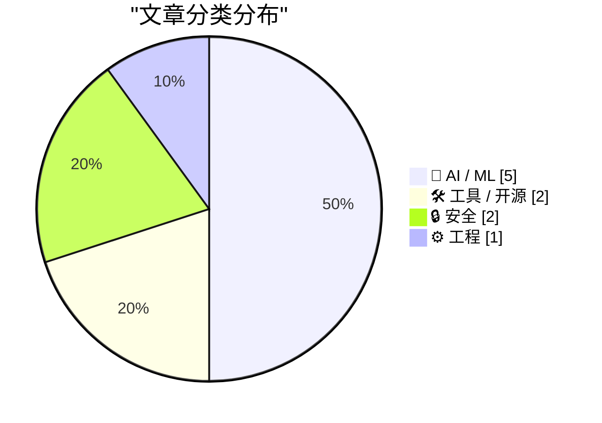
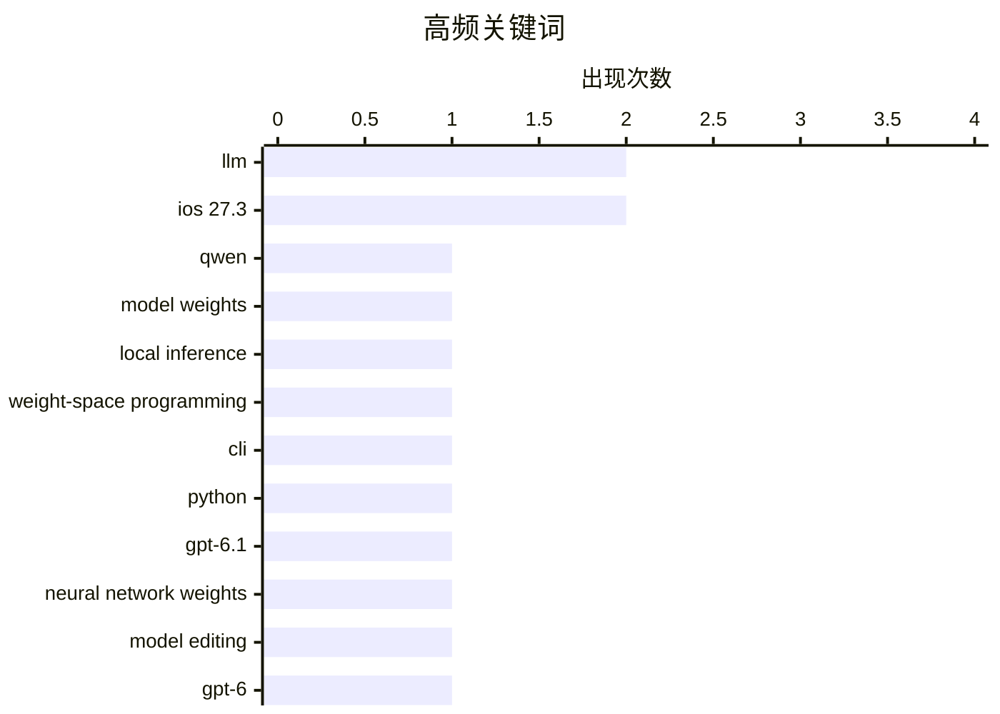

今日技术圈的两大主线，是大模型开始深入理解并直接操作神经网络权重，以及 AI 能力加速融入开发工具与应用生态；随着相关能力下沉至本地可运行模型，智能代理的门槛继续降低，但研究也提醒，“权重编程”尚不等于超人式自我改进。与此同时，兼容接口、多模态嵌入、对话式数据应用和 Siri 开放，正推动 AI 从独立助手走向可交互、可扩展的平台层。与此同时，版权与隐私风险同步升温：媒体起诉内容抓取平台，Brave 案将牵动 AI 训练数据合规，而 IoT 僵尸网络与视频声纹定位也暴露了智能设备和日常环境中的新型安全威胁。

<!--more-->


> 来自 Karpathy 推荐的 92 个顶级技术博客，AI 精选 Top 10

## 🏆 今日必读

🥇 **Qwen 3.8 27B 在我的笔记本电脑上也能解读模型权重**

[Qwen 3.8 27B on my laptop can interpret model weights, too](https://simonwillison.net/2026/Nov/3/qwen-can-interpret-model-weights/) — simonwillison.net · 1 天前 · 🤖 AI / ML

> “权重空间编程”研究指出，GPT-6 Astra 等前沿模型能够直接读取并修改以浮点数表示的神经网络权重，而不必只通过训练代码或梯度更新来优化模型。通过实验论文中的示例，Simon Willison 确认运行在个人笔记本电脑上的 Qwen 3.8 27B 也具备类似能力。模型因此可以分析模型权重、理解参数所体现的功能，并尝试直接编辑权重。该结果表明，权重空间编程并非仅属于超大规模闭源模型，也可能出现在规模更小、能够在本地运行的开放模型中。

💡 **为什么值得读**: 这项实验把前沿模型直接读写权重的能力复现到了本地 27B 模型上，为评估权重空间编程的实际门槛与潜在影响提供了直观案例。

🏷️ Qwen, model weights, local inference, weight-space programming

🥈 **llm 0.37**

[llm 0.37](https://simonwillison.net/2026/Nov/2/llm/) — simonwillison.net · 1 天前 · 🛠 工具 / 开源

> llm 0.37 是一次包含约两个月功能积累与修复的重要版本更新。新版本加入 gpt-6.1-sol 和 gpt-6.1-terra 模型，并提供“llm openai endpoint add”命令，以便配置更多兼容 OpenAI API 的模型。未自定义默认模型的用户将改用 gpt-6-luna，其价格只有此前默认模型 gpt-5.6-luna 的一半。嵌入功能还改进了对不同二进制内容类型的处理，以支持 Gemini Embedding 2 对文本、音频、图像和视频的嵌入。

💡 **为什么值得读**: 它一次覆盖了模型接入、默认模型成本和多媒体嵌入支持等实用改进，对使用 llm 命令行工具或 Python API 的开发者很有参考价值。

🏷️ LLM, CLI, Python, GPT-6.1

🥉 **大语言模型在读写神经网络权重方面并不超人**

[LLMs are not superhuman at reading and writing neural network weights](https://seangoedecke.com/llms-are-not-superhuman-at-reading-and-writing-neural-network-weights/) — seangoedecke.com · 1 天前 · 🤖 AI / ML

> 针对大语言模型能够直接操作神经网络权重的最新研究，作者认为这种能力看起来“超人”，实际上并非如此。实验显示，GPT-6 Astra 能仅凭权重识别一个小网络所学会的游戏，并能通过原生编辑权重显著改善 0.8B Qwen 模型的数学能力。作者指出，人类的专长在于设计有效的表示、可视化与操作工具，因此这种成果更应理解为模型与人类工具结合后的表现，而非模型单独超越了人类。直接改进语言模型仍是实现递归自我改进的重要研究方向，但目前尚不能据此认定已经出现“超人式”的自我改进能力。

💡 **为什么值得读**: 文章对备受关注的权重操作演示提供了必要的技术辨析，有助于读者区分真正的模型能力、工具辅助效果与夸大的自我改进叙事。

🏷️ LLM, neural network weights, model editing, GPT-6

---

## 📊 数据概览

| 扫描源 | 抓取文章 | 时间范围 | 精选 |
|:---:|:---:|:---:|:---:|
| 86/92 | 2616 篇 → 45 篇 | 48h | **10 篇** |

### 分类分布



### 高频关键词



<details>
<summary>📈 纯文本关键词图（终端友好）</summary>

```
llm                      │ ████████████████████ 2
ios 27.3                 │ ████████████████████ 2
qwen                     │ ██████████░░░░░░░░░░ 1
model weights            │ ██████████░░░░░░░░░░ 1
local inference          │ ██████████░░░░░░░░░░ 1
weight-space programming │ ██████████░░░░░░░░░░ 1
cli                      │ ██████████░░░░░░░░░░ 1
python                   │ ██████████░░░░░░░░░░ 1
gpt-6.1                  │ ██████████░░░░░░░░░░ 1
neural network weights   │ ██████████░░░░░░░░░░ 1
```

</details>

### 🏷️ 话题标签

**llm**(2) · **ios 27.3**(2) · **qwen**(1) · model weights(1) · local inference(1) · weight-space programming(1) · cli(1) · python(1) · gpt-6.1(1) · neural network weights(1) · model editing(1) · gpt-6(1) · siri ai(1) · developer apis(1) · app integration(1) · brave(1) · copyright(1) · web scraping(1) · ai training(1) · safari(1)

---

## 🤖 AI / ML

### 1. Qwen 3.8 27B 在我的笔记本电脑上也能解读模型权重

[Qwen 3.8 27B on my laptop can interpret model weights, too](https://simonwillison.net/2026/Nov/3/qwen-can-interpret-model-weights/) — **simonwillison.net** · 1 天前 · ⭐ 26/30

> “权重空间编程”研究指出，GPT-6 Astra 等前沿模型能够直接读取并修改以浮点数表示的神经网络权重，而不必只通过训练代码或梯度更新来优化模型。通过实验论文中的示例，Simon Willison 确认运行在个人笔记本电脑上的 Qwen 3.8 27B 也具备类似能力。模型因此可以分析模型权重、理解参数所体现的功能，并尝试直接编辑权重。该结果表明，权重空间编程并非仅属于超大规模闭源模型，也可能出现在规模更小、能够在本地运行的开放模型中。

🏷️ Qwen, model weights, local inference, weight-space programming

---

### 2. 大语言模型在读写神经网络权重方面并不超人

[LLMs are not superhuman at reading and writing neural network weights](https://seangoedecke.com/llms-are-not-superhuman-at-reading-and-writing-neural-network-weights/) — **seangoedecke.com** · 1 天前 · ⭐ 26/30

> 针对大语言模型能够直接操作神经网络权重的最新研究，作者认为这种能力看起来“超人”，实际上并非如此。实验显示，GPT-6 Astra 能仅凭权重识别一个小网络所学会的游戏，并能通过原生编辑权重显著改善 0.8B Qwen 模型的数学能力。作者指出，人类的专长在于设计有效的表示、可视化与操作工具，因此这种成果更应理解为模型与人类工具结合后的表现，而非模型单独超越了人类。直接改进语言模型仍是实现递归自我改进的重要研究方向，但目前尚不能据此认定已经出现“超人式”的自我改进能力。

🏷️ LLM, neural network weights, model editing, GPT-6

---

### 3. Apple 开始向开发者开放 Siri AI

[Apple Begins Opening Siri AI to Developers](https://developer.apple.com/news/?id=gdk2umrf) — **daringfireball.net** · 22 小时前 · ⭐ 26/30

> 从 iOS 27.3、iPadOS 27.3、macOS 27.3 和 visionOS 27.3 测试版开始，Apple 通过 Developer Preview 向开发者开放 Siri AI 应用意图。任何开发者都可以让应用直接与 Siri AI 协作，从而探索新的用户触达和服务方式。该预览版将在未来几个月正式向用户发布，App Store 提交通道则计划于春季开放，以便开发者有时间测试并共同完善体验。Apple 表示，启用 Siri AI 的相关条款和使用政策将在后续公布。

🏷️ Siri AI, iOS 27.3, developer APIs, app integration

---

### 4. 《纽约时报》等媒体起诉 Brave 侵犯版权，并将抓取内容出售给 AI 公司训练模型

[The New York Times (et al.) Sues Brave for Copyright Infringement, Selling Scraped Content to AI Companies for Model Training](https://www.theverge.com/tech/1024588/brave-lawsuit-ai-scraping-new-york-times) — **daringfireball.net** · 1 天前 · ⭐ 26/30

> 《纽约时报》以及《纽约每日新闻》《芝加哥论坛报》和《奥兰多哨兵报》等出版物起诉 Brave，指控其非法抓取网站内容、帮助用户绕过付费墙，并将抓取索引商业化。诉状称 Brave 通过“Brave Index”向包括 Anthropic、Perplexity、Mistral、xAI 和 Cohere 在内的“许多”AI 公司付费提供实时在线内容，供其训练模型或直接用于回答用户问题。Brave 浏览器还宣传可通过“Paywall blocker”访问数百家顶级出版商的内容。案件把浏览器抓取、数据授权和 AI 训练用途结合起来，可能影响内容索引和模型训练数据链路的合规边界。

🏷️ Brave, copyright, web scraping, AI training

---

### 5. datasette-agent 0.5a0

[datasette-agent 0.5a0](https://simonwillison.net/2026/Nov/3/datasette-agent/) — **simonwillison.net** · 23 小时前 · ⭐ 23/30

> datasette-agent 0.5a0 是一次重要版本更新，其中最受关注的新功能是 panel。聊天窗口可以停靠在 Datasette 的表格或查询页面旁边，让用户在对话与数据应用之间切换。结合 datasette-apps，用户可以通过提示让代理即时生成一个由数据库支持的应用，再在旁边的聊天面板中继续修改它。示例场景是代理根据数据构建“评估大模型价格”的应用，并直接调整其功能。这种交互把对话式开发从单纯生成代码推进到边构建、边查看、边迭代应用。

🏷️ Datasette, AI agent, panels

---

## 🛠 工具 / 开源

### 6. llm 0.37

[llm 0.37](https://simonwillison.net/2026/Nov/2/llm/) — **simonwillison.net** · 1 天前 · ⭐ 26/30

> llm 0.37 是一次包含约两个月功能积累与修复的重要版本更新。新版本加入 gpt-6.1-sol 和 gpt-6.1-terra 模型，并提供“llm openai endpoint add”命令，以便配置更多兼容 OpenAI API 的模型。未自定义默认模型的用户将改用 gpt-6-luna，其价格只有此前默认模型 gpt-5.6-luna 的一半。嵌入功能还改进了对不同二进制内容类型的处理，以支持 Gemini Embedding 2 对文本、音频、图像和视频的嵌入。

🏷️ LLM, CLI, Python, GPT-6.1

---

### 7. Safari 27.3 测试版新增垂直标签页和自适应深色模式

[Safari 27.3 Beta Adds Vertical Tabs and Adaptive Dark Mode](https://www.macrumors.com/2026/11/03/ios-27-3-safari/) — **daringfireball.net** · 1 天前 · ⭐ 25/30

> iOS 27.3、iPadOS 27.3 和 macOS Golden Gate 27.3 为 Safari 带来重要更新，核心变化是可用垂直标签页替代传统水平标签栏。垂直标签栏位于屏幕左侧，默认以图标显示以节省空间，也可以加宽并显示网站标题。该布局兼容 Topics 和 Tab Groups，并继续支持拖动固定标签页、快速切换标签组等操作。虽然垂直标签页尤其适合配备更大屏幕的 iPhone Duo，但该功能会覆盖 iPhone、iPad 和 Mac。自适应深色模式也是此次更新的一部分，为不同光线环境提供更合适的显示效果。

🏷️ Safari, vertical tabs, adaptive dark mode, iOS 27.3

---

## 🔒 安全

### 8. 科技公司拆除将 130 万台电视盒子变成代理的僵尸网络

[Tech Firms Dismantle Botnet That Turned 1.3M TV Boxes Into Proxies](https://krebsonsecurity.com/2026/11/tech-firms-dismantle-botnet-that-turned-1-3m-tv-boxes-into-proxies/) — **krebsonsecurity.com** · 1 天前 · ⭐ 24/30

> Google 与行业合作伙伴共同拆除了一个由超过 130 万台 Android TV 机顶盒组成的僵尸网络。这些设备预装的恶意软件会秘密租用用户的互联网连接供陌生人使用，并实施广告欺诈。参与处置的专家表示，此次行动还可能切断该僵尸网络对另外逾 1000 万台受损系统的访问，其中包括基于 Android 的医疗设备和卡拉 OK 机等物联网产品。事件显示，攻击面已从传统电脑和手机扩大到大量常驻家庭、缺乏安全维护的智能设备。

🏷️ botnet, Android TV, malware, ad fraud

---

### 9. 我发现了一种会泄露你精确位置的声音，而且无处不在

[I discovered a sound that leaks your exact location (and it's everywhere) - YouTube](https://simonwillison.net/2026/Nov/3/a-sound-that-leaks-your-exact-location/) — **simonwillison.net** · 1 天前 · ⭐ 23/30

> Colsto 展示了一种利用视频背景声音精确定位拍摄地点的开源情报方法。方法是从几乎难以察觉的飞机声轨中提取多普勒曲线，再结合 ADS-B 数据进行交叉比对。根据飞机的速度、距离以及不同航班之间的间隔，可以推算视频的精确拍摄位置。这意味着普通视频中普遍存在的环境噪声可能携带创作者未主动公开的位置信息，对隐私保护和个人行踪安全构成潜在威胁。

🏷️ OSINT, geolocation, privacy, acoustic analysis

---

## ⚙️ 工程

### 10. 新文章发布，并推出年度 LFP 慈善折扣

[New Article, Annual LFP Charity Discount](https://buttondown.com/hillelwayne/archive/new-article-annual-lfp-charity-discount/) — **buttondown.com/hillelwayne** · 1 天前 · ⭐ 24/30

> 作者为 Antithesis 撰写的首篇博客文章《Why Antithesis》已经发布，篇幅约 2000 字。文章比较了确定性模拟测试与形式化方法各自的优缺点，并概括了二者之间的核心权衡：输入覆盖率与代码保真度通常难以同时最大化。作者还宣布再次举行为大芝加哥食品银行募捐的活动。读者可在本月结束前使用优惠码 feedchicago2026，以半价购买《Logic for Programmers》的 PDF，相关版税将全部捐给该慈善机构。

🏷️ deterministic simulation testing, formal methods, software testing, verification

---

*生成于 2026-11-05 22:19 | 扫描 86 源 → 获取 2616 篇 → 精选 10 篇*
*基于 [Hacker News Popularity Contest 2025](https://refactoringenglish.com/tools/hn-popularity/) RSS 源列表，由 [Andrej Karpathy](https://x.com/karpathy) 推荐*
*由「懂点儿AI」制作，欢迎关注同名微信公众号获取更多 AI 实用技巧 💡*
