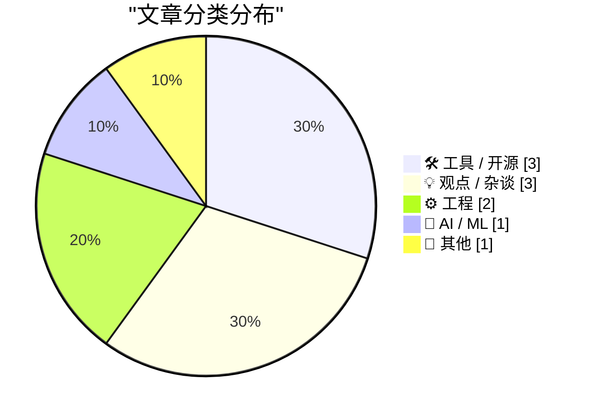
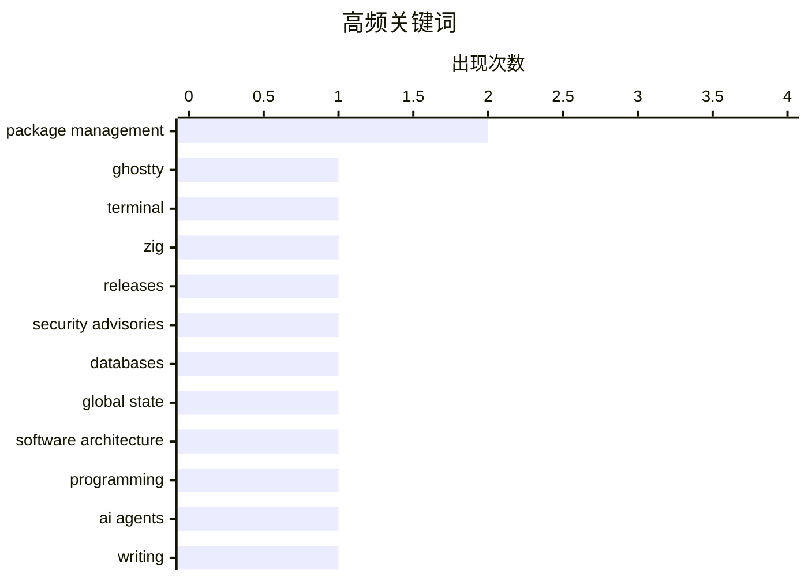

今日技术圈的主线之一，是 AI 从单点辅助升级为“主智能体＋多代理协作”，直接接管研究、写作、编码与内容生产。与此同时，行业开始正视智能体尚未兑现的价值，以及算力、噪声、低质输出等被外部化的成本。另一条主线是软件供应链风险持续升温，依赖锁定、组件复用与终端基础设施解耦都在促使团队重新审视安全边界和集成方式。工程与组织层面，共享状态治理、跨职能设计协作以及科技平台权力集中，正成为开发者重新审视软件架构与职场结构的重要切口。

<!--more-->


> 来自 Karpathy 推荐的 92 个顶级技术博客，AI 精选 Top 10

## 🏆 今日必读

🥇 **Libghostty 1.0**

[Libghostty 1.0](https://mitchellh.com/writing/libghostty-1-0) — mitchellh.com · 1 天前 · 🛠 工具 / 开源

> Libghostty 1.0 标志着 Ghostty 终端核心能力以可复用库的形式达到 1.0 稳定版本。发布重点是把终端模拟器所需的界面、输入输出与渲染能力从完整应用中解耦，以便其他产品直接集成。它为开发跨平台终端工具、编辑器终端面板及定制化终端环境提供了比复用整个 Ghostty 应用更明确的接入路径。其核心价值在于降低复用门槛，同时允许集成方继续控制产品体验与发布节奏。

💡 **为什么值得读**: 这是了解 Ghostty 生态从独立终端应用走向可嵌入基础设施的重要发布说明，适合关注终端技术、跨平台开发或工具链组件化的读者。

🏷️ Ghostty, terminal, Zig

🥈 **本周包管理动态：2026 年 11 月 7 日**

[This Week in Package Management: 7 November 2026](https://nesbitt.io/2026/11/07/this-week-in-package-management.html) — nesbitt.io · 12 小时前 · 🛠 工具 / 开源

> 这期包管理周报汇总了 2026 年 11 月 7 日全球软件包生态的最新动态。内容覆盖包管理器与依赖项目发布、安全公告以及值得阅读的技术文章三条主线。它将分散在开源项目、语言包仓库和开发者社区中的更新集中整理，方便读者追踪供应链变化。文章的定位不是深入讲解单一工具，而是帮助开发者快速掌握近期包管理界面的整体变化与风险信号。

💡 **为什么值得读**: 它能在一处汇总包发布、安全预警和生态文章，是开发者定期检查依赖管理与软件供应链动态的高效入口。

🏷️ package management, releases, security advisories

🥉 **数据库就是全局变量的存储区**

[A database is a store for global variables](https://seangoedecke.com/a-database-is-a-store-for-global-variables/) — seangoedecke.com · 1 天前 · ⚙️ 工程

> 数据库可以被理解为程序中的全局变量存储区，因为任意代码位置都可能读取或修改其中的记录。作者指出，全局变量通常有两大问题：它允许程序各部分隐式传递数据，并让多个模块因共享状态而相互耦合。这两个问题同样适用于数据库，因此优雅的软件仍然离不开数据库，本身就说明“避免全局变量”这条建议并不完整。文章进一步追问数据库究竟凭借什么特性成为全局状态管理中的例外，从而重新审视应用架构中的共享状态与模块边界。

💡 **为什么值得读**: 文章用一个直观而反直觉的类比澄清数据库与全局变量的关系，有助于开发者理解数据访问层、隐式耦合和架构边界之间的取舍。

🏷️ databases, global state, software architecture, programming

---

## 📊 数据概览

| 扫描源 | 抓取文章 | 时间范围 | 精选 |
|:---:|:---:|:---:|:---:|
| 85/92 | 2609 篇 → 26 篇 | 48h | **10 篇** |

### 分类分布



### 高频关键词



<details>
<summary>📈 纯文本关键词图（终端友好）</summary>

```
package management    │ ████████████████████ 2
ghostty               │ ██████████░░░░░░░░░░ 1
terminal              │ ██████████░░░░░░░░░░ 1
zig                   │ ██████████░░░░░░░░░░ 1
releases              │ ██████████░░░░░░░░░░ 1
security advisories   │ ██████████░░░░░░░░░░ 1
databases             │ ██████████░░░░░░░░░░ 1
global state          │ ██████████░░░░░░░░░░ 1
software architecture │ ██████████░░░░░░░░░░ 1
programming           │ ██████████░░░░░░░░░░ 1
```

</details>

### 🏷️ 话题标签

**package management**(2) · **ghostty**(1) · **terminal**(1) · zig(1) · releases(1) · security advisories(1) · databases(1) · global state(1) · software architecture(1) · programming(1) · ai agents(1) · writing(1) · english(1) · automation(1) · tech oligarchy(1) · labor organizing(1) · worker rights(1) · technology policy(1) · dependencies(1) · supply chain(1)

---

## 🛠 工具 / 开源

### 1. Libghostty 1.0

[Libghostty 1.0](https://mitchellh.com/writing/libghostty-1-0) — **mitchellh.com** · 1 天前 · ⭐ 23/30

> Libghostty 1.0 标志着 Ghostty 终端核心能力以可复用库的形式达到 1.0 稳定版本。发布重点是把终端模拟器所需的界面、输入输出与渲染能力从完整应用中解耦，以便其他产品直接集成。它为开发跨平台终端工具、编辑器终端面板及定制化终端环境提供了比复用整个 Ghostty 应用更明确的接入路径。其核心价值在于降低复用门槛，同时允许集成方继续控制产品体验与发布节奏。

🏷️ Ghostty, terminal, Zig

---

### 2. 本周包管理动态：2026 年 11 月 7 日

[This Week in Package Management: 7 November 2026](https://nesbitt.io/2026/11/07/this-week-in-package-management.html) — **nesbitt.io** · 12 小时前 · ⭐ 23/30

> 这期包管理周报汇总了 2026 年 11 月 7 日全球软件包生态的最新动态。内容覆盖包管理器与依赖项目发布、安全公告以及值得阅读的技术文章三条主线。它将分散在开源项目、语言包仓库和开发者社区中的更新集中整理，方便读者追踪供应链变化。文章的定位不是深入讲解单一工具，而是帮助开发者快速掌握近期包管理界面的整体变化与风险信号。

🏷️ package management, releases, security advisories

---

### 3. Bernie 的周末II

[Weekend at Bernie’s II](https://nesbitt.io/2026/11/06/weekend-at-bernies-ii.html) — **nesbitt.io** · 1 天前 · ⭐ 22/30

> 这是一次以六个月为时间尺度的软件供应链事件回顾，重点检查当前依赖项中还潜藏着哪些风险。作者用“哪些依赖项还戴着墨镜”隐晦追问哪些组件仍在隐藏异常行为或安全威胁。内容延续“周末Bernie”主题对受污染依赖、隐蔽攻击面和开发者信任问题的审视。它提醒团队，持续锁定版本并不能自动消除供应链风险，安全响应必须覆盖整个依赖图。

🏷️ dependencies, package management, supply chain, security

---

## 💡 观点 / 杂谈

### 4. 写英语已经解决

[Writing English is Solved](https://idiallo.com/byte-size/english-is-solved) — **idiallo.com** · 1 天前 · ⭐ 22/30

> 作者以半开玩笑的方式宣称，在 AI 已接入日常工作的英语环境中，人类已经不必亲自完成英文写作。实际工作流由一个“主智能体”接收需求、拆解任务，再把工作分派给多个派生智能体执行。作者每月投入约 3,000 美元购买模型 token，主要用于研究搜索、摘要与转录、写作，以及艺术和音乐生成。其程序员工作方式也因此改变：当 AI 能合并代码而无需逐行复核时，作者同样不再要求自己审阅 AI 写出的英文。核心观点是，AI 不仅解决部分编码任务，也正在接管跨研究、表达和内容生产的完整流程。

🏷️ AI agents, writing, English, automation

---

### 5. 多元论：JS Tan 与 Clarissa Redwine 的《反对科技寡头》

[Pluralistic: JS Tan and Clarissa Redwine's "Against Tech Oligarchy" (07 Nov 2026)](https://pluralistic.net/2026/11/07/aeiou-but-sometimes-why/) — **pluralistic.net** · 9 小时前 · ⭐ 22/30

> 《反对科技寡头》总结科技行业工会化运动的实践经验，并尝试为这一特殊行业建立新的劳工组织路线。JS Tan 与 Clarissa Redwine 参与过多场艰苦的科技公司工会组织行动，早期曾取得显著成果，但在第二届特朗普任期遭遇更强烈阻力。文章将科技劳动问题与股东至上、企业垄断及其造成的“劣化化”现象联系起来，指出劳动者需要针对行业的权力集中建立独立策略。其核心主张是，面对科技寡头，传统的劳资关系和渐进式改良已不足以应对，需要探索新的组织与谈判方式。

🏷️ tech oligarchy, labor organizing, worker rights, technology policy

---

### 6. 与设计师协作

[Working with designers](https://seangoedecke.com/working-with-designers/) — **seangoedecke.com** · 22 小时前 · ⭐ 21/30

> 作者认为，设计师与工程师、产品经理和管理者存在明显的文化差异，因此能够带来独特价值。多位设计师同时加入一个团队却可能制造麻烦，而作者本人对设计系统也抱有复杂甚至负面的看法。文章的核心在于解释设计角色为何独特，以及这种特殊性如何影响团队协作方式。设计并不只是把工程成果视觉化，而是一套能够直接影响需求判断、问题定义和实现取舍的独立工作方法。

🏷️ design systems, engineering culture, designers, collaboration

---

## ⚙️ 工程

### 7. 数据库就是全局变量的存储区

[A database is a store for global variables](https://seangoedecke.com/a-database-is-a-store-for-global-variables/) — **seangoedecke.com** · 1 天前 · ⭐ 22/30

> 数据库可以被理解为程序中的全局变量存储区，因为任意代码位置都可能读取或修改其中的记录。作者指出，全局变量通常有两大问题：它允许程序各部分隐式传递数据，并让多个模块因共享状态而相互耦合。这两个问题同样适用于数据库，因此优雅的软件仍然离不开数据库，本身就说明“避免全局变量”这条建议并不完整。文章进一步追问数据库究竟凭借什么特性成为全局状态管理中的例外，从而重新审视应用架构中的共享状态与模块边界。

🏷️ databases, global state, software architecture, programming

---

### 8. 关于邮件的一点说明

[A bit about email](https://maurycyz.com/misc/email/) — **maurycyz.com** · 1 天前 · ⭐ 21/30

> 文章以简化的方式解释一封电子邮件从发件人到收件人之间经历的主要组件和协议。典型路径依次经过发件人的 MUA、通过 465 端口提交邮件的 MSA、发送 MTA、接收 MTA、LDA 与消息存储，以及通过 IMAP 取信的收件人 MUA。这些组件可以位于不同机器或不同程序中，但统一命名有助于理解每一段职责。SMTP 465 通常承担加密提交，SMTP 25 用于服务器间传输，IMAP 则负责用户最终读取和同步邮件。作者也明确承认现实网络由大量边界情况构成，这套模型意在提供易懂的邮件协议全景，而非穷尽全部实现差异。

🏷️ email, protocols, infrastructure, system design

---

## 🤖 AI / ML

### 9. 引用 Nilay Patel 的观点

[Quoting Nilay Patel](https://simonwillison.net/2026/Nov/6/nilay-patel/) — **simonwillison.net** · 1 天前 · ⭐ 21/30

> Nilay Patel 认为，当前 AI 产品的价值尚不足以说服用户接受其真实成本。消费者不仅要承受数据中心在社区附近产生的噪声，还要面对 AI 概览和深度伪造内容等低质量输出，而所谓智能代理也尚未证明具有实际用途。多家公司对这些产品的投入已经超过收入，文章还以欧洲储存血液的冷藏设备遭到攻击为例，质疑整个产业把社会成本外部化的做法。他进一步把这种成本转移与腐败、加密货币利益以及企业高管对政府的政治关系联系起来。核心结论是，AI 行业只有先提供明显更好的产品，而不是继续制造“垃圾”，才可能摆脱当前困境。

🏷️ AI infrastructure, data centers, deepfakes, product costs

---

## 📝 其他

### 10. 触摸与发光

[★ Touch and Glow](https://daringfireball.net/2026/11/touch_and_glow) — **daringfireball.net** · 1 天前 · ⭐ 21/30

> 文章聚焦苹果在洛杉矶举行的“Pro and Tell”活动，并讨论新款 MacBook Pro。核心硬件亮点包括采用 PROLED XDR 显示器的机型，这也是标题“触摸与发光”所指的展示重点。除了产品本身，作者还评估了当前 Macintosh 平台的发展状态与竞争力。这是一次连接硬件发布、显示技术升级和苹果电脑平台前景的综合观察。

🏷️ MacBook Pro, XDR display, Apple event, Macintosh

---

*生成于 2026-11-08 22:19 | 扫描 85 源 → 获取 2609 篇 → 精选 10 篇*
*基于 [Hacker News Popularity Contest 2025](https://refactoringenglish.com/tools/hn-popularity/) RSS 源列表，由 [Andrej Karpathy](https://x.com/karpathy) 推荐*
*由「懂点儿AI」制作，欢迎关注同名微信公众号获取更多 AI 实用技巧 💡*
