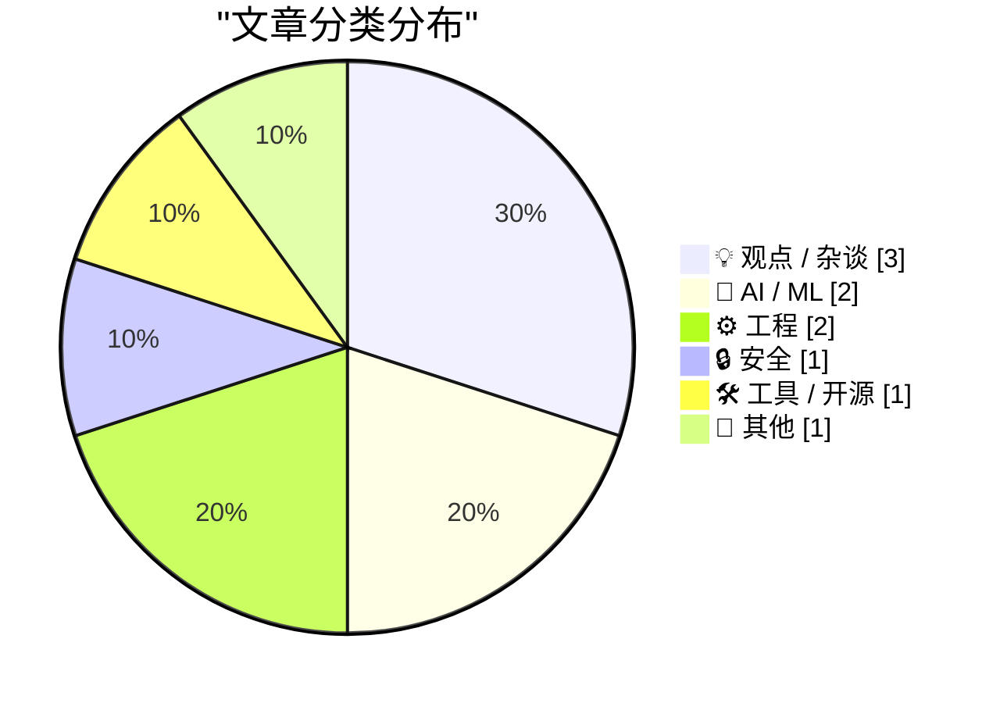
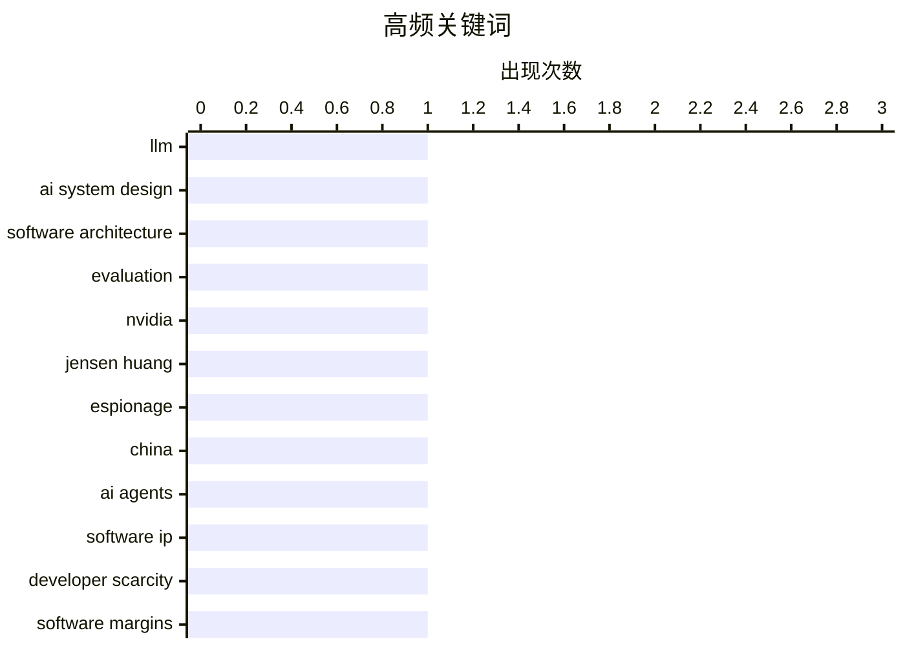

今天的技术圈焦点集中在两条主线上：一方面，围绕大模型能力边界的反思明显升温——LLM 写得了常规代码却难以驾驭需要概率推理与反馈循环的 AI 系统设计，同时也有声音追问 AI 是否正走向崩盘，但结论仍刻意保留不确定性；另一方面，随着 Agent 大幅降低软件开发的人力门槛，软件行业赖以维持高利润率的“工程师稀缺”瓶颈正在松动，知识产权价值面临系统性减记，价值可能向模型、数据与分发渠道转移。第三条线索是 AI 权力与治理：黄仁勋因涉及中国间谍关系被英伟达调查、《反对科技寡头》所探讨的劳动者组织与权力集中，以及包管理、浏览器预取等工程细节，都指向同一个现实——技术进步的收益与代价正在同时被重新分配与审视。

<!--more-->


> 来自 Karpathy 推荐的 92 个顶级技术博客，AI 精选 Top 10

## 🏆 今日必读

🥇 **LLM 极不擅长设计 AI 系统**

[LLMs are terrible at designing AI systems](https://seangoedecke.com/llms-are-terrible-at-designing-ai-systems/) — seangoedecke.com · 22 小时前 · 🤖 AI / ML

> LLM 擅长编写常规软件，却经常无法正确处理需要概率推理、上下文管理和不确定性权衡的 AI 化问题。原因之一是它们容易沿着“符号化兔子洞”寻找并不存在的确定性方案，把本质上依赖统计分布与反馈循环的任务误当成传统程序设计。由 LLM 直接生成的系统架构还可能缺乏清晰的组件边界、评估指标和故障处理机制。核心观点是，AI 系统设计需要人类主导目标定义与系统级判断，LLM 更适合被约束在边界明确的具体子任务中。

💡 **为什么值得读**: 这篇文章指出了“让大模型设计大模型应用”这一常见做法的根本盲区，对正在搭建 RAG、Agent 或其他 LLM 应用的团队很有警示价值。

🏷️ LLM, AI system design, software architecture, evaluation

🥈 **英伟达 CEO 黄仁勋曾与一名中国间谍交往，后者还向北京输送信息**

[Nvidia CEO Jensen Huang Was Banging a Chinese Spy, Who Was Feeding Information Back to Beijing](https://www.nytimes.com/2026/11/08/technology/nvidia-investigation-jensen-huang-china.html?unlocked_article_code=1.O1E.Soow.6UjrM7Ch-C8L) — daringfireball.net · 27 分钟前 · 🔒 安全

> 据《纽约时报》报道，英伟达已就 CEO 黄仁勋与一名被美国情报机构认定为中国间谍的女性高管之间的亲密关系展开调查。美国 surveillance 显示，Alice Huang 曾直接向北京输送信息，而黄仁勋本人是 AI 革命中最具影响力的人物之一，也是美国总统特朗普的重要盟友。英伟达董事会称，目前没有理由相信国家安全信息或公司机密已经泄露，但调查仍将评估这一关系可能造成的风险。黄仁勋已道歉，承认对妻子不忠并给家庭造成伤害。

💡 **为什么值得读**: 这起事件同时涉及英伟达的关键人物、美国国家安全和中国情报活动，可能对企业治理、AI 产业政策及地缘政治风险产生重要影响。

🏷️ Nvidia, Jensen Huang, espionage, China

🥉 **软件知识产权的大规模减记**

[The great software IP writedown](https://martinalderson.com/posts/the-great-software-ip-writedown/?utm_source=rss&amp;utm_medium=rss&amp;utm_campaign=feed) — martinalderson.com · 22 小时前 · 💡 观点 / 杂谈

> 软件行业长期拥有的高利润率，依赖于能够独立构建复杂软件的工程师极为稀缺。随着 AI Agent 开始降低软件开发所需的人力，这种供给瓶颈正在消失。传统依靠技术壁垒、代码稀缺性和专有实现维持的软件 IP 价值，可能面临系统性下调。作者由此提出核心问题：当构建软件不再稀缺，价值究竟会转移到模型、数据、分发渠道还是服务关系之上。

💡 **为什么值得读**: 文章把 AI Agent 对开发成本的影响进一步推演到软件商业模式和估值层面，为投资者与 SaaS 创业者提供了审视“软件护城河”的新框架。

🏷️ AI agents, software IP, developer scarcity, software margins

---

## 📊 数据概览

| 扫描源 | 抓取文章 | 时间范围 | 精选 |
|:---:|:---:|:---:|:---:|
| 86/92 | 2635 篇 → 17 篇 | 48h | **10 篇** |

### 分类分布



### 高频关键词



<details>
<summary>📈 纯文本关键词图（终端友好）</summary>

```
llm                   │ ████████████████████ 1
ai system design      │ ████████████████████ 1
software architecture │ ████████████████████ 1
evaluation            │ ████████████████████ 1
nvidia                │ ████████████████████ 1
jensen huang          │ ████████████████████ 1
espionage             │ ████████████████████ 1
china                 │ ████████████████████ 1
ai agents             │ ████████████████████ 1
software ip           │ ████████████████████ 1
```

</details>

### 🏷️ 话题标签

**llm**(1) · **ai system design**(1) · **software architecture**(1) · evaluation(1) · nvidia(1) · jensen huang(1) · espionage(1) · china(1) · ai agents(1) · software ip(1) · developer scarcity(1) · software margins(1) · package management(1) · releases(1) · security advisories(1) · developer tools(1) · ai bubble(1) · ai economics(1) · dot-com crash(1) · industry analysis(1)

---

## 💡 观点 / 杂谈

### 1. 软件知识产权的大规模减记

[The great software IP writedown](https://martinalderson.com/posts/the-great-software-ip-writedown/?utm_source=rss&amp;utm_medium=rss&amp;utm_campaign=feed) — **martinalderson.com** · 22 小时前 · ⭐ 26/30

> 软件行业长期拥有的高利润率，依赖于能够独立构建复杂软件的工程师极为稀缺。随着 AI Agent 开始降低软件开发所需的人力，这种供给瓶颈正在消失。传统依靠技术壁垒、代码稀缺性和专有实现维持的软件 IP 价值，可能面临系统性下调。作者由此提出核心问题：当构建软件不再稀缺，价值究竟会转移到模型、数据、分发渠道还是服务关系之上。

🏷️ AI agents, software IP, developer scarcity, software margins

---

### 2. Pluralistic：JS Tan 与 Clarissa Redwine 的《反对科技寡头》

[Pluralistic: JS Tan and Clarissa Redwine's "Against Tech Oligarchy" (07 Nov 2026)](https://pluralistic.net/2026/11/07/aeiou-but-sometimes-why/) — **pluralistic.net** · 1 天前 · ⭐ 22/30

> 文章推荐 JS Tan 与 Clarissa Redwine 的《反对科技 oligarchy》，后者试图为科技行业创造一种新的劳工组织与谈判模式。两位作者都经历过科技工会的成功推动，也亲历特朗普第二任期开始后企业界的强烈抵制。文章同时穿插一则科技文化链接汇编，涉及 Gnutella、盗版损失争议、Google、Linux 内核故障、香港局势及劳动的“劣化”等话题。其总体观点是，科技寡头带来的权力集中正在同时影响产业竞争和劳动者组织方式。

🏷️ tech oligarchy, labor, worker ownership, tech industry

---

### 3. 与设计师协作

[Working with designers](https://seangoedecke.com/working-with-designers/) — **seangoedecke.com** · 1 天前 · ⭐ 21/30

> 作者喜欢与设计师合作，因为设计与工程、产品管理和管理岗位相比，具有明显不同的职业文化。设计师通常能迅速展示自身价值，并从视觉与体验角度介入问题。然而，团队中同时存在多名设计师也可能引发冲突和协调难题，这暴露出设计岗位在决策权与职责边界上的特殊性。作者同时对设计系统持复杂态度，质疑它是否总能带来协作效率，还是会形成新的僵化约束。

🏷️ design systems, engineering culture, collaboration, design-engineering

---

## 🤖 AI / ML

### 4. LLM 极不擅长设计 AI 系统

[LLMs are terrible at designing AI systems](https://seangoedecke.com/llms-are-terrible-at-designing-ai-systems/) — **seangoedecke.com** · 22 小时前 · ⭐ 26/30

> LLM 擅长编写常规软件，却经常无法正确处理需要概率推理、上下文管理和不确定性权衡的 AI 化问题。原因之一是它们容易沿着“符号化兔子洞”寻找并不存在的确定性方案，把本质上依赖统计分布与反馈循环的任务误当成传统程序设计。由 LLM 直接生成的系统架构还可能缺乏清晰的组件边界、评估指标和故障处理机制。核心观点是，AI 系统设计需要人类主导目标定义与系统级判断，LLM 更适合被约束在边界明确的具体子任务中。

🏷️ LLM, AI system design, software architecture, evaluation

---

### 5. AI 正在崩盘吗？

[Is AI crashing?](https://dfarq.homeip.net/is-ai-crashing/?utm_source=rss&#038;utm_medium=rss&#038;utm_campaign=is-ai-crashing) — **dfarq.homeip.net** · 10 小时前 · ⭐ 23/30

> 作者在 2027 年 11 月 8 日发问，但明确表示尚无法判断 AI 是否正在崩溃，也不能确认 AI 泡沫已经破裂。有人已经把当前形势与互联网泡沫和随后发生的互联网崩盘相提并论，但这种类比本身不足以证明泡沫破裂。文章刻意保留不确定性，重点在于记录可疑信号，而不是急于给出确定结论。作者最终强调，目前还没有足够依据宣告 AI 时代已经终结。

🏷️ AI bubble, AI economics, dot-com crash, industry analysis

---

## ⚙️ 工程

### 6. 逆向工程一颗 vintage 二极管-晶体管逻辑芯片

[Reverse engineering a vintage diode-transistor logic chip](http://www.righto.com/feeds/7533579802505281921/comments/default) — **righto.com** · 6 小时前 · ⭐ 20/30

> CuriousMarc 在一批老旧器件中发现无法识别的集成电路，作者随后对其晶粒进行显微观察和逆向工程。分析表明，这是一颗采用传统二极管-晶体管逻辑（DTL）实现四个 NAND 门的逻辑芯片。芯片最终被鉴定为 1965 年 Signetics 600 系列中的 ST680A。文章将拆解芯片、分析电路结构与讲解 DTL 工作原理结合起来，还展示了不同集成电路封装方式。

🏷️ reverse engineering, diode-transistor logic, NAND gates, integrated circuits

---

### 7. datasette #3046：不要向 Firefox 的 HTML 页面提供 link: rel=next HTTP 头

[datasette #3046: Don't serve link: rel=next HTTP headers to Firefox for HTML pages](https://simonwillison.net/2026/Nov/7/link-rel-next/) — **simonwillison.net** · 22 小时前 · ⭐ 19/30

> 作者在 Firefox 网络面板中发现，访问 Datasette 表格页面时会自动预取下一页数据。触发原因是页面返回了 `link: <...>; rel="next"` HTTP 头，Firefox 因而将分页链接视为预取候选。实际只有很小一部分访问者会点击“下一页”，多数预取请求都会产生无用开销，包括服务器额外渲染完整页面后丢弃结果。该问题对应 Datasette 的 GitHub issue #3046，目标是避免向 Firefox 提供不适用的分页预取头。

🏷️ Datasette, Firefox, HTTP headers, pagination

---

## 🔒 安全

### 8. 英伟达 CEO 黄仁勋曾与一名中国间谍交往，后者还向北京输送信息

[Nvidia CEO Jensen Huang Was Banging a Chinese Spy, Who Was Feeding Information Back to Beijing](https://www.nytimes.com/2026/11/08/technology/nvidia-investigation-jensen-huang-china.html?unlocked_article_code=1.O1E.Soow.6UjrM7Ch-C8L) — **daringfireball.net** · 27 分钟前 · ⭐ 26/30

> 据《纽约时报》报道，英伟达已就 CEO 黄仁勋与一名被美国情报机构认定为中国间谍的女性高管之间的亲密关系展开调查。美国 surveillance 显示，Alice Huang 曾直接向北京输送信息，而黄仁勋本人是 AI 革命中最具影响力的人物之一，也是美国总统特朗普的重要盟友。英伟达董事会称，目前没有理由相信国家安全信息或公司机密已经泄露，但调查仍将评估这一关系可能造成的风险。黄仁勋已道歉，承认对妻子不忠并给家庭造成伤害。

🏷️ Nvidia, Jensen Huang, espionage, China

---

## 🛠 工具 / 开源

### 9. 本周包管理动态：2026 年 11 月 7 日

[This Week in Package Management: 7 November 2026](https://nesbitt.io/2026/11/07/this-week-in-package-management.html) — **nesbitt.io** · 1 天前 · ⭐ 25/30

> 这是一份汇总包管理领域最新发行版、安全公告与相关文章的每周简报。内容覆盖不同语言和工具生态中的版本更新、维护动态及风险信息。其价值在于把分散在各项目中的发布与安全消息集中整理，方便开发者快速扫描。它适合希望持续掌握依赖工具链变化、供应链漏洞和社区技术讨论的读者。

🏷️ package management, releases, security advisories, developer tools

---

## 📝 其他

### 10. 我做客 Full Stack Creator，聊聊配备 PROLED XDR 显示屏的新款 MacBook Pro

[Yours Truly on Full Stack Creator, Talking About the New MacBook Pros With PROLED XDR Displays](https://www.youtube.com/watch?v=f2GZtWuUPl0) — **daringfireball.net** · 1 天前 · ⭐ 18/30

> 作者 Tyler Stalman 和 David Altizer 邀请作者登上 Full Stack Creator 节目，主题是新款 MacBook Pro。视频重点体验并讨论搭载 PROLED XDR 显示屏的 MacBook Pro，作者称这些新电脑既实用也很适合视频创作。节目中还顺带介绍了理光 legendary GR 系列紧凑型相机，并展示作者使用 20 年前的 GR-D 拍摄史蒂夫·乔布斯与 Walt Mossberg 的旧照片。该内容把专业显示器、创作者工作流和数码摄影文化串联在一起。

🏷️ MacBook Pro, PROLED XDR, laptop hardware, podcast

---

*生成于 2026-11-09 22:18 | 扫描 86 源 → 获取 2635 篇 → 精选 10 篇*
*基于 [Hacker News Popularity Contest 2025](https://refactoringenglish.com/tools/hn-popularity/) RSS 源列表，由 [Andrej Karpathy](https://x.com/karpathy) 推荐*
*由「懂点儿AI」制作，欢迎关注同名微信公众号获取更多 AI 实用技巧 💡*
