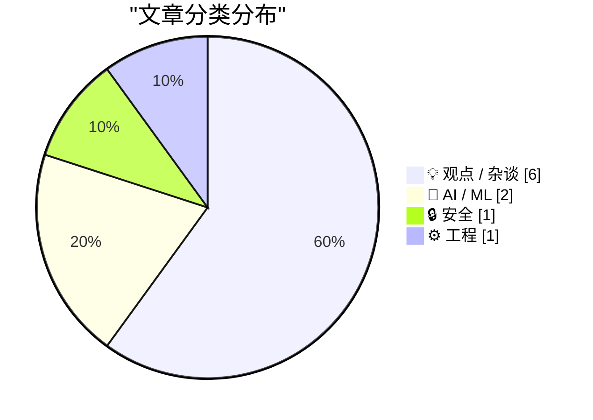
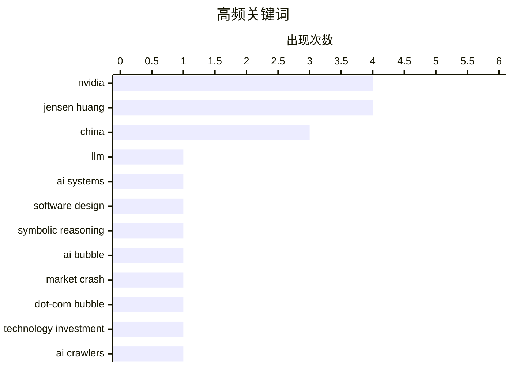

今天的讨论集中在三条主线上：AI 系统设计正在从“写代码”转向模型、工具、反馈与评测的协同，单纯增强编程能力并不足以解决非确定性和复杂编排问题。随着编码智能体降低开发门槛，AI 正在重塑软件生产流程，并迫使行业重新评估代码知识产权、人才稀缺性和商业价值的来源。与此同时，AI 爬虫泛滥、企业安全与国家安全治理开始承压，从主动反制机器人到审视科技高管权力监督，相关制度漏洞都受到关注。整体来看，AI 热潮虽进入调整期，但真正值得警惕的并非简单的“崩盘”，而是技术加速背后的架构、治理与价值重估能否跟上。

<!--more-->


> 来自 Karpathy 推荐的 92 个顶级技术博客，AI 精选 Top 10

## 🏆 今日必读

🥇 **大语言模型极不擅长设计 AI 系统**

[LLMs are terrible at designing AI systems](https://seangoedecke.com/llms-are-terrible-at-designing-ai-systems/) — seangoedecke.com · 1 天前 · 🤖 AI / ML

> 大语言模型虽然擅长编写常规软件，却经常无法正确处理具有 AI 特征、存在不确定性的系统设计问题。其根本原因在于，模型容易沿用传统符号式软件的思路，把本应由模型、工具、反馈机制和评测体系共同构成的系统简化为普通代码生成任务。这种思路错位会掩盖 AI 应用特有的复杂性，例如非确定性输出、上下文管理、模型编排以及效果评估。作者的核心观点是：仅靠更强的代码生成能力，并不能让大语言模型自动成为优秀的 AI 系统架构师。

💡 **为什么值得读**: 文章揭示了大模型在 AI 工程设计中的典型盲区，有助于开发者避免把传统软件套路生硬套用到智能体和 AI 应用中。

🏷️ LLM, AI systems, software design, symbolic reasoning

🥈 **AI 正在崩盘吗？**

[Is AI crashing?](https://dfarq.homeip.net/is-ai-crashing/?utm_source=rss&#038;utm_medium=rss&#038;utm_campaign=is-ai-crashing) — dfarq.homeip.net · 1 天前 · 💡 观点 / 杂谈

> 作者在 2026 年 11 月 8 日审视 AI 热潮是否已经进入类似互联网泡沫破裂的阶段。虽然市场上已经出现“AI 崩盘”的说法，但作者当时仍无法确认泡沫是否真正破裂。作者将当前处境与历史上的互联网泡沫崩溃进行对照，并承认自己当年没有及时记录互联网泡沫破裂前后的变化。整体判断保持谨慎：AI 产业可能正在调整，但此时就断言全面崩盘仍为时过早。

💡 **为什么值得读**: 这篇短文提供了审视 AI 商业化热潮与估值风险的时间坐标，适合想在情绪化看空或看多之外寻找理性判断的读者。

🏷️ AI bubble, market crash, dot-com bubble, technology investment

🥉 **钝锤式封杀：强势拦截基础 AI 爬虫**

[Blunt Banhammer Blocks Basic Bots Ballistically](https://shkspr.mobi/blog/2026/11/blunt-banhammer-blocks-basic-bots-ballistically/) — shkspr.mobi · 9 小时前 · 🔒 安全

> 作者发现个人网站 OpenBenches.org 上月向访问者传输了超过 2.5TB 数据，其中很大一部分可能来自持续抓取页面和图片的 AI 机器人。为阻止这些无用流量，他设计了一个名为 B 的工具，通过设置“陷阱”对机器人进行不加区分的反制。该方法使网站机器人流量减少了 80% 以上。文章体现了个人站长面对 AI 爬虫侵权时，从单纯封禁转向主动诱捕和资源消耗式防御的思路。

💡 **为什么值得读**: 文章给出了一个可量化的反 AI 爬虫实践方案，对遭遇带宽、带宽成本和内容盗取问题的网站运营者尤其有参考价值。

🏷️ AI crawlers, bot detection, honeypot, web scraping

---

## 📊 数据概览

| 扫描源 | 抓取文章 | 时间范围 | 精选 |
|:---:|:---:|:---:|:---:|
| 85/92 | 2610 篇 → 31 篇 | 48h | **10 篇** |

### 分类分布



### 高频关键词



<details>
<summary>📈 纯文本关键词图（终端友好）</summary>

```
nvidia             │ ████████████████████ 4
jensen huang       │ ████████████████████ 4
china              │ ███████████████░░░░░ 3
llm                │ █████░░░░░░░░░░░░░░░ 1
ai systems         │ █████░░░░░░░░░░░░░░░ 1
software design    │ █████░░░░░░░░░░░░░░░ 1
symbolic reasoning │ █████░░░░░░░░░░░░░░░ 1
ai bubble          │ █████░░░░░░░░░░░░░░░ 1
market crash       │ █████░░░░░░░░░░░░░░░ 1
dot-com bubble     │ █████░░░░░░░░░░░░░░░ 1
```

</details>

### 🏷️ 话题标签

**nvidia**(4) · **jensen huang**(4) · **china**(3) · llm(1) · ai systems(1) · software design(1) · symbolic reasoning(1) · ai bubble(1) · market crash(1) · dot-com bubble(1) · technology investment(1) · ai crawlers(1) · bot detection(1) · honeypot(1) · web scraping(1) · software ip(1) · ai agents(1) · margins(1) · valuation(1) · chinese espionage(1)

---

## 💡 观点 / 杂谈

### 1. AI 正在崩盘吗？

[Is AI crashing?](https://dfarq.homeip.net/is-ai-crashing/?utm_source=rss&#038;utm_medium=rss&#038;utm_campaign=is-ai-crashing) — **dfarq.homeip.net** · 1 天前 · ⭐ 27/30

> 作者在 2026 年 11 月 8 日审视 AI 热潮是否已经进入类似互联网泡沫破裂的阶段。虽然市场上已经出现“AI 崩盘”的说法，但作者当时仍无法确认泡沫是否真正破裂。作者将当前处境与历史上的互联网泡沫崩溃进行对照，并承认自己当年没有及时记录互联网泡沫破裂前后的变化。整体判断保持谨慎：AI 产业可能正在调整，但此时就断言全面崩盘仍为时过早。

🏷️ AI bubble, market crash, dot-com bubble, technology investment

---

### 2. 软件知识产权的大幅减值

[The great software IP writedown](https://martinalderson.com/posts/the-great-software-ip-writedown/?utm_source=rss&amp;utm_medium=rss&amp;utm_campaign=feed) — **martinalderson.com** · 1 天前 · ⭐ 26/30

> 传统软件行业的高利润，很大程度上建立在能够开发复杂软件的工程师极其稀缺这一条件之上。随着 AI 智能体开始降低软件开发门槛，人才稀缺性带来的议价能力和利润空间正在消失。这意味着依靠代码所有权、许可收入和功能壁垒建立起来的软件知识产权价值可能面临大幅缩水。文章由此追问：当编程能力不再稀缺时，软件公司的长期价值究竟会转移到数据、品牌、分发渠道还是平台控制权上。核心结论是，AI 不会只是提高开发效率，它正在从根本上重估整个软件行业的知识产权结构。

🏷️ software IP, AI agents, margins, valuation

---

### 3. 英伟达 CEO 黄仁勋与一名中国间谍交往，并向北京传递信息

[Nvidia CEO Jensen Huang Was Banging a Chinese Spy, Who Was Feeding Information Back to Beijing](https://www.nytimes.com/2026/11/08/technology/nvidia-investigation-jensen-huang-china.html?unlocked_article_code=1.O1E.Soow.6UjrM7Ch-C8L) — **daringfireball.net** · 1 天前 · ⭐ 25/30

> 《纽约时报》报道称，黄仁勋在与一名被美国情报机构认定为中国间谍的高管 Alice Huang 发生亲密关系后，已向英伟达董事会承认此事。监控显示，Alice Huang 将信息直接传递给北京，因此黄仁勋与她的关系引发了国家安全方面的担忧。黄仁勋为背叛妻子并伤害家人道歉，而英伟达董事会称目前“没有理由相信”国家安全或公司机密遭到泄露。英伟达随后启动调查，以确认相关行为是否触及公司政策、保密义务或国家安全风险。

🏷️ Nvidia, Jensen Huang, Chinese espionage, AI chips

---

### 4. 黄仁勋事件：他们当时知道什么，又是什么时候知道的？

[The Huang Affair: What did they know and when did they know it?](https://garymarcus.substack.com/p/the-huang-affair-what-did-they-know) — **garymarcus.substack.com** · 20 小时前 · ⭐ 24/30

> Gary Marcus 以“黄仁勋事件”为切入点，质疑美国政府、英伟达管理层以及相关情报机构掌握关键信息的时间线。文章关注的重点不是单一丑闻本身，而是决策者何时获知黄仁勋与中国间谍的关系，以及为何仍然允许其继续参与高层 AI 政策与商业活动。这种追问涉及国家安全预警、董事会监督以及权力制衡是否及时发挥作用。结合黄仁勋事件引发的个人诚信、公司责任和政治影响，作者意在揭示更广泛的制度失灵。

🏷️ Jensen Huang, Nvidia, export controls, China

---

### 5. 鲁比奥曾就英伟达 CEO 与中国间谍的关系警告政府官员

[Rubio Warned Officials About Nvidia Chief’s Entanglement With Chinese Spy - the New York Times](https://www.nytimes.com/2026/11/08/us/politics/rubio-nvidia-ceo-chinese-spy.html?unlocked_article_code=1.PFE.dLW7.D8C1YUYhNooj) — **daringfireball.net** · 4 小时前 · ⭐ 23/30

> 《纽约时报》报道称，鲁比奥曾在特朗普 2026 年 5 月访华前向政府高层发送备忘录，警告黄仁勋与被认定为中国间谍的 Alice Huang 之间的关系。最初，黄仁勋未被列入随特朗普访华的重要商业与科技界代表名单，原因是否与这份备忘录有关尚不清楚。当时政府内部还担心，黄仁勋作为 AI 先驱及 influential ally，可能过度影响特朗普对 AI 采取较为宽松的监管政策。在媒体报道黄仁勋缺席代表团之后，特朗普才要求他在阿拉斯加中途加入行程。关于“排除后重新邀请”的先后顺序，构成事件问责时间线的核心疑点。

🏷️ Nvidia, Jensen Huang, China, national security

---

### 6. 黄仁勋背叛的不只是家人，也包括英伟达

[Jensen Huang Betrayed Nvidia, Not Just His Family](https://www.nytimes.com/2026/11/06/us/politics/chinese-spy-agency-nvidia-jensen-huang.html?unlocked_article_code=1.O1E.DRyO.9mNcxhaxhtlI) — **daringfireball.net** · 22 小时前 · ⭐ 23/30

> 黄仁勋与被美国情报机构认定为中国间谍的 Alice Huang 之间的关系，不仅构成严重的个人诚信问题，也直接危及英伟达的商业利益和国家安全声誉。英伟达发言人曾称黄仁勋与该女性的互动并不异常，符合他与普通客户的会面方式，但在相关指控曝光后，这一解释显得难以成立。英伟达还向中国政府维护称，中国一直推动包括华为在内的国产替代，并严格限制进口英伟达数据中心产品，这相当于替潜在利益相关方的规避行为作证。文章认为，公司的公开回应没有正视黄仁勋行为可能带来的商业与政策风险。

🏷️ Nvidia, Jensen Huang, classified information, China

---

## 🤖 AI / ML

### 7. 大语言模型极不擅长设计 AI 系统

[LLMs are terrible at designing AI systems](https://seangoedecke.com/llms-are-terrible-at-designing-ai-systems/) — **seangoedecke.com** · 1 天前 · ⭐ 27/30

> 大语言模型虽然擅长编写常规软件，却经常无法正确处理具有 AI 特征、存在不确定性的系统设计问题。其根本原因在于，模型容易沿用传统符号式软件的思路，把本应由模型、工具、反馈机制和评测体系共同构成的系统简化为普通代码生成任务。这种思路错位会掩盖 AI 应用特有的复杂性，例如非确定性输出、上下文管理、模型编排以及效果评估。作者的核心观点是：仅靠更强的代码生成能力，并不能让大语言模型自动成为优秀的 AI 系统架构师。

🏷️ LLM, AI systems, software design, symbolic reasoning

---

### 8. 用 details/summary 折叠 AI 生成的 PR 描述

[Hide your slop PR descriptions behind <details><summary>](https://simonwillison.net/2026/Nov/9/details-summary/) — **simonwillison.net** · 17 小时前 · ⭐ 24/30

> Simon Willison 如今的大部分项目修改，都以 Claude Code 或 Codex 自动创建的拉取请求为单位，并通过 PR 打包提交、迭代功能、记录决策和完成合并。现代编码智能体能够写出准确且全面的 PR 描述，但问题恰恰是信息过于冗长，读起来像未经消化的“AI 渣稿”。即使内容本身有用，读者也会本能地产生“我不打算读完这些”的抵触感。使用 HTML 的 details 与 summary 元素折叠 PR 描述，可以先展示简短摘要，再按需展开细节，从而降低评审负担。

🏷️ Claude Code, Codex, pull requests, AI coding

---

## 🔒 安全

### 9. 钝锤式封杀：强势拦截基础 AI 爬虫

[Blunt Banhammer Blocks Basic Bots Ballistically](https://shkspr.mobi/blog/2026/11/blunt-banhammer-blocks-basic-bots-ballistically/) — **shkspr.mobi** · 9 小时前 · ⭐ 26/30

> 作者发现个人网站 OpenBenches.org 上月向访问者传输了超过 2.5TB 数据，其中很大一部分可能来自持续抓取页面和图片的 AI 机器人。为阻止这些无用流量，他设计了一个名为 B 的工具，通过设置“陷阱”对机器人进行不加区分的反制。该方法使网站机器人流量减少了 80% 以上。文章体现了个人站长面对 AI 爬虫侵权时，从单纯封禁转向主动诱捕和资源消耗式防御的思路。

🏷️ AI crawlers, bot detection, honeypot, web scraping

---

## ⚙️ 工程

### 10. 将 parse_number() 做成 SQLite 扩展：C 与 Rust 对比

[parse_number() as a SQLite extension: C vs Rust](https://simonwillison.net/2026/Nov/8/sqlite-parse-number-c-vs-rust/) — **simonwillison.net** · 23 小时前 · ⭐ 24/30

> 这项研究尝试为 SQLite 编写自定义 parse_number() 函数，把“-$1,234.56”或“12.5%”等字符串转换成可求和、排序的数值。该函数会移除逗号、美元、英镑和百分号等符号，处理负号，并在无法解析时返回 NULL。作者使用 Claude Opus 5.5 协助设计实验，对比以 C 和 Rust 实现 SQLite 扩展时的性能、代码复杂度及生成动态库的体积。研究把 SQLite 原生扩展开发与 Rust 工具链放在同一套可复现实验中，为实际项目选择实现语言提供参考。

🏷️ SQLite, Rust, C, extensions

---

*生成于 2026-11-10 22:19 | 扫描 85 源 → 获取 2610 篇 → 精选 10 篇*
*基于 [Hacker News Popularity Contest 2025](https://refactoringenglish.com/tools/hn-popularity/) RSS 源列表，由 [Andrej Karpathy](https://x.com/karpathy) 推荐*
*由「懂点儿AI」制作，欢迎关注同名微信公众号获取更多 AI 实用技巧 💡*
