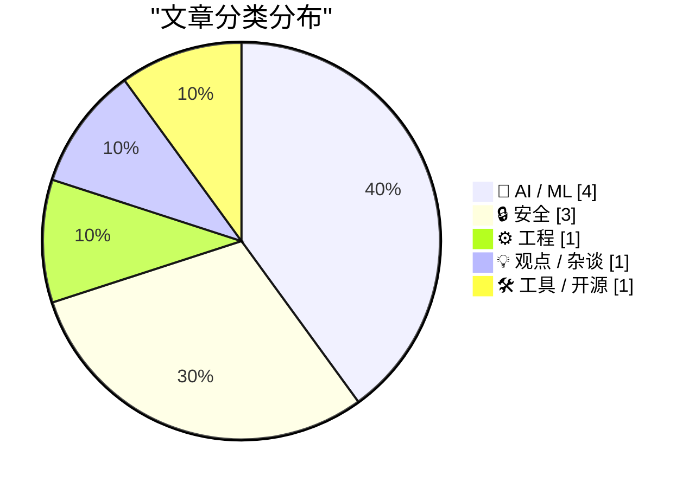
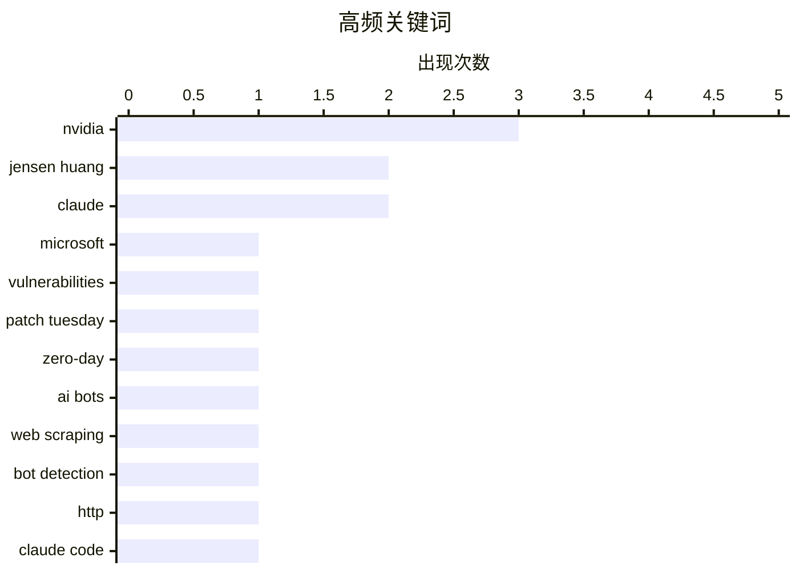

AI 编程与代理正在从“能力竞赛”转向成本和可控性竞争，小型高效模型、推理强度分级及令牌消耗追踪成为新焦点。与此同时，模型行为开始受到代码所有权等上下文提示的显著影响，开发者需要重新审视提示设计与任务治理。
安全议题持续升温，微软一次修复近1100个漏洞，凸显企业补丁管理和零日攻击响应仍是日常运营底线。随着 AI 爬虫流量激增，网站运营者也开始探索更主动的反机器人手段。
另一方面，AI 芯片流通、企业高管与政府关系正在深度交织，芯片出口调查乃至企业高管的政治联系，都可能影响 AI 产业布局与监管走向。

<!--more-->


> 来自 Karpathy 推荐的 92 个顶级技术博客，AI 精选 Top 10

## 🏆 今日必读

🥇 **微软修复近 1100 个安全漏洞**

[Microsoft Fixes Nearly 1,100 Security Vulnerabilities](https://krebsonsecurity.com/2026/11/microsoft-fixes-nearly-1100-security-vulnerabilities/) — krebsonsecurity.com · 23 分钟前 · 🔒 安全

> 微软发布又一次四位数规模的补丁更新，修复 Windows 操作系统及受支持软件中近 1100 个安全漏洞。本次“补丁星期二”涵盖 63 个严重漏洞，其中包括 Microsoft Outlook 中一个已被利用的零日漏洞。Adobe、Apple、Google 和 Mozilla 等厂商也同期发布了重要安全更新。整体来看，此次更新数量庞大，企业和用户需要尽快核查受影响产品并完成修补。

💡 **为什么值得读**: 近 1100 个漏洞和 63 个严重漏洞意味着较大的攻击面，这份清单可帮助安全团队快速确定 Microsoft 产品的补丁优先级。

🏷️ Microsoft, vulnerabilities, Patch Tuesday, zero-day

🥈 **钝重锤子以弹道方式拦截基础机器人**

[Blunt Banhammer Blocks Basic Bots Ballistically](https://shkspr.mobi/blog/2026/11/blunt-banhammer-blocks-basic-bots-ballistically/) — shkspr.mobi · 1 天前 · ⚙️ 工程

> 个人网站 OpenBenches.org 上月向访客传输超过 2.5TB 数据，异常流量很可能来自持续抓取网页与图片的 AI 机器人。作者开发了名为“B”的工具，通过设置陷阱实现对这类不受欢迎访问的 indiscriminate 拦截。该方案让网站机器人流量减少了 80% 以上。它以简单而强硬的方式阻止基础爬虫，为高流量内容站提供了实用的反机器人思路。

💡 **为什么值得读**: 文章展示了仅用一个简单陷阱就削减 80% 以上机器人流量的低成本方案，对遭遇 AI 爬虫和带宽滥用的网站尤其有参考价值。

🏷️ AI bots, web scraping, bot detection, HTTP

🥉 **Claude Code 令牌成本浏览器**

[Claude Code token cost explorer](https://entropicthoughts.com/claude-code-token-cost-explorer) — entropicthoughts.com · 23 小时前 · 🤖 AI / ML

> 在让子代理参与 LLM 编程工作流时，作者发现 Claude Code 的 /context 命令无法细分子代理的令牌消耗。现有工具 ccusage 和 claude-agent-ledger 也无法提供满足其优化需求的细粒度数据。于是他借助 Claude Code 开发了一个上下文成本浏览器，用于查看各会话和子代理的令牌使用情况。所有数据都在本机处理，不会上传对话记录，为控制 Claude Code 使用成本提供了更清晰的入口。

💡 **为什么值得读**: 这个本地运行的成本可视化工具补足了 Claude Code 现有子代理统计的盲区，适合希望降低多代理编程会话开销的用户。

🏷️ Claude Code, token usage, subagents, cost analysis

---

## 📊 数据概览

| 扫描源 | 抓取文章 | 时间范围 | 精选 |
|:---:|:---:|:---:|:---:|
| 86/92 | 2634 篇 → 56 篇 | 48h | **10 篇** |

### 分类分布



### 高频关键词



<details>
<summary>📈 纯文本关键词图（终端友好）</summary>

```
nvidia          │ ████████████████████ 3
jensen huang    │ █████████████░░░░░░░ 2
claude          │ █████████████░░░░░░░ 2
microsoft       │ ███████░░░░░░░░░░░░░ 1
vulnerabilities │ ███████░░░░░░░░░░░░░ 1
patch tuesday   │ ███████░░░░░░░░░░░░░ 1
zero-day        │ ███████░░░░░░░░░░░░░ 1
ai bots         │ ███████░░░░░░░░░░░░░ 1
web scraping    │ ███████░░░░░░░░░░░░░ 1
bot detection   │ ███████░░░░░░░░░░░░░ 1
```

</details>

### 🏷️ 话题标签

**nvidia**(3) · **jensen huang**(2) · **claude**(2) · microsoft(1) · vulnerabilities(1) · patch tuesday(1) · zero-day(1) · ai bots(1) · web scraping(1) · bot detection(1) · http(1) · claude code(1) · token usage(1) · subagents(1) · cost analysis(1) · megaspeed(1) · ai chips(1) · export controls(1) · china(1) · espionage(1)

---

## 🤖 AI / ML

### 1. Claude Code 令牌成本浏览器

[Claude Code token cost explorer](https://entropicthoughts.com/claude-code-token-cost-explorer) — **entropicthoughts.com** · 23 小时前 · ⭐ 26/30

> 在让子代理参与 LLM 编程工作流时，作者发现 Claude Code 的 /context 命令无法细分子代理的令牌消耗。现有工具 ccusage 和 claude-agent-ledger 也无法提供满足其优化需求的细粒度数据。于是他借助 Claude Code 开发了一个上下文成本浏览器，用于查看各会话和子代理的令牌使用情况。所有数据都在本机处理，不会上传对话记录，为控制 Claude Code 使用成本提供了更清晰的入口。

🏷️ Claude Code, token usage, subagents, cost analysis

---

### 2. 黄仁勋的离奇之旅

[Jensen's Bizarre Adventure](https://www.wheresyoured.at/jensens-bizarre-adventure/) — **wheresyoured.at** · 4 小时前 · ⭐ 25/30

> 文章标题指向黄仁勋近期一段围绕 AI 芯片、政府关系和商业决策展开的非寻常经历。当前提供的正文片段没有展示事件经过或具体结论，只显示付费通讯的订阅说明。订阅价格为每年 70 美元、每季度 18 美元或每月 7 美元。其核心卖点是每周深入分析 AI 产业及相关公司的财务状况。

🏷️ NVIDIA, Jensen Huang, AI economics, semiconductors

---

### 3. 推出我们最小、最高效的模型：Muse Ember

[Introducing Our Smallest, Most Efficient Model: Muse Ember](https://simonwillison.net/2026/Nov/10/muse-ember/) — **simonwillison.net** · 14 小时前 · ⭐ 24/30

> Meta AI 发布 Muse Ember，定位为 Claude Haiku 和 GPT Luna 所在类别中的小型高效模型，适合复杂推理及代理每天重复执行的任务，包括工具调用、编码子任务、路由、信息提取和长文档解析。短提示下，其价格为每百万输入令牌 0.10 美元、每百万输出令牌 0.50 美元，与 GPT-6 Luna 和 Claude Haiku 5.5 相同。Claude Fable 5.2 的短提示价格则是其 80 倍，为每百万输入 8 美元、输出 40 美元。三款小型模型均支持最多 100 万输入令牌，但超过价格阈值后会加价，而 Muse Ember 综合定价处于另外两者之间。

🏷️ Muse Ember, Meta AI, small language models, efficiency

---

### 4. 通过提示词引用影响 Claude Fable 5.2 的代码所有权判断

[Quoting Prompting Claude Fable 5.2](https://simonwillison.net/2026/Nov/10/prompting-claude-fable-52/) — **simonwillison.net** · 16 小时前 · ⭐ 24/30

> Anthropic 的测试显示，Claude Fable 5.2 会根据提示词中关于代码所有权的信息改变重构行为。当提示词不说明所有权，或把代码库描述为他人所有时，模型通常会延续现有结构，即使这些结构包含重复代码。若明确告诉模型“这个代码库归你所有，由你决定其用途和构建方式，并继续在其基础上开发”，结果会不同。加入该表述后，模型在小规模编码任务中约有一半尝试合并重复代码，而不使用该句时这一比例低于十分之一。

🏷️ Claude, prompt engineering, AI-assisted coding, code ownership

---

## 🔒 安全

### 5. 微软修复近 1100 个安全漏洞

[Microsoft Fixes Nearly 1,100 Security Vulnerabilities](https://krebsonsecurity.com/2026/11/microsoft-fixes-nearly-1100-security-vulnerabilities/) — **krebsonsecurity.com** · 23 分钟前 · ⭐ 27/30

> 微软发布又一次四位数规模的补丁更新，修复 Windows 操作系统及受支持软件中近 1100 个安全漏洞。本次“补丁星期二”涵盖 63 个严重漏洞，其中包括 Microsoft Outlook 中一个已被利用的零日漏洞。Adobe、Apple、Google 和 Mozilla 等厂商也同期发布了重要安全更新。整体来看，此次更新数量庞大，企业和用户需要尽快核查受影响产品并完成修补。

🏷️ Microsoft, vulnerabilities, Patch Tuesday, zero-day

---

### 6. 英伟达提及特朗普任命官员后，美国商务部中止对 Megaspeed 的调查

[U.S. Commerce Dept. Inquiry Into Megaspeed Was Halted After Nvidia Name-Dropped Trump Appointee](https://www.nytimes.com/2026/11/09/business/economy/nvidia-megaspeed-investigation-huang.html?unlocked_article_code=1.PVE.GxBL.iBpBoc8Y4tnb) — **daringfireball.net** · 7 小时前 · ⭐ 25/30

> 美国商务部曾深入调查数据中心公司 Megaspeed，怀疑其将英伟达的人工智能芯片走私进入中国。案件后来突然移交司法部，导火索是英伟达总法律顾问 Tim Teter 就调查内容与商务部调查人员联系。报道特别指出，与涉案企业沟通本身并不罕见，异常之处在于该邮件的具体内容。文章聚焦英伟达管理层关系如何可能影响针对其中国芯片流向的政府调查。

🏷️ Nvidia, Megaspeed, AI chips, export controls

---

### 7. 鲁比奥曾警告官员：黄仁勋与一名中国间谍关系密切

[Rubio Warned Officials About Jensen Huang’s Affair With a Chinese Spy](https://www.nytimes.com/2026/11/08/us/politics/rubio-nvidia-ceo-chinese-spy.html?unlocked_article_code=1.PFE.dLW7.D8C1YUYhNooj) — **daringfireball.net** · 1 天前 · ⭐ 25/30

> 一份由国务卿鲁比奥起草并向高级安全许可官员传阅的备忘录，警告黄仁勋与一名被美国官员认定为中国间谍的人存在关系。黄仁勋起初未被列入特朗普访华时邀请的主要科技与商业高管名单，但报道无法确认这是否与备忘录有关。报道还指出，特朗普在看到黄仁勋缺席相关报道后，要求其在阿拉斯加经停时登上空军一号加入行程。事件反映了黄仁勋与政府高层围绕对华关系及人工智能监管政策的特殊联系。

🏷️ Jensen Huang, Nvidia, China, espionage

---

## ⚙️ 工程

### 8. 钝重锤子以弹道方式拦截基础机器人

[Blunt Banhammer Blocks Basic Bots Ballistically](https://shkspr.mobi/blog/2026/11/blunt-banhammer-blocks-basic-bots-ballistically/) — **shkspr.mobi** · 1 天前 · ⭐ 26/30

> 个人网站 OpenBenches.org 上月向访客传输超过 2.5TB 数据，异常流量很可能来自持续抓取网页与图片的 AI 机器人。作者开发了名为“B”的工具，通过设置陷阱实现对这类不受欢迎访问的 indiscriminate 拦截。该方案让网站机器人流量减少了 80% 以上。它以简单而强硬的方式阻止基础爬虫，为高流量内容站提供了实用的反机器人思路。

🏷️ AI bots, web scraping, bot detection, HTTP

---

## 💡 观点 / 杂谈

### 9. 每周更新 529：儿童社交媒体禁令及其他动态

[Weekly Update 529: Kids Social Media Bans (and Everything Else)](https://www.troyhunt.com/weekly-update-529/) — **troyhunt.com** · 21 小时前 · ⭐ 25/30

> 作者认为，针对儿童使用社交媒体的法律争议，关键问题不在于是否应将访问年龄推迟到 16 岁，而在于谁负责执行限制。法律通过后，平台、家长、学校和政府之间的执行责任仍容易出现模糊。澳大利亚总理提供的说明被用于梳理该法律框架及其落实方式。作者据此提出，真正需要讨论的是责任归属，而不只是禁令本身。

🏷️ social media, child safety, regulation, online platforms

---

## 🛠 工具 / 开源

### 10. llm-anthropic 0.31

[llm-anthropic 0.31](https://simonwillison.net/2026/Nov/9/llm-anthropic/) — **simonwillison.net** · 22 小时前 · ⭐ 24/30

> Anthropic 发布 Claude Fable 5.2 和 Claude Mythos 5.2，其中 Fable 5.2 在 Artificial Analysis 上暂列第一。Anthropic 宣称 Fable 5.2 解决了两个黑洞物理领域的开放问题，显示其内部评测已转向更高难度任务。作者同步更新 llm-anthropic 0.31，允许用户通过 LLM 命令行工具调用 claude-fable-5.2。新版本还支持 low、medium、high、xhigh 和 max 五档推理强度，便于比较不同设置下的输出。

🏷️ llm-anthropic, Claude, LLM, CLI

---

*生成于 2026-11-11 22:18 | 扫描 86 源 → 获取 2634 篇 → 精选 10 篇*
*基于 [Hacker News Popularity Contest 2025](https://refactoringenglish.com/tools/hn-popularity/) RSS 源列表，由 [Andrej Karpathy](https://x.com/karpathy) 推荐*
*由「懂点儿AI」制作，欢迎关注同名微信公众号获取更多 AI 实用技巧 💡*
