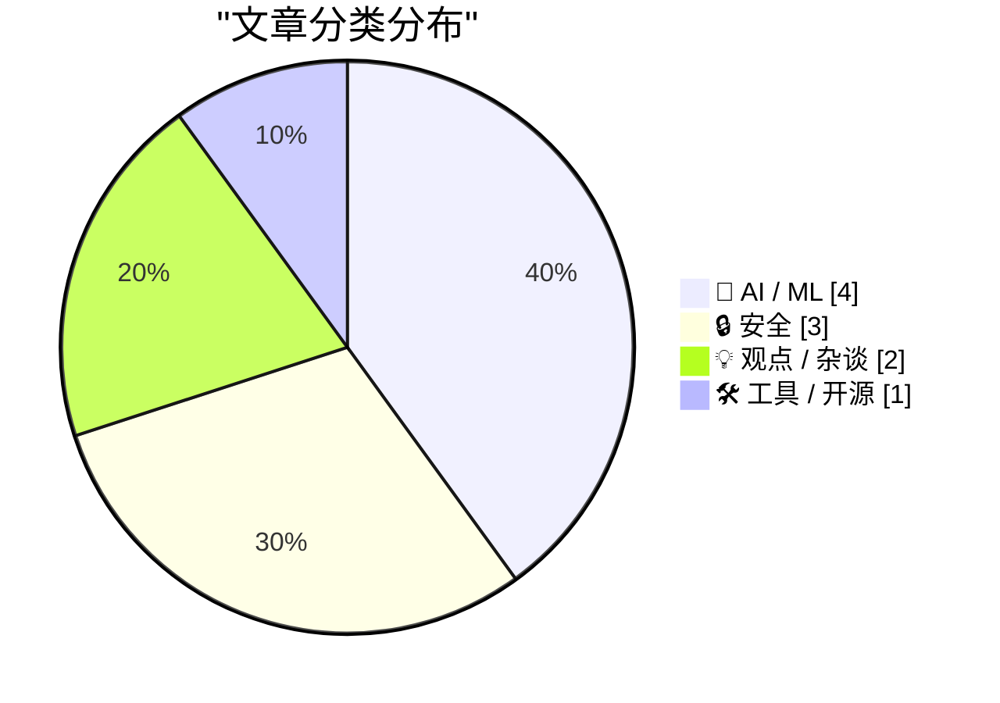
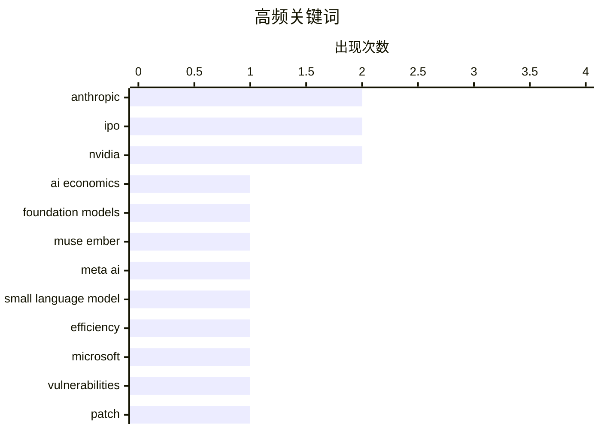

今日技术圈的主线之一，是 AI 从“模型竞赛”加速转向商业与成本效率博弈：轻量级代理模型、多模态决策 API 和低门槛工具链不断涌现，但头部公司的巨额算力投入、IPO 叙事与单位经济性也正受到更严格审视。与此同时，模型能力 increasingly 取决于任务设计，赋予 AI 决策主体性正成为提升重构与自主执行效果的新路径。安全议题则从漏洞修补延伸至勒索软件溯源、芯片出口管制调查及科技领袖利益冲突，暴露技术扩张背后的治理盲区。随着 AI 基础设施和应用边界快速扩张，安全、合规与可持续性正成为决定技术落地成败的核心变量。

<!--more-->


> 来自 Karpathy 推荐的 92 个顶级技术博客，AI 精选 Top 10

## 🏆 今日必读

🥇 **加里·马库斯：还是对 Anthropic 的 IPO 说“不”吧**

[Gary Marcus: ‘Just Say No to Anthropic’s IPO’](https://garymarcus.substack.com/p/just-say-no-to-anthropics-ipo?r=3k69a0) — daringfireball.net · 1 天前 · 🤖 AI / ML

> Gary Marcus 认为，Anthropic 必须在资本需求指数级增长、质量仅小幅提升且累计亏损远高于历史收入的竞争市场中证明自身价值，但这一前景不容乐观。他坚信 AI 模型本身没有护城河，而 Anthropic 的 IPO 叙事却建立在一个极其巨大的护城河之上；其未来数年承诺的 9000 亿美元支出进一步凸显了商业模式的可持续性问题。Anthropic 甚至可能像曾三次尝试 IPO 均告失败的 WeWork 一样上市失败，甚至最终破产。结论是，在缺乏模型技术壁垒和健康单位经济性的情况下，投资者应拒绝为 Anthropic 的 IPO 叙事买单。

💡 **为什么值得读**: 这篇文章提供了审视 Anthropic 上市计划的高强度批判视角，适合想了解其商业模式、资本消耗与所谓 AI 护城河争议的读者。

🏷️ Anthropic, IPO, AI economics, foundation models

🥈 **推出最小、最高效的模型：Muse Ember**

[Introducing Our Smallest, Most Efficient Model: Muse Ember](https://simonwillison.net/2026/Nov/10/muse-ember/) — simonwillison.net · 1 天前 · 🤖 AI / ML

> Meta AI 发布面向高频代理任务的 Muse Ember，定位为最小且最高效的模型，可处理工具调用、编程子任务、路由、信息提取和长文档解析。三款主要模型均支持最多 100 万输入 token；在短提示场景下，Muse Ember 的价格为每百万输入 token 0.10 美元、输出 0.50 美元，与 GPT-6 Luna 和 Claude Haiku 5.5 相同。当输入超过计费阈值后价格会上升，综合长上下文成本后，Muse Ember 的定价介于同级产品之间；作为对照，Claude Fable 5.2 的输入和输出价格分别为 8 美元与 40 美元，是前者的 80 倍。Muse Ember 的核心卖点是以接近轻量模型的成本，承担全天候代理执行和复杂推理工作。

💡 **为什么值得读**: 该发布给出了清晰的模型定位、上下文上限和价格对照，有助于开发者直接评估 Meta、OpenAI 与 Anthropic 轻量模型在代理工作负载上的性价比。

🏷️ Muse Ember, Meta AI, small language model, efficiency

🥉 **微软修复近 1100 个安全漏洞**

[Microsoft Fixes Nearly 1,100 Security Vulnerabilities](https://krebsonsecurity.com/2026/11/microsoft-fixes-nearly-1100-security-vulnerabilities/) — krebsonsecurity.com · 1 天前 · 🔒 安全

> 微软再次发布包含四位数漏洞修复的补丁包，为 Windows 操作系统及受支持软件更新了接近 1100 个安全漏洞。本月“补丁星期二”涵盖 63 个严重漏洞，其中包括 Microsoft Outlook 中的一个零日漏洞。Adobe、Apple、Google 和 Mozilla 同期也发布了重要安全更新。漏洞数量和严重程度表明，企业与个人用户应尽快完成补丁部署，而不是仅优先处理零日漏洞。

💡 **为什么值得读**: 近 1100 个漏洞和 63 个严重漏洞构成高优先级运维清单，尤其是 Outlook 零日漏洞值得安全团队立即核查。

🏷️ Microsoft, vulnerabilities, patch, zero-day

---

## 📊 数据概览

| 扫描源 | 抓取文章 | 时间范围 | 精选 |
|:---:|:---:|:---:|:---:|
| 85/92 | 2600 篇 → 53 篇 | 48h | **10 篇** |

### 分类分布



### 高频关键词



<details>
<summary>📈 纯文本关键词图（终端友好）</summary>

```
anthropic            │ ████████████████████ 2
ipo                  │ ████████████████████ 2
nvidia               │ ████████████████████ 2
ai economics         │ ██████████░░░░░░░░░░ 1
foundation models    │ ██████████░░░░░░░░░░ 1
muse ember           │ ██████████░░░░░░░░░░ 1
meta ai              │ ██████████░░░░░░░░░░ 1
small language model │ ██████████░░░░░░░░░░ 1
efficiency           │ ██████████░░░░░░░░░░ 1
microsoft            │ ██████████░░░░░░░░░░ 1
```

</details>

### 🏷️ 话题标签

**anthropic**(2) · **ipo**(2) · **nvidia**(2) · ai economics(1) · foundation models(1) · muse ember(1) · meta ai(1) · small language model(1) · efficiency(1) · microsoft(1) · vulnerabilities(1) · patch(1) · zero-day(1) · ai business(1) · ransomware(1) · qilin(1) · cybercrime(1) · attribution(1) · megaspeed(1) · export controls(1)

---

## 🤖 AI / ML

### 1. 加里·马库斯：还是对 Anthropic 的 IPO 说“不”吧

[Gary Marcus: ‘Just Say No to Anthropic’s IPO’](https://garymarcus.substack.com/p/just-say-no-to-anthropics-ipo?r=3k69a0) — **daringfireball.net** · 1 天前 · ⭐ 28/30

> Gary Marcus 认为，Anthropic 必须在资本需求指数级增长、质量仅小幅提升且累计亏损远高于历史收入的竞争市场中证明自身价值，但这一前景不容乐观。他坚信 AI 模型本身没有护城河，而 Anthropic 的 IPO 叙事却建立在一个极其巨大的护城河之上；其未来数年承诺的 9000 亿美元支出进一步凸显了商业模式的可持续性问题。Anthropic 甚至可能像曾三次尝试 IPO 均告失败的 WeWork 一样上市失败，甚至最终破产。结论是，在缺乏模型技术壁垒和健康单位经济性的情况下，投资者应拒绝为 Anthropic 的 IPO 叙事买单。

🏷️ Anthropic, IPO, AI economics, foundation models

---

### 2. 推出最小、最高效的模型：Muse Ember

[Introducing Our Smallest, Most Efficient Model: Muse Ember](https://simonwillison.net/2026/Nov/10/muse-ember/) — **simonwillison.net** · 1 天前 · ⭐ 27/30

> Meta AI 发布面向高频代理任务的 Muse Ember，定位为最小且最高效的模型，可处理工具调用、编程子任务、路由、信息提取和长文档解析。三款主要模型均支持最多 100 万输入 token；在短提示场景下，Muse Ember 的价格为每百万输入 token 0.10 美元、输出 0.50 美元，与 GPT-6 Luna 和 Claude Haiku 5.5 相同。当输入超过计费阈值后价格会上升，综合长上下文成本后，Muse Ember 的定价介于同级产品之间；作为对照，Claude Fable 5.2 的输入和输出价格分别为 8 美元与 40 美元，是前者的 80 倍。Muse Ember 的核心卖点是以接近轻量模型的成本，承担全天候代理执行和复杂推理工作。

🏷️ Muse Ember, Meta AI, small language model, efficiency

---

### 3. 提示词如何影响 Claude Fable 5.2

[Quoting Prompting Claude Fable 5.2](https://simonwillison.net/2026/Nov/10/prompting-claude-fable-52/) — **simonwillison.net** · 1 天前 · ⭐ 25/30

> Anthropic 的测试显示，Claude Fable 5.2 会根据提示词对代码所有权和改造权限的描述，采取明显不同的重构策略。若提示词未说明所有权，或将代码库描述为他人所有，模型倾向于延续现有结构，即便其中存在重复代码。若明确告诉模型“这个代码库属于你，由你决定其用途和架构并继续构建”，其合并重复代码的比例从不足十分之一提升到约一半。核心发现是，通过提示词赋予模型决策主体性，可以显著增强其主动重构代码的意愿。

🏷️ Claude Fable 5.2, prompting, coding, ownership

---

### 4. Gemini 决策 API

[Gemini Decisions API](https://simonwillison.net/2026/Nov/11/gemini-decisions-api/) — **simonwillison.net** · 15 分钟前 · ⭐ 24/30

> Google 推出 Gemini Decision 1，加入 Jev 和 OpenAI 决策模型所在的专用决策模型赛道。该 API 支持是/否、选项选择和量规评分三类问题，并沿用 Jev 对是/否问题所用的“Noul”概念。其价格为每百万输入 token 0.10 美元，输出免费，与 GPT-6 Luna 相同，但高于 Jev 的每百万输入 token 0.042 美元。Gemini Decision 1 还提供完整的多模态能力，可处理文本、图像、音频、视频和 PDF，而 Jev 仅支持文本与 JSON，OpenAI 则支持文本和图像。

🏷️ Gemini, Decisions API, LLM agents

---

## 🔒 安全

### 5. 微软修复近 1100 个安全漏洞

[Microsoft Fixes Nearly 1,100 Security Vulnerabilities](https://krebsonsecurity.com/2026/11/microsoft-fixes-nearly-1100-security-vulnerabilities/) — **krebsonsecurity.com** · 1 天前 · ⭐ 27/30

> 微软再次发布包含四位数漏洞修复的补丁包，为 Windows 操作系统及受支持软件更新了接近 1100 个安全漏洞。本月“补丁星期二”涵盖 63 个严重漏洞，其中包括 Microsoft Outlook 中的一个零日漏洞。Adobe、Apple、Google 和 Mozilla 同期也发布了重要安全更新。漏洞数量和严重程度表明，企业与个人用户应尽快完成补丁部署，而不是仅优先处理零日漏洞。

🏷️ Microsoft, vulnerabilities, patch, zero-day

---

### 6. 谁在运营勒索软件组织 Qilin？

[Who Runs the Ransomware Group Qilin?](https://krebsonsecurity.com/2026/11/who-runs-the-ransomware-group-qilin/) — **krebsonsecurity.com** · 4 小时前 · ⭐ 26/30

> 勒索软件联盟组织 Qilin 已成为全球最活跃的勒索软件附属机构之一，仅过去三个月就宣称攻击了至少 365 家受害组织。调查人员通过分析该组织运营者过去十年留下的操作安全失误，将线索指向一名居住在俄罗斯圣彼得堡的 36 岁男性。其管理行为中的关键失误共同暴露了身份关联线索，但网络犯罪团伙通常会刻意隐藏成员身份。该案例凸显了勒索软件运营者即使具备高级攻击能力，也可能因日常运营安全疏忽而遭溯源。

🏷️ ransomware, Qilin, cybercrime, attribution

---

### 7. 英伟达提名前官员后，美国商务部对 Megaspeed 的调查突然中止

[U.S. Commerce Dept. Inquiry Into Megaspeed Was Halted After Nvidia Name-Dropped Trump Appointee](https://www.nytimes.com/2026/11/09/business/economy/nvidia-megaspeed-investigation-huang.html?unlocked_article_code=1.PVE.GxBL.iBpBoc8Y4tnb) — **daringfireball.net** · 1 天前 · ⭐ 26/30

> 美国商务部曾深入调查数据中心运营商 Megaspeed，怀疑其将英伟达人工智能芯片走私进入中国，案件涉及该公司一名被美方认定涉嫌中国间谍活动的高管。此人与英伟达首席执行官黄仁勋存在关系，而案件在持续数月后于去年年底突然停止，并被移交给司法部。转折发生在商务部调查人员收到英伟达总法律顾问 Tim Teter 索要案件信息邮件之后。事件因此引发对潜在利益冲突、出口管制调查独立性和大型科技公司介入政府执法的质疑。

🏷️ Nvidia, Megaspeed, export controls, AI chips

---

## 💡 观点 / 杂谈

### 8. Anthropic 的 IPO 路演视频

[Anthropic's IPO roadshow video](https://simonwillison.net/2026/Nov/11/anthropic-ipo-roadshow/) — **simonwillison.net** · 7 小时前 · ⭐ 26/30

> Anthropic 启动 IPO 路演，并通过一段此前未公开的视频披露了部分业务运作方式，其中最值得关注的是联合创始人 Tom Brown 对计算基础设施策略的讲解。Anthropic 已在 AWS Trainium、Google TPU、NVIDIA GPU 和 AMD GPU 四类芯片上训练并部署 Claude。支撑这一布局的是其早期采用的非传统多芯片策略，但每种芯片都需要专门的软件栈和推理优化。多芯片战略既体现了基础设施层面的技术投入，也揭示了模型训练与服务高度复杂、资本密集的真实运作方式。

🏷️ Anthropic, IPO, AI business

---

### 9. “经济中心的丑闻”

[‘A Scandal at the Center of the Economy’](https://www.theatlantic.com/technology/2026/11/jensen-huang-chinese-spy/689357/?gift=aQyUJR7AIw1mJWdQ6Ed6yPI8n1FlV88MR9f9IZruvFA&amp;) — **daringfireball.net** · 1 天前 · ⭐ 25/30

> 黄仁勋被曝与一名同时充当中国国家安全部门资产的中国女商人存在浪漫关系后，硅谷和华盛顿的舆论反应显得异常克制。比尔·阿克曼、Shaun Maguire、埃隆·马斯克等人在事实尚未完全明朗时便为他辩护，理由包括个人会犯错、黄仁勋对美国的 AI 领导力不可替代，以及可能不存在恶意。评论者由此质疑，科技领袖的个人关系与涉及国家安全和芯片出口管制的职责之间，是否存在更严格的利益冲突审查标准。这场丑闻不仅是个人伦理争议，也暴露出围绕黄仁勋权力、影响力及美国 AI 战略的制度性盲区。

🏷️ Jensen Huang, Nvidia, China, MSS

---

## 🛠 工具 / 开源

### 10. AWS 模拟器

[aws-emulator](https://simonwillison.net/2026/Nov/11/aws-emulator/) — **simonwillison.net** · 1 小时前 · ⭐ 25/30

> AWS 官方开源 aws-emulator，允许开发者针对 AWS 各类服务的本地克隆环境运行测试，无需配置付费 API 密钥。该项目使用 Rust 编写，最初三周便产生 29,684 次提交，主要由大规模代理协作完成代码开发。当前版本需要通过 Docker 运行，macOS 和 Windows 均在使用上有这一要求。作者希望未来能提供单一可执行文件，使开发者能在更多语言和平台上直接纳入标准测试套件。

🏷️ AWS, emulator, Rust, testing

---

*生成于 2026-11-12 22:18 | 扫描 85 源 → 获取 2600 篇 → 精选 10 篇*
*基于 [Hacker News Popularity Contest 2025](https://refactoringenglish.com/tools/hn-popularity/) RSS 源列表，由 [Andrej Karpathy](https://x.com/karpathy) 推荐*
*由「懂点儿AI」制作，欢迎关注同名微信公众号获取更多 AI 实用技巧 💡*
