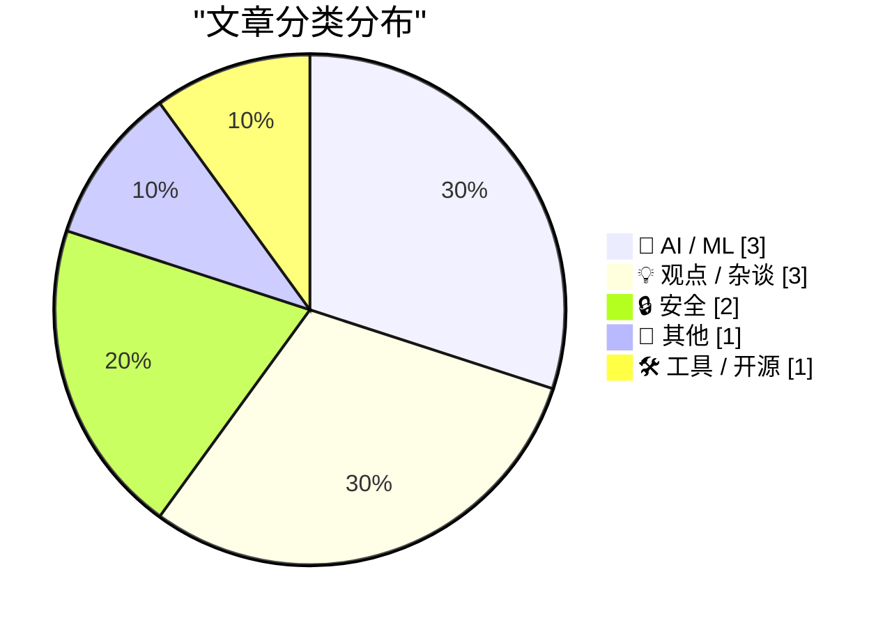
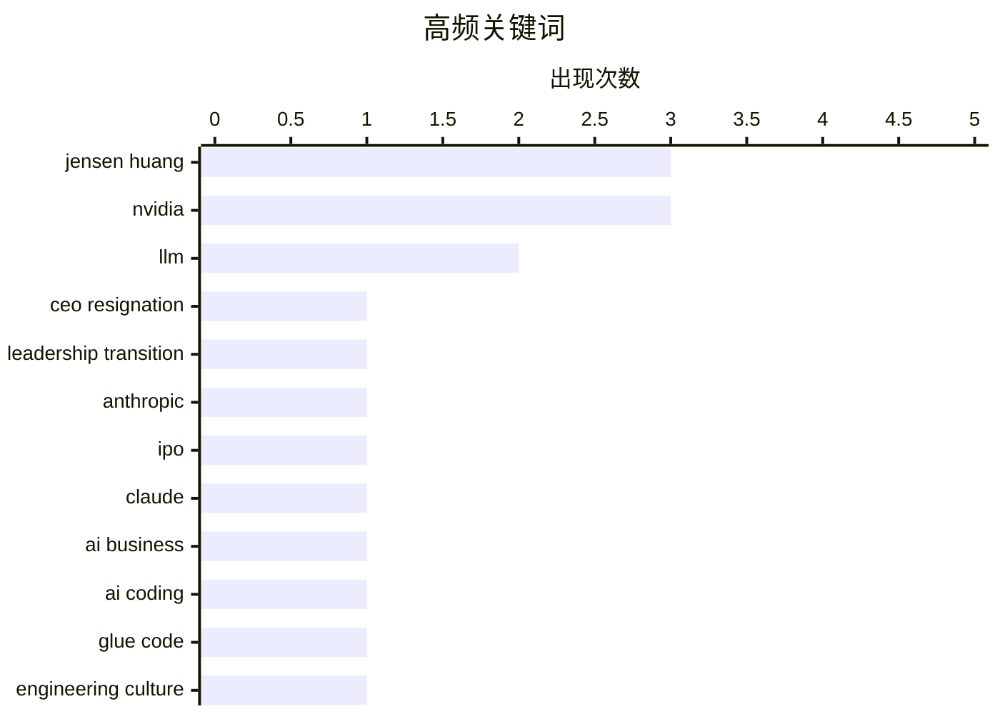

英伟达 CEO 突然更替，成为今日科技圈最大变量：董事会已启动继任者遴选，AI 芯片巨头进入战略与组织连续性的关键考验。与此同时，AI 基础设施正加速走向多芯片与多模型并行，Anthropic 降低单一供应商依赖，Google 则推出支持多模态输入的决策模型 API。另一边，AI Agent 正在重塑开发协作和安全攻防，自动化流程普及的同时，勒索软件与模型工具的凭证安全问题仍需警惕。

<!--more-->


> 来自 Karpathy 推荐的 92 个顶级技术博客，AI 精选 Top 10

## 🏆 今日必读

🥇 **黄仁勋辞任英伟达 CEO**

[Jensen Huang Resigns From Nvidia](https://nvidianews.nvidia.com/news/nvidia-announces-ceo-transition) — daringfireball.net · 6 小时前 · 📝 其他

> 英伟达董事会宣布黄仁勋立即辞去总裁、首席执行官及董事职务，结束其领导公司的重大职位变动。现任执行副总裁兼首席财务官 Colette Kress 同意在找到永久继任者前兼任临时 CEO，并继续负责原有财务职责。董事会将启动永久 CEO 招聘，同时考虑内部和外部候选人。董事会称 Kress 深度了解公司的业务、客户、运营和财务状况，并拥有能够推动战略执行与技术路线图发展的资深团队支持。

💡 **为什么值得读**: 这次最高层领导层的突然交接，将直接影响英伟达的战略连续性、投资者信心以及 AI 芯片业务的发展方向。

🏷️ Jensen Huang, Nvidia, CEO resignation, leadership transition

🥈 **Anthropic 的 IPO 路演视频**

[Anthropic's IPO roadshow video](https://simonwillison.net/2026/Nov/11/anthropic-ipo-roadshow/) — simonwillison.net · 1 天前 · 🤖 AI / ML

> Anthropic 启动 IPO 路演，并在公开视频中披露了 Claude 训练与推理基础设施的若干新信息。联合创始人 Tom Brown 表示，公司从早期便采用多芯片策略，让 Claude 得以运行在 AWS Trainium、Google TPU、英伟达 GPU 和 AMD GPU 四大芯片家族上。相比统一硬件路线，这种策略需要为每类芯片构建专门的软件栈和推理支持，但可减少对单一芯片供应商的依赖。Simon Willison 还使用 MacWhisper 提取了官方尚未提供的视频文字稿，方便开发者了解路演细节。

💡 **为什么值得读**: Anthropic 罕见的官方路演材料揭示了 Claude 的多芯片基础设施路线，有助于判断其算力供应策略、供应商关系与 IPO 商业叙事。

🏷️ Anthropic, IPO, Claude, AI business

🥉 **AI 时代，“胶水工作”依然有害**

[Glue work is still harmful in the age of AI](https://seangoedecke.com/glue-work-is-still-harmful-in-the-age-of-ai/) — seangoedecke.com · 1 天前 · 💡 观点 / 杂谈

> 作者主张，依靠工程师无偿牺牲才能维持的流程应当被淘汰，并认为 AI 时代这类“胶水工作”反而比 2010 年代更不重要。LLM 已承担大量编码工作，但 AI Agent 对个人能力的放大效应也减少了项目交付所需的协调成本。单个工程师现在可以独立承接过去需要小团队完成的任务，从而不再需要安排启动会议、同步状态或在公司内部反复传递信息。结果是，AI 未必会把人从繁琐协作中解放出来，而是直接消除其中相当一部分组织性工作。

💡 **为什么值得读**: 文章挑战了“AI 会让人从事更多协调和胶水工作”的常见假设，为技术团队判断哪些流程值得保留或自动化提供了鲜明视角。

🏷️ AI coding, glue code, engineering culture, technical debt

---

## 📊 数据概览

| 扫描源 | 抓取文章 | 时间范围 | 精选 |
|:---:|:---:|:---:|:---:|
| 86/92 | 2625 篇 → 43 篇 | 48h | **10 篇** |

### 分类分布



### 高频关键词



<details>
<summary>📈 纯文本关键词图（终端友好）</summary>

```
jensen huang          │ ████████████████████ 3
nvidia                │ ████████████████████ 3
llm                   │ █████████████░░░░░░░ 2
ceo resignation       │ ███████░░░░░░░░░░░░░ 1
leadership transition │ ███████░░░░░░░░░░░░░ 1
anthropic             │ ███████░░░░░░░░░░░░░ 1
ipo                   │ ███████░░░░░░░░░░░░░ 1
claude                │ ███████░░░░░░░░░░░░░ 1
ai business           │ ███████░░░░░░░░░░░░░ 1
ai coding             │ ███████░░░░░░░░░░░░░ 1
```

</details>

### 🏷️ 话题标签

**jensen huang**(3) · **nvidia**(3) · **llm**(2) · ceo resignation(1) · leadership transition(1) · anthropic(1) · ipo(1) · claude(1) · ai business(1) · ai coding(1) · glue code(1) · engineering culture(1) · technical debt(1) · ransomware(1) · qilin(1) · cybercrime(1) · attribution(1) · gemini(1) · decisions api(1) · google(1)

---

## 🤖 AI / ML

### 1. Anthropic 的 IPO 路演视频

[Anthropic's IPO roadshow video](https://simonwillison.net/2026/Nov/11/anthropic-ipo-roadshow/) — **simonwillison.net** · 1 天前 · ⭐ 26/30

> Anthropic 启动 IPO 路演，并在公开视频中披露了 Claude 训练与推理基础设施的若干新信息。联合创始人 Tom Brown 表示，公司从早期便采用多芯片策略，让 Claude 得以运行在 AWS Trainium、Google TPU、英伟达 GPU 和 AMD GPU 四大芯片家族上。相比统一硬件路线，这种策略需要为每类芯片构建专门的软件栈和推理支持，但可减少对单一芯片供应商的依赖。Simon Willison 还使用 MacWhisper 提取了官方尚未提供的视频文字稿，方便开发者了解路演细节。

🏷️ Anthropic, IPO, Claude, AI business

---

### 2. Gemini Decisions API

[Gemini Decisions API](https://simonwillison.net/2026/Nov/11/gemini-decisions-api/) — **simonwillison.net** · 1 天前 · ⭐ 25/30

> Google 推出“Gemini Decision 1”决策模型 API，与 Jev 和 OpenAI 的决策模型展开竞争。Gemini Decision 1 支持是/否、选项选择和量规评分三类问题，并沿用了 Jev 对是/否问题所使用的“Noul”术语。其输入价格为每百万 token 10 美分、输出免费，与 GPT-6 Luna 相同，但仍高于 Jev 的每百万输入 token 4.2 美分。Gemini Decision 1 的主要差异是完整的多模态覆盖，可处理文本、图像、音频、视频和 PDF；相比之下，Jev 仅支持文本与 JSON，OpenAI 支持文本和图像。

🏷️ Gemini, Decisions API, LLM, Google

---

### 3. 黄仁勋辞任

[Jensen Huang resigns.](https://garymarcus.substack.com/p/jensen-huang-resigns) — **garymarcus.substack.com** · 7 小时前 · ⭐ 24/30

> 黄仁勋辞任意味着英伟达将进入一个没有其直接领导的新阶段，公司的长期战略与组织连续性面临考验。其离任不仅可能影响英伟达自身，也可能波及整个 AI 芯片产业及高速计算市场。各方目前难以立即判断继任安排会如何影响产品路线、客户关系和资本策略，因此公司的下一阶段管理能力仍充满不确定性。现阶段最关键的观察点将是董事会选择谁接任，以及外部投资者如何评估这一重大高层变动。

🏷️ Jensen Huang, Nvidia, AI, leadership

---

## 💡 观点 / 杂谈

### 4. AI 时代，“胶水工作”依然有害

[Glue work is still harmful in the age of AI](https://seangoedecke.com/glue-work-is-still-harmful-in-the-age-of-ai/) — **seangoedecke.com** · 1 天前 · ⭐ 26/30

> 作者主张，依靠工程师无偿牺牲才能维持的流程应当被淘汰，并认为 AI 时代这类“胶水工作”反而比 2010 年代更不重要。LLM 已承担大量编码工作，但 AI Agent 对个人能力的放大效应也减少了项目交付所需的协调成本。单个工程师现在可以独立承接过去需要小团队完成的任务，从而不再需要安排启动会议、同步状态或在公司内部反复传递信息。结果是，AI 未必会把人从繁琐协作中解放出来，而是直接消除其中相当一部分组织性工作。

🏷️ AI coding, glue code, engineering culture, technical debt

---

### 5. 英伟达正与外部机构物色 CEO 候选人

[Nvidia Working With Outside Firm to Identify CEO Candidates](https://www.bloomberg.com/news/articles/2026-11-11/nvidia-working-with-outside-firm-to-identify-ceo-candidates) — **daringfireball.net** · 18 小时前 · ⭐ 24/30

> 据 Bloomberg 报道，英伟达董事会已在黄仁勋离职风波后与外部猎头机构合作，寻找潜在 CEO 接任者。报道援引知情人士称，董事会讨论过先任命临时负责人、再寻找永久继任者的方案。相关风波涉及黄仁勋被曝存在多段婚外情，其中一段关系的对象据称涉嫌为中国从事间谍活动，但相关说法尚未得到公开证实。黄仁勋此前拒绝在公司内部建立继任规划，因此董事会缺少明显的内部候选人，外聘难度可能更高。

🏷️ Jensen Huang, Nvidia, CEO succession, executive search

---

### 6. Austin Mann 的双屏 iPhone 评测

[Austin Mann’s iPhone Duo Review](https://www.austinmann.com/trek/iphone-duo) — **daringfireball.net** · 1 天前 · ⭐ 24/30

> Austin Mann 试用折叠形态的 iPhone Duo 后认为，它在拍照前后的规划、编辑和分享体验上展现了独特价值，而不只是增加一种镜头配置。Duo 的 0.5 倍超广角镜头与 iPhone 18 Pro 基本相同，同时保留 Pro 的 4 倍和 8 倍长焦镜头，但 Pro 的 1 倍和 2 倍主摄仍是 Apple 画质最好的方案。Duo 自身的 1 倍和 2 倍主摄同样表现出色，不过对多数用户而言，常规 iPhone 在体积、便携性或综合体验上仍更容易被优先选择。评测认为 Duo 的真正优势在于围绕摄影构建的完整体验，而非单靠相机硬件规格取胜。

🏷️ iPhone Duo, foldable, Apple, review

---

## 🔒 安全

### 7. 谁在运营勒索软件组织 Qilin？

[Who Runs the Ransomware Group Qilin?](https://krebsonsecurity.com/2026/11/who-runs-the-ransomware-group-qilin/) — **krebsonsecurity.com** · 1 天前 · ⭐ 26/30

> 勒索软件附属网络 Qilin 已成为全球最活跃的勒索软件犯罪计划之一，过去三个月至少宣称攻击了 365 家受害机构。调查人员认为，即使是顶级的俄罗斯黑客也可能在运营安全上犯错，而 Qilin 管理员过去十年的多项失误暴露了可追踪线索。这些线索共同指向一名居住在俄罗斯圣彼得堡的 36 岁男子。分析重点在于说明大型勒索软件团伙即使规模庞大、经验老到，也可能因长期操作习惯而暴露身份线索。

🏷️ ransomware, Qilin, cybercrime, attribution

---

### 8. LLM 0.37.2

[llm 0.37.2](https://simonwillison.net/2026/Nov/11/llm/) — **simonwillison.net** · 1 天前 · ⭐ 24/30

> LLM 0.37.2 修复了 Daniel de Araujo 报告的两项安全问题，对应公告 GHSA-v9h7-jj4g-f862 和 GHSA-r639-rr7r-x72w。该版本也更新了 extra-openai-models.yaml 的管理方式，新加入的“llm openai endpoint add”命令可配置其他供应商的 OpenAI 兼容端点。此前若 api_key_name 指向的密钥尚未存储，或相关名称被错误复用，LLM 可能意外把配置的 OpenAI API 密钥发送给第三方服务商。修复这些端点配置流程后，版本仍建议用户尽快升级，以降低凭证泄露风险。

🏷️ LLM, security advisory, vulnerability, release

---

## 📝 其他

### 9. 黄仁勋辞任英伟达 CEO

[Jensen Huang Resigns From Nvidia](https://nvidianews.nvidia.com/news/nvidia-announces-ceo-transition) — **daringfireball.net** · 6 小时前 · ⭐ 27/30

> 英伟达董事会宣布黄仁勋立即辞去总裁、首席执行官及董事职务，结束其领导公司的重大职位变动。现任执行副总裁兼首席财务官 Colette Kress 同意在找到永久继任者前兼任临时 CEO，并继续负责原有财务职责。董事会将启动永久 CEO 招聘，同时考虑内部和外部候选人。董事会称 Kress 深度了解公司的业务、客户、运营和财务状况，并拥有能够推动战略执行与技术路线图发展的资深团队支持。

🏷️ Jensen Huang, Nvidia, CEO resignation, leadership transition

---

## 🛠 工具 / 开源

### 10. AWS 模拟器

[aws-emulator](https://simonwillison.net/2026/Nov/11/aws-emulator/) — **simonwillison.net** · 1 天前 · ⭐ 24/30

> AWS 发布了官方开源模拟器 aws-emulator，允许开发者通过本地克隆的多项 AWS 服务运行测试，而不必配置付费 API 密钥。该项目使用 Rust 编写，首个三周便产生 29,684 次提交，主要由大规模 AI Agent 协作完成。模拟器目前需要通过 Docker 在 macOS 或 Windows 上运行，尚未提供单一可执行文件。文章作者希望未来能直接下载二进制程序，从而将其纳入不同语言和平台的常规测试套件。

🏷️ AWS, emulator, Rust, testing

---

*生成于 2026-11-13 22:18 | 扫描 86 源 → 获取 2625 篇 → 精选 10 篇*
*基于 [Hacker News Popularity Contest 2025](https://refactoringenglish.com/tools/hn-popularity/) RSS 源列表，由 [Andrej Karpathy](https://x.com/karpathy) 推荐*
*由「懂点儿AI」制作，欢迎关注同名微信公众号获取更多 AI 实用技巧 💡*
