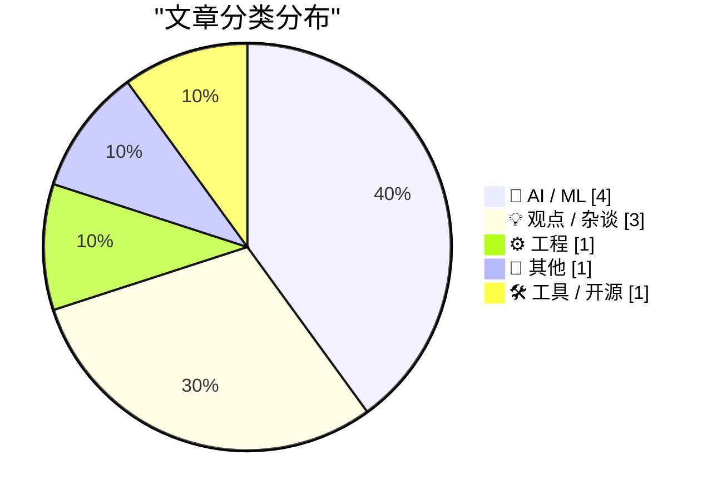
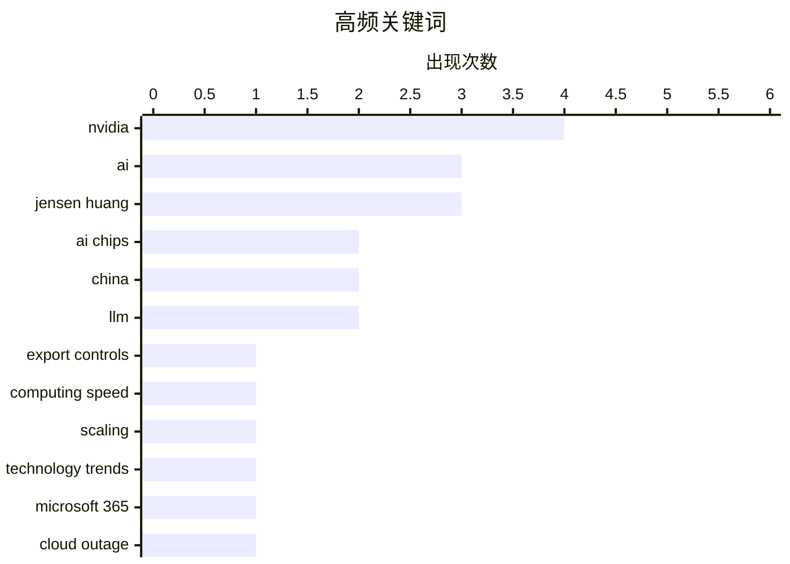

今日技术圈的三条主线格外清晰：AI 竞争正加速与芯片出口管制、能源禀赋和地缘政治深度绑定，英伟达高层动荡更凸显企业巨头无法置身政策博弈之外。与此同时，模型能力与价格选择快速趋同，企业采购正从追逐参数领先转向按任务和预算试错。与此同时，微软全球云故障暴露出基础设施即使未遭攻击，也可能因自动化检查失误瞬间失控。随着数学突破、算力扩张与电力约束持续重塑技术节奏，今天的行业创新仍建立在稳定性与地缘资本的双重考验之上。

<!--more-->


> 来自 Karpathy 推荐的 92 个顶级技术博客，AI 精选 Top 10

## 🏆 今日必读

🥇 **纽约时报：随着加强出口管制的呼声日益高涨，卢特尼克对英伟达采取了更温和的立场**

[NYT: ‘Howard Lutnick Took Softer Line on Nvidia as Calls for Tougher Controls Grew’](https://www.nytimes.com/2026/11/12/us/politics/lutnick-nvidia-commerce-china-chips.html?unlocked_article_code=1.QFE.hj_X.iLppRX0Ec_Jj) — daringfireball.net · 6 小时前 · 💡 观点 / 杂谈

> 美国商务部长霍华德·卢特尼克在收紧对华 AI 芯片管制上的立场，与特朗普政府多数高层的共同判断相左。多位现任和前任官员称，商务部内部对英伟达给予特殊优先待遇，其事务由高级副手杰夫·凯斯勒集中处理，重大行动通常需要卢特尼克本人批准。卢特尼克还频繁与英伟达 CEO 黄仁勋通话和发消息，商务部会为双方在五楼办公室的私人会面进行周密准备。报道据此指出，面对阻止中国利用先进芯片追赶 AI 技术的政策呼声，卢特尼克仍采取了明显更温和、且偏向维护英伟达利益的路线。

💡 **为什么值得读**: 这篇深度调查揭示了美国对华芯片管制阵营内部的重要分歧，以及商务部对英伟达的特殊政策待遇如何影响监管中立性。

🏷️ Nvidia, export controls, AI chips, China

🥈 **速度狂人的恶意指南**

[Premium: The Hater’s Guide To Megaspeed](https://www.wheresyoured.at/hg-megaspeed/) — wheresyoured.at · 3 小时前 · 🤖 AI / ML

> 文章以“仇恨指南”的形式审视当前围绕“Megaspeed”的高速竞赛，但现有节选没有披露具体事件、企业或技术方案。编者强调，文中讨论的局面变化极快，本文完成写作以及付印之后都可能继续出现新信息。报道内容可能因此发生难以预料的调整，部分判断和结论具有明显的时效性。对读者而言，理解这类高速发展叙事需要同时关注后续披露，而不能只依据发布之初的信息。

💡 **为什么值得读**: 它适合快速把握“超高速”叙事中的争议点和信息时效性，并提醒读者用后续进展校正早期判断。

🏷️ AI, computing speed, scaling, technology trends

🥉 **微软及其客户正遭受全球云服务中断**

[Microsoft, and Its Customers, Are Suffering a Global Cloud Outage](https://arstechnica.com/tech-policy/2026/11/microsoft-blames-failed-server-health-checks-not-hackers-for-global-outage/) — daringfireball.net · 4 小时前 · ⚙️ 工程

> 微软发生全球性云服务故障，Microsoft 365 的电子邮件、云服务及 AI 服务均受到影响，故障从当地时间周四中午开始并持续至周五上午。微软将问题归因于失败的服务器健康检查，而不是黑客攻击，并公布了完整的受影响服务清单。为避免长时间中断导致客户邮件丢失，微软将邮件超时设置延长至 48 小时，同时表示恢复操作仍在进行。此次事故显示，即使没有外部攻击，自动化健康检查或基础设施故障也可能迅速波及全球用户。

💡 **为什么值得读**: 事件集中展示了单一云服务商故障对办公、通信和 AI 应用的连锁影响，也暴露了健康检查机制失效的系统性风险。

🏷️ Microsoft 365, cloud outage, AI services, availability

---

## 📊 数据概览

| 扫描源 | 抓取文章 | 时间范围 | 精选 |
|:---:|:---:|:---:|:---:|
| 86/92 | 2635 篇 → 43 篇 | 48h | **10 篇** |

### 分类分布



### 高频关键词



<details>
<summary>📈 纯文本关键词图（终端友好）</summary>

```
nvidia            │ ████████████████████ 4
ai                │ ███████████████░░░░░ 3
jensen huang      │ ███████████████░░░░░ 3
ai chips          │ ██████████░░░░░░░░░░ 2
china             │ ██████████░░░░░░░░░░ 2
llm               │ ██████████░░░░░░░░░░ 2
export controls   │ █████░░░░░░░░░░░░░░░ 1
computing speed   │ █████░░░░░░░░░░░░░░░ 1
scaling           │ █████░░░░░░░░░░░░░░░ 1
technology trends │ █████░░░░░░░░░░░░░░░ 1
```

</details>

### 🏷️ 话题标签

**nvidia**(4) · **ai**(3) · **jensen huang**(3) · ai chips(2) · china(2) · llm(2) · export controls(1) · computing speed(1) · scaling(1) · technology trends(1) · microsoft 365(1) · cloud outage(1) · ai services(1) · availability(1) · superintelligence(1) · mathematics(1) · 2030(1) · leadership(1) · congress(1) · testimony(1)

---

## 🤖 AI / ML

### 1. 速度狂人的恶意指南

[Premium: The Hater’s Guide To Megaspeed](https://www.wheresyoured.at/hg-megaspeed/) — **wheresyoured.at** · 3 小时前 · ⭐ 27/30

> 文章以“仇恨指南”的形式审视当前围绕“Megaspeed”的高速竞赛，但现有节选没有披露具体事件、企业或技术方案。编者强调，文中讨论的局面变化极快，本文完成写作以及付印之后都可能继续出现新信息。报道内容可能因此发生难以预料的调整，部分判断和结论具有明显的时效性。对读者而言，理解这类高速发展叙事需要同时关注后续披露，而不能只依据发布之初的信息。

🏷️ AI, computing speed, scaling, technology trends

---

### 2. 席卷数学界的雪崩即将冲击 AI 发展

[The avalanche that hit math is coming for AI development](https://www.dwarkesh.com/p/rsi) — **dwarkesh.com** · 3 小时前 · ⭐ 26/30

> 核心论点是，数学领域正在经历的结构性震荡将传导至 AI 研发，并影响通往更高级人工智能的进度。作者以这一趋势为依据，将超级智能出现的时间预期提前到 2030 年。数学能力与 AI 研究扩张之间的联系，被视为判断技术发展节奏的重要前置信号。现有节选没有列出具体政策、模型或组织层面的证据，因此更适合作为趋势判断的入口，而非完整的因果论证。

🏷️ superintelligence, AI, mathematics, 2030

---

### 3. 第一次打击

[First Strike](https://geohot.github.io//blog/jekyll/update/2026/11/13/first-strike.html) — **geohot.github.io** · 1 天前 · ⭐ 24/30

> 作者提出一个关键判断：如果当前趋势持续，中国将在 10 年后拥有美国 10 倍的电力供应，因此任何地缘战略都必须考虑能源优势。其建议是美国尽可能向中国出售 AI 芯片，再用所得资金购买太阳能板和电池工厂产能，并快速扩充发电能力，因为算力本质上受电力约束。作者还结合机器人劳动力、Jensen Huang 和 Elon Musk 等移民型人才、商业友好文化及土地资源，认为 50 年后谁占上风尚无定论。美国当前推动的“AI 竞赛”更多体现短期零和思维，这与上述长期共同繁荣战略背道而驰，并令他深感担忧。

🏷️ AI, China, electricity, geopolitics

---

### 4. 你想为公司采购 AI

[So you want to buy AI for your company](https://idiallo.com/byte-size/buying-ai-for-your-company) — **idiallo.com** · 21 小时前 · ⭐ 23/30

> 文章为企业 AI 选型提供了一份模型清单，但建议不要一开始就追求功能最强的产品，而应根据具体任务和预算进行试用。候选方案包括 Gemini 4 Hydrogen、Claude Sonnet 5.5 或 5.4，以及日常能力更强但仍不及 Mythos 5.2 的 Opus 5.2；基准分数显示 Opus、Fable 和 Mythos 分别为 94.8、92.7 和 96.1。中国模型方面，可以先测试 DeepSeek R1，再考虑 V4；GLM 5.3 Flash 采用 Mixture-of-Experts 架构，并获得 87.3 的 Benchmark Performance Index 分数。整体选型建议是先用合适规模的产品验证需求，必要时再升级到更强模型，避免一开始就采用可能造成能力浪费的 Astra。

🏷️ enterprise AI, LLM, model selection, procurement

---

## 💡 观点 / 杂谈

### 5. 纽约时报：随着加强出口管制的呼声日益高涨，卢特尼克对英伟达采取了更温和的立场

[NYT: ‘Howard Lutnick Took Softer Line on Nvidia as Calls for Tougher Controls Grew’](https://www.nytimes.com/2026/11/12/us/politics/lutnick-nvidia-commerce-china-chips.html?unlocked_article_code=1.QFE.hj_X.iLppRX0Ec_Jj) — **daringfireball.net** · 6 小时前 · ⭐ 27/30

> 美国商务部长霍华德·卢特尼克在收紧对华 AI 芯片管制上的立场，与特朗普政府多数高层的共同判断相左。多位现任和前任官员称，商务部内部对英伟达给予特殊优先待遇，其事务由高级副手杰夫·凯斯勒集中处理，重大行动通常需要卢特尼克本人批准。卢特尼克还频繁与英伟达 CEO 黄仁勋通话和发消息，商务部会为双方在五楼办公室的私人会面进行周密准备。报道据此指出，面对阻止中国利用先进芯片追赶 AI 技术的政策呼声，卢特尼克仍采取了明显更温和、且偏向维护英伟达利益的路线。

🏷️ Nvidia, export controls, AI chips, China

---

### 6. 黄仁勋：“黄仁勋注定会输”

[Andrew Sharp: ‘Jensen Huang Was Always Going to Lose’](https://sharptext.net/2026/jensen-huang-was-always-going-to-lose/) — **daringfireball.net** · 2 小时前 · ⭐ 24/30

> 作者认为黄仁勋遭遇的舆论风暴既悲惨又带有黑色幽默，而黄仁勋本人可能无论面对哪种局面都注定会输。他高度评价黄仁勋的能力，称其为美国最优秀的 CEO 之一，并认为他极为推动了 AI 生态系统的发展。黄仁勋从最受尊敬的科技领袖之一迅速跌落的过程，不仅突然，而且看起来像是经过协同操作。结论并非否定黄仁勋过去的技术和商业成就，而是指出其个人成就已无法抵消政治压力、公众愤怒与地缘政治博弈。

🏷️ Jensen Huang, Nvidia, AI chips, leadership

---

### 7. 黄仁勋同意赴国会作证，但目前不会公开

[Jensen Huang Agrees to Testify Before Congress, But Not Publicly (Yet)](https://techcrunch.com/2026/11/12/jensen-huang-agrees-to-testify-before-congress/) — **daringfireball.net** · 1 天前 · ⭐ 24/30

> 在多名资深议员威胁发出传票后，黄仁勋同意于本月感恩节前到美国众议院外交事务委员会作证。作证将采用闭门形式，但委员会主席布赖恩·马斯特表示，简报预计会被录像并转录成文字。相关背景包括黄仁勋因涉嫌与一名被怀疑为中国从事间谍活动有关的女性存在婚外情而辞去 CEO 职位。作者认为，闭门听证只是前置程序，真正的公开问责可能要到下年，并警告事件可能冲击英伟达股价，进而拖累依赖其投资的整个 AI 行业。

🏷️ Jensen Huang, Congress, Nvidia, testimony

---

## ⚙️ 工程

### 8. 微软及其客户正遭受全球云服务中断

[Microsoft, and Its Customers, Are Suffering a Global Cloud Outage](https://arstechnica.com/tech-policy/2026/11/microsoft-blames-failed-server-health-checks-not-hackers-for-global-outage/) — **daringfireball.net** · 4 小时前 · ⭐ 26/30

> 微软发生全球性云服务故障，Microsoft 365 的电子邮件、云服务及 AI 服务均受到影响，故障从当地时间周四中午开始并持续至周五上午。微软将问题归因于失败的服务器健康检查，而不是黑客攻击，并公布了完整的受影响服务清单。为避免长时间中断导致客户邮件丢失，微软将邮件超时设置延长至 48 小时，同时表示恢复操作仍在进行。此次事故显示，即使没有外部攻击，自动化健康检查或基础设施故障也可能迅速波及全球用户。

🏷️ Microsoft 365, cloud outage, AI services, availability

---

## 📝 其他

### 9. 黄仁勋辞任英伟达 CEO

[Jensen Huang Resigns From Nvidia](https://nvidianews.nvidia.com/news/nvidia-announces-ceo-transition) — **daringfireball.net** · 1 天前 · ⭐ 24/30

> 英伟达董事会宣布，黄仁勋已立即辞去总裁、首席执行官及董事会成员职务。现任执行副总裁兼首席财务官 Colette Kress 同意在寻找永久继任者期间兼任临时 CEO，并继续保留原有高管和 CFO 职责。董事会将同时考虑内部和外部候选人，以确定正式首席执行官。英伟达称 Kress 对公司业务、客户、运营和财务状况有深入理解，且董事会相信经验丰富的领导团队能够继续执行既定战略并推进技术路线图。此次变动意味着英伟达正式进入由财务高管临时主持的过渡期。

🏷️ Nvidia, Jensen Huang, CEO resignation, Colette Kress

---

## 🛠 工具 / 开源

### 10. llm-gemini 0.37

[llm-gemini 0.37](https://simonwillison.net/2026/Nov/12/llm-gemini/) — **simonwillison.net** · 23 小时前 · ⭐ 23/30

> llm-gemini 0.37 发布之际，Google 推出了 Gemini 4 家族中成本最低的成员 Gemini 4 Hydrogen。其价格并未与更大的 Carbon 和 Argo 模型拉开足够明显的差距，作者因此认为 Gemini 4 的定价体系相当令人困惑。可见的数据中，Gemini 4 Carbon 在 2026 年 11 月 30 日前的输入、缓存输入和输出价格分别为每百万 token 2 美元、0.10 美元和 10 美元。自 12 月 1 日起，这三项价格将翻倍至 4 美元、0.20 美元和 20 美元。版本更新与新模型的低价定位相结合，为通过 llm-gemini 接入 Gemini 4 的开发者提供了新的成本选择。

🏷️ Gemini 4, llm-gemini, LLM, release

---

*生成于 2026-11-14 22:18 | 扫描 86 源 → 获取 2635 篇 → 精选 10 篇*
*基于 [Hacker News Popularity Contest 2025](https://refactoringenglish.com/tools/hn-popularity/) RSS 源列表，由 [Andrej Karpathy](https://x.com/karpathy) 推荐*
*由「懂点儿AI」制作，欢迎关注同名微信公众号获取更多 AI 实用技巧 💡*
