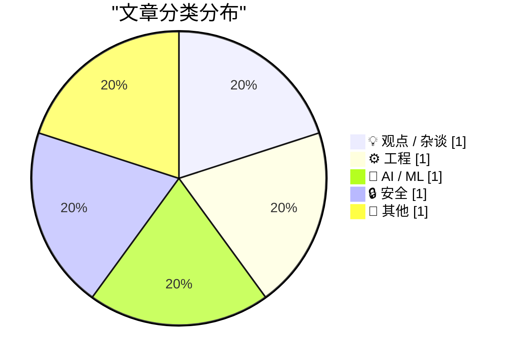
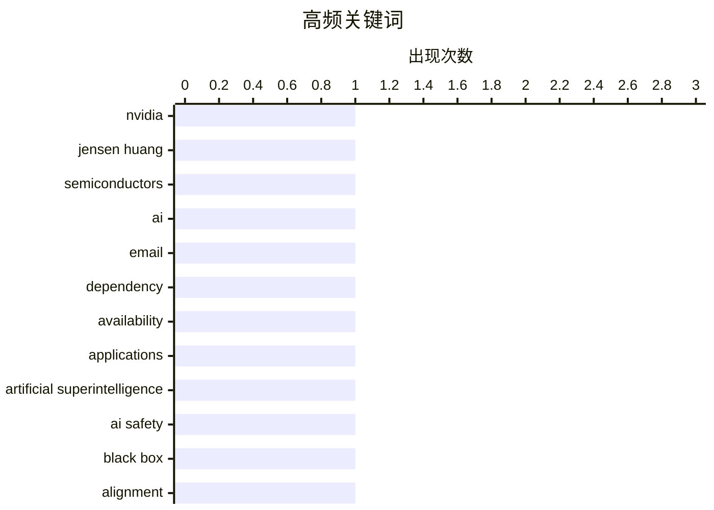

今日技术圈的关注点集中在 AI 基础设施与智能边界：英伟达的下一步仍将牵引算力扩张，而超级人工智能“黑箱化”则把安全、解释与治理问题推向台前。与此同时，邮件依赖、应用生态等日常系统暴露出技术栈日益复杂后的脆弱性，安全与密码学基础仍是数字世界的底层支柱。

<!--more-->


> 来自 Karpathy 推荐的 92 个顶级技术博客，AI 精选 Top 5

## 🏆 今日必读

🥇 **What’s Next For Nvidia?**

[What’s Next For Nvidia?](https://steveblank.com/2026/11/15/whats-next-for-nvidia/) — steveblank.com · 1 天前 · 💡 观点 / 杂谈

> What’s Next For Nvidia?

🏷️ Nvidia, Jensen Huang, semiconductors, AI

🥈 **Weekly Update 530: Email Dependencies & Apps**

[Weekly Update 530: Email Dependencies & Apps](https://www.troyhunt.com/weekly-update-530/) — troyhunt.com · 15 小时前 · ⚙️ 工程

> Weekly Update 530: Email Dependencies & Apps

🏷️ email, dependency, availability, applications

🥉 **ASI as a Black Box**

[ASI as a Black Box](https://borretti.me/article/asi-as-a-black-box) — borretti.me · 1 天前 · 🤖 AI / ML

> ASI as a Black Box

🏷️ artificial superintelligence, AI safety, black box, alignment

---

## 📊 数据概览

| 扫描源 | 抓取文章 | 时间范围 | 精选 |
|:---:|:---:|:---:|:---:|
| 20/92 | 673 篇 → 5 篇 | 48h | **5 篇** |

### 分类分布



### 高频关键词



<details>
<summary>📈 纯文本关键词图（终端友好）</summary>

```
nvidia                       │ ████████████████████ 1
jensen huang                 │ ████████████████████ 1
semiconductors               │ ████████████████████ 1
ai                           │ ████████████████████ 1
email                        │ ████████████████████ 1
dependency                   │ ████████████████████ 1
availability                 │ ████████████████████ 1
applications                 │ ████████████████████ 1
artificial superintelligence │ ████████████████████ 1
ai safety                    │ ████████████████████ 1
```

</details>

### 🏷️ 话题标签

**nvidia**(1) · **jensen huang**(1) · **semiconductors**(1) · ai(1) · email(1) · dependency(1) · availability(1) · applications(1) · artificial superintelligence(1) · ai safety(1) · black box(1) · alignment(1) · md5(1) · hashing(1) · privacy(1) · nyc taxi data(1) · orbital mechanics(1) · kepler's law(1) · dwarf planet(1)

---

## 💡 观点 / 杂谈

### 1. What’s Next For Nvidia?

[What’s Next For Nvidia?](https://steveblank.com/2026/11/15/whats-next-for-nvidia/) — **steveblank.com** · 1 天前 · ⭐ 27/30

> What’s Next For Nvidia?

🏷️ Nvidia, Jensen Huang, semiconductors, AI

---

## ⚙️ 工程

### 2. Weekly Update 530: Email Dependencies & Apps

[Weekly Update 530: Email Dependencies & Apps](https://www.troyhunt.com/weekly-update-530/) — **troyhunt.com** · 15 小时前 · ⭐ 23/30

> Weekly Update 530: Email Dependencies & Apps

🏷️ email, dependency, availability, applications

---

## 🤖 AI / ML

### 3. ASI as a Black Box

[ASI as a Black Box](https://borretti.me/article/asi-as-a-black-box) — **borretti.me** · 1 天前 · ⭐ 22/30

> ASI as a Black Box

🏷️ artificial superintelligence, AI safety, black box, alignment

---

## 🔒 安全

### 4. Taxis and hash functions

[Taxis and hash functions](https://www.johndcook.com/blog/2026/11/16/taxis-and-hash-functions/) — **johndcook.com** · 7 小时前 · ⭐ 18/30

> Taxis and hash functions

🏷️ MD5, hashing, privacy, NYC taxi data

---

## 📝 其他

### 5. Orbital footnote

[Orbital footnote](https://www.johndcook.com/blog/2026/11/15/orbital-footnote/) — **johndcook.com** · 20 小时前 · ⭐ 12/30

> Orbital footnote

🏷️ orbital mechanics, Kepler's law, dwarf planet

---

*生成于 2026-11-17 22:23 | 扫描 20 源 → 获取 673 篇 → 精选 5 篇*
*基于 [Hacker News Popularity Contest 2025](https://refactoringenglish.com/tools/hn-popularity/) RSS 源列表，由 [Andrej Karpathy](https://x.com/karpathy) 推荐*
*由「懂点儿AI」制作，欢迎关注同名微信公众号获取更多 AI 实用技巧 💡*
