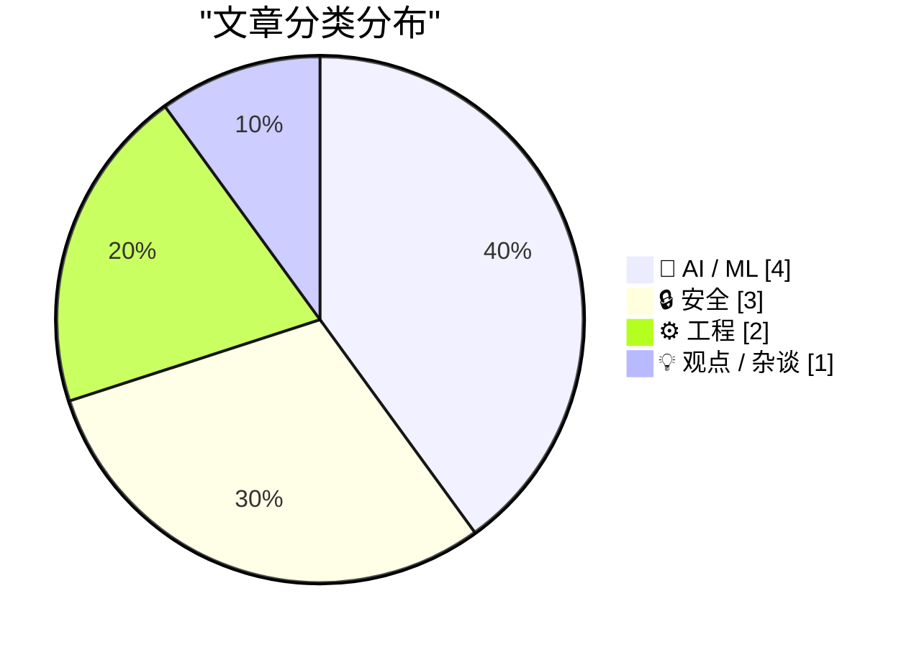
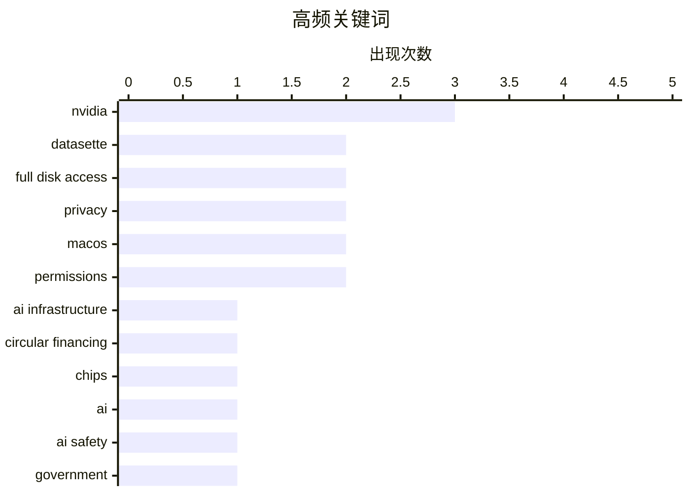

今日技术圈的主线之一，是英伟达以信用和资金托底 AI 算力扩张的模式正面临审视，巨额基础设施投入能否转化为可持续收入成为关键。与此同时，先进 AI 的治理风险快速升温，业界开始从模型能力竞赛转向超级智能对权力结构和社会秩序的长期影响。另一条趋势则是 AI 与数据工具向本地化、浏览器化和隐私优先方向演进，开放权重模型、WebAssembly 服务端与更细化的系统权限控制同步推进。随着应用门槛降低，安全修复和明确授权机制也成为技术落地不可忽视的底座。

<!--more-->


> 来自 Karpathy 推荐的 92 个顶级技术博客，AI 精选 Top 10

## 🏆 今日必读

🥇 **本·汤普森谈英伟达**

[Ben Thompson on Nvidia](https://stratechery.com/2026/obituaries/) — daringfireball.net · 1 天前 · 🤖 AI / ML

> 文章聚焦英伟达如何利用现金流和信用评级，为购买其 AI 芯片的“新型云”公司提供资金与信用支持。多空双方将这一模式分别称为“循环融资”和通往 AI 盈利时代的必要桥梁。风险在于，英伟达过去依赖黄仁勋一人集中决策，而这种大胆押注难以长期持续；新型云及其债权人、股东也将失去重要靠山。支撑整个 AI 基础设施建设所需的全行业收入规模约达万亿美元，必须尽快兑现，否则英伟达的扩张模式将难以维系。

💡 **为什么值得读**: 文章清晰揭示了英伟达支撑 AI 生态繁荣背后的信用杠杆与系统性风险，是理解其商业模式可持续性的关键材料。

🏷️ Nvidia, AI infrastructure, circular financing, chips

🥈 **保罗·克里斯蒂安诺：我们可能距离能够推翻政府的 AI 只有 12 个月**

[Paul Christiano – We could be 12 months away from AIs that can overthrow the government](https://www.dwarkesh.com/p/paul-christiano-2) — dwarkesh.com · 1 天前 · 🤖 AI / ML

> 这期长达 99 分钟的访谈讨论了先进 AI 的能力增长及其对政府权力和社会秩序的潜在影响。保罗·克里斯蒂安诺给出的判断是，人类可能只剩约 12 年的时间窗口，应对能够颠覆政府的 AI 系统。他强调，一旦这种局面形成，人类将很难恢复原有状态。访谈的核心因此不是一般性的 AI 风险，而是要求现在就认真评估超级智能带来的治理与生存挑战。

💡 **为什么值得读**: 这是一场由前沿 AI 研究者直接参与的高规格访谈，为评估 AI 失控和治理风险的时间尺度提供了罕见视角。

🏷️ AI, AI safety, government, automation

🥉 **《华尔街日报》：英伟达作为 AI 经济“无限支票簿”的日子将结束**

[WSJ: ‘Nvidia’s Days as an Open Checkbook for the AI Economy Are Numbered’](https://www.wsj.com/tech/ai/nvidias-days-as-an-open-checkbook-for-the-ai-economy-are-numbered-90c7b388) — daringfireball.net · 1 天前 · 🤖 AI / ML

> 报道指出，在黄仁勋担任英伟达 CEO 的最后阶段，他已经着手减少公司替 AI 初创企业承担财务风险的做法。新任财务负责人对部分既有交易本就有所顾虑，依赖英伟达支持的创业公司预计会遭遇更明显的撤回。英伟达在欧洲 AI 大会上明确释放信号，不再充当整个 AI 行业的“开放支票簿”。这种收缩与英伟达继续斥资 130 亿美元收购 Hugging Face 构成鲜明张力，显示其战略正在从全面托底转向更有选择性的支持。

💡 **为什么值得读**: 文章呈现了英伟达从“慷慨输血”转向战略收缩的内部信号，并揭示这一变化对 AI 初创企业融资模式的直接影响。

🏷️ Nvidia, AI economy, financing, data centers

---

## 📊 数据概览

| 扫描源 | 抓取文章 | 时间范围 | 精选 |
|:---:|:---:|:---:|:---:|
| 86/92 | 2621 篇 → 38 篇 | 48h | **10 篇** |

### 分类分布



### 高频关键词



<details>
<summary>📈 纯文本关键词图（终端友好）</summary>

```
nvidia             │ ████████████████████ 3
datasette          │ █████████████░░░░░░░ 2
full disk access   │ █████████████░░░░░░░ 2
privacy            │ █████████████░░░░░░░ 2
macos              │ █████████████░░░░░░░ 2
permissions        │ █████████████░░░░░░░ 2
ai infrastructure  │ ███████░░░░░░░░░░░░░ 1
circular financing │ ███████░░░░░░░░░░░░░ 1
chips              │ ███████░░░░░░░░░░░░░ 1
ai                 │ ███████░░░░░░░░░░░░░ 1
```

</details>

### 🏷️ 话题标签

**nvidia**(3) · **datasette**(2) · **full disk access**(2) · privacy(2) · macos(2) · permissions(2) · ai infrastructure(1) · circular financing(1) · chips(1) · ai(1) · ai safety(1) · government(1) · automation(1) · ai economy(1) · financing(1) · data centers(1) · ai investment(1) · market bubble(1) · semiconductors(1) · pyodide(1)

---

## 🤖 AI / ML

### 1. 本·汤普森谈英伟达

[Ben Thompson on Nvidia](https://stratechery.com/2026/obituaries/) — **daringfireball.net** · 1 天前 · ⭐ 27/30

> 文章聚焦英伟达如何利用现金流和信用评级，为购买其 AI 芯片的“新型云”公司提供资金与信用支持。多空双方将这一模式分别称为“循环融资”和通往 AI 盈利时代的必要桥梁。风险在于，英伟达过去依赖黄仁勋一人集中决策，而这种大胆押注难以长期持续；新型云及其债权人、股东也将失去重要靠山。支撑整个 AI 基础设施建设所需的全行业收入规模约达万亿美元，必须尽快兑现，否则英伟达的扩张模式将难以维系。

🏷️ Nvidia, AI infrastructure, circular financing, chips

---

### 2. 保罗·克里斯蒂安诺：我们可能距离能够推翻政府的 AI 只有 12 个月

[Paul Christiano – We could be 12 months away from AIs that can overthrow the government](https://www.dwarkesh.com/p/paul-christiano-2) — **dwarkesh.com** · 1 天前 · ⭐ 27/30

> 这期长达 99 分钟的访谈讨论了先进 AI 的能力增长及其对政府权力和社会秩序的潜在影响。保罗·克里斯蒂安诺给出的判断是，人类可能只剩约 12 年的时间窗口，应对能够颠覆政府的 AI 系统。他强调，一旦这种局面形成，人类将很难恢复原有状态。访谈的核心因此不是一般性的 AI 风险，而是要求现在就认真评估超级智能带来的治理与生存挑战。

🏷️ AI, AI safety, government, automation

---

### 3. 《华尔街日报》：英伟达作为 AI 经济“无限支票簿”的日子将结束

[WSJ: ‘Nvidia’s Days as an Open Checkbook for the AI Economy Are Numbered’](https://www.wsj.com/tech/ai/nvidias-days-as-an-open-checkbook-for-the-ai-economy-are-numbered-90c7b388) — **daringfireball.net** · 1 天前 · ⭐ 26/30

> 报道指出，在黄仁勋担任英伟达 CEO 的最后阶段，他已经着手减少公司替 AI 初创企业承担财务风险的做法。新任财务负责人对部分既有交易本就有所顾虑，依赖英伟达支持的创业公司预计会遭遇更明显的撤回。英伟达在欧洲 AI 大会上明确释放信号，不再充当整个 AI 行业的“开放支票簿”。这种收缩与英伟达继续斥资 130 亿美元收购 Hugging Face 构成鲜明张力，显示其战略正在从全面托底转向更有选择性的支持。

🏷️ Nvidia, AI economy, financing, data centers

---

### 4. 任何人都可以轻松使用私有开放权重模型

[Here's how anyone can easily use private, open weight models](https://micahflee.com/heres-how-anyone-can-easily-use-private-open-weight-models/) — **micahflee.com** · 1 天前 · ⭐ 24/30

> 文章聚焦如何让普通用户方便地运行私有、开放权重的本地大语言模型。核心动机是，尽管封闭模型服务可能提供强大能力，但 OpenAI 和 Anthropic 等平台的数据处理方式与隐私表现难以获得信任。本地运行开放权重模型能够减少敏感信息上传至第三方服务，并降低对单一平台的依赖。现摘录主要强调本地模型的实际价值，但未展示具体操作流程和所采用的软件方案。

🏷️ open-weight models, private LLM, local inference, data privacy

---

## 🔒 安全

### 5. macOS Golden Gate 27.3 Beta 2 新增完全磁盘访问权限等隐私控制

[MacOS Golden Gate 27.3b2 Includes New Privacy Controls for Full Disk Access (and More)](https://9to5mac.com/2026/11/16/macos-27-3-includes-new-privacy-controls-for-full-disk-access-and-more/) — **daringfireball.net** · 1 天前 · ⭐ 24/30

> macOS 27.3 开发者测试版 2 改进了“完全磁盘访问”的授权界面，要求用户通过更明确的操作授予高权限。此前位于系统设置中的“设备控制与数据访问”统一开关被拆分为“辅助功能”和“系统与 App 保护覆盖”两个类别。新版设计试图区分辅助技术的正当需求与需要绕过系统或应用保护的应用。相较之下，旧版权限设置较为粗糙，而此次调整更强调用户知情、明确授权和最小化误操作。

🏷️ Full Disk Access, privacy, macOS, permissions

---

### 6. Datasette 0.65.6

[datasette 0.65.6](https://simonwillison.net/2026/Nov/15/datasette-2/) — **simonwillison.net** · 1 天前 · ⭐ 23/30

> Datasette 0.65.6 是从 1.0a43 版本回移了一项小型安全修复的发布版本。问题涉及通过 add_database(db, name=..., route=...) 注册数据库时，如果 route 与 name 不同，原本无权访问该数据库的用户仍可能通过 /<route>.db 下载它。此次更新修正了这条权限绕过路径。虽然功能变化较小，但直接提升了数据库文件访问控制的可靠性。

🏷️ Datasette, security, routing, backport

---

### 7. Apple 关于 macOS 27.3 Beta 2 中全新“完全磁盘访问”和“系统与 App 保护覆盖”设置的官方支持文档

[Apple Support Document on the New ‘Full Disk Access’ and ‘System & App Protection Override’ Settings in MacOS 27.3 Beta 2](https://support.apple.com/en-us/149699) — **daringfireball.net** · 20 小时前 · ⭐ 23/30

> Apple 为 macOS 27.3 Beta 2 的新版高权限设置发布了详细支持文档，重点解释“完全磁盘访问”与“系统与 App 保护覆盖”的用途和授权方式。文章认为，一些用户把新界面视为更吓人的“恐吓清单”，但这一看法可以讨论，设计本身并非草率。Apple 的出发点是避免用户在没有充分意识到风险的情况下，把此类 extraordinary 权限授予过多应用。相比旧版设置，这一方案在权限分类、意图说明和用户确认方面都更经过系统性设计。

🏷️ macOS, Full Disk Access, permissions, privacy

---

## ⚙️ 工程

### 8. 利用 Service Worker 和 Pyodide 在浏览器中运行完整的 Datasette 服务端 Python 应用

[Running the full server-side Datasette Python app in the browser with service workers and Pyodide](https://simonwillison.net/2026/Nov/17/datasette-lite/) — **simonwillison.net** · 5 小时前 · ⭐ 24/30

> Datasette Lite 被重写为可直接在浏览器中运行的 WebAssembly 与 Pyodide 应用，并通过 Service Worker 实现接近原生服务端版本的体验。用户可以浏览 SQLite 数据库、JSON、CSV 和 SQL 脚本，也能从 PyPI 选择已发布的 Datasette 版本。开发者还可加载 GitHub 仓库中的特定提交、标签或分支，并从 100 多个 SQLite 版本中进行选择。系统同时支持从 PyPI 或 wheel 文件地址安装 Datasette 插件，包括 JavaScript 可视化工具。

🏷️ Datasette, Pyodide, WebAssembly, Service Workers

---

### 9. 每周更新 530：电子邮件依赖与应用

[Weekly Update 530: Email Dependencies & Apps](https://www.troyhunt.com/weekly-update-530/) — **troyhunt.com** · 1 天前 · ⭐ 23/30

> 第 530 期每周更新围绕电子邮件及相关应用依赖展开，审视数字服务对单一基础设施的依赖程度。电子邮件与现代生活的工作方式类似，人们通常默认它会像电力或供水一样持续可用，但这种连续性需要复杂的底层系统共同保障。文章借此讨论应用在邮件服务中断或发生变化时应如何调整与用户相关的工作流。当前摘录未包含具体故障事件、数据或全部应用建议，完整内容还涵盖作者近期实践与观察。

🏷️ email, infrastructure, applications, reliability

---

## 💡 观点 / 杂谈

### 10. 英伟达泡沫

[The NVIDIA Bubble](https://www.wheresyoured.at/the-nvidia-bubble/) — **wheresyoured.at** · 6 小时前 · ⭐ 26/30

> 文章的核心问题是，当前围绕英伟达和 AI 基础设施的繁荣是否已经形成不可持续的泡沫。英伟达对芯片采购方和新型云企业的资金支持，使需求增长与自身信用能力深度绑定，这种循环关系是判断估值和商业可持续性的关键。作者借此对英伟达的资本运作、AI 收入预期及相关资产定价进行审视。当前公开节选主要说明文章属于深入分析 AI 财务状况的付费通讯，未展示正文中的完整数据与最终结论。

🏷️ NVIDIA, AI investment, market bubble, semiconductors

---

*生成于 2026-11-18 22:19 | 扫描 86 源 → 获取 2621 篇 → 精选 10 篇*
*基于 [Hacker News Popularity Contest 2025](https://refactoringenglish.com/tools/hn-popularity/) RSS 源列表，由 [Andrej Karpathy](https://x.com/karpathy) 推荐*
*由「懂点儿AI」制作，欢迎关注同名微信公众号获取更多 AI 实用技巧 💡*
