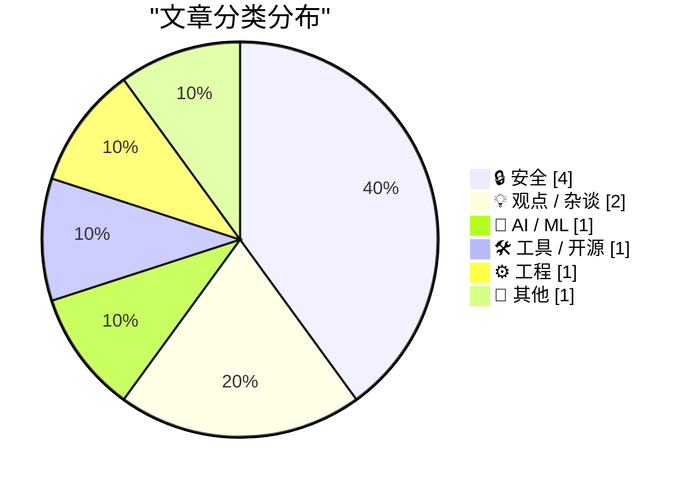
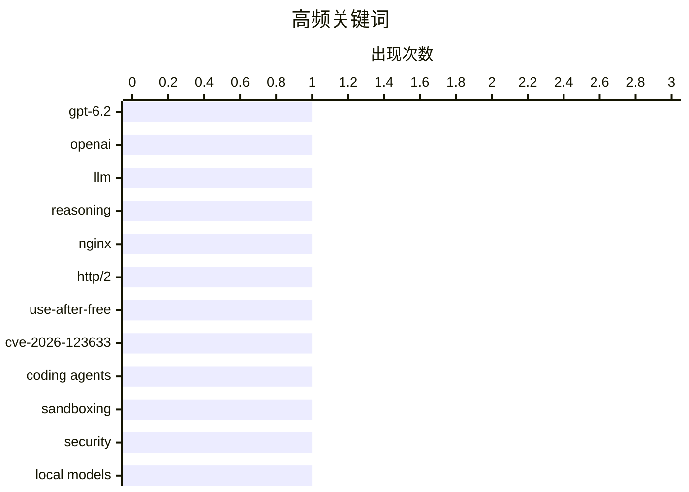

今天技术圈的主线之一，是大模型竞争进一步转向“高性能与低成本并重”：OpenAI 新推旗舰模型，不仅瞄准长周期智能体任务，也通过大幅降价加剧与通用模型之间的竞争。与此同时，编程智能体的安全边界开始成为基础设施，外部沙箱正成为隔离错误与提示注入风险的关键方案。安全议题则呈现出系统性与供应链化趋势，从 NGINX 内存漏洞到第三方优化平台被利用，暴露传统软件缺陷和外部依赖都可能演变为大规模攻击入口。与此同时，浏览器端 Python、服务端能力的持续下沉，以及 AI 基础设施对公共系统的潜在压力，也显示技术扩张的成本与影响正被更广泛地审视。

<!--more-->


> 来自 Karpathy 推荐的 92 个顶级技术博客，AI 精选 Top 10

## 🏆 今日必读

🥇 **GPT-6.2 Astra 与 GPT-6.2 Sol**

[GPT‑6.2 Astra and GPT‑6.2 Sol](https://simonwillison.net/2026/Nov/17/gpt62-astra-and-sol/) — simonwillison.net · 23 小时前 · 🤖 AI / ML

> OpenAI 发布面向高难度项目的旗舰模型 GPT-6.2 Astra，以及兼顾日常任务与效率的 GPT-6.2 Sol，API 模型名分别为 gpt-6.2-astra 和 gpt-6.2-sol。LLM 0.38 已率先支持这两款新模型。Astra 的输入与输出价格分别为每百万 Token 8 美元和 40 美元，是上一代 GPT-6 Astra 的 80%，与 Claude Fable 5.2 相同；其缓存输入价更低至每百万 Token 0.40 美元，较旧模型的 1 美元下降 60%。GPT-6.2 Sol 维持每百万 Token 输入 2 美元、输出 10 美元的定价，与 GPT-6.1 Sol 和 GPT-6 Sol 一致，同时比 GPT-5.6 Sol 便宜一半。整体来看，Astra 主打降低长周期智能体任务的成本，Sol 则以更低价格维持通用型模型的竞争力。

💡 **为什么值得读**: 文章用具体 API 价格和版本对比展示了新模型的成本优势，对正在选择智能体或日常推理模型的使用者很有参考价值。

🏷️ GPT-6.2, OpenAI, LLM, reasoning

🥈 **“根本无从阻止”遭遇此类问题的用户说，而这种问题经常发生的语言只有一种**

["No way to prevent this" say users of only language where this regularly happens](https://xeiaso.net/shitposts/no-way-to-prevent-this/memory-safety/CVE-2026-123633/) — xeiaso.net · 22 小时前 · 🔒 安全

> NGINX 曝出 CVE-2026-123633 与 CVE-2026-123007，分别涉及 HTTP/2 反向代理连接槽不足时的释放后使用，以及经 TLS 触发的流控整数下溢和越界内存复制。两项漏洞都可能让启用 HTTP/2 的服务器遭到未认证远程代码执行，运维人员因此紧急重建并修补系统。文章以讽刺口吻把问题根源指向 C 语言，并援引“全球 90% 的内存安全漏洞”这一说法批评其长期存在的安全缺陷。标题所表达的“无法阻止”，反映的是作者对仅靠逐个修补漏洞难以消除系统性问题的不满。

💡 **为什么值得读**: 这起事件既展示了高危 NGINX 漏洞的实际影响，也以尖锐评论呈现了围绕 C 语言内存安全和防御式编程的长期争论。

🏷️ NGINX, HTTP/2, use-after-free, CVE-2026-123633

🥉 **为编程智能体提供外部沙箱**

[External sandboxes for coding agents](https://simonwillison.net/2026/Nov/17/external-sandboxes-for-coding-agents/) — simonwillison.net · 23 小时前 · 🔒 安全

> Simon Willison 与 AI 研究实验室 Prime Radiant 探索了如何隔离编程智能体执行的代码，以避免本地模型在出错或遭受提示注入时破坏宿主机。其方案采用“外部沙箱”模式：智能体本身运行在沙箱之外，而它生成的代码只能在独立沙箱中执行。项目团队同时发布了三种沙箱服务器实现，用于展示这一隔离架构。该模式的核心价值是把模型决策与高权限代码执行分离，从而缩小提示注入和错误操作可能造成的破坏范围。

💡 **为什么值得读**: 文章给出了一个可直接落地的智能体安全隔离模式及开源实现，适合希望安全运行本地模型和自动化编程智能体的开发者。

🏷️ coding agents, sandboxing, security, local models

---

## 📊 数据概览

| 扫描源 | 抓取文章 | 时间范围 | 精选 |
|:---:|:---:|:---:|:---:|
| 86/92 | 2622 篇 → 35 篇 | 48h | **10 篇** |

### 分类分布



### 高频关键词



<details>
<summary>📈 纯文本关键词图（终端友好）</summary>

```
gpt-6.2         │ ████████████████████ 1
openai          │ ████████████████████ 1
llm             │ ████████████████████ 1
reasoning       │ ████████████████████ 1
nginx           │ ████████████████████ 1
http/2          │ ████████████████████ 1
use-after-free  │ ████████████████████ 1
cve-2026-123633 │ ████████████████████ 1
coding agents   │ ████████████████████ 1
sandboxing      │ ████████████████████ 1
```

</details>

### 🏷️ 话题标签

**gpt-6.2**(1) · **openai**(1) · **llm**(1) · reasoning(1) · nginx(1) · http/2(1) · use-after-free(1) · cve-2026-123633(1) · coding agents(1) · sandboxing(1) · security(1) · local models(1) · datasette(1) · pyodide(1) · webassembly(1) · service workers(1) · optimizely(1) · malware(1) · supply chain(1) · vulnerability(1)

---

## 🔒 安全

### 1. “根本无从阻止”遭遇此类问题的用户说，而这种问题经常发生的语言只有一种

["No way to prevent this" say users of only language where this regularly happens](https://xeiaso.net/shitposts/no-way-to-prevent-this/memory-safety/CVE-2026-123633/) — **xeiaso.net** · 22 小时前 · ⭐ 27/30

> NGINX 曝出 CVE-2026-123633 与 CVE-2026-123007，分别涉及 HTTP/2 反向代理连接槽不足时的释放后使用，以及经 TLS 触发的流控整数下溢和越界内存复制。两项漏洞都可能让启用 HTTP/2 的服务器遭到未认证远程代码执行，运维人员因此紧急重建并修补系统。文章以讽刺口吻把问题根源指向 C 语言，并援引“全球 90% 的内存安全漏洞”这一说法批评其长期存在的安全缺陷。标题所表达的“无法阻止”，反映的是作者对仅靠逐个修补漏洞难以消除系统性问题的不满。

🏷️ NGINX, HTTP/2, use-after-free, CVE-2026-123633

---

### 2. 为编程智能体提供外部沙箱

[External sandboxes for coding agents](https://simonwillison.net/2026/Nov/17/external-sandboxes-for-coding-agents/) — **simonwillison.net** · 23 小时前 · ⭐ 26/30

> Simon Willison 与 AI 研究实验室 Prime Radiant 探索了如何隔离编程智能体执行的代码，以避免本地模型在出错或遭受提示注入时破坏宿主机。其方案采用“外部沙箱”模式：智能体本身运行在沙箱之外，而它生成的代码只能在独立沙箱中执行。项目团队同时发布了三种沙箱服务器实现，用于展示这一隔离架构。该模式的核心价值是把模型决策与高权限代码执行分离，从而缩小提示注入和错误操作可能造成的破坏范围。

🏷️ coding agents, sandboxing, security, local models

---

### 3. 攻击者利用 Optimizely 在顶级网站上对恶意软件进行 A/B 测试

[Attackers Used Optimizely to A/B Test Malware on Top Websites](https://krebsonsecurity.com/2026/11/attackers-used-optimizely-to-a-b-test-malware-on-top-websites/) — **krebsonsecurity.com** · 19 小时前 · ⭐ 25/30

> Optimizely 的一处安全漏洞导致至少 178 个知名网站在过去 24 小时内向访客分发了多种恶意漏洞利用程序。受影响网站包括 BBC、CNN、Equifax、Ledger 和 Zoom，攻击载荷能够静默注入数据窃取软件。攻击者利用 Optimizely 原本用于网站体验优化和功能测试的能力，对不同恶意软件方案进行 A/B 测试。事件还暴露出热门网站对第三方内容来源普遍缺乏严格限制这一供应链风险。

🏷️ Optimizely, malware, supply chain, vulnerability

---

### 4. 关于 macOS 27.3 Beta 2 新增“完全磁盘访问权限”和“系统与应用保护覆盖”设置的 Apple 支持文档

[Apple Support Document on the New ‘Full Disk Access’ and ‘System & App Protection Override’ Settings in MacOS 27.3 Beta 2](https://support.apple.com/en-us/149699) — **daringfireball.net** · 1 天前 · ⭐ 25/30

> Apple 为 macOS 27.3 Beta 2 的“完全磁盘访问权限”和“系统与应用保护覆盖”设置发布了专门的支持文档，解释相关权限及其设计意图。部分用户将这些设置视为更令人不安的权限面板，但作者认为这一担忧可以讨论，Apple 的实际设计却经过充分考量。其出发点是许多 Mac 用户在不了解权限范围的情况下向过多应用授予了完全磁盘访问权限，而旧版设置相对随意。此次在首个测试版本阶段就提供详尽支持文档，也被作者视为 Apple 对新权限机制认真负责的信号。

🏷️ macOS 27.3, Full Disk Access, permissions, privacy

---

## 💡 观点 / 杂谈

### 5. Anthropic 上市对投资者和社会来说是一场糟糕的赌注吗？

[Is Anthropic’s IPO a bad bet, both for investors and society?](https://garymarcus.substack.com/p/is-anthropics-ipo-a-bad-bet-both) — **garymarcus.substack.com** · 33 分钟前 · ⭐ 23/30

> 文章审视 Anthropic 的潜在 IPO 是否会同时损害投资者利益与社会价值。其重点是指出支持 Anthropic 上市的多头论证忽略了某些关键因素，而不只是复述公司的增长与商业前景。现有原文摘要没有披露这些被忽略的具体假设、估值指标或风险，因此无法据此判断作者采用了哪些财务和社会层面的论据。文章最终将 Anthropic 上市置于投资回报与外部成本的双重框架下，而不是仅讨论公司能否获得资本。

🏷️ Anthropic, IPO, AI investment, societal impact

---

### 6. 醒醒！美国的基础设施正在崩塌，AI 似乎也要承担部分责任

[Wake up! America’s infrastructure is melting. And AI appears to be partly responsible.](https://garymarcus.substack.com/p/wake-up-americas-infrastructure-is) — **garymarcus.substack.com** · 1 天前 · ⭐ 23/30

> 文章聚焦美国基础设施状况恶化的问题，并提出 AI 可能是部分责任方。已有数百家公司受到影响，显示相关故障或压力已经形成广泛而现实的经济冲击。作者试图把基础设施衰退与 AI 的快速扩张联系起来，质疑技术增长是否正在挤压或破坏既有系统。现有原文摘要没有提供受影响行业、故障类型、AI 关联机制及具体数据，因此尚不足以验证这一因果判断。

🏷️ AI, infrastructure, data centers, energy

---

## 🤖 AI / ML

### 7. GPT-6.2 Astra 与 GPT-6.2 Sol

[GPT‑6.2 Astra and GPT‑6.2 Sol](https://simonwillison.net/2026/Nov/17/gpt62-astra-and-sol/) — **simonwillison.net** · 23 小时前 · ⭐ 28/30

> OpenAI 发布面向高难度项目的旗舰模型 GPT-6.2 Astra，以及兼顾日常任务与效率的 GPT-6.2 Sol，API 模型名分别为 gpt-6.2-astra 和 gpt-6.2-sol。LLM 0.38 已率先支持这两款新模型。Astra 的输入与输出价格分别为每百万 Token 8 美元和 40 美元，是上一代 GPT-6 Astra 的 80%，与 Claude Fable 5.2 相同；其缓存输入价更低至每百万 Token 0.40 美元，较旧模型的 1 美元下降 60%。GPT-6.2 Sol 维持每百万 Token 输入 2 美元、输出 10 美元的定价，与 GPT-6.1 Sol 和 GPT-6 Sol 一致，同时比 GPT-5.6 Sol 便宜一半。整体来看，Astra 主打降低长周期智能体任务的成本，Sol 则以更低价格维持通用型模型的竞争力。

🏷️ GPT-6.2, OpenAI, LLM, reasoning

---

## 🛠 工具 / 开源

### 8. 借助 Service Worker 与 Pyodide 在浏览器中运行完整的 Datasette 服务端 Python 应用

[Running the full server-side Datasette Python app in the browser with service workers and Pyodide](https://simonwillison.net/2026/Nov/17/datasette-lite/) — **simonwillison.net** · 1 天前 · ⭐ 25/30

> Datasette Lite 是 Datasette Python 应用的浏览器端移植版本，通过 WebAssembly 和 Pyodide 直接运行。新版经过完整重写并引入 Service Worker，其体验已经接近真正的服务端应用。用户可在客户端浏览任意 SQLite 数据库、JSON 文件、CSV 文件或 SQL 脚本，并选择从 PyPI 安装的 Datasette 版本，或加载 GitHub 仓库中的特定提交、标签与分支。它还支持从超过 100 个 SQLite 版本中进行选择，并可安装来自 PyPI 或 wheel 文件的额外 Datasette 插件，包括 JavaScript 可视化工具。项目让 Datasette 的数据探索、版本选择和插件扩展能力基本都能脱离服务器在浏览器中完成。

🏷️ Datasette, Pyodide, WebAssembly, service workers

---

## ⚙️ 工程

### 9. 本周版本控制动态：2026 年 11 月 18 日

[This Week in Source Control: 18 November 2026](https://nesbitt.io/2026/11/18/this-week-in-source-control.html) — **nesbitt.io** · 12 小时前 · ⭐ 25/30

> 这份 2026 年 11 月 18 日的版本控制周报汇总了版本控制系统与开发平台社区的最新动态。内容覆盖软件发布、安全公告以及相关文章三类信息。它以跨项目和工具的周度简报形式，帮助开发者集中掌握生态变化。由于所提供的原文摘要没有列出具体项目、版本号或公告编号，读者需阅读全文才能确认各条目的影响范围。

🏷️ Git, version control, forges, security advisories

---

## 📝 其他

### 10. 黄仁勋发推回应重返 NVIDIA CEO 职位的呼声

[Jensen Huang Tweets](https://x.com/JensenHuang/status/2122726005219737649) — **daringfireball.net** · 6 小时前 · ⭐ 24/30

> 黄仁勋在 X 发帖称，在离开公司后收到了员工、投资人、合作伙伴和客户要求其回归 CEO 岗位的大量联络。他表示，NVIDIA 正经历技术、市场、竞争和地缘政治方面的复杂局面，而 NVIDIA 是“百年难遇”的公司；如果董事会认定回归符合股东、员工、公司和美国的利益，他愿考虑回归。发帖时间正值 NVIDIA 季度财报发布前数小时，公开表态因而受到市场与舆论关注。作者批评公开表达复职呼声的做法，并引用 Jason Calacanis 关于中国芯片禁令和美国衰退的预测来质疑部分舆论叙事。

🏷️ NVIDIA, Jensen Huang, CEO, AI chips

---

*生成于 2026-11-19 22:18 | 扫描 86 源 → 获取 2622 篇 → 精选 10 篇*
*基于 [Hacker News Popularity Contest 2025](https://refactoringenglish.com/tools/hn-popularity/) RSS 源列表，由 [Andrej Karpathy](https://x.com/karpathy) 推荐*
*由「懂点儿AI」制作，欢迎关注同名微信公众号获取更多 AI 实用技巧 💡*
