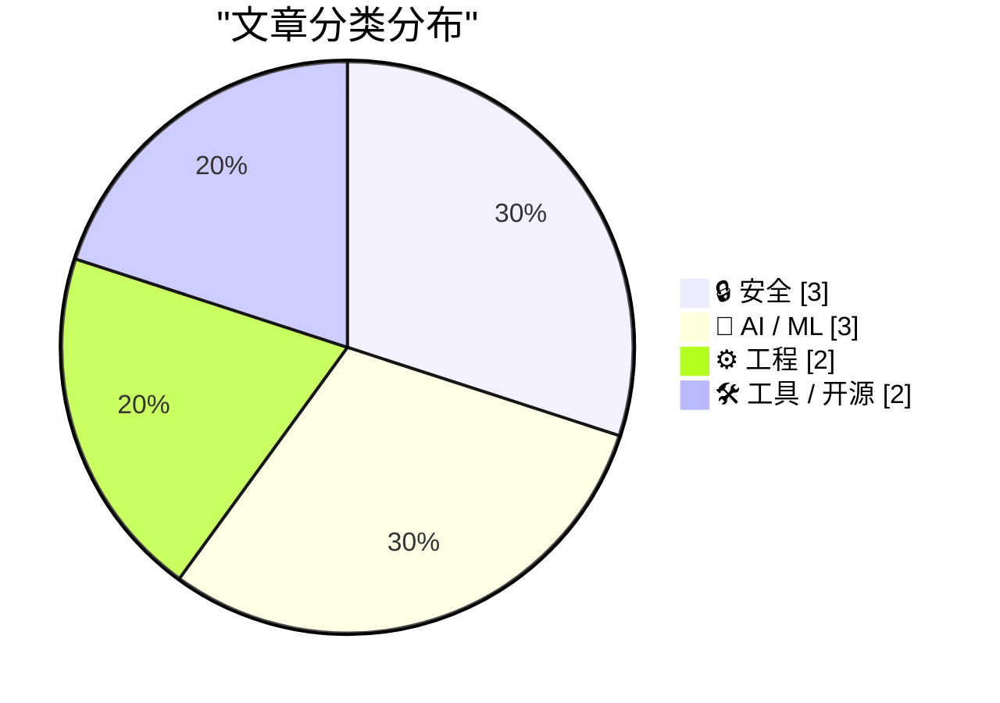
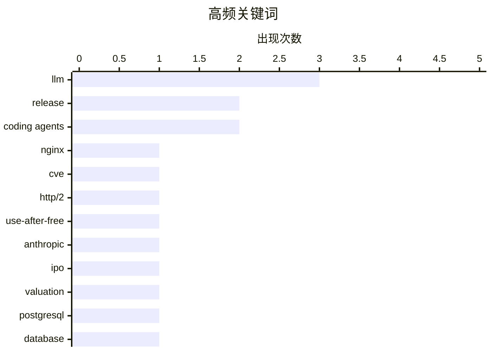

今日技术圈的主线集中在三处：一是安全议题以系统性和供应链形式回归，NGINX 的 C 语言内存漏洞、Optimizely 被用于向 BBC、CNN 等头部站点 A/B 测试投放恶意软件，都指向底层语言缺陷与第三方依赖治理这两个老问题的叠加风险；二是 AI 竞争从模型能力转向成本与资本叙事，OpenAI 用 GPT‑6.2 Astra/Sol 的降价与缓存计费直指长时代智能体会话成本，Anthropic 的"史上最大 IPO"传闻与黄仁勋回归风波则显示估值泡沫和治理成熟度正接受审视；三是工程实践开始反思"AI 批量产出"的局限，curl 维护者质疑 18.5 万行 C 转成 34 万行 Rust 的重写是否跟得上真实维护节奏，PostgreSQL 19 因大量 AI 报告漏洞而延期两个月，编程智能体也纷纷转向外部沙箱以隔离执行风险。整体来看，技术红利仍在推进，但安全治理、真实工程价值与商业叙事的可信度，正成为比性能参数更受关注的判断标准。

<!--more-->


> 来自 Karpathy 推荐的 92 个顶级技术博客，AI 精选 Top 10

## 🏆 今日必读

🥇 **用户称“无法阻止”：这是唯一经常出现此类安全问题的编程语言**

["No way to prevent this" say users of only language where this regularly happens](https://xeiaso.net/shitposts/no-way-to-prevent-this/memory-safety/CVE-2026-123633/) — xeiaso.net · 1 天前 · 🔒 安全

> NGINX 曝出 CVE-2026-123633 与 CVE-2026-123007，分别涉及反向代理处理 HTTP/2 连接时的释放后重用，以及 TLS 流量控制整数下溢导致的越界内存复制。攻击者可在启用 HTTP/2 的服务器上实施未经身份验证的远程代码执行，运维人员因此需要紧急重建和修补系统。文章以讽刺口吻将问题归咎于使用 C 语言开发的组件，并援引“全球 90% 的内存安全漏洞都发生在 C 语言中”这一说法。核心观点是，频繁爆发的内存安全漏洞并非偶发事故，而是 C 语言及其底层内存管理方式带来的系统性风险。

💡 **为什么值得读**: 文章把两个高危 NGINX 漏洞与 C 语言的内存安全缺陷联系起来，既提供具体风险信息，也直观展示了技术债如何演变成可远程利用的安全事件。

🏷️ NGINX, CVE, HTTP/2, use-after-free

🥈 **Anthropic 上市，将超越 SpaceX 成为史上最大 IPO**

[Anthropic IPOs, Topping SpaceX for the Largest Ever](https://www.techmeme.com/261118/p34#a261118p34) — daringfireball.net · 5 小时前 · 🤖 AI / ML

> 针对 Anthropic 可能创下史上最大规模 IPO 的消息，作者表达了双重怀疑。其一是 LLM 技术不存在永久护城河，当前优势仅是受英伟达及黄仁勋推动的巨额资本泡沫支撑的前沿优势。其二，即便技术判断有误，Anthropic 团队也不具备领导一家上市公司的能力。作者用“宗教狂热分子和怪人群体”等措辞批评 Anthropic 的企业文化与治理方式。总体结论是，Anthropic 的技术声誉和估值不足以证明其具备成熟上市公司的管理能力。

💡 **为什么值得读**: 这篇文章从技术护城河泡沫和公司治理两个角度挑战 Anthropic 超级 IPO 的乐观叙事，适合关注大模型商业化及其上市估值的读者。

🏷️ Anthropic, IPO, LLM, valuation

🥉 **PostgreSQL 19 正式发布**

[PostgreSQL 19 Released](https://simonwillison.net/2026/Nov/19/postgresql-19/) — simonwillison.net · 1 小时前 · ⚙️ 工程

> PostgreSQL 19 从通常的 9 月发布时间推迟到 11 月，主要原因是团队需要集中处理由 AI 报告的大量漏洞。最受作者关注的新功能是 WAIT FOR LSN 命令，它允许主库会话等待从库将 WAL 重放至指定的日志序列号，从而实现“读己之写”一致性。该机制特别适合向只读副本发送查询的应用，可避免刚写入主库的数据尚未同步到从库时读到旧值。作者认为这些改进足以弥补两个月的延期，PostgreSQL 19 是一款值得等待的版本。

💡 **为什么值得读**: WAIT FOR LSN 直接解决了分布式 PostgreSQL 中主从延迟导致的数据一致性问题，同时版本延期与 AI 辅助漏洞发现也反映了现代数据库维护压力的变化。

🏷️ PostgreSQL, database, release, open source

---

## 📊 数据概览

| 扫描源 | 抓取文章 | 时间范围 | 精选 |
|:---:|:---:|:---:|:---:|
| 86/92 | 2622 篇 → 34 篇 | 48h | **10 篇** |

### 分类分布



### 高频关键词



<details>
<summary>📈 纯文本关键词图（终端友好）</summary>

```
llm            │ ████████████████████ 3
release        │ █████████████░░░░░░░ 2
coding agents  │ █████████████░░░░░░░ 2
nginx          │ ███████░░░░░░░░░░░░░ 1
cve            │ ███████░░░░░░░░░░░░░ 1
http/2         │ ███████░░░░░░░░░░░░░ 1
use-after-free │ ███████░░░░░░░░░░░░░ 1
anthropic      │ ███████░░░░░░░░░░░░░ 1
ipo            │ ███████░░░░░░░░░░░░░ 1
valuation      │ ███████░░░░░░░░░░░░░ 1
```

</details>

### 🏷️ 话题标签

**llm**(3) · **release**(2) · **coding agents**(2) · nginx(1) · cve(1) · http/2(1) · use-after-free(1) · anthropic(1) · ipo(1) · valuation(1) · postgresql(1) · database(1) · open source(1) · sandboxing(1) · security(1) · local models(1) · gpt-6.2(1) · openai(1) · reasoning(1) · optimizely(1)

---

## 🔒 安全

### 1. 用户称“无法阻止”：这是唯一经常出现此类安全问题的编程语言

["No way to prevent this" say users of only language where this regularly happens](https://xeiaso.net/shitposts/no-way-to-prevent-this/memory-safety/CVE-2026-123633/) — **xeiaso.net** · 1 天前 · ⭐ 28/30

> NGINX 曝出 CVE-2026-123633 与 CVE-2026-123007，分别涉及反向代理处理 HTTP/2 连接时的释放后重用，以及 TLS 流量控制整数下溢导致的越界内存复制。攻击者可在启用 HTTP/2 的服务器上实施未经身份验证的远程代码执行，运维人员因此需要紧急重建和修补系统。文章以讽刺口吻将问题归咎于使用 C 语言开发的组件，并援引“全球 90% 的内存安全漏洞都发生在 C 语言中”这一说法。核心观点是，频繁爆发的内存安全漏洞并非偶发事故，而是 C 语言及其底层内存管理方式带来的系统性风险。

🏷️ NGINX, CVE, HTTP/2, use-after-free

---

### 2. 为编程智能体构建外部沙箱

[External sandboxes for coding agents](https://simonwillison.net/2026/Nov/17/external-sandboxes-for-coding-agents/) — **simonwillison.net** · 1 天前 · ⭐ 26/30

> Simon Willison 与 AI 研究机构 Prime Radiant 合作探索了一种“外部沙箱”模式，用于隔离由编程智能体执行的代码。该模式让智能体本身留在沙箱之外，而其生成的代码只能在专用沙箱服务器中运行，从而降低本地模型出错或遭受提示注入后破坏宿主机的风险。项目还发布了三套独立的沙箱服务器实现，以展示这一架构并非只能依赖特定虚拟化平台。其核心目标是让开发者能够更安全地试用本地模型和自动化编程智能体，而不必直接暴露开发环境。

🏷️ coding agents, sandboxing, security, local models

---

### 3. 攻击者利用 Optimizely 在头部网站上对恶意软件进行 A/B 测试

[Attackers Used Optimizely to A/B Test Malware on Top Websites](https://krebsonsecurity.com/2026/11/attackers-used-optimizely-to-a-b-test-malware-on-top-websites/) — **krebsonsecurity.com** · 1 天前 · ⭐ 26/30

> Optimizely 的一项安全漏洞导致至少 178 个知名网站在过去 24 小时内向访问者静默投放了多种恶意软件利用程序。BBC、CNN、Equifax、Ledger 和 Zoom 等站点均被列为受影响目标，攻击载荷包含可窃取数据的恶意软件。攻击者还利用 Optimizely 的实验能力对不同攻击方式进行 A/B 测试，以提高恶意内容的命中率。事件进一步暴露出热门网站对第三方内容来源普遍缺乏严格准入和供应链治理的问题。

🏷️ Optimizely, malware, supply chain, web security

---

## 🤖 AI / ML

### 4. Anthropic 上市，将超越 SpaceX 成为史上最大 IPO

[Anthropic IPOs, Topping SpaceX for the Largest Ever](https://www.techmeme.com/261118/p34#a261118p34) — **daringfireball.net** · 5 小时前 · ⭐ 27/30

> 针对 Anthropic 可能创下史上最大规模 IPO 的消息，作者表达了双重怀疑。其一是 LLM 技术不存在永久护城河，当前优势仅是受英伟达及黄仁勋推动的巨额资本泡沫支撑的前沿优势。其二，即便技术判断有误，Anthropic 团队也不具备领导一家上市公司的能力。作者用“宗教狂热分子和怪人群体”等措辞批评 Anthropic 的企业文化与治理方式。总体结论是，Anthropic 的技术声誉和估值不足以证明其具备成熟上市公司的管理能力。

🏷️ Anthropic, IPO, LLM, valuation

---

### 5. GPT‑6.2 Astra 与 GPT‑6.2 Sol 发布

[GPT‑6.2 Astra and GPT‑6.2 Sol](https://simonwillison.net/2026/Nov/17/gpt62-astra-and-sol/) — **simonwillison.net** · 1 天前 · ⭐ 26/30

> OpenAI 推出面向高难度项目的 GPT‑6.2 Astra，以及兼顾日常任务的高效通用模型 GPT‑6.2 Sol，API 名称分别为 gpt-6.2-astra 和 gpt-6.2-sol。Simon Willison 已发布 LLM 0.38 以支持这两个模型。Astra 的价格为每百万输入 token 8 美元、每百万输出 token 40 美元，是上一代 6 Astra 的 80%，其缓存输入价格则从 1 美元降至 0.40 美元。Sol 维持每百万输入 token 2 美元、输出 token 10 美元，是 GPT‑5.6 Sol 的一半价格。整体来看，新系列通过更低价格和更友好的缓存计费，重点改善了长时间运行的智能体会话成本。

🏷️ GPT-6.2, OpenAI, LLM, reasoning

---

### 6. 黄仁勋发推回应重返英伟达 CEO 的呼声

[Jensen Huang Tweets](https://x.com/JensenHuang/status/2122726005219737649) — **daringfireball.net** · 1 天前 · ⭐ 25/30

> 英伟达 CEO 黄仁勋在 X 上表示，离开公司后收到了员工、投资人、合作伙伴和客户要求其回归的请求，并称若董事会认为回归符合股东及公司利益，他会考虑返回。发帖时间恰在英伟达季度财报公布前数小时，因此外界关注这是否构成对治理和领导权变动的信号。作者对公开呼吁黄仁勋回归的行为持强烈批评态度，称网络上存在大量盲目支持者。他还引用“鹰派”观点制造中美芯片禁运和美国经济衰退的极端预期，以讽刺相关舆论中的夸张与恐慌。整体来看，文章认为这场公开请愿更多反映政治与粉丝文化，而非严肃的企业治理讨论。

🏷️ Jensen Huang, Nvidia, CEO, earnings

---

## ⚙️ 工程

### 7. PostgreSQL 19 正式发布

[PostgreSQL 19 Released](https://simonwillison.net/2026/Nov/19/postgresql-19/) — **simonwillison.net** · 1 小时前 · ⭐ 26/30

> PostgreSQL 19 从通常的 9 月发布时间推迟到 11 月，主要原因是团队需要集中处理由 AI 报告的大量漏洞。最受作者关注的新功能是 WAIT FOR LSN 命令，它允许主库会话等待从库将 WAL 重放至指定的日志序列号，从而实现“读己之写”一致性。该机制特别适合向只读副本发送查询的应用，可避免刚写入主库的数据尚未同步到从库时读到旧值。作者认为这些改进足以弥补两个月的延期，PostgreSQL 19 是一款值得等待的版本。

🏷️ PostgreSQL, database, release, open source

---

### 8. 引用 Daniel Stenberg：真正的 curl 重写只是徒有其表

[Quoting Daniel Stenberg](https://simonwillison.net/2026/Nov/18/daniel-stenberg/) — **simonwillison.net** · 1 天前 · ⭐ 25/30

> curl 维护者 Daniel Stenberg 对将项目代码改写为 Rust 的做法提出质疑。根据他的统计，智能体把约 185,000 行 C 代码转换成了 340,000 行 Rust 代码，但真正的 curl 项目同期合并了超过 300 个提交，并完成了约 200 项这些 Rust 重写并未包含的缺陷修复。一个多月后又完成了约 200 项修复，并可能修补了更多漏洞，说明原项目仍保持活跃维护。Stenberg 的反问是，这些依赖智能体生成的重写版本能否跟上 curl 的实际发展。核心观点是，用代码行数和语言迁移制造的重写成果，不能替代持续集成、测试和维护所形成的真实工程价值。

🏷️ curl, Rust, C, coding agents

---

## 🛠 工具 / 开源

### 9. llm-gemini 0.38 发布

[llm-gemini 0.38](https://simonwillison.net/2026/Nov/18/llm-gemini/) — **simonwillison.net** · 22 小时前 · ⭐ 24/30

> llm-gemini 0.38 随 Google Gemini 4 Neon 的发布而更新，Simon Willison 同时指出 Gemini 4 系列的定价体系更加混乱。此前产品线包括 Hydrogen、Argon 和 Carbon，其中 Argon 与 Carbon 同价，而 Hydrogen 当前价格为它们的四分之三。随着其他型号在 12 月 1 日结束初始折扣并翻倍，Hydrogen 的相对价格将降至四分之一。Neon 的发布材料甚至没有提及 Argon，使原有产品线关系更加不透明。整体而言，版本更新提供了对新模型的访问方式，但复杂且不断变化的定价仍是用户选型的主要障碍。

🏷️ Gemini, LLM, llm-gemini, release

---

### 10. 本周源码管理动态：2026 年 11 月 18 日

[This Week in Source Control: 18 November 2026](https://nesbitt.io/2026/11/18/this-week-in-source-control.html) — **nesbitt.io** · 1 天前 · ⭐ 24/30

> 这是一份 2026 年 11 月 18 日的源码管理与开发平台周度汇总。内容范围覆盖版本控制系统及相关开发平台的最新动态，包括软件发布、安全公告和行业文章。它将分散在各项目中的更新集中整理，便于读者快速掌握本周值得关注的生态变化。摘要信息强调的是跨项目信息聚合，而非对某一项版本控制工具的深入技术分析。具体条目涉及哪些项目和版本，需要查阅原文才能完整确认。

🏷️ source control, Git, forges, software releases

---

*生成于 2026-11-20 22:18 | 扫描 86 源 → 获取 2622 篇 → 精选 10 篇*
*基于 [Hacker News Popularity Contest 2025](https://refactoringenglish.com/tools/hn-popularity/) RSS 源列表，由 [Andrej Karpathy](https://x.com/karpathy) 推荐*
*由「懂点儿AI」制作，欢迎关注同名微信公众号获取更多 AI 实用技巧 💡*
