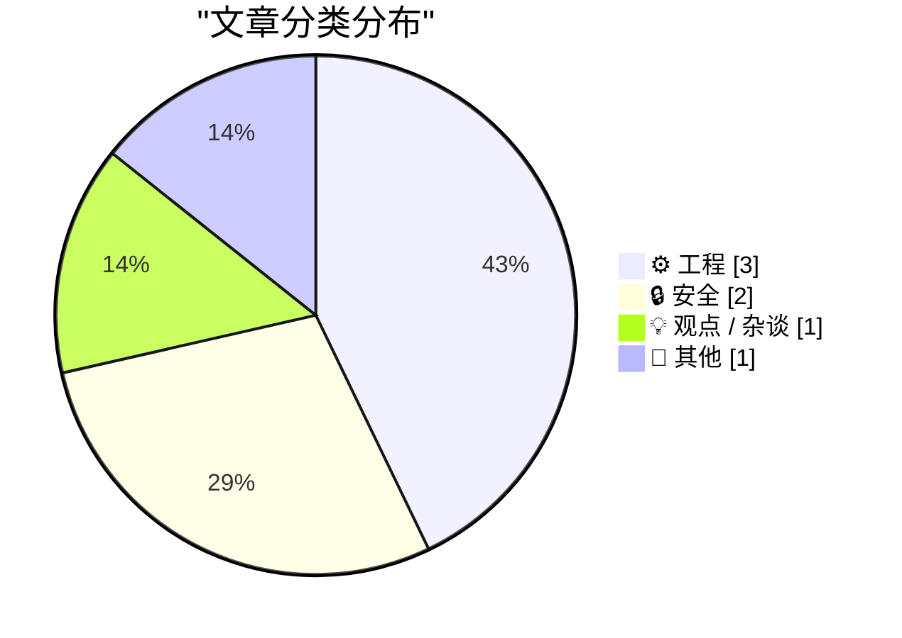
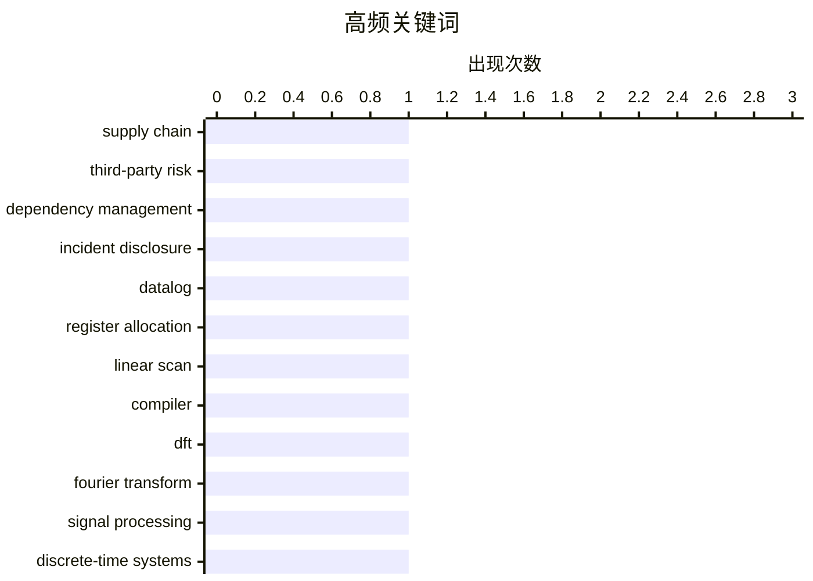

今天的技术讨论呈现出三条主线：软件供应链安全问题再次被置于责任归属的核心，第三方脚本和组件的引入不能成为网站及用户免除问责的理由。与此同时，Datalog 线性扫描寄存器分配和 DFT 实践表明，程序分析与信号处理正持续向更形式化、更贴近工程应用的方向推进。复古硬件改造与消费品结构解读则共同强调，技术选择不仅取决于“标准”方案，还应兼顾兼容性、拆装维护和实际使用体验。

<!--more-->


> 来自 Karpathy 推荐的 92 个顶级技术博客，AI 精选 Top 7

## 🏆 今日必读

🥇 **第531期周报：Optimizely、脚本依赖与第三方**

[Weekly Update 531: Optimizely. Script Dependencies & Third Parties](https://www.troyhunt.com/weekly-update-531/) — troyhunt.com · 16 小时前 · 🔒 安全

> 这次周报聚焦 Optimizely、网页脚本依赖和第三方风险，尤其是安全事件披露中的责任归属。作者批评公告以“事件发生在第三方”为由淡化影响，指出供应链中承担最终责任的一方不能把问责外包。分析重点包括第三方脚本及其依赖关系：一个外部组件被入侵或失效，可能把风险传导至大量使用它的站点。文章的核心立场是，第三方可以参与处置，却不能替受影响网站及其用户免除责任。

💡 **为什么值得读**: 它把脚本供应链风险与责任归属放在同一框架下讨论，有助于网站运营者理解第三方组件出问题时该如何披露和回应。

🏷️ supply chain, third-party risk, dependency management, incident disclosure

🥈 **在 Datalog 中实现线性扫描寄存器分配**

[Linear scan register allocation in Datalog](https://bernsteinbear.com/blog/lsra-datalog/?utm_source=rss) — bernsteinbear.com · 1 天前 · ⚙️ 工程

> 目标是用 Datalog 实现线性扫描寄存器分配，把此前的 Ruby/SSA 版本推进为更适合程序分析的形式化实现。作者先回顾自己编写的首个线性扫描分配器，以及随后与 Waleed Khan 讨论的 Datalog 活性不动点算法。项目在 PLDI 会议期间与 Yannis Smaragdakis 合作展开，借助专家共同作者补足 Datalog 专业知识。核心方法以活性分析为基础，再把寄存器分配决策表达为 Datalog 规则，从而探索可声明、可求解的分配器实现。

💡 **为什么值得读**: 文章展示了如何把编译器中的寄存器分配问题改写为 Datalog 程序，适合想了解程序分析、SSA 和声明式编译器技术的读者。

🏷️ Datalog, register allocation, linear scan, compiler

🥉 **离散傅里叶变换（DFT）笔记**

[Notes on the discrete Fourier transform (DFT)](https://eli.thegreenplace.net/2026/notes-on-the-discrete-fourier-transform-dft/) — eli.thegreenplace.net · 23 小时前 · ⚙️ 工程

> 这篇笔记承接此前关于离散时间傅里叶级数（DTFS）和离散时间傅里叶变换（DTFT）的文章，把讨论推进到有限长度离散信号。DTFS 和 DTFT 适合分析无限持续、周期或非周期的信号，而现实数字信号处理通常还要处理有限采样序列，因此需要 DFT。内容围绕 DFT 展开，重点在于明确它与 DTFT 在有限数据情形下的关系，并连接到实际数字信号处理流程。核心结论是，DFT 是处理有限长度离散信号时更贴近工程实践的频域分析工具。

💡 **为什么值得读**: 它从 DTFS、DTFT 逐步过渡到有限信号的 DFT，适合希望补牢离散傅里叶变换概念及其实际用途的读者。

🏷️ DFT, Fourier transform, signal processing, discrete-time systems

---

## 📊 数据概览

| 扫描源 | 抓取文章 | 时间范围 | 精选 |
|:---:|:---:|:---:|:---:|
| 51/92 | 1692 篇 → 7 篇 | 48h | **7 篇** |

### 分类分布



### 高频关键词



<details>
<summary>📈 纯文本关键词图（终端友好）</summary>

```
supply chain          │ ████████████████████ 1
third-party risk      │ ████████████████████ 1
dependency management │ ████████████████████ 1
incident disclosure   │ ████████████████████ 1
datalog               │ ████████████████████ 1
register allocation   │ ████████████████████ 1
linear scan           │ ████████████████████ 1
compiler              │ ████████████████████ 1
dft                   │ ████████████████████ 1
fourier transform     │ ████████████████████ 1
```

</details>

### 🏷️ 话题标签

**supply chain**(1) · **third-party risk**(1) · **dependency management**(1) · incident disclosure(1) · datalog(1) · register allocation(1) · linear scan(1) · compiler(1) · dft(1) · fourier transform(1) · signal processing(1) · discrete-time systems(1) · weapons systems(1) · cybersecurity(1) · nuclear safety(1) · chemical warfare(1) · tandy 1000(1) · mouse(1) · retro computing(1) · hardware compatibility(1)

---

## ⚙️ 工程

### 1. 在 Datalog 中实现线性扫描寄存器分配

[Linear scan register allocation in Datalog](https://bernsteinbear.com/blog/lsra-datalog/?utm_source=rss) — **bernsteinbear.com** · 1 天前 · ⭐ 20/30

> 目标是用 Datalog 实现线性扫描寄存器分配，把此前的 Ruby/SSA 版本推进为更适合程序分析的形式化实现。作者先回顾自己编写的首个线性扫描分配器，以及随后与 Waleed Khan 讨论的 Datalog 活性不动点算法。项目在 PLDI 会议期间与 Yannis Smaragdakis 合作展开，借助专家共同作者补足 Datalog 专业知识。核心方法以活性分析为基础，再把寄存器分配决策表达为 Datalog 规则，从而探索可声明、可求解的分配器实现。

🏷️ Datalog, register allocation, linear scan, compiler

---

### 2. 离散傅里叶变换（DFT）笔记

[Notes on the discrete Fourier transform (DFT)](https://eli.thegreenplace.net/2026/notes-on-the-discrete-fourier-transform-dft/) — **eli.thegreenplace.net** · 23 小时前 · ⭐ 18/30

> 这篇笔记承接此前关于离散时间傅里叶级数（DTFS）和离散时间傅里叶变换（DTFT）的文章，把讨论推进到有限长度离散信号。DTFS 和 DTFT 适合分析无限持续、周期或非周期的信号，而现实数字信号处理通常还要处理有限采样序列，因此需要 DFT。内容围绕 DFT 展开，重点在于明确它与 DTFT 在有限数据情形下的关系，并连接到实际数字信号处理流程。核心结论是，DFT 是处理有限长度离散信号时更贴近工程实践的频域分析工具。

🏷️ DFT, Fourier transform, signal processing, discrete-time systems

---

### 3. 适用于 Tandy 1000 的鼠标

[Mouse for Tandy 1000](https://dfarq.homeip.net/mouse-for-tandy-1000/?utm_source=rss&#038;utm_medium=rss&#038;utm_campaign=mouse-for-tandy-1000) — **dfarq.homeip.net** · 10 小时前 · ⭐ 13/30

> 文章从 Tandy 1000 早期机型原配的 TRS-80 彩色鼠标出发，讨论可替代的鼠标方案。作者指出，TRS-80 color mouse 虽然是“标准”配件，却并非用户唯一选择，也未必是体验最佳。内容对不同替代鼠标的连接方式、适配情况和操作体验进行比较，帮助旧硬件用户在保留设备的同时选择更合适的输入设备。核心目标是说明 Tandy 1000 的鼠标生态并不受原厂配件限制。

🏷️ Tandy 1000, mouse, retro computing, hardware compatibility

---

## 🔒 安全

### 4. 第531期周报：Optimizely、脚本依赖与第三方

[Weekly Update 531: Optimizely. Script Dependencies & Third Parties](https://www.troyhunt.com/weekly-update-531/) — **troyhunt.com** · 16 小时前 · ⭐ 24/30

> 这次周报聚焦 Optimizely、网页脚本依赖和第三方风险，尤其是安全事件披露中的责任归属。作者批评公告以“事件发生在第三方”为由淡化影响，指出供应链中承担最终责任的一方不能把问责外包。分析重点包括第三方脚本及其依赖关系：一个外部组件被入侵或失效，可能把风险传导至大量使用它的站点。文章的核心立场是，第三方可以参与处置，却不能替受影响网站及其用户免除责任。

🏷️ supply chain, third-party risk, dependency management, incident disclosure

---

### 5. 大规模杀伤性武器

[mass destruction of weapons](https://computer.rip/2026-11-22-mass-destruction-of-weapons.html) — **computer.rip** · 22 小时前 · ⭐ 17/30

> 文章回顾化学、生物与核武器的历史，并解释“ Weapons of Mass Destruction（大规模杀伤性武器）”一词如何从核武语境扩展为核、生物和化学武器的统称。作者将 1993 年《化学武器公约》与 1990 年代美国最后一次核试验前后的社会情绪并置，说明当年“终结历史”的乐观预期曾同时推动相关武器项目收缩。尽管正式的化学武器禁令已经出现，核武器仍持续出现在流行文化中，并象征现代战争的破坏力，而“WMD”标签本身也具有复杂且先于核武的历史。核心观点是，武器类型、技术与公众话语之间并不存在简单的一一对应，理解其差异必须放回具体历史语境。

🏷️ weapons systems, cybersecurity, nuclear safety, chemical warfare

---

## 💡 观点 / 杂谈

### 6. 未发布的博客文章

[unpublished blog posts](https://jyn.dev/unpublished-blog-posts/) — **jyn.dev** · 1 天前 · ⭐ 13/30

> 页面主题是作者尚未公开的博客文章合集，而非一篇完整的技术教程。现有摘录仅以“bring the jubilee”等高度压缩的文字提示其内容，未披露具体文章题目、技术栈或发布时间。整体更像发布预告或素材归档，读者无法仅凭现有内容判断各篇文章的主题与深度。核心信息因此是：这些文章尚未正式发布，后续值得继续关注。

🏷️ blogging, unpublished posts, writing, publishing

---

## 📝 其他

### 7. 垃圾处理器“三螺栓安装”的含义

[What three-bolt mount means on a garbage disposal](https://dfarq.homeip.net/what-three-bolt-mount-means-on-a-garbage-disposal/?utm_source=rss&#038;utm_medium=rss&#038;utm_campaign=what-three-bolt-mount-means-on-a-garbage-disposal) — **dfarq.homeip.net** · 1 天前 · ⭐ 11/30

> 文章解释垃圾处理器商品页面中的“三螺栓安装（three-bolt mount）”究竟指什么，以及它为何被标为便于改装升级。它描述的是处理器与水槽下方安装法兰或管道之间的固定结构，用三个螺栓把设备锁紧，从而让原有设备可以快速拆下并更换。对消费者而言，这一信息可用于判断现有安装孔位和管线是否兼容，以及是否无需额外改造即可完成替换。核心结论是，“三螺栓安装”主要代表快速拆装与更换便利性的结构设计，不能单独反映处理器的性能。

🏷️ garbage disposal, three-bolt mount, retrofit, plumbing hardware

---

*生成于 2026-11-23 22:24 | 扫描 51 源 → 获取 1692 篇 → 精选 7 篇*
*基于 [Hacker News Popularity Contest 2025](https://refactoringenglish.com/tools/hn-popularity/) RSS 源列表，由 [Andrej Karpathy](https://x.com/karpathy) 推荐*
*由「懂点儿AI」制作，欢迎关注同名微信公众号获取更多 AI 实用技巧 💡*
