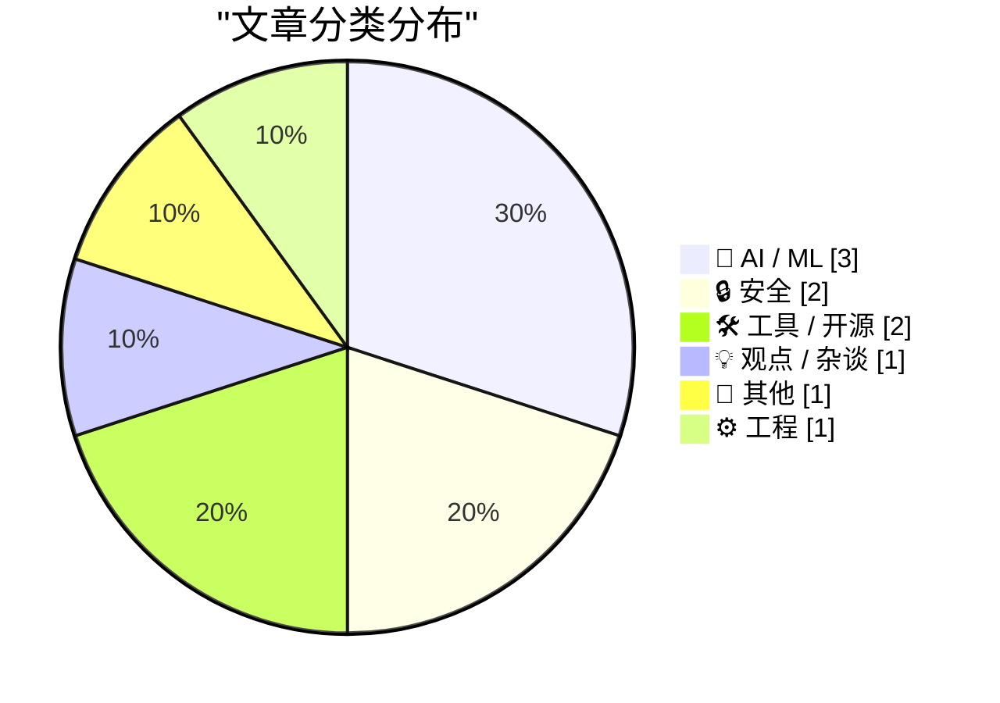
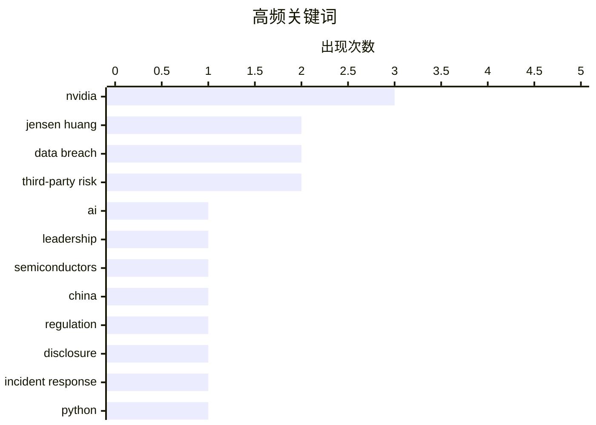

今日技术圈的三条主线格外清晰：AI 产业与政治权力进一步交织，黄仁勋复职凸显政府监管、国家安全和芯片需求之间的复杂联动。与此同时，数据泄露事件持续暴露第三方依赖下的责任推诿，企业在事故响应、合规沟通上的问责边界正面临重新审视。工具与工程实践也在加速演进，Rust/AI 辅助开发、独立浏览器以及模型评测等新项目不断推动软件基础设施迭代，而 AI 对工作方式的替代节奏可能比预期更快。整体来看，技术竞争已不只是算法与产品的比拼，也 increasingly 取决于治理能力、责任意识和工程基本功。

<!--more-->


> 来自 Karpathy 推荐的 92 个顶级技术博客，AI 精选 Top 10

## 🏆 今日必读

🥇 **英伟达董事会恢复黄仁勋职务**

[Nvidia Board Reinstates Jensen Huang](https://nvidianews.nvidia.com/news/nvidia-board-reinstates-jensen-huang-as-president-ceo-and-board-director) — daringfireball.net · 7 小时前 · 🤖 AI / ML

> 英伟达董事会一致投票恢复黄仁勋的董事长兼首席执行官职务，并让他重新进入董事会。董事会此前与黄仁勋进行多轮讨论，最终确信他的坦诚态度和领导能力足以胜任，并认为复职不会构成国家安全风险。决策过程中，董事会还听取了美国政府高层的意见；政治评论者格鲁弗因此承认自己此前对特朗普政府政治资本及干预意愿的判断有误。黄仁勋复职凸显了 AI 产业、政府利益与公司治理之间的罕见交织。

💡 **为什么值得读**: 这不仅是一次企业高管人事决定，也展示了美国政府在 AI 芯片龙头治理中的直接介入程度。

🏷️ Nvidia, Jensen Huang, AI, leadership

🥈 **政府监管与需求**

[Government Regulation and Demand](https://stratechery.com/2026/obituaries/) — daringfireball.net · 6 小时前 · 💡 观点 / 杂谈

> 文章在黄仁勋职务风波的新背景下，重新审视美国政府监管 AI 芯片与半导体需求所扮演的角色。让中国持续使用英伟达等美国公司的芯片，可能成为维持中美技术竞争张力的重要手段，因为需求端会推动模型公司相互攀比并采用最新硬件。AI 和半导体生态的形成不仅需要政府以资金和指令控制供给，也需要用户、开发者、模型公司与制造商之间形成快速反馈循环。与政府偏好长期稳定的产业政策不同，需求端往往更关注短期竞争压力。

💡 **为什么值得读**: 文章把英伟达高管事件与芯片需求、产业生态和中美科技竞争放在同一框架下，提供了理解 AI 政策逻辑的不同视角。

🏷️ Nvidia, semiconductors, China, regulation

🥉 **数据泄露为何难以披露：与数百封涉泄露公司往来邮件的启示**

[Here's Why Data Breach Disclosure is so Hard: Lessons from Hundreds of Emails with Hacked Companies](https://www.troyhunt.com/heres-why-data-breach-disclosure-is-so-hard-lessons-from-hundreds-of-emails-with-hacked-companies/) — troyhunt.com · 14 小时前 · 🔒 安全

> 作者通过分析自己与数百家遭遇数据泄露公司的往来邮件，总结了企业在事故沟通中的常见模式。典型行为包括态度疏离、故意拖延，以及让律师、法务或其他第三方深度介入，从而弱化自身责任。邮件还显示，第三方脚本或供应链事件常被当作推卸披露责任的理由，但外包技术工作并不会外包相应的问责义务。文章借助 Claude 协助写作，同时基于作者多年处理真实泄露事件的邮件证据提炼这些规律。

💡 **为什么值得读**: 它用大量真实企业往来邮件揭示数据泄露通报中的拖延、推诿与防御机制，对安全负责人和合规团队尤其有参考价值。

🏷️ data breach, disclosure, incident response, third-party risk

---

## 📊 数据概览

| 扫描源 | 抓取文章 | 时间范围 | 精选 |
|:---:|:---:|:---:|:---:|
| 85/92 | 2564 篇 → 31 篇 | 48h | **10 篇** |

### 分类分布



### 高频关键词



<details>
<summary>📈 纯文本关键词图（终端友好）</summary>

```
nvidia           │ ████████████████████ 3
jensen huang     │ █████████████░░░░░░░ 2
data breach      │ █████████████░░░░░░░ 2
third-party risk │ █████████████░░░░░░░ 2
ai               │ ███████░░░░░░░░░░░░░ 1
leadership       │ ███████░░░░░░░░░░░░░ 1
semiconductors   │ ███████░░░░░░░░░░░░░ 1
china            │ ███████░░░░░░░░░░░░░ 1
regulation       │ ███████░░░░░░░░░░░░░ 1
disclosure       │ ███████░░░░░░░░░░░░░ 1
```

</details>

### 🏷️ 话题标签

**nvidia**(3) · **jensen huang**(2) · **data breach**(2) · third-party risk(2) · ai(1) · leadership(1) · semiconductors(1) · china(1) · regulation(1) · disclosure(1) · incident response(1) · python(1) · mod_wsgi(1) · deployment(1) · ai-assisted development(1) · openai(1) · perplexity(1) · language models(1) · evaluation(1) · corporate governance(1)

---

## 🤖 AI / ML

### 1. 英伟达董事会恢复黄仁勋职务

[Nvidia Board Reinstates Jensen Huang](https://nvidianews.nvidia.com/news/nvidia-board-reinstates-jensen-huang-as-president-ceo-and-board-director) — **daringfireball.net** · 7 小时前 · ⭐ 27/30

> 英伟达董事会一致投票恢复黄仁勋的董事长兼首席执行官职务，并让他重新进入董事会。董事会此前与黄仁勋进行多轮讨论，最终确信他的坦诚态度和领导能力足以胜任，并认为复职不会构成国家安全风险。决策过程中，董事会还听取了美国政府高层的意见；政治评论者格鲁弗因此承认自己此前对特朗普政府政治资本及干预意愿的判断有误。黄仁勋复职凸显了 AI 产业、政府利益与公司治理之间的罕见交织。

🏷️ Nvidia, Jensen Huang, AI, leadership

---

### 2. 对 OpenAI 困惑度揭示的笔记

[Notes on OpenAI's perplexity reveal](https://seangoedecke.com/notes-on-openais-perplexity-reveal/) — **seangoedecke.com** · 22 小时前 · ⭐ 25/30

> OpenAI 发布了一张图表，呈现其所有已发布模型随时间变化的困惑度指标。困惑度通常用于衡量模型对预测内容的意外程度，因而可帮助观察不同代际模型在已知语料上的语言建模表现。文章围绕这张图提出了一系列问题，并分析为何 OpenAI 会公开此类内部评测数据。比较历史模型的困惑度曲线，有助于理解模型扩展与训练方法变化之间的关系，但指标本身不能完整代表推理能力、事实可靠性或实际任务表现。

🏷️ OpenAI, perplexity, language models, evaluation

---

### 3. 两张图表

[Two graphs](https://martinalderson.com/posts/two-graphs/?utm_source=rss&amp;utm_medium=rss&amp;utm_campaign=feed) — **martinalderson.com** · 22 小时前 · ⭐ 24/30

> 作者通过 Remote Labor Index 与 METR 时间跨度数据的推演，思考 2027 年可能出现的局面。两张图分别从远程劳动和 AI 可完成任务时间跨度的角度，描绘自动化能力的变化趋势。将这些趋势外推到 2027 年，暗示 AI 对人类工作的替代与协作边界可能比许多人预期推进得更快。文章的核心价值在于用可视化数据促使读者重新评估未来一年的就业和自动化时间表。

🏷️ AI automation, remote labor, METR, time horizon

---

## 🔒 安全

### 4. 数据泄露为何难以披露：与数百封涉泄露公司往来邮件的启示

[Here's Why Data Breach Disclosure is so Hard: Lessons from Hundreds of Emails with Hacked Companies](https://www.troyhunt.com/heres-why-data-breach-disclosure-is-so-hard-lessons-from-hundreds-of-emails-with-hacked-companies/) — **troyhunt.com** · 14 小时前 · ⭐ 26/30

> 作者通过分析自己与数百家遭遇数据泄露公司的往来邮件，总结了企业在事故沟通中的常见模式。典型行为包括态度疏离、故意拖延，以及让律师、法务或其他第三方深度介入，从而弱化自身责任。邮件还显示，第三方脚本或供应链事件常被当作推卸披露责任的理由，但外包技术工作并不会外包相应的问责义务。文章借助 Claude 协助写作，同时基于作者多年处理真实泄露事件的邮件证据提炼这些规律。

🏷️ data breach, disclosure, incident response, third-party risk

---

### 5. 每周更新 531：Optimizely、脚本依赖与第三方

[Weekly Update 531: Optimizely. Script Dependencies & Third Parties](https://www.troyhunt.com/weekly-update-531/) — **troyhunt.com** · 1 天前 · ⭐ 24/30

> 围绕数据泄露披露中的责任归属，本期更新聚焦 Optimizely、脚本依赖和第三方服务等场景。作者指出，企业不能在事故通报中把事件描述为“第三方发生的问题”，便将其视为减轻自身责任的方式。这种表述反映出组织正在将责任外包，但技术工作的外包并不等于合规责任的转移。文章持续追踪数据泄露披露实践，并分析网站与 SaaS 依赖关系如何影响事故响应和沟通。

🏷️ data breach, third-party risk, accountability, dependency management

---

## 🛠 工具 / 开源

### 6. Muru

[Muru](https://simonwillison.net/2026/Nov/21/muru/) — **simonwillison.net** · 1 天前 · ⭐ 25/30

> Muru 是 mod_wsgi 作者 Graham Dumpleton 在 mod_wsgi 诞生 20 年后推出的新项目，目标是为 Python Web 应用提供理想的生产环境服务器。它使用 Rust 构建，并借助 AI 辅助开发，旨在同时支持 ASGI 与 WSGI 应用，覆盖开发和生产场景。Dumpleton 延续了开发 wrapture 时的公开记录方式，在最近三周内持续发布设计细节与开发进展。Muru 代表了 Python 服务托管从传统模块化方案向专用、高性能运行时演进的尝试。

🏷️ Python, mod_wsgi, deployment, AI-assisted development

---

### 7. Ladybird 发布首个 Alpha 版本

[Ladybird's first alpha release](https://simonwillison.net/2026/Nov/23/ladybird/) — **simonwillison.net** · 31 分钟前 · ⭐ 24/30

> Ladybird 项目发布了首个 Alpha 版本，用户现在可以直接在 macOS 或 Linux 上安装，而不必自行编译。该浏览器极具雄心，自主实现了 HTML 解析、CSS 引擎、页面布局、JavaScript 和 WebAssembly 等大量关键组件。它仍依赖 HarfBuzz 进行文本整形、Skia 负责二维图形、FFmpeg 处理视频，并使用 SQLite，但其余核心部分来自 Ladybird 及其前身 SerenityOS。作者试用后认为，它的运行速度快，界面轻量、直观，整体表现令人印象深刻。

🏷️ Ladybird, browser, web engine, alpha release

---

## 💡 观点 / 杂谈

### 8. 政府监管与需求

[Government Regulation and Demand](https://stratechery.com/2026/obituaries/) — **daringfireball.net** · 6 小时前 · ⭐ 26/30

> 文章在黄仁勋职务风波的新背景下，重新审视美国政府监管 AI 芯片与半导体需求所扮演的角色。让中国持续使用英伟达等美国公司的芯片，可能成为维持中美技术竞争张力的重要手段，因为需求端会推动模型公司相互攀比并采用最新硬件。AI 和半导体生态的形成不仅需要政府以资金和指令控制供给，也需要用户、开发者、模型公司与制造商之间形成快速反馈循环。与政府偏好长期稳定的产业政策不同，需求端往往更关注短期竞争压力。

🏷️ Nvidia, semiconductors, China, regulation

---

## 📝 其他

### 9. Semafor：黄仁勋复职前数小时，特朗普致电英伟达董事会敦促其回归

[Semafor: ‘Hours Before Huang’s Reinstatement, Trump Called Nvidia’s Board to Argue for His Return’](https://www.semafor.com/article/11/23/2026/jensen-huang-reinstated-as-nvidia-ceo) — **daringfireball.net** · 6 小时前 · ⭐ 25/30

> 据 Semafor 报道，在英伟达恢复黄仁勋职务前数小时，美国总统特朗普曾直接致电英伟达董事会，要求其让黄仁勋回归。白宫传播主任史蒂文·张表示，特朗普深度参与了这项决定，董事会需要“保护我们的天才”。英伟达方面随后称，复任黄仁勋符合股东、员工和公司的最佳利益。此前共和党通常主张政府不应干预企业事务，因此作者认为，公开支持这种行政干预构成了政治上的双重标准。

🏷️ Nvidia, Jensen Huang, corporate governance, Trump

---

## ⚙️ 工程

### 10. 写好代码，只需避免大错

[To code well, avoid blunders](https://seangoedecke.com/to-code-well-avoid-blunders/) — **seangoedecke.com** · 1 天前 · ⭐ 22/30

> 写出好代码的关键不是持续产生 Brilliant 的技术洞见，而是避免可能造成灾难性后果的错误。作者以国际象棋和网球作类比：只要不主动送出被将死的棋子，或不持续打出容易失误的球，就足以击败大多数对手。程序员往往误把优秀等同于发现精妙算法或巧妙抽象，却低估了规避低级错误的价值。实践重点因此应放在代码审查、测试、边界检查和消除高风险操作上，而不是追求每一处都足够炫技。

🏷️ code quality, mistakes, risk management, software engineering

---

*生成于 2026-11-24 22:18 | 扫描 85 源 → 获取 2564 篇 → 精选 10 篇*
*基于 [Hacker News Popularity Contest 2025](https://refactoringenglish.com/tools/hn-popularity/) RSS 源列表，由 [Andrej Karpathy](https://x.com/karpathy) 推荐*
*由「懂点儿AI」制作，欢迎关注同名微信公众号获取更多 AI 实用技巧 💡*
