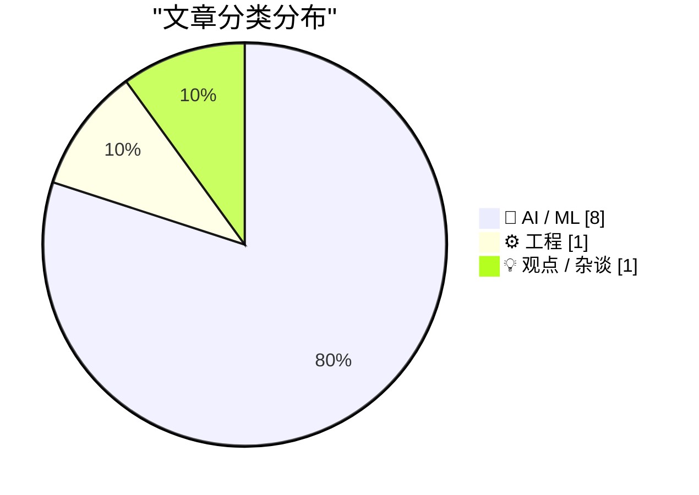
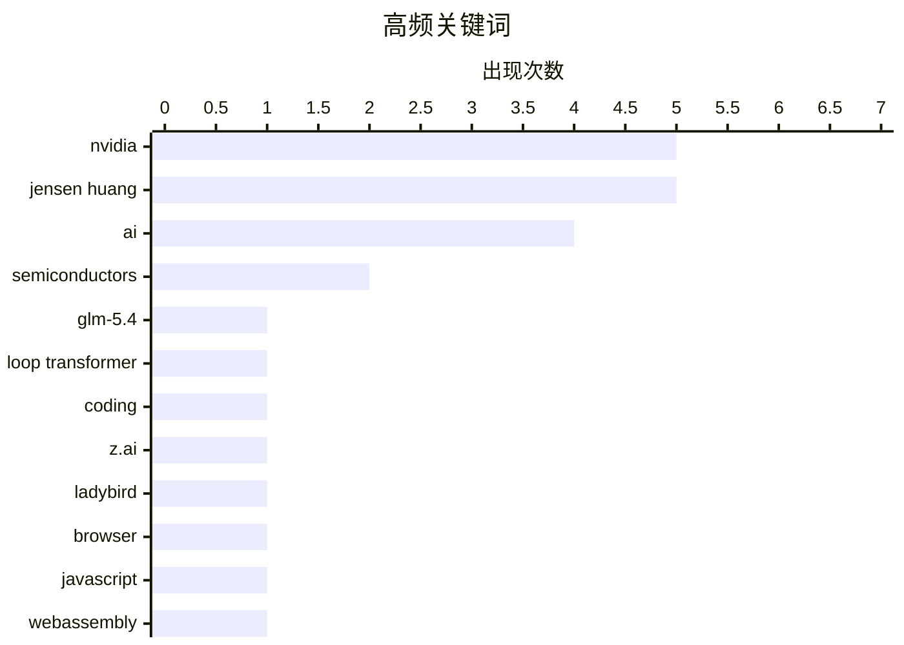

今日技术圈的主线之一，是循环 Transformer 开始成为提升模型计算深度的新路径，AI 实验室正尝试以更低参数成本换取更强的编程与复杂推理能力。与此同时，模型能力加速正从基准测试外溢至真实劳动场景，递归式自我改进的效率、风险与治理问题也被推上桌面。另一焦点是黄仁勋复职及其背后的政治与资本博弈，凸显头部 AI 领袖对公司治理、市场预期乃至国家战略的日益巨大影响。与此同时，Ladybird 进入公开测试阶段，提醒业界浏览器等基础软件仍存在从零重构的创新空间。

<!--more-->


> 来自 Karpathy 推荐的 92 个顶级技术博客，AI 精选 Top 10

## 🏆 今日必读

🥇 **GLM-5.4：借助首个循环 Transformer 迈向通用编程**

[GLM-5.4: Toward Generalized Coding with Our First Loop Transformer](https://simonwillison.net/2026/Nov/23/glm-54/) — simonwillison.net · 22 小时前 · 🤖 AI / ML

> 智谱 AI 推出的 GLM-5.4 首次采用循环 Transformer 架构，通过让一组共享权重的层在每次前向传播中执行多轮计算，持续优化隐藏状态。与标准 Transformer 每层只运行一次不同，这种设计能够在不增加参数量的情况下获得更深的计算网络，从而增强推理和编程能力。此前一周，Thinking Machines Lab 也发布了采用循环结构的 Inkling 2 Mini，后者会让模型的中间层针对每个 token 运行三次。两款模型表明，循环 Transformer 正成为扩展模型计算深度的一种新路径。GLM-5.4 的核心意义在于以较低参数成本推进通用编码与复杂推理。

💡 **为什么值得读**: 这是一篇用具体架构解释近期热门模型演进的短文，有助于快速理解循环 Transformer 与传统 Transformer 的关键差异。

🏷️ GLM-5.4, Loop Transformer, coding, Z.ai

🥈 **Ladybird 发布首个 Alpha 版本**

[Ladybird's first alpha release](https://simonwillison.net/2026/Nov/23/ladybird/) — simonwillison.net · 1 天前 · ⚙️ 工程

> Ladybird 是一款从零构建的新型浏览器，自主实现了 HTML 解析、CSS 引擎、布局、JavaScript 和 WebAssembly 等核心组件。它仍依赖 HarfBuzz 进行文本整形、Skia 渲染 2D 图形，并使用 ffmpeg 和 SQLite，但其余部分来自 Ladybird 及其前身 SerenityOS 的代码库。首个 Alpha 版本现已支持 macOS 和 Linux，用户无需自行编译即可直接安装。实际体验显示，浏览器运行速度较快，界面轻量且直观，标志着这一雄心勃勃的项目终于进入更易被普通用户测试的阶段。

💡 **为什么值得读**: 首个可安装版本让读者有机会亲自检验这款自研浏览器，也能直观看到 Web 引擎逐步摆脱现有浏览器依赖的努力。

🏷️ Ladybird, browser, JavaScript, WebAssembly

🥉 **Semafor：黄仁勋复职前数小时，特朗普致电英伟达董事会要求其回归**

[Semafor: ‘Hours Before Huang’s Reinstatement, Trump Called Nvidia’s Board to Argue for His Return’](https://www.semafor.com/article/11/23/2026/jensen-huang-reinstated-as-nvidia-ceo) — daringfireball.net · 1 天前 · 🤖 AI / ML

> 据 Semafor 报道，在英伟达恢复黄仁勋董事长兼首席执行官职务前数小时，美国总统特朗普曾直接致电英伟达董事会，敦促其让黄仁勋回归。白宫随后表示，董事会“必须保护我们的天才”，并将复职决定描述为符合股东和员工利益的选择。报道显示，这次人事决策不仅涉及公司治理，也受到美国政府高层的直接推动。评论者批评特朗普的介入违背共和党传统上“政府不应干预商业事务”的立场，并认为这种做法存在明显的双重标准。

💡 **为什么值得读**: 报道揭示了美国政府直接介入大型科技公司 CEO 人事的罕见程度，为观察政治权力与科技治理的边界提供了关键案例。

🏷️ Nvidia, Jensen Huang, board governance, AI

---

## 📊 数据概览

| 扫描源 | 抓取文章 | 时间范围 | 精选 |
|:---:|:---:|:---:|:---:|
| 85/92 | 2565 篇 → 56 篇 | 48h | **10 篇** |

### 分类分布



### 高频关键词



<details>
<summary>📈 纯文本关键词图（终端友好）</summary>

```
nvidia           │ ████████████████████ 5
jensen huang     │ ████████████████████ 5
ai               │ ████████████████░░░░ 4
semiconductors   │ ████████░░░░░░░░░░░░ 2
glm-5.4          │ ████░░░░░░░░░░░░░░░░ 1
loop transformer │ ████░░░░░░░░░░░░░░░░ 1
coding           │ ████░░░░░░░░░░░░░░░░ 1
z.ai             │ ████░░░░░░░░░░░░░░░░ 1
ladybird         │ ████░░░░░░░░░░░░░░░░ 1
browser          │ ████░░░░░░░░░░░░░░░░ 1
```

</details>

### 🏷️ 话题标签

**nvidia**(5) · **jensen huang**(5) · **ai**(4) · semiconductors(2) · glm-5.4(1) · loop transformer(1) · coding(1) · z.ai(1) · ladybird(1) · browser(1) · javascript(1) · webassembly(1) · board governance(1) · ai chips(1) · ai economy(1) · openai(1) · perplexity(1) · language models(1) · model evaluation(1) · corporate governance(1)

---

## 🤖 AI / ML

### 1. GLM-5.4：借助首个循环 Transformer 迈向通用编程

[GLM-5.4: Toward Generalized Coding with Our First Loop Transformer](https://simonwillison.net/2026/Nov/23/glm-54/) — **simonwillison.net** · 22 小时前 · ⭐ 27/30

> 智谱 AI 推出的 GLM-5.4 首次采用循环 Transformer 架构，通过让一组共享权重的层在每次前向传播中执行多轮计算，持续优化隐藏状态。与标准 Transformer 每层只运行一次不同，这种设计能够在不增加参数量的情况下获得更深的计算网络，从而增强推理和编程能力。此前一周，Thinking Machines Lab 也发布了采用循环结构的 Inkling 2 Mini，后者会让模型的中间层针对每个 token 运行三次。两款模型表明，循环 Transformer 正成为扩展模型计算深度的一种新路径。GLM-5.4 的核心意义在于以较低参数成本推进通用编码与复杂推理。

🏷️ GLM-5.4, Loop Transformer, coding, Z.ai

---

### 2. Semafor：黄仁勋复职前数小时，特朗普致电英伟达董事会要求其回归

[Semafor: ‘Hours Before Huang’s Reinstatement, Trump Called Nvidia’s Board to Argue for His Return’](https://www.semafor.com/article/11/23/2026/jensen-huang-reinstated-as-nvidia-ceo) — **daringfireball.net** · 1 天前 · ⭐ 27/30

> 据 Semafor 报道，在英伟达恢复黄仁勋董事长兼首席执行官职务前数小时，美国总统特朗普曾直接致电英伟达董事会，敦促其让黄仁勋回归。白宫随后表示，董事会“必须保护我们的天才”，并将复职决定描述为符合股东和员工利益的选择。报道显示，这次人事决策不仅涉及公司治理，也受到美国政府高层的直接推动。评论者批评特朗普的介入违背共和党传统上“政府不应干预商业事务”的立场，并认为这种做法存在明显的双重标准。

🏷️ Nvidia, Jensen Huang, board governance, AI

---

### 3. 英伟达董事会恢复黄仁勋职务

[Nvidia Board Reinstates Jensen Huang](https://nvidianews.nvidia.com/news/nvidia-board-reinstates-jensen-huang-as-president-ceo-and-board-director) — **daringfireball.net** · 1 天前 · ⭐ 27/30

> 英伟达董事会宣布立即恢复黄仁勋的总裁兼首席执行官职务，并让他重新进入董事会。董事会经过一系列沟通后一致作出决定，表示已重新认可黄仁勋的坦诚态度和领导能力。决定过程中，董事会还听取美国政府高级官员的意见，并认定其复职不会构成国家安全风险。作者因此承认，自己和科技界的政治判断可能过于乐观，低估了特朗普政府动用政治资本推动此事的能力。事件显示，AI 产业领袖的人事危机已经能够直接影响公司治理、美国政府决策和市场预期。

🏷️ Nvidia, Jensen Huang, AI chips, semiconductors

---

### 4. “经济处于人质劫持状态”

[‘The Economy Is a Hostage Situation’](https://www.theatlantic.com/technology/2026/11/ai-hostage-economy-nvidia-huang/689552/?gift=aQyUJR7AIw1mJWdQ6Ed6yMQrokNaYAmgr0aVusAzQCY&amp;) — **daringfireball.net** · 3 小时前 · ⭐ 26/30

> 文章认为，黄仁勋已成为 AI 繁荣的中心人物，而英伟达及其投资布局则像围绕他建立的外骨骼。没有黄仁勋，AI 进展、美国科技领导地位和投资者信心都可能迅速失速。黄仁勋离职后的 11 天一度让外界以为这种个人影响力正在减弱，但他最终复职又证明其依然“不能倒”。风投家和股东主张美国在与中国争夺 AI 主导权时需要黄仁勋不受约束的领导权，这种逻辑也暴露出产业对出口管制和国家利益边界的担忧。将整个股市乃至美国经济与一位科技领袖的存续绑定，本身正是泡沫和脆弱性的信号。

🏷️ Nvidia, Jensen Huang, AI economy, semiconductors

---

### 5. 对 OpenAI 困惑度公开图的笔记

[Notes on OpenAI's perplexity reveal](https://seangoedecke.com/notes-on-openais-perplexity-reveal/) — **seangoedecke.com** · 1 天前 · ⭐ 25/30

> OpenAI 发布了一张图表，汇总其历年公开模型的困惑度变化，并邀请外界对这些结果进行解读。困惑度衡量模型对预测 token 的不确定性，数值越低通常意味着模型对语言分布建模得越好。按时间比较不同模型，有助于观察数据规模、训练方法和架构变化带来的性能演进，也为评估“模型越来越智能”这一说法提供统一视角。不过，单纯比较困惑度并不能完整衡量推理、可靠性或实际任务能力，因此图表本身更适合作为趋势线索，而非全面的能力排行榜。作者借这一公开数据进一步讨论 OpenAI 公布模型历史表现的意义。

🏷️ OpenAI, perplexity, language models, model evaluation

---

### 6. 我早就说过要押“超额收益”

[I Told You to Bet the Over](https://www.wsj.com/business/nvidia-jensen-huang-white-house-9ad03961?st=HzeUyV) — **daringfireball.net** · 3 小时前 · ⭐ 25/30

> 《华尔街日报》记载，在黄仁勋复职前经历的 48 小时内，特朗普、副总统及白宫高层曾向英伟达董事会转达官员的保证，试图挽救这位领袖。市场随后积极回应黄仁勋的回归，美股公司市值单日增幅创下纪录。英伟达董事会则在周日进行了长时间会议，期间黄仁勋披露了媒体报道之外的其他不当行为，并表达悔意。作者把这场围绕个人领导者的政治与资本动员视为警讯：如果整个股市和美国经济都依赖市场对黄仁勋的信心，那么这本身就是尚未破裂的泡沫。

🏷️ Nvidia, Jensen Huang, corporate governance, AI

---

### 7. 黄仁勋重返英伟达

[Jensen Huang Returns to Work](https://www.businessinsider.com/jensen-huang-returns-to-nvidia-hq-im-terribly-sorry-2026-11) — **daringfireball.net** · 22 小时前 · ⭐ 25/30

> 黄仁勋复职当天回到英伟达总部，员工聚集欢迎并高喊他的名字，现场拥挤到员工争相近距离看他。他身穿深蓝色棉外套而非标志性的黑色皮夹克，并多次把手放在胸前表示歉意。黄仁勋称这是自己“第一天上班”，为让全体员工经历这一切深感抱歉，并承诺第二次会做一名更好的 CEO。他还宣称，今后只会同时与一名供应商或员工发生性关系，以讽刺此前卷入的多重关系指控。报道既记录了员工对黄仁勋的强烈支持，也保留了围绕其个人行为的争议。

🏷️ Nvidia, Jensen Huang, AI, CEO

---

### 8. 两张图

[Two graphs](https://martinalderson.com/posts/two-graphs/?utm_source=rss&amp;utm_medium=rss&amp;utm_campaign=feed) — **martinalderson.com** · 1 天前 · ⭐ 25/30

> 作者用两张图重新评估快速 AI 进展可能带来的经济影响，其中一张是 Remote Labor Index，另一张是对 METR“任务时间跨度”指标的外推。Remote Labor Index 关注 AI 在劳动任务上的替代或辅助程度，而 METR 时间跨度则衡量机器能够独立完成多长时间的人类工作。两条证据线共同显示，AI 能力增长可能远比传统技术扩散周期更快。作者借助图表推演 2027 年的工作场景，暗示劳动市场和社会规划必须提前面对显著加速的自动化冲击。

🏷️ AI automation, labor, METR, time horizons

---

## ⚙️ 工程

### 9. Ladybird 发布首个 Alpha 版本

[Ladybird's first alpha release](https://simonwillison.net/2026/Nov/23/ladybird/) — **simonwillison.net** · 1 天前 · ⭐ 27/30

> Ladybird 是一款从零构建的新型浏览器，自主实现了 HTML 解析、CSS 引擎、布局、JavaScript 和 WebAssembly 等核心组件。它仍依赖 HarfBuzz 进行文本整形、Skia 渲染 2D 图形，并使用 ffmpeg 和 SQLite，但其余部分来自 Ladybird 及其前身 SerenityOS 的代码库。首个 Alpha 版本现已支持 macOS 和 Linux，用户无需自行编译即可直接安装。实际体验显示，浏览器运行速度较快，界面轻量且直观，标志着这一雄心勃勃的项目终于进入更易被普通用户测试的阶段。

🏷️ Ladybird, browser, JavaScript, WebAssembly

---

## 💡 观点 / 杂谈

### 10. 回应针对递归式自我改进的反对意见

[Responding to objections to recursive self-improvement](https://www.dwarkesh.com/p/rsiobjections) — **dwarkesh.com** · 33 分钟前 · ⭐ 25/30

> 文章聚焦超级智能与递归式自我改进面临的质疑，试图区分反对者真正成立的理由与可能过度的担忧。递归式自我改进的核心问题是，模型能否改进自身并因此加速后续改进，而这一过程又会带来能力、安全和对齐方面的新挑战。反驳者需要正面解释这些风险为何可控，而不是仅以模型尚未具备自我改进能力来回避问题。对怀疑论者合理关切的承认，是评估超级智能前景时建立可信论证的重要基础。文章据此对递归式自我改进的可行性与主要异议作出回应。

🏷️ recursive self-improvement, superintelligence, AI, skepticism

---

*生成于 2026-11-25 22:18 | 扫描 85 源 → 获取 2565 篇 → 精选 10 篇*
*基于 [Hacker News Popularity Contest 2025](https://refactoringenglish.com/tools/hn-popularity/) RSS 源列表，由 [Andrej Karpathy](https://x.com/karpathy) 推荐*
*由「懂点儿AI」制作，欢迎关注同名微信公众号获取更多 AI 实用技巧 💡*
