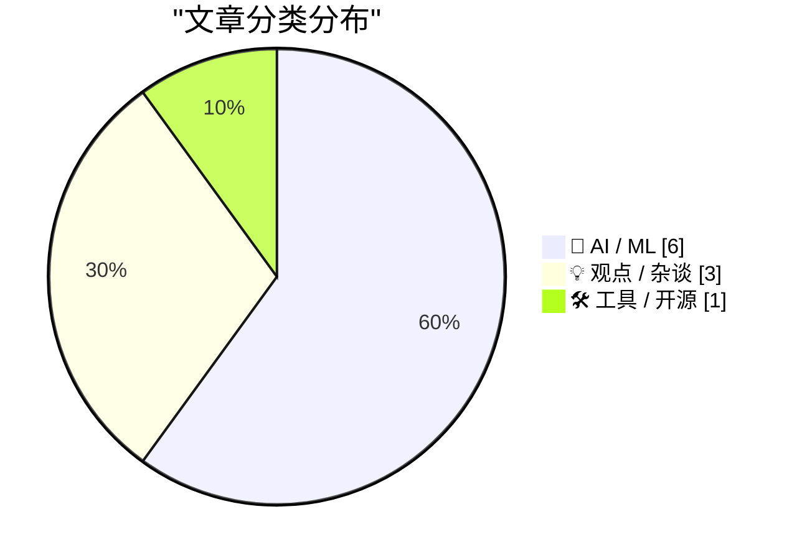
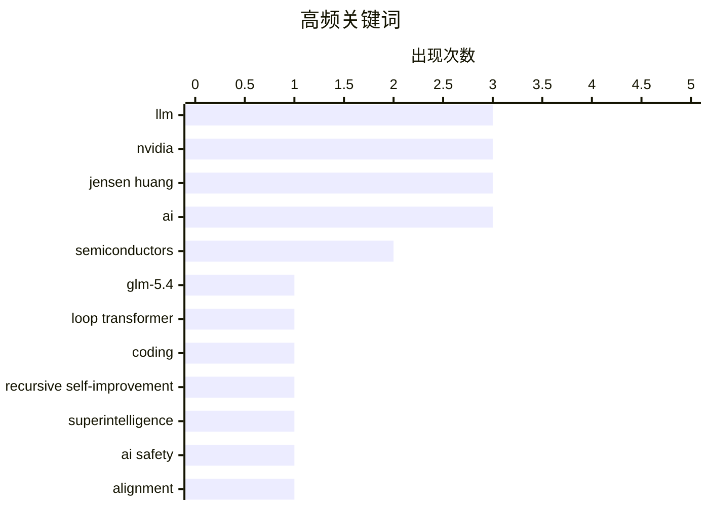

今日技术圈的主线是 AI 编程从“辅助写代码”加速迈向可自主执行、持续迭代的智能体阶段，通用编码模型与 Loop Transformer 成为核心焦点。与此同时，递归自我改进的可行性、风险与边界再次成为争议焦点，反映业界对高级别 AI 演进的谨慎期待。短短十二个月内的三次关键拐点，也凸显模型能力跃迁与产业预期加速共振的态势。整体来看，技术创新与经济、技术加速主义的讨论正深度融合，未来竞争不仅在模型能力，更在智能体落地与治理能力。

<!--more-->


> 来自 Karpathy 推荐的 92 个顶级技术博客，AI 精选 Top 10

## 🏆 今日必读

🥇 **GLM-5.4: Toward Generalized Coding with Our First Loop Transformer**

[GLM-5.4: Toward Generalized Coding with Our First Loop Transformer](https://simonwillison.net/2026/Nov/23/glm-54/) — simonwillison.net · 1 天前 · 🤖 AI / ML

> GLM-5.4: Toward Generalized Coding with Our First Loop Transformer

🏷️ GLM-5.4, Loop Transformer, coding, LLM

🥈 **Responding to objections to recursive self-improvement**

[Responding to objections to recursive self-improvement](https://www.dwarkesh.com/p/rsiobjections) — dwarkesh.com · 1 天前 · 🤖 AI / ML

> Responding to objections to recursive self-improvement

🏷️ recursive self-improvement, superintelligence, AI safety, alignment

🥉 **Have You Tried Using Your Agent?**

[Have You Tried Using Your Agent?](https://blog.jim-nielsen.com/2026/have-you-tried-your-agent/) — blog.jim-nielsen.com · 3 小时前 · 🤖 AI / ML

> Have You Tried Using Your Agent?

🏷️ AI agents, agentic UX, software development, AX

---

## 📊 数据概览

| 扫描源 | 抓取文章 | 时间范围 | 精选 |
|:---:|:---:|:---:|:---:|
| 84/92 | 2536 篇 → 48 篇 | 48h | **10 篇** |

### 分类分布



### 高频关键词



<details>
<summary>📈 纯文本关键词图（终端友好）</summary>

```
llm                        │ ████████████████████ 3
nvidia                     │ ████████████████████ 3
jensen huang               │ ████████████████████ 3
ai                         │ ████████████████████ 3
semiconductors             │ █████████████░░░░░░░ 2
glm-5.4                    │ ███████░░░░░░░░░░░░░ 1
loop transformer           │ ███████░░░░░░░░░░░░░ 1
coding                     │ ███████░░░░░░░░░░░░░ 1
recursive self-improvement │ ███████░░░░░░░░░░░░░ 1
superintelligence          │ ███████░░░░░░░░░░░░░ 1
```

</details>

### 🏷️ 话题标签

**llm**(3) · **nvidia**(3) · **jensen huang**(3) · ai(3) · semiconductors(2) · glm-5.4(1) · loop transformer(1) · coding(1) · recursive self-improvement(1) · superintelligence(1) · ai safety(1) · alignment(1) · ai agents(1) · agentic ux(1) · software development(1) · ax(1) · coding agents(1) · ai engineering(1) · ai economy(1) · corporate governance(1)

---

## 🤖 AI / ML

### 1. GLM-5.4: Toward Generalized Coding with Our First Loop Transformer

[GLM-5.4: Toward Generalized Coding with Our First Loop Transformer](https://simonwillison.net/2026/Nov/23/glm-54/) — **simonwillison.net** · 1 天前 · ⭐ 27/30

> GLM-5.4: Toward Generalized Coding with Our First Loop Transformer

🏷️ GLM-5.4, Loop Transformer, coding, LLM

---

### 2. Responding to objections to recursive self-improvement

[Responding to objections to recursive self-improvement](https://www.dwarkesh.com/p/rsiobjections) — **dwarkesh.com** · 1 天前 · ⭐ 27/30

> Responding to objections to recursive self-improvement

🏷️ recursive self-improvement, superintelligence, AI safety, alignment

---

### 3. Have You Tried Using Your Agent?

[Have You Tried Using Your Agent?](https://blog.jim-nielsen.com/2026/have-you-tried-your-agent/) — **blog.jim-nielsen.com** · 3 小时前 · ⭐ 27/30

> Have You Tried Using Your Agent?

🏷️ AI agents, agentic UX, software development, AX

---

### 4. Three LLM inflection points in twelve months

[Three LLM inflection points in twelve months](https://simonwillison.net/2026/Nov/24/llm-inflection-points/) — **simonwillison.net** · 23 小时前 · ⭐ 26/30

> Three LLM inflection points in twelve months

🏷️ LLM, coding agents, AI engineering

---

### 5. Jensen Huang Returns to Work

[Jensen Huang Returns to Work](https://www.businessinsider.com/jensen-huang-returns-to-nvidia-hq-im-terribly-sorry-2026-11) — **daringfireball.net** · 1 天前 · ⭐ 24/30

> Jensen Huang Returns to Work

🏷️ Nvidia, Jensen Huang, AI, semiconductors

---

### 6. Has Jevons paradox broken down?

[Has Jevons paradox broken down?](https://martinalderson.com/posts/has-jevons-paradox-broken-down/?utm_source=rss&amp;utm_medium=rss&amp;utm_campaign=feed) — **martinalderson.com** · 22 小时前 · ⭐ 24/30

> Has Jevons paradox broken down?

🏷️ LLM, token consumption, Jevons paradox, AI productivity

---

## 💡 观点 / 杂谈

### 7. ‘The Economy Is a Hostage Situation’

[‘The Economy Is a Hostage Situation’](https://www.theatlantic.com/technology/2026/11/ai-hostage-economy-nvidia-huang/689552/?gift=aQyUJR7AIw1mJWdQ6Ed6yMQrokNaYAmgr0aVusAzQCY&amp;) — **daringfireball.net** · 1 天前 · ⭐ 24/30

> ‘The Economy Is a Hostage Situation’

🏷️ Nvidia, Jensen Huang, AI economy, semiconductors

---

### 8. I Told You to Bet the Over

[I Told You to Bet the Over](https://www.wsj.com/business/nvidia-jensen-huang-white-house-9ad03961?st=HzeUyV) — **daringfireball.net** · 1 天前 · ⭐ 24/30

> I Told You to Bet the Over

🏷️ Nvidia, Jensen Huang, corporate governance, AI

---

### 9. Defective Accelerationism

[Defective Accelerationism](https://www.wheresyoured.at/defective-accelerationism/) — **wheresyoured.at** · 1 天前 · ⭐ 24/30

> Defective Accelerationism

🏷️ accelerationism, AI, AGI, technology policy

---

## 🛠 工具 / 开源

### 10. This Week in Source Control: 25 November 2026

[This Week in Source Control: 25 November 2026](https://nesbitt.io/2026/11/25/this-week-in-source-control.html) — **nesbitt.io** · 12 小时前 · ⭐ 24/30

> This Week in Source Control: 25 November 2026

🏷️ source control, Git, releases, security advisories

---

*生成于 2026-11-26 22:19 | 扫描 84 源 → 获取 2536 篇 → 精选 10 篇*
*基于 [Hacker News Popularity Contest 2025](https://refactoringenglish.com/tools/hn-popularity/) RSS 源列表，由 [Andrej Karpathy](https://x.com/karpathy) 推荐*
*由「懂点儿AI」制作，欢迎关注同名微信公众号获取更多 AI 实用技巧 💡*
