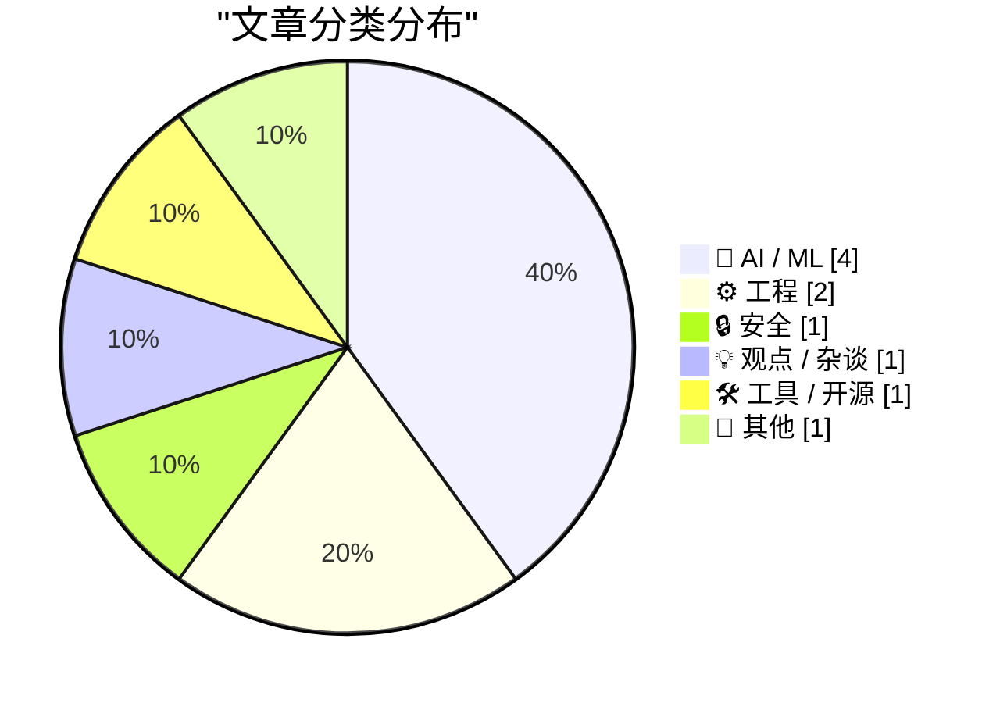
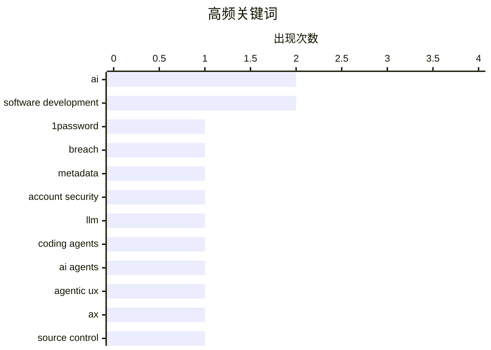

今日技术圈的主线是 AI 智能体从编程辅助走向更复杂的软件协作者，但产业也开始反思“面向智能体”的产品是否反而削弱了人类体验，以及效率提升未必自动带来代币消费增长。安全与工程可靠性同步成为焦点：1Password 泄露事件提醒业界重视零信任与元数据防护，依赖漏洞、sudo 提权兼容和锁机制调整则暴露出现有工具链的适应成本。与此同时，模型能力的快速跃迁正在把讨论推向更基础的数学与复杂性问题，技术竞争已不只围绕基准成绩展开。

<!--more-->


> 来自 Karpathy 推荐的 92 个顶级技术博客，AI 精选 Top 10

## 🏆 今日必读

🥇 **1Password 后端系统遭入侵，但泄露仅限于客户账户元数据**

[1Password’s Backend Systems Were Compromised, Revealing Only Customer Account Metadata](https://1password.com/blog/update-on-nov-2026-security-incident) — daringfireball.net · 23 小时前 · 🔒 安全

> 攻击者入侵了 1Password 的部分后端系统，并从部分客户账户中复制了有限的数据，包括登录所用的姓名和电子邮箱。密码库内容、密码条目以及保护这些数据的密钥均未受影响，原因是敏感数据需要只有客户持有的秘密密钥才能解锁。1Password 已隔离受感染服务、恢复干净版本并轮换内部凭据，现有应用和服务运行正常，用户无需修改密码或账户配置。由于账户邮箱可能已被用于定向攻击，用户应警惕并非自己发起的邀请、账户恢复请求等钓鱼邮件。

💡 **为什么值得读**: 事件展示了零知识密码管理器在部分后端被攻破时仍能保护核心密钥的架构优势，同时提供了实用的钓鱼防范建议。

🏷️ 1Password, breach, metadata, account security

🥈 **十二个月内的三个大语言模型拐点**

[Three LLM inflection points in twelve months](https://simonwillison.net/2026/Nov/24/llm-inflection-points/) — simonwillison.net · 1 天前 · 🤖 AI / ML

> 作者以在 AI Engineer Code Summit 发表的演讲为起点，用三个重要拐点回顾过去 12 个月里大语言模型与编程智能体能力的快速演进。第一个节点是 2025 年 11 月 Claude Opus 4.5 的发布，该模型被作者视为对后续智能体能力发展具有决定性影响。分析重点不只是单项基准成绩，而是智能体从辅助编程工具逐渐走向能够执行更复杂任务的软件协作者。作者认为，理解这些连续的能力跃迁，是判断当前 AI 工程实践和未来产品方向的重要前提。

💡 **为什么值得读**: 文章用清晰的时间线提炼大语言模型与编程智能体过去一年的关键变化，有助于技术团队校准对 AI 能力发展速度的判断。

🏷️ LLM, coding agents, AI, software development

🥉 **你试过使用自己的智能体吗？**

[Have You Tried Using Your Agent?](https://blog.jim-nielsen.com/2026/have-you-tried-your-agent/) — blog.jim-nielsen.com · 1 天前 · 💡 观点 / 杂谈

> 作者延续对“AX”方向的反思，批评软件行业正在越来越多地面向 AI 智能体设计，而不是提升人类直接使用产品时的可访问性。在这一趋势下，产品对机器人越来越友好，对普通人却可能依然难以使用。技术团队常见的做法是要求人类通过智能体访问服务，而不是让服务本身更好地服务每一位用户。作者担忧注意力持续从人类体验转移到机器接口，最终会使所谓“代表用户工作”的智能体成为遮挡而非消除交互障碍的中间层。

💡 **为什么值得读**: 这篇短文提出了一个容易被 AI 热潮掩盖的产品伦理问题：智能体是否真的在增强人类，还是在把人类从软件界面中进一步排除。

🏷️ AI agents, agentic UX, software development, AX

---

## 📊 数据概览

| 扫描源 | 抓取文章 | 时间范围 | 精选 |
|:---:|:---:|:---:|:---:|
| 84/92 | 2556 篇 → 29 篇 | 48h | **10 篇** |

### 分类分布



### 高频关键词



<details>
<summary>📈 纯文本关键词图（终端友好）</summary>

```
ai                   │ ████████████████████ 2
software development │ ████████████████████ 2
1password            │ ██████████░░░░░░░░░░ 1
breach               │ ██████████░░░░░░░░░░ 1
metadata             │ ██████████░░░░░░░░░░ 1
account security     │ ██████████░░░░░░░░░░ 1
llm                  │ ██████████░░░░░░░░░░ 1
coding agents        │ ██████████░░░░░░░░░░ 1
ai agents            │ ██████████░░░░░░░░░░ 1
agentic ux           │ ██████████░░░░░░░░░░ 1
```

</details>

### 🏷️ 话题标签

**ai**(2) · **software development**(2) · **1password**(1) · breach(1) · metadata(1) · account security(1) · llm(1) · coding agents(1) · ai agents(1) · agentic ux(1) · ax(1) · source control(1) · releases(1) · security advisories(1) · forges(1) · ansible(1) · ubuntu 26(1) · sudo(1) · privilege escalation(1) · rust(1)

---

## 🤖 AI / ML

### 1. 十二个月内的三个大语言模型拐点

[Three LLM inflection points in twelve months](https://simonwillison.net/2026/Nov/24/llm-inflection-points/) — **simonwillison.net** · 1 天前 · ⭐ 27/30

> 作者以在 AI Engineer Code Summit 发表的演讲为起点，用三个重要拐点回顾过去 12 个月里大语言模型与编程智能体能力的快速演进。第一个节点是 2025 年 11 月 Claude Opus 4.5 的发布，该模型被作者视为对后续智能体能力发展具有决定性影响。分析重点不只是单项基准成绩，而是智能体从辅助编程工具逐渐走向能够执行更复杂任务的软件协作者。作者认为，理解这些连续的能力跃迁，是判断当前 AI 工程实践和未来产品方向的重要前提。

🏷️ LLM, coding agents, AI, software development

---

### 2. 杰文斯悖论是否已经失灵？

[Has Jevons paradox broken down?](https://martinalderson.com/posts/has-jevons-paradox-broken-down/?utm_source=rss&amp;utm_medium=rss&amp;utm_campaign=feed) — **martinalderson.com** · 1 天前 · ⭐ 23/30

> Ramp 的数据显示，用户的代币支出增长开始停滞，这与杰文斯悖论所暗示的效率提升可能反向扩大技术使用规模并不一致。作者自身对 AI 代币的消耗也进入平台期，未能像预期那样随着使用便利和成本下降而持续增加。核心问题在于，组织流程的改造速度能否超过代币价格下降和效率提升带来的需求收缩。若 AI 带来的效率收益只能节省成本，却没有创造新的使用场景，那么更便宜的技术资源未必会自动转化为更多消费。

🏷️ Jevons paradox, token consumption, AI economics, productivity

---

### 3. 特朗普曾想让黄仁勋回归，如今总统却独自留在华盛顿

[‘Trump Wanted Jensen Huang Back. Now, the President Is Alone in Washington’](https://www.cnbc.com/2026/11/24/trump-jensen-huang-nvidia.html) — **daringfireball.net** · 23 小时前 · ⭐ 22/30

> 特朗普重新接纳英伟达 CEO 黄仁勋返回华盛顿，与其最坚定的国会盟友之间的反应形成鲜明反差。部分共和党议员对这一决定表示强烈反对，并誓言继续调查黄仁勋与潜在中国情报资产之间的关系。参议员 Kevin Cramer 表示，供应链关键人物可能被中国间谍掌握信息，这一国家安全风险不能被忽视。争议不仅涉及英伟达与中国的业务，也触及特朗普政府是否放弃自由放任资本主义等传统共和党原则。

🏷️ Nvidia, Jensen Huang, AI chips, China

---

### 4. 引用斯科特·阿伦森的话

[Quoting Scott Aaronson](https://simonwillison.net/2026/Nov/25/scott-aaronson/) — **simonwillison.net** · 22 小时前 · ⭐ 21/30

> 斯科特·阿伦森认为，LLM 带来的突破将不只是解决某一个复杂性问题的孤立方案，而是揭示一大片此前仅隐约可见的数学真理。他把这种认知提升类比为列文虎克用显微镜观察池水、伽利略用望远镜观察星空。复杂性理论由此可能成为人类探索更大范围数学真理的新入口，其研究分辨率也将显著提高。Simon Willison 以引用形式收录这段观点，并将其归入数学、LLM 与生成式 AI 等主题。

🏷️ AI, mathematics, complexity, discovery

---

## ⚙️ 工程

### 5. Ansible 在 Ubuntu 26 上等待提权时失败

[Ansible Fails waiting for privilege escalation on Ubuntu 26](https://www.jeffgeerling.com/blog/2026/ansible-fails-become-ubuntu2604/) — **jeffgeerling.com** · 1 天前 · ⭐ 23/30

> 作者将服务器从 Ubuntu 22 和 24 迁移到 Ubuntu 26 后，发现启用密码保护的 sudo 会导致 Ansible 自动化任务失败。使用 ansible-playbook -K 时，程序能够显示 BECOME password 提示，但在收集主机信息等任务执行阶段仍以 fatal 错误中止。问题表明，Ubuntu 26 的 sudo 提权行为与 Ansible 的 become 机制之间存在兼容性变化。排查此类故障时，需要重点检查 sudo 配置、提权提示传递方式以及目标系统对非交互式认证的处理。

🏷️ Ansible, Ubuntu 26, sudo, privilege escalation

---

### 6. 废除互斥锁中毒机制

[Abolish Lock Poisoning](https://lucumr.pocoo.org/2026/11/25/poisoning/) — **lucumr.pocoo.org** · 1 天前 · ⭐ 23/30

> Rust 的 std::sync::Mutex 带有“中毒”机制：持锁代码一旦 panic，后续 lock() 调用就会返回 PoisonError。该设计原本用于提醒调用者，panic 可能破坏对象内部状态，需要显式检查和恢复。作者认为这一机制在现实代码中很少得到真正处理，反而制造了冗长、容易出错的错误传播路径。Rust 库团队正在讨论下一版本默认采用不中毒的锁，因此相关社区已经展开激烈争论。作者主张彻底移除中毒锁，或至少将其改为少数情况下才使用的例外机制。

🏷️ Rust, Mutex, lock poisoning, API design

---

## 🔒 安全

### 7. 1Password 后端系统遭入侵，但泄露仅限于客户账户元数据

[1Password’s Backend Systems Were Compromised, Revealing Only Customer Account Metadata](https://1password.com/blog/update-on-nov-2026-security-incident) — **daringfireball.net** · 23 小时前 · ⭐ 28/30

> 攻击者入侵了 1Password 的部分后端系统，并从部分客户账户中复制了有限的数据，包括登录所用的姓名和电子邮箱。密码库内容、密码条目以及保护这些数据的密钥均未受影响，原因是敏感数据需要只有客户持有的秘密密钥才能解锁。1Password 已隔离受感染服务、恢复干净版本并轮换内部凭据，现有应用和服务运行正常，用户无需修改密码或账户配置。由于账户邮箱可能已被用于定向攻击，用户应警惕并非自己发起的邀请、账户恢复请求等钓鱼邮件。

🏷️ 1Password, breach, metadata, account security

---

## 💡 观点 / 杂谈

### 8. 你试过使用自己的智能体吗？

[Have You Tried Using Your Agent?](https://blog.jim-nielsen.com/2026/have-you-tried-your-agent/) — **blog.jim-nielsen.com** · 1 天前 · ⭐ 25/30

> 作者延续对“AX”方向的反思，批评软件行业正在越来越多地面向 AI 智能体设计，而不是提升人类直接使用产品时的可访问性。在这一趋势下，产品对机器人越来越友好，对普通人却可能依然难以使用。技术团队常见的做法是要求人类通过智能体访问服务，而不是让服务本身更好地服务每一位用户。作者担忧注意力持续从人类体验转移到机器接口，最终会使所谓“代表用户工作”的智能体成为遮挡而非消除交互障碍的中间层。

🏷️ AI agents, agentic UX, software development, AX

---

## 🛠 工具 / 开源

### 9. 本周源码管理动态：2026 年 11 月 25 日

[This Week in Source Control: 25 November 2026](https://nesbitt.io/2026/11/25/this-week-in-source-control.html) — **nesbitt.io** · 1 天前 · ⭐ 24/30

> 这是一份每周源码管理资讯汇总，集中整理版本控制系统及代码托管平台生态中的最新动态。内容覆盖软件发布、安全公告和相关文章，让开发者无需分别追踪多个项目即可掌握重要变化。安全公告尤其值得关注，因为依赖项或托管平台漏洞可能直接影响开发环境与 CI/CD 流程。整体定位是提供一份便于快速浏览和筛选的周度更新列表。

🏷️ source control, releases, security advisories, forges

---

## 📝 其他

### 10. Engadget 爆料：iPhone 18e 将采用摄像头凸起设计

[Engadget Scoop Claims iPhone 18e Will Have a Camera Plateau](https://www.engadget.com/2325828/new-leaks-reveal-the-iphone-18e-will-have-a-redesigned-camera-plateau/) — **daringfireball.net** · 1 天前 · ⭐ 22/30

> Engadget 根据 CAD 图显示，苹果可能为 iPhone 18e 重新加入摄像头凸起，与现款 iPhone 17e 的平整背面设计不同。渲染图中的凸起区域接近方形，尺寸约为 28 毫米乘 35 毫米，单摄、LED 闪光灯和后置麦克风将被整合其中。这种外观与 M5 iPad Pro 的摄像头模组较为相似，而 16e 和 17e 仅有轻微镜头凸起的无凸起设计曾受到用户欢迎。报道据此判断，苹果全系 iPhone 最终可能都会采用摄像头凸起方案。

🏷️ iPhone 18e, camera, Apple, rumor

---

*生成于 2026-11-27 22:18 | 扫描 84 源 → 获取 2556 篇 → 精选 10 篇*
*基于 [Hacker News Popularity Contest 2025](https://refactoringenglish.com/tools/hn-popularity/) RSS 源列表，由 [Andrej Karpathy](https://x.com/karpathy) 推荐*
*由「懂点儿AI」制作，欢迎关注同名微信公众号获取更多 AI 实用技巧 💡*
